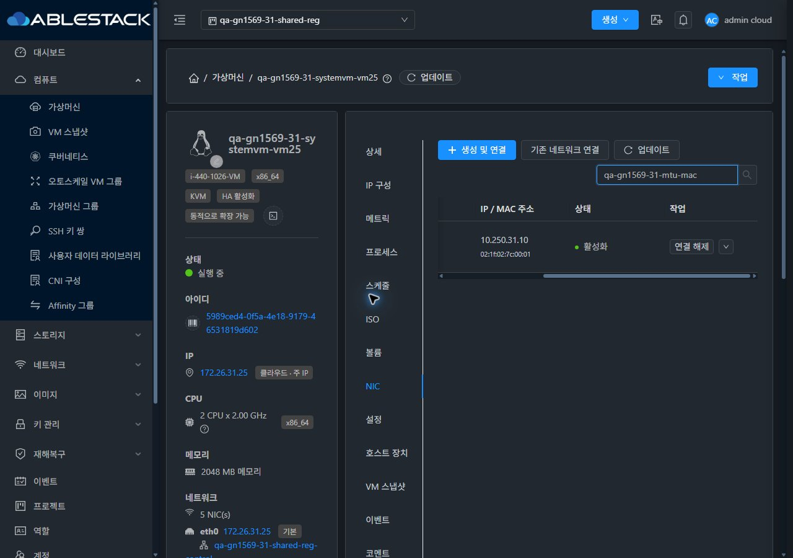

<!--
Licensed to the Apache Software Foundation (ASF) under one
or more contributor license agreements.  See the NOTICE file
distributed with this work for additional information
regarding copyright ownership.  The ASF licenses this file
to you under the Apache License, Version 2.0 (the
"License"); you may not use this file except in compliance
with the License.  You may obtain a copy of the License at

  http://www.apache.org/licenses/LICENSE-2.0

Unless required by applicable law or agreed to in writing,
software distributed under the License is distributed on an
"AS IS" BASIS, WITHOUT WARRANTIES OR CONDITIONS OF ANY
KIND, either express or implied.  See the License for the
specific language governing permissions and limitations
under the License.
 -->

# #1569 잔여 검증·새 SystemVM 반영·종료 가능성 평가

**현재 #1569는 종료할 수 없다.** 준비된 잔여 시험을 진행하면서 새 미해결 5건을 재현·게시했다. 63개 시나리오 전체를 다시 대조했으며, 전체 행 완료나 모든 조건부 시험 완료로 표시하지 않는다. Epic #1554와 Draft [PR #1577](https://github.com/ablecloud-team/ablestack-cloud/pull/1577), 브랜치 dhslove/epic-1554-guest-networks를 유지한다.

## 이번에 완료한 작업

- source d5088214ede2f464df9b932e5acf8b62dfdff707의 Debian 12.12.0 ISO에서 SystemVM을 새로 빌드했다. 기존 이미지의 오프라인 파생본이 아니다. Packer 1.9.4, 36분46초의 실제 빌드·export·압축 왕복 검증이다.
- 양쪽 ROUTING 템플릿 Ready → Zone 라우터용 override → 새 Shared 최초 라우터 → 기존 Shared 요소 재생성까지 실제 UI/API/job·라우터·NIC로 확인했다. 제품 release는 4.23.0.0, dnsmasq-base는 2.90-4~deb12u2+ablestack1다.
- 새 이미지·새 라우터·실행 중 dnsmasq의 SHA256이 모두 74ccbca89162f04d8615484173283f62b29824671120bd2d2579bf0e36e4b9cc다. 일반/Live Patch 재시작 후 PID와 NRestarts=0을 유지했다.
- 새 Shared에서 사이트별 NIC 3개의 DHCP, source-bound UDP/TCP DNS, 같은 호스트의 VM 간 ICMP/SSH를 확인했다. 재생성 Shared에서 신규 DORA → 갱신 → 반납 → 재DORA와 기존 임대를 확인했다.
- 새 이미지의 정상 구간 합계는 각 사이트 **UDP/TCP DNS 각각900/900, 기존 NIC ICMP/SSH 각각225/225**다. 재생성 중 의도된 DNS 중단은 분리했다. 이 수치를 무중단 요소 교체로 표현하지 않는다.
- 각 사이트 필터·태그·코멘트 등43 API 사례, 4유형+명시 false clone·상태 전환, Shared 범위 CRUD, 실제 UDP/ICMP/ALL 송신 방화벽, Public IP/Static NAT/TCP·UDP·ICMP/PF 범위·변경·삭제를 추가 검증했다.
- Shared 조회 권한48개 결과, 관리자/소유자/member/readOnly 실제 UI, VM 표준 목록/상세/NIC/연결창·즉시 테마·프로젝트 왕복·모바일·breadcrumb 최초/새로고침 스크롤을 확인했다.
- CRL/OCSP 시험 CA와 정상/폐기 응답을 새로 준비해 실제 HTTP·서명·API 검사까지 수행했다. 정상 기본 정책이 실패해 #1632로 분리했다.

## 새 미해결 항목

| 순서/이슈 | 실환경 재현 | 미해결 내용 | 대표 영향 |
| --- | --- | --- | --- |
| [#1630](https://github.com/ablecloud-team/ablestack-cloud/issues/1630) | 31 | NIC 추가 job2 뒤 DB/API의 Allocated NIC 잔류·실제 libvirt에는 없는데 UI 활성화 | C03/C05/C06/M02 |
| [#1628](https://github.com/ablecloud-team/ablestack-cloud/issues/1628) | 32 | Shared 추가 IPv4 서브넷 530: networks.cidr 18·gateway 15인 기존 스키마 | S06 |
| [#1629](https://github.com/ablecloud-team/ablestack-cloud/issues/1629) | 31·32 | 프로젝트에 공유된 Shared는 조회되지만 member/readOnly IP 조회531 | C07/S05/M02 |
| [#1631](https://github.com/ablecloud-team/ablestack-cloud/issues/1631) | 32 | Public MAC 유지=true에서 도메인 단독 수정의 VR 재생성 후 실제 MAC 변경 | I01/I06/I07 |
| [#1632](https://github.com/ablecloud-team/ablestack-cloud/issues/1632) | 31·32 | 정상 CRL·서명 OCSP·관리 서버 HTTP200을 준비해도 기본 SSL 폐기 검사 정상 체인530 | P07 |

31의 VLAN 부족 자체와 MTU 지정 비활성은 환경/설정 조건이다. #1630의 실패 후 잔류·거짓 활성 표시와 구분한다. #1631은32에서 도메인 단독 수정으로 분리 재현했고31의 동일 경로 성공/실패로 확대하지 않는다. #1632의 정확한 PKIX/JVM 원인은 조사 대상이며, false 대조 요청 성공을 해결로 취급하지 않는다.

## UI 변경과 확인 근거

**이번 제품 UI/API 소스 변경은0건이다.** 기존 VM 표준을 실제 대조하고 결함을 이슈로 분리했다. VM toolbar의 주 작업 버튼 뒤 reload+업데이트, NIC 표/연결창, Shared IP·주소 범위·라우터 탭, 프로젝트 전환·390/768/1280·밝음/다크와 breadcrumb를 검증했다. 기존 보호 정책을 완화하지 않았다.

원본 JPEG 210장 중 **174장**을 연결 증거로 사용한다. 요약 영역만 찍힌 구형 탭 프레임과 helper 세션 메타데이터가 불완전한 **36장**은 보존하되 배치 통과 근거에서 제외했다. 실제 탭 본문이 viewport 안에 있는36개 새 Shared 배치를 다시 캡처했다. [캡처 전체와 제외 이유](capture-matrix.ko.md).

## 적용·보존 상태

| 클러스터 | 새 ROUTING 템플릿 ID | Ready | 최초 생성 VR | 요소 재생성 VR | 동일 호스트 |
| --- | --- | --- | --- | --- | --- |
| 31 | 78f1d144-d065-4193-a169-18934f49b530 | True | r-1027-VM | r-1028-VM | ablecube31-3 |
| 32 | bc7298e5-a2cc-4627-8c55-7e74ed6e108c | True | r-501-VM | r-502-VM | ablecube32-2 |

두 관리 JAR은 기존 #1627 SHA baa20755fb2dec6117528a46a68dc15c6fbd0764d5caddb5e8e326eec0254974이고 WEB-INF·HTTP200을 확인했다. 정적 UI 번들과 기존 운영 설정을 유지했다. Zone 라우터 override만 새 템플릿으로 전환했으며 global/SYSTEM 템플릿을 바꾸지 않았다.

기존 VM·기존 NIC의 식별자/주요 상태 변경·누락0건이다. 새 확인용 네트워크·VM/NIC·템플릿·clone·인증서와 실패 재현 자원을 남겼다. Public IP 수명주기 시험에서는 Free 반환을 확인했지만, 후속 MAC 시험에서31의10.10.31.143과32의10.10.32.103을 다시 할당했으므로 **종료 시 둘 다 Allocated**다. [확인 자원과 남긴 실패 상태](resources.ko.md).

31의 임시 secondary 용량 임계값은0.95→원래0.90으로 복원했다. 임시 호스트 제어 IP·게스트 시험 경로·관리 서버 echo·CRL/OCSP helper 및 추가 방화벽 규칙은 정리/중지했다. CRL 공개 응답 파일과 비공개 CA 재료는 재현용으로 보관한다. 브라우저는 원래 다크 테마를 유지하고 임시 viewport override를 해제한 관리자 확인 탭2개를 남겼다.

## 종료 조건과 후속

**#1630 → #1628 → #1629 → #1631 → #1632 → #1569 영향 회귀·아직 미실행인 지원 조합 → 환경 조건/명시적 범위 결정 →63행 최종 판정** 순서다. 기존 Glue RBD 삭제 후속 #1586도 열린 상태이며 이번 작업으로 닫지 않는다.

IPv6/BGP/외부 DNS Zone·Health Monitor 제공자·독립 VPN 동시 클라이언트 조건은 완료로 계산하지 않는다. 현재 미해결 결함을 고치지 않은 채 #1569를 닫을 근거는 없다. 세부 미실행 항목도 [63행 평가](coverage.ko.md)에 남겼다.

- [검증 설계·범위](design.ko.md)
- [UI/API/실제 통신·빌드·한계](test-results.ko.md)
- [63행 현재 판정](coverage.ko.md)
- [캡처와 검증 무결성](capture-matrix.ko.md)
- [남긴 자원](resources.ko.md)
- [후속 순서](followups.ko.md)

이번에는 Cloud Java/UI 구현 변경이 없어 Maven/UI 재빌드는 하지 않았다. 요청한 SystemVM 이미지만 로컬 WSL ext4에서 빌드했다. 전체 Cloud 빌드나 수동 GitHub Actions를 실행하지 않았다. 등록된 CI와 로컬/실환경 결과는 별개이며 전체 CI 녹색을 주장하지 않는다.

첫 보고 commit 3ba8ee643b78d816b3b82c05f7c441a42e97e5e6의 자동 CI에서 RAT는 저장소 전체 미승인 라이선스3574건으로 실패했다. 해당 미승인 목록에서 이번 보고 디렉터리 경로는0건이다. 관찰 시 pre-commit은 진행 중이었다. [CI 관찰](evidence/git-and-ci-observed.json)과 [RAT 결과](evidence/license-check-observed.json)는 그 시점의 상태이며 최종 CI 통과 증거로 사용하지 않는다.
