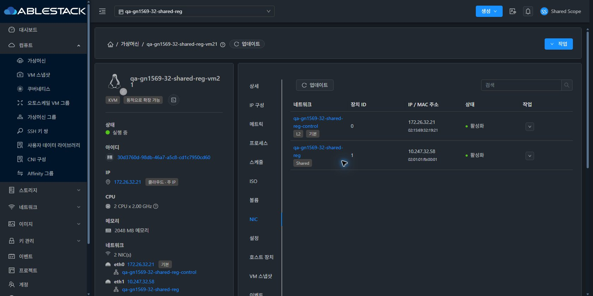
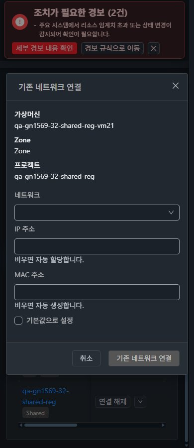
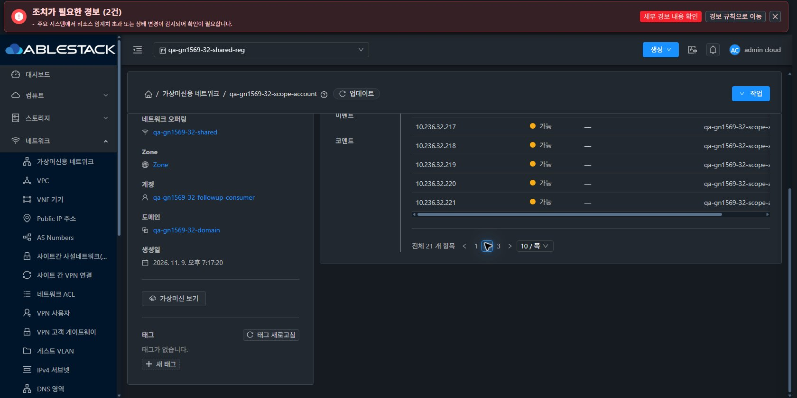

<!--
Licensed to the Apache Software Foundation (ASF) under one
or more contributor license agreements.  See the NOTICE file
distributed with this work for additional information
regarding copyright ownership.  The ASF licenses this file
to you under the Apache License, Version 2.0 (the
"License"); you may not use this file except in compliance
with the License.  You may obtain a copy of the License at

  http://www.apache.org/licenses/LICENSE-2.0

Unless required by applicable law or agreed to in writing,
software distributed under the License is distributed on an
"AS IS" BASIS, WITHOUT WARRANTIES OR CONDITIONS OF ANY
KIND, either express or implied.  See the License for the
specific language governing permissions and limitations
under the License.
 -->

# 실제 UI 캡처

원본 121개 JPEG 모두 실제 viewport와 디코딩 치수 일치. 기본 60개 행렬, 역할·읽기 전용·프로젝트·테마·추가 확인 화면을 포함한다. 화면 일부가 본문 스크롤로 보이지 않는 캡처는 전체 콘텐츠/스크롤 앵커 보존의 성공 근거가 아니다.

| 캡처 | 실제 viewport | 테마 |
| --- | --- | --- |
| [31-readonly-project-scope-list](screenshots/31-readonly-project-scope-list.jpg) | 1680×841 | light |
| [31-readonly-vm-nic](screenshots/31-readonly-vm-nic.jpg) | 1680×841 | light |
| [31-readonly-network-detail](screenshots/31-readonly-network-detail.jpg) | 1680×841 | light |
| [32-readonly-project-scope-list](screenshots/32-readonly-project-scope-list.jpg) | 1680×841 | dark |
| [32-readonly-vm-nic](screenshots/32-readonly-vm-nic.jpg) | 1680×841 | dark |
| [32-readonly-network-detail](screenshots/32-readonly-network-detail.jpg) | 1680×841 | dark |
| [32-owner-scope-list](screenshots/32-owner-scope-list.jpg) | 1680×841 | dark |
| [31-peer-scope-list](screenshots/31-peer-scope-list.jpg) | 1680×841 | light |
| [32-projectMember-nic-candidates](screenshots/32-projectMember-nic-candidates.jpg) | 1680×841 | dark |
| [31-project-admin-vm-nic](screenshots/31-project-admin-vm-nic.jpg) | 1680×841 | light |
| [31-projectAdmin-nic-candidates](screenshots/31-projectAdmin-nic-candidates.jpg) | 1680×841 | light |
| [32-child-scope-list](screenshots/32-child-scope-list.jpg) | 1680×841 | dark |
| [31-projectAdmin-personal-return-scope-list](screenshots/31-projectAdmin-personal-return-scope-list.jpg) | 1680×841 | light |
| [31-projectAdmin-project-return-scope-list](screenshots/31-projectAdmin-project-return-scope-list.jpg) | 1680×841 | light |
| [32-outsider-scope-list](screenshots/32-outsider-scope-list.jpg) | 1680×841 | dark |
| [31-owner-scope-list](screenshots/31-owner-scope-list.jpg) | 1680×841 | light |
| [32-peer-scope-list](screenshots/32-peer-scope-list.jpg) | 1680×841 | dark |
| [31-projectMember-nic-candidates](screenshots/31-projectMember-nic-candidates.jpg) | 1680×841 | light |
| [32-projectAdmin-nic-candidates](screenshots/32-projectAdmin-nic-candidates.jpg) | 1680×841 | dark |
| [32-projectAdmin-personal-return-scope-list](screenshots/32-projectAdmin-personal-return-scope-list.jpg) | 1680×841 | dark |
| [32-projectAdmin-project-return-scope-list](screenshots/32-projectAdmin-project-return-scope-list.jpg) | 1680×841 | dark |
| [31-projectMember-personal-return-scope-list](screenshots/31-projectMember-personal-return-scope-list.jpg) | 1680×841 | light |
| [31-projectMember-project-return-scope-list](screenshots/31-projectMember-project-return-scope-list.jpg) | 1680×841 | light |
| [31-member-mobile-vm-nic](screenshots/31-member-mobile-vm-nic.jpg) | 390×900 | light |
| [31-member-mobile-nic-dialog](screenshots/31-member-mobile-nic-dialog.jpg) | 390×900 | light |
| [31-member-mobile-nic-tab-visible](screenshots/31-member-mobile-nic-tab-visible.jpg) | 390×900 | light |
| [32-project-admin-mobile-nic-tab](screenshots/32-project-admin-mobile-nic-tab.jpg) | 390×900 | dark |
| [32-project-admin-mobile-nic-dialog](screenshots/32-project-admin-mobile-nic-dialog.jpg) | 390×900 | dark |
| [31-nonadmin-tablet-nic-tab](screenshots/31-nonadmin-tablet-nic-tab.jpg) | 768×900 | light |
| [31-nonadmin-tablet-nic-dialog](screenshots/31-nonadmin-tablet-nic-dialog.jpg) | 768×900 | light |
| [32-nonadmin-tablet-nic-tab](screenshots/32-nonadmin-tablet-nic-tab.jpg) | 768×900 | dark |
| [32-nonadmin-tablet-nic-dialog](screenshots/32-nonadmin-tablet-nic-dialog.jpg) | 768×900 | dark |
| [31-child-scope-list](screenshots/31-child-scope-list.jpg) | 1680×841 | light |
| [32-domainAdmin-scope-list](screenshots/32-domainAdmin-scope-list.jpg) | 1680×841 | dark |
| [31-outsider-scope-list](screenshots/31-outsider-scope-list.jpg) | 1680×841 | light |
| [32-root-scope-list](screenshots/32-root-scope-list.jpg) | 1680×841 | dark |
| [31-domainAdmin-scope-list](screenshots/31-domainAdmin-scope-list.jpg) | 1680×841 | light |
| [32-theme-panel-light-switch](screenshots/32-theme-panel-light-switch.jpg) | 1680×841 | light |
| [31-light-390-network-list](screenshots/31-light-390-network-list.jpg) | 390×900 | light |
| [31-light-390-network-ip-tab](screenshots/31-light-390-network-ip-tab.jpg) | 390×900 | light |
| [31-light-390-network-permissions-tab](screenshots/31-light-390-network-permissions-tab.jpg) | 390×900 | light |
| [31-light-390-vm-nic-tab](screenshots/31-light-390-vm-nic-tab.jpg) | 390×900 | light |
| [31-light-390-nic-dialog](screenshots/31-light-390-nic-dialog.jpg) | 390×900 | light |
| [32-light-390-network-list](screenshots/32-light-390-network-list.jpg) | 390×900 | light |
| [32-light-390-network-ip-tab](screenshots/32-light-390-network-ip-tab.jpg) | 390×900 | light |
| [32-light-390-network-permissions-tab](screenshots/32-light-390-network-permissions-tab.jpg) | 390×900 | light |
| [32-light-390-vm-nic-tab](screenshots/32-light-390-vm-nic-tab.jpg) | 390×900 | light |
| [32-light-390-nic-dialog](screenshots/32-light-390-nic-dialog.jpg) | 390×900 | light |
| [31-light-768-network-list](screenshots/31-light-768-network-list.jpg) | 768×900 | light |
| [31-light-768-network-ip-tab](screenshots/31-light-768-network-ip-tab.jpg) | 768×900 | light |
| [31-light-768-network-permissions-tab](screenshots/31-light-768-network-permissions-tab.jpg) | 768×900 | light |
| [31-light-768-vm-nic-tab](screenshots/31-light-768-vm-nic-tab.jpg) | 768×900 | light |
| [31-light-768-nic-dialog](screenshots/31-light-768-nic-dialog.jpg) | 768×900 | light |
| [32-light-768-network-list](screenshots/32-light-768-network-list.jpg) | 768×900 | light |
| [32-light-768-network-ip-tab](screenshots/32-light-768-network-ip-tab.jpg) | 768×900 | light |
| [32-light-768-network-permissions-tab](screenshots/32-light-768-network-permissions-tab.jpg) | 768×900 | light |
| [32-light-768-vm-nic-tab](screenshots/32-light-768-vm-nic-tab.jpg) | 768×900 | light |
| [32-light-768-nic-dialog](screenshots/32-light-768-nic-dialog.jpg) | 768×900 | light |
| [31-light-1280-network-list](screenshots/31-light-1280-network-list.jpg) | 1280×900 | light |
| [31-light-1280-network-ip-tab](screenshots/31-light-1280-network-ip-tab.jpg) | 1280×900 | light |
| [31-light-1280-network-permissions-tab](screenshots/31-light-1280-network-permissions-tab.jpg) | 1280×900 | light |
| [31-light-1280-vm-nic-tab](screenshots/31-light-1280-vm-nic-tab.jpg) | 1280×900 | light |
| [31-light-1280-nic-dialog](screenshots/31-light-1280-nic-dialog.jpg) | 1280×900 | light |
| [32-light-1280-network-list](screenshots/32-light-1280-network-list.jpg) | 1280×900 | light |
| [32-light-1280-network-ip-tab](screenshots/32-light-1280-network-ip-tab.jpg) | 1280×900 | light |
| [32-light-1280-network-permissions-tab](screenshots/32-light-1280-network-permissions-tab.jpg) | 1280×900 | light |
| [32-light-1280-vm-nic-tab](screenshots/32-light-1280-vm-nic-tab.jpg) | 1280×900 | light |
| [32-light-1280-nic-dialog](screenshots/32-light-1280-nic-dialog.jpg) | 1280×900 | light |
| [31-immediate-dark-vm-nic](screenshots/31-immediate-dark-vm-nic.jpg) | 1280×900 | dark |
| [32-immediate-dark-vm-nic](screenshots/32-immediate-dark-vm-nic.jpg) | 1280×900 | dark |
| [31-dark-390-network-list](screenshots/31-dark-390-network-list.jpg) | 390×900 | dark |
| [31-dark-390-network-ip-tab](screenshots/31-dark-390-network-ip-tab.jpg) | 390×900 | dark |
| [31-dark-390-network-permissions-tab](screenshots/31-dark-390-network-permissions-tab.jpg) | 390×900 | dark |
| [31-dark-390-vm-nic-tab](screenshots/31-dark-390-vm-nic-tab.jpg) | 390×900 | dark |
| [31-dark-390-nic-dialog](screenshots/31-dark-390-nic-dialog.jpg) | 390×900 | dark |
| [32-dark-390-network-list](screenshots/32-dark-390-network-list.jpg) | 390×900 | dark |
| [32-dark-390-network-ip-tab](screenshots/32-dark-390-network-ip-tab.jpg) | 390×900 | dark |
| [32-dark-390-network-permissions-tab](screenshots/32-dark-390-network-permissions-tab.jpg) | 390×900 | dark |
| [32-dark-390-vm-nic-tab](screenshots/32-dark-390-vm-nic-tab.jpg) | 390×900 | dark |
| [32-dark-390-nic-dialog](screenshots/32-dark-390-nic-dialog.jpg) | 390×900 | dark |
| [31-dark-768-network-list](screenshots/31-dark-768-network-list.jpg) | 768×900 | dark |
| [31-dark-768-network-ip-tab](screenshots/31-dark-768-network-ip-tab.jpg) | 768×900 | dark |
| [31-dark-768-network-permissions-tab](screenshots/31-dark-768-network-permissions-tab.jpg) | 768×900 | dark |
| [31-dark-768-vm-nic-tab](screenshots/31-dark-768-vm-nic-tab.jpg) | 768×900 | dark |
| [31-dark-768-nic-dialog](screenshots/31-dark-768-nic-dialog.jpg) | 768×900 | dark |
| [32-dark-768-network-list](screenshots/32-dark-768-network-list.jpg) | 768×900 | dark |
| [32-dark-768-network-ip-tab](screenshots/32-dark-768-network-ip-tab.jpg) | 768×900 | dark |
| [32-dark-768-network-permissions-tab](screenshots/32-dark-768-network-permissions-tab.jpg) | 768×900 | dark |
| [32-dark-768-vm-nic-tab](screenshots/32-dark-768-vm-nic-tab.jpg) | 768×900 | dark |
| [32-dark-768-nic-dialog](screenshots/32-dark-768-nic-dialog.jpg) | 768×900 | dark |
| [31-dark-1280-network-list](screenshots/31-dark-1280-network-list.jpg) | 1280×900 | dark |
| [31-dark-1280-network-ip-tab](screenshots/31-dark-1280-network-ip-tab.jpg) | 1280×900 | dark |
| [31-dark-1280-network-permissions-tab](screenshots/31-dark-1280-network-permissions-tab.jpg) | 1280×900 | dark |
| [31-dark-1280-vm-nic-tab](screenshots/31-dark-1280-vm-nic-tab.jpg) | 1280×900 | dark |
| [31-dark-1280-nic-dialog](screenshots/31-dark-1280-nic-dialog.jpg) | 1280×900 | dark |
| [32-dark-1280-network-list](screenshots/32-dark-1280-network-list.jpg) | 1280×900 | dark |
| [32-dark-1280-network-ip-tab](screenshots/32-dark-1280-network-ip-tab.jpg) | 1280×900 | dark |
| [32-dark-1280-network-permissions-tab](screenshots/32-dark-1280-network-permissions-tab.jpg) | 1280×900 | dark |
| [32-dark-1280-vm-nic-tab](screenshots/32-dark-1280-vm-nic-tab.jpg) | 1280×900 | dark |
| [32-dark-1280-nic-dialog](screenshots/32-dark-1280-nic-dialog.jpg) | 1280×900 | dark |
| [31-immediate-light-return](screenshots/31-immediate-light-return.jpg) | 1280×900 | light |
| [32-immediate-light-return](screenshots/32-immediate-light-return.jpg) | 1280×900 | light |
| [31-root-personal-roundtrip](screenshots/31-root-personal-roundtrip.jpg) | 1280×900 | light |
| [31-root-project-roundtrip](screenshots/31-root-project-roundtrip.jpg) | 1280×900 | light |
| [32-root-personal-roundtrip](screenshots/32-root-personal-roundtrip.jpg) | 1280×900 | light |
| [32-root-project-roundtrip](screenshots/32-root-project-roundtrip.jpg) | 1280×900 | light |
| [31-six-nic-mobile-light](screenshots/31-six-nic-mobile-light.jpg) | 390×900 | light |
| [31-six-nic-resize-768](screenshots/31-six-nic-resize-768.jpg) | 768×900 | light |
| [31-six-nic-resize-1280](screenshots/31-six-nic-resize-1280.jpg) | 1280×900 | light |
| [31-six-nic-resize-390](screenshots/31-six-nic-resize-390.jpg) | 390×900 | light |
| [32-six-nic-mobile-dark](screenshots/32-six-nic-mobile-dark.jpg) | 390×900 | dark |
| [32-six-nic-resize-768](screenshots/32-six-nic-resize-768.jpg) | 768×900 | dark |
| [32-six-nic-resize-1280](screenshots/32-six-nic-resize-1280.jpg) | 1280×900 | dark |
| [32-six-nic-resize-390](screenshots/32-six-nic-resize-390.jpg) | 390×900 | dark |
| [32-shared-ip-page2-allocated-vm](screenshots/32-shared-ip-page2-allocated-vm.jpg) | 1280×900 | dark |
| [32-dark-guest-range-update-standard](screenshots/32-dark-guest-range-update-standard.jpg) | 1280×900 | dark |
| [31-service-review-vpc-public-ip](screenshots/31-service-review-vpc-public-ip.jpg) | 1280×900 | light |
| [32-service-review-vpc-public-ip](screenshots/32-service-review-vpc-public-ip.jpg) | 1280×900 | dark |
| [32-six-nic-desktop-readable](screenshots/32-six-nic-desktop-readable.jpg) | 1280×900 | dark |
| [31-final-review-vpc](screenshots/31-final-review-vpc.jpg) | 1680×841 | light |
| [32-final-review-shared-ip](screenshots/32-final-review-shared-ip.jpg) | 1680×841 | dark |

