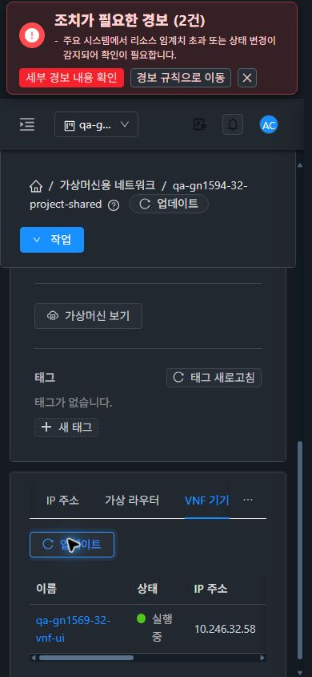
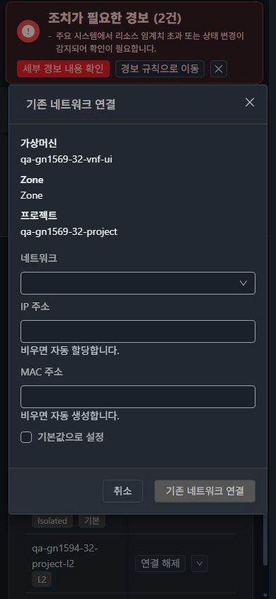

# #1569 32번 반응형·다크모드·프로젝트 전환 추가 검증 (2026-11-08)

**32 Glue RBD의 남은 반응형·다크모드·프로젝트 전환 UI 검증을 완료했다.** Isolated·L2·Shared의 VNF 탭을 1280×900 / 768×1024 / 390×844, 라이트·다크 **18조합**으로 실제 브라우저에서 확인했다. 직전 31의 18조합과 합해 양쪽 36조합이다. 이전 중단 구간을 이번 실행으로 보완했으며, 과거 실행 결과를 소급 변경하지 않는다.

이번 변경은 **검증 문서·캡처뿐**이다. 제품 UI/API/Java 소스 수정, 새 빌드·배포, 네트워크/VM/NIC 생성·삭제·연결 제출은 없다. 기존 #1594 배포본을 검증했다. **#1569/Epic Open, 기존 Epic 브랜치와 Draft PR #1577을 유지한다.** #1595~#1598은 미구현/Open이다.

## 실행 결과

| 검증 | 실제 관찰과 범위 | 결과 |
| --- | --- | --- |
| 세 유형 × 세 크기 × 두 테마 | 실제 viewport 일치, 연관 VNF 1행, 표 사각형 전체가 화면 안, 문서 너비가 viewport 이하 | 18조합 확인 |
| 네트워크별 IP | Isolated `10.251.32.38`, Shared `10.246.32.58`, L2 `—`; 다른 NIC의 IP로 대체하지 않음 | 일치 |
| 390px 표 가로 스크롤 | 라이트·다크 모두 scrollLeft 0→384, clientWidth296 / scrollWidth680; 오른쪽 호스트 열 접근 | 확인 |
| 1280px 라이트 프로젝트 전환 | QA→기본 보기→다른 프로젝트→QA. 전환 완료 후 dashboard, 이전 VNF/NIC/대화상자 제거. 다른 프로젝트 VNF0, QA복귀1 | 확인 |
| 390px 다크 프로젝트 전환 | VNF NIC 화면에서 기본 보기 및 다른 프로젝트로 이동 후 이전 NIC0/창0. child VNF0→QA VNF1, 원래 VNF의 NIC3 복귀 | 확인 |
| 실제 UI 요청 범위 | child `d9a9327e-94d3-45ea-9b44-b8961692272e`: HTTP200/0건; QA `0db180fc-4a19-4f9a-b387-00599ffa86c0`: HTTP200/1건 | 일치 |
| VM 표준 대화상자 비교 | 일반 VM과 VNF에서 같은 기존 네트워크 연결 창. VM/Zone/프로젝트 metadata, 세로 입력, 모바일 footer. VNF는 라이트·다크, 일반 VM은 다크 | 일치 |
| 390px 대화상자 | 안정화 후 폭366/높이606, x12~378/y119~725. Close48px·취소32px, 다크에서 버튼 중심 hit-test 성공. 열기→취소, 제출 없음 | 확인 |
| 화면 이동·breadcrumb | 일반 VM 목록→상세/NIC→기존 연결창 취소→breadcrumb VM 목록, 모바일 메뉴→VNF 목록→상세/NIC | 확인 |
| 알려진 VNF 링크 누락 | 일반 VM NIC4행/네트워크 링크4개, VNF NIC3행/링크0개 | 기존 #1596 유지 |

18조합은 **네트워크 상세의 VNF 탭** 범위이며 모든 탭·역할·서비스 조건의 전체 통과를 뜻하지 않는다. [측정 JSON](evidence/ui-layouts.json), [UI 동작 원본](evidence/ui-actions.json), [UI 요청 projectid/응답](evidence/ui-project-wire.json), [원본 JPEG 32장](capture-matrix.ko.md).

## VM UI 표준과 가독성

32번 실제 일반 VM `qa-gn1594-32-owner-vm`의 NIC·연결창을 비교 기준으로 열었다. 목록·상세 ResourceView와 InfoCard, 탭의 텍스트 작업→업데이트→검색 배치, breadcrumb 이동, MoldDialog의 소유 metadata/세로 입력/반응형 footer, 고정 작업 열의 테마 배경을 확인했다. 새 스타일을 추가한 작업은 아니다.

VNF 연결창의 다크 배경은 `rgb(34,40,47)`, 문자는 `rgb(240,243,246)`이고 일반 VM과 창의 위치·크기가 같다. VNF 탭의 다크 셀 배경/문자색은 `rgb(34,40,47)` / `rgb(197,204,212)`다. 모바일에서 창과 취소/닫기 버튼이 잘리지 않고, VNF 표는 내부 수평 스크롤로 나머지 열에 접근한다. 실제 화면의 기존 시스템 경보 배너는 숨기거나 편집하지 않았다.

초기 표본에는 화면 밖 표에서 wheel을 보내 scrollLeft0이었던 기록, modal 열림 애니메이션 중 작은 버튼 치수, 일반 VM 접근 조회 완료 전 링크0이 포함된다. 통과 판정은 화면 안으로 이동/안정화/조회 완료 후 표본(스크롤384, 창366×606, 일반 VM 링크4)으로 했다. 원본 동작은 지우지 않았다. 모바일 메뉴가 열린 중간 캡처2장은 본문 판정에서 제외했으며, 마스크를 눌러 닫고 다른 프로젝트 빈 목록을 캡처했다. 사이드메뉴 자동 닫힘 전체 회귀는 이번 통과 범위에 포함하지 않는다.

## 시험 자원 보존·런타임

32 QA 프로젝트는 검증 전후 **VM4대·NIC19개·네트워크46개**다. VM/VNF의 ID·상태·호스트·프로젝트·템플릿·NIC ID/망/IP/MAC/default/device, 네트워크 소유/오퍼링/상태/VLAN/주소, 멤버십·한도를 대조해 모두 유지됐다. 이번 자원 변경0건이다. 확인용 VNF는 Running/3 NIC이며 기존 일반 VM3대/16 NIC도 보존됐다. 31의 시험 자원은 이번에 변경하지 않았다.

32 프로젝트 `qa-gn1569-32-project`를 선택하면 다음 화면에서 확인할 수 있다.

- [VNF NIC3개](http://10.10.32.10:8080/client/#/vnfapp/d4b7e358-98c8-475d-b8aa-893479539a36?tab=nics)
- [Isolated VNF](http://10.10.32.10:8080/client/#/guestnetwork/c50abf1a-d037-498a-b29f-bcc5ad4e2d68?tab=vnf.appliances)
- [L2 VNF](http://10.10.32.10:8080/client/#/guestnetwork/dfc7f6c6-0906-48d7-abe6-4a1fe4fe11f3?tab=vnf.appliances)
- [Shared VNF](http://10.10.32.10:8080/client/#/guestnetwork/15a7e449-7333-401a-a7f1-448283423553?tab=vnf.appliances)

[자원 보존 비교](evidence/resource-preservation.json) · [API 전](evidence/32-before.json) · [API 후](evidence/32-after.json) · [기존 양쪽 시험 자원 목록](../guest-network-1569-vnf-20261108/resources.ko.md).

31·32의 기존 정적 UI662개 해시, 관리 JAR `2faddb218741a22b1e83ff89337adb73e0a981d525c2bdc32c313b7bb33b8592`, FTCTL/네트워크 UI 표식이 유지됐다. mold active, HTTP200, WEB-INF 존재, 최근15,000로그 행 linkage 오류0. [31 런타임](evidence/31-runtime-after.json) · [32 런타임](evidence/32-runtime-after.json). 문서 변경만 있으므로 새 단위 테스트/빌드/Actions는 실행하지 않았다. 임시 viewport는 원래1680×841로 복원했다.

## 남은 항목과 순서

1. **#1595** 기본 VNF 화면에서 고급 User Data 준비 전 실행 버튼 비활성 문제 구현·31/32 재검증.
2. **#1596** `/vnfapp`의 요약/NIC 네트워크 링크 범위 판정 개선·역할/프로젝트 회귀.
3. **#1597** 프로젝트 VNF 배포와 Isolated IP 후보 조회 권한 계약 정합성 개선.
4. **#1598** VNF 템플릿 NIC 추가 중복 대화상자 제거.
5. **#1569** 위 결함 회귀 후 VNF의 잔여 역할/실패 조건·서비스 범위, L2 ConfigDrive/PVLAN·VPC 등 잔여 조합. 이전 32 일반 VM 전용 L2 대조군의 VNF0 **UI**는 이번에도 미실행이며 프로젝트 빈 목록과 별개다.
6. IPv6/BGP/Tungsten 실제 제공자·주소·라우팅 환경 준비 후 조건부 검증. #1586 RBD 정리는 별도 후속이다. 사용자 지시에 따라 LB 백엔드 분산 자체를 필수 시험으로 추가하지 않는다.

**이번에 완료된 것은 32 UI 미완료 구간이다.** 알려진 결함을 고치거나 #1569 전체를 종료한 것은 아니다. 63행 집계는 실패2·부분47·미실행5·환경차단6·적용제외3·전체행성공0으로 유지한다. Epic 하위35개 중 완료30/Open5(1569,1595~1598)다.
