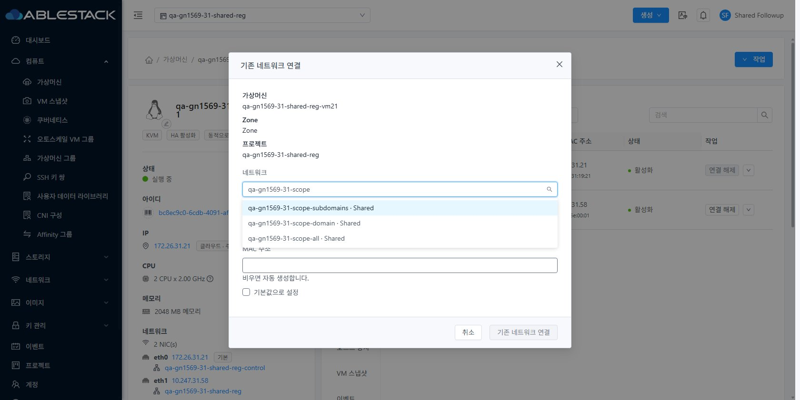
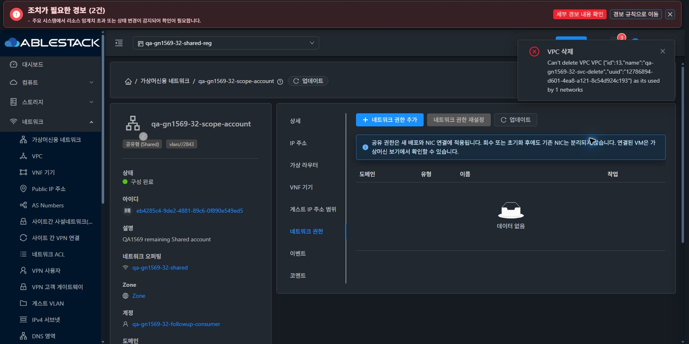

<!--
Licensed to the Apache Software Foundation (ASF) under one
or more contributor license agreements.  See the NOTICE file
distributed with this work for additional information
regarding copyright ownership.  The ASF licenses this file
to you under the Apache License, Version 2.0 (the
"License"); you may not use this file except in compliance
with the License.  You may obtain a copy of the License at

  http://www.apache.org/licenses/LICENSE-2.0

Unless required by applicable law or agreed to in writing,
software distributed under the License is distributed on an
"AS IS" BASIS, WITHOUT WARRANTIES OR CONDITIONS OF ANY
KIND, either express or implied.  See the License for the
specific language governing permissions and limitations
under the License.
 -->

# UI 캡처

원본 JPEG 27장 중 실제 viewport 메타데이터가 있는 26장 모두 디코딩 치수 일치. 수동 원본 1장은 반응형 근거에서 제외한다. 이번 캡처는 모두 데스크톱이며 모바일 완료를 의미하지 않는다. [치수/해시 검사](evidence/image-validation.json).

| 캡처 | 실제 viewport | 테마 | 범위/주의 |
| --- | --- | --- | --- |
| [31-vpc-delete-connected-confirm](screenshots/31-vpc-delete-connected-confirm.jpg) | 1680×897 | light | 화면 표시와 완료 범위는 본문 참조 |
| [31-vpc-delete-connected-result](screenshots/31-vpc-delete-connected-result.jpg) | 1680×897 | light | 화면 표시와 완료 범위는 본문 참조 |
| [32-vpc-delete-connected-confirm](screenshots/32-vpc-delete-connected-confirm.jpg) | 1680×841 | dark | 화면 표시와 완료 범위는 본문 참조 |
| [32-vpc-delete-connected-result](screenshots/32-vpc-delete-connected-result.jpg) | 1680×841 | dark | 화면 표시와 완료 범위는 본문 참조 |
| [31-vpc-connected-tier](screenshots/31-vpc-connected-tier.jpg) | 1680×897 | light | 화면 표시와 완료 범위는 본문 참조 |
| [31-vpc-zero-tier](screenshots/31-vpc-zero-tier.jpg) | 1680×897 | light | 화면 표시와 완료 범위는 본문 참조 |
| [31-vpc-delete-ready-confirm](screenshots/31-vpc-delete-ready-confirm.jpg) | 1680×897 | light | 화면 표시와 완료 범위는 본문 참조 |
| [32-vpc-zero-tier](screenshots/32-vpc-zero-tier.jpg) | 1680×841 | dark | 화면 표시와 완료 범위는 본문 참조 |
| [32-vpc-delete-ready-confirm](screenshots/32-vpc-delete-ready-confirm.jpg) | 1680×841 | dark | 화면 표시와 완료 범위는 본문 참조 |
| [31-vpc-delete-success](screenshots/31-vpc-delete-success.jpg) | 1680×897 | light | 삭제 요청 후 화면 이동. 이 캡처 단독으로 job 성공을 판정하지 않는다. |
| [31-vpc-deleted-result](screenshots/31-vpc-deleted-result.jpg) | 1680×897 | light | 삭제 후 대시보드. 이전 실패 알림이 남을 수 있다. 완료 판정은 DB/API job 및 자원 부재 근거다. |
| [32-vpc-deleted-result](screenshots/32-vpc-deleted-result.jpg) | 1680×841 | dark | 삭제 후 이전 Shared 화면으로 이동. 이전 실패 알림과 현재 삭제 결과를 혼동하지 않는다. |
| [31-shared-project-grant-before-reset](screenshots/31-shared-project-grant-before-reset.jpg) | 1680×897 | light | 화면 표시와 완료 범위는 본문 참조 |
| [31-shared-reset-dialog](screenshots/31-shared-reset-dialog.jpg) | 1680×897 | light | 화면 표시와 완료 범위는 본문 참조 |
| [32-shared-project-grant-before-reset](screenshots/32-shared-project-grant-before-reset.jpg) | 1680×841 | dark | 화면 표시와 완료 범위는 본문 참조 |
| [32-shared-reset-dialog](screenshots/32-shared-reset-dialog.jpg) | 1680×841 | dark | 화면 표시와 완료 범위는 본문 참조 |
| [31-shared-grants-cleared](screenshots/31-shared-grants-cleared.jpg) | 1680×897 | light | 화면 표시와 완료 범위는 본문 참조 |
| [32-shared-grants-cleared](screenshots/32-shared-grants-cleared.jpg) | 1680×841 | dark | 화면 표시와 완료 범위는 본문 참조 |
| [31-owner-personal-four-scopes](screenshots/31-owner-personal-four-scopes.jpg) | 1680×841 | light | 화면 표시와 완료 범위는 본문 참조 |
| [31-project-member-after-revoke](screenshots/31-project-member-after-revoke.jpg) | 1680×841 | light | 프로젝트 즉시 전환 후 대시보드. NIC 후보의 근거는 아래 별도 대화상자 캡처다. |
| [31-project-member-list-after-revoke](screenshots/31-project-member-list-after-revoke.jpg) | 1680×841 | light | 화면 표시와 완료 범위는 본문 참조 |
| [31-project-member-nic-candidates-after-revoke](screenshots/31-project-member-nic-candidates-after-revoke.jpg) | 1680×841 | light | 화면 표시와 완료 범위는 본문 참조 |
| [31-child-scope-list](screenshots/31-child-scope-list.jpg) | 1680×841 | light | 화면 표시와 완료 범위는 본문 참조 |
| [31-outsider-scope-list](screenshots/31-outsider-scope-list.jpg) | 1680×841 | light | 화면 표시와 완료 범위는 본문 참조 |
| [31-peer-scope-list](screenshots/31-peer-scope-list.jpg) | 1680×841 | light | 화면 표시와 완료 범위는 본문 참조 |
| [31-domainAdmin-scope-list](screenshots/31-domainAdmin-scope-list.jpg) | 1680×841 | light | 화면 표시와 완료 범위는 본문 참조 |

브라우저 제어 중단 후의 읽기 전용/32 비관리자/반응형/즉시 테마 캡처는 없다. 없는 증적을 이전 실행 캡처로 대체하지 않는다.

