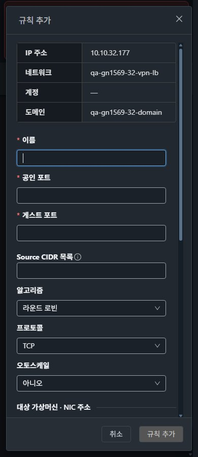
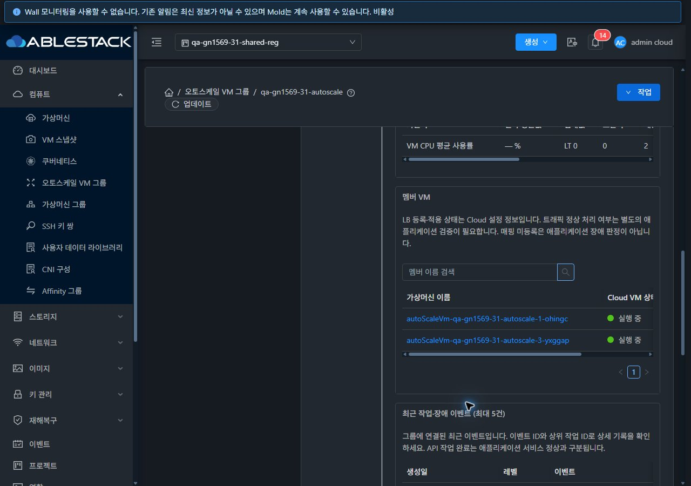

<!--
Licensed to the Apache Software Foundation (ASF) under one
or more contributor license agreements.  See the NOTICE file
distributed with this work for additional information
regarding copyright ownership.  The ASF licenses this file
to you under the Apache License, Version 2.0 (the
"License"); you may not use this file except in compliance
with the License.  You may obtain a copy of the License at

  http://www.apache.org/licenses/LICENSE-2.0

Unless required by applicable law or agreed to in writing,
software distributed under the License is distributed on an
"AS IS" BASIS, WITHOUT WARRANTIES OR CONDITIONS OF ANY
KIND, either express or implied.  See the License for the
specific language governing permissions and limitations
under the License.
-->

# #1569 VPN·LB·Health Monitor·AutoScale 통합 검증

2026-11-09. 31 GFS2·32 Glue(Ceph) RBD의 **전용 Isolated 시험망**에서 실제 UI 작업과 API·VR 설정·실제 AutoScale VM 상태를 대조했다. 제품 UI/API 코드와 보안 정책은 변경하지 않았고 새 빌드·배포도 없다. 기존 Epic 브랜치 `dhslove/epic-1554-guest-networks`·Draft PR #1577을 유지한다. **새 UI 결함 3건과 조건부 항목이 남아 #1569는 Open**이다. 과거 전체 회귀 결과와 이번 검증 범위를 혼동하지 않는다.

[원본 캡처 169장](capture-matrix.ko.md) · [확인용 자원/화면 링크](resources.ko.md) · [요약 JSON](evidence/summary.json) · [UI 상태/DOM](evidence/ui-state.json) · [72개 화면 행렬](evidence/ui-matrix.json) · [전체 63행](../guest-network-1569-integrated/coverage.ko.md).

## 기능 결과

| 범위 | 31·32 실행 결과 | 남은 범위 |
| --- | --- | --- |
| Remote Access VPN | Source NAT IP에서 UI 활성화→Running, VPN 사용자 추가, 비활성화→API 목록 제거, 재활성화→새 VPN UUID/Running. 기존 VPN 사용자는 Active 유지. PSK는 UI 기본 마스킹, 증적에 비밀값 미게시. VR strongSwan/xl2tpd 활성·UDP500/4500/1701 리스닝 확인 | 실제 외부 VPN 클라이언트 인증/패킷, VPC S2S gateway/연결·reset/peer 장애 복구는 이번에 실행하지 않음 |
| VPN 실패 복구 | 허용 문자 외 `!`를 포함한 시험 비밀번호를 UI로 제출해 API431 재현. 대화상자·사용자 이름·비밀번호 입력 보존. 유효 문자로 수정 후 Active 사용자 생성 성공 | 사용자 삭제와 실제 클라이언트 세션 철회 영향은 미실행 |
| TCP LB | UI 생성 18871→22, Source CIDR 10.10.0.0/16, 백엔드 시험 VM/NIC 연결→Active. 알고리즘 roundrobin→source 수정. UI 연결 해제→API 대상0/상태Add/HAProxy backend 제거, 원래 VM 재연결→Active/대상1/실제 설정 복원 | 다중 backend/NIC·다른 제공자·UDP/TCP-proxy 조합은 별도 조건 |
| LB 실패 복구/삭제 | 같은 공인 포트18871 중복 생성은 537로 거부. 입력 보존 후18872로 수정→Active. 복구 시험 규칙만 UI 삭제하고 TCP/SSL/AutoScale 규칙3개를 유지 | 서비스가 연결된 IP 해제·다른 공유/역할 조합은 남음 |
| TLS·세션 고정 | 전용 자체서명 시험 인증서를 프로젝트에 API 등록하고 UI에서 SSL 규칙18874→22에 선택·연결. API 인증서/백엔드 연결, HAProxy ssl bind/TLS1.2 이상 설정, VR에서 실제 TLS handshake 확인. UI LbCookie 생성→API·HAProxy cookie 설정 일치 | 백엔드 HTTP 애플리케이션 동작·TLS 재암호화·인증서 교체/제거·다른 stickiness 조합은 미실행. 게스트22는 설정 검증용 SSH이며 HTTPS 애플리케이션 성공으로 주장하지 않음 |
| Health Monitor | VirtualRouter에는 범용 HealthCheckPolicy capability가 없고 Netscaler/Tungsten 제공자가 준비되지 않음. UI에 Tungsten 전용 health monitor 작업이 노출되지 않음. 유효한 전용 LB에 createLBHealthCheckPolicy 요청→양쪽430 unsupported 거부, 정책 잔여0 | **정상 생성·health 상태 변화·장애 복구는 환경 차단**. HAProxy 기본 `check`를 별도 Health Monitor 정책 성공으로 간주하지 않음 |
| AutoScale 생성/연계 | UI의 빈 LB 규칙→설정의 오토스케일 링크→그룹 생성. 프로젝트·망·LB·템플릿·고정2CPU/2GiB 오퍼링·VM 프로필·조건·정책 소유/UUID 일치. 실제 최소1 VM Running, LB 연결 확인 | 기본 생성 경로에 #1606/#1607 결함이 있어 UI 우회 후 수행. 우회 성공을 수정 완료로 간주하지 않음 |
| AutoScale 실제 조정 | UI에서 최소/최대1→2→1 조정과 실제 VM1→2→1·LB 대상 변화를 확인. 별도로 최소1·최대2를 유지하며 실제 호스트 CPU 샘플에 대한 GT0/LT0 정책으로 **정책 확장1→2**, 기준 GT95/LT5로 복원하여 **정책 축소2→1**을 실제 VM Running/이벤트·API로 확인. MIN_MEMBERS·MAX_MEMBERS·샘플 부족/멤버 변경 대기 판정도 대조 | LB 부하/처리량·분산 비율은 측정하지 않음. 외부 LB 제공자·스케줄·호스트 용량 부족/장기 장애 복구 조합은 남음 |
| AutoScale 실패 복구 | 비활성화 후 정책 기간60초보다 긴 폴링 주기120초 업데이트→Job status2/error431. API 설정은60초 유지. 다시 열고 정상값으로 수정 후 활성화/실제 조정 성공 | **실패 시 대화상자 닫힘·입력 유실은 #1608로 등록**, 입력 보존 성공으로 판정하지 않음 |
| LB 오퍼링 | 현재4096/Keepalive=false를 UI·API·실제 HAProxy maxconn4096/option httpclose와 대조. UI 음수(-1) 제출 시 인라인 오류/입력 보존,4096으로 되돌린 뒤 취소해 기존 오퍼링 보존 | 다른 값/Keepalive=true의 실행망 실제 적용·VPC/Internal/external 제공자 전수 조합은 미실행 |

TLS 첫 probe는 LB 생성의 `openfirewall=false` 상태에서 시간 초과됐다. 전용 IP에18874/TCP·10.10.0.0/16 방화벽을 명시적으로 추가한 뒤 TLS 연결이 성립했다. 방화벽을 열기 전의 실패를 TLS 결함으로 분류하지 않았다. 자체서명 검증 경고는 전용 시험 인증서에 따른 것으로 신뢰 체인 검증 성공을 뜻하지 않는다. 초기 32 CPU 축소 관찰의240초 제한 때에는 SCALING/멤버1/작업 진행이었다. 이후 작업 종료와 ENABLED/Running1을 다시 확인했으며 시간 초과를 성공으로 바꾸거나 관리 서비스를 재시작하지 않았다.

## 발견한 UI 결함과 해결 순서

1. **[#1606](https://github.com/ablecloud-team/ablestack-cloud/issues/1606)** — LB 생성에서 오토스케일 예 선택 시 숨겨진 수동 백엔드 검사로 추가 버튼 무응답. 양쪽 createLoadBalancerRule 요청0건. 오토스케일 아니오에서 '규칙만 생성·나중에 연결' 선택 후 예로 바꾸는 UI 경로로 우회했다.
2. **[#1607](https://github.com/ablecloud-team/ablestack-cloud/issues/1607)** — AutoScale 기본 생성 화면에서 숨겨진 User Data 선택기의 준비 대기로 생성 버튼 비활성화. 고급 설정만 열면 '설정 안함'이 초기화돼 생성 가능하다. API/권한 검사를 완화하지 않는 초기화 설계를 이슈에 포함했다.
3. **[#1608](https://github.com/ablecloud-team/ablestack-cloud/issues/1608)** — 그룹 업데이트의 비동기431 실패 전에 창이 닫혀120초 입력 소실. VM 표준 MoldDialog·job 추적·실패 입력 보존/수정 재시도 설계를 포함했다.

세 이슈를 Epic #1554의 실제 하위 이슈로 연결했다. 구현·재검증 전에는 Open을 유지한다. 다음 구현은 **#1606**, 이어서 #1607→#1608이다. 이후 VPN 실제 클라이언트/VPC S2S·Health Monitor 제공자 준비→외부/VPC/Internal LB·잔여 오퍼링 조합→PVLAN/IPv6/Routed·BGP/외부 DNS 조건→63행 최종 통합 순으로 진행한다. 준비되지 않은 환경을 PASS/적용제외로 바꾸지 않는다.

## VM 메뉴 UI 표준 검증

제품 UI를 수정한 실행은 아니다. 공통 목록·요약/상세·탭 도구막대·MoldDialog·breadcrumb 구조를 실제 VM NIC 화면과 비교했다. VPN 탭·LB 탭·LB 생성창·AutoScale 목록·운영 탭·VM NIC 기준 화면의 **31/32 ×390/768/1280px ×라이트/다크 ×6화면 =72개 배치 검사 통과**. 페이지 전체 가로 넘침0, sticky breadcrumb 폭과 모달/footer가 viewport 범위를 유지했다. 표 내부 스크롤과 창 본문 스크롤은 허용하며 전체 내용을 한 화면에 보인다고 주장하지 않는다.

실제 관리자 페이지 스타일 메뉴로 새로고침 없는 라이트↔다크 전환을 하고, 화면 이동 후 테마 유지를 확인했다. 프로젝트→기본 보기에서 이번 프로젝트 그룹이 목록에 없고, 프로젝트 복귀 후 LB·VPN·그룹이 복원됨을 확인했다. 기본 보기에서 root가 소유하지 않는 프로젝트 자원을 표시하지 않은 것은 접근 범위 결과다. 이번 테마/프로젝트 행렬은 Root 관리자 문맥이며 모든 역할 전수 조합은 아니다. API 세션 주입·Vuex/localStorage/DOM 테마 조작으로 성공 화면을 만들지 않았다. 브라우저 자체 원본 JPEG **169장 모두 실제 live viewport·디코딩 치수·해시 일치**, 대표 라이트/다크/모바일 이미지를 열어 가독성을 점검했다. 실패 재현 알림을 보존 캡처 후 닫아 기본 행렬을 가리지 않게 했다.

## 보관·배포 상태

각 클러스터 새 전용 Isolated망1·수동 시험VM1·VR1·추가IP1·VPN1/사용자1·LB규칙3·인증서1·컴퓨트오퍼링1·AutoScale그룹/프로필 각1·정책/조건 각2를 보관했다. **AutoScale 그룹만 DISABLED**, 수동 시험 VM과 AutoScale 멤버 각1은 Running이다. CPU 기준95/5·기간60·quiettime300·interval60·최소1/최대2를 복원했다. 증감 과정에서 자동 생성·삭제된 추가 멤버 및18872 복구용 LB 규칙은 시험 절차의 소모 자원이며 최종 보관 대상과 구분한다.

기존 31의VM153·망114,32의VM81·망97 식별자가 모두 유지됐고 AS-PROD 그룹의 상태/범위/주기/프로필/LB 참조가 시작 전과 같다. 기존 시험 자원을 일괄 정리하지 않았다. 두 관리 서버의 WEB-INF 유지·/client HTTP200·활성 정적 자산 해시 동일을 확인했다. **새 제품 빌드·JAR/UI 배포나 전체 Cloud 빌드는 실행하지 않았다.** 주 FT 작업 tracked diff 해시는 시작 기준과 동일하다. 실환경 검증과 자동 CI 결과는 별도로 보고한다.

