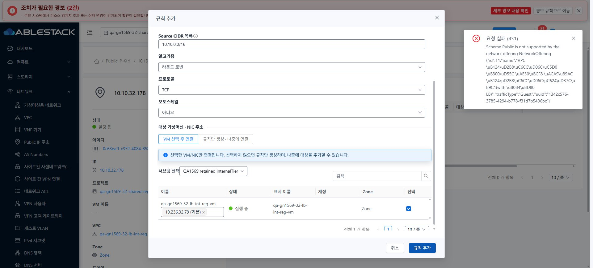
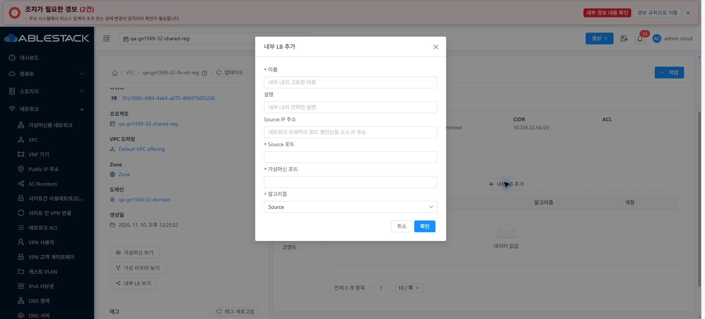

<!--
Licensed to the Apache Software Foundation (ASF) under one
or more contributor license agreements. See the NOTICE file
distributed with this work for additional information
regarding copyright ownership. The ASF licenses this file
to you under the Apache License, Version 2.0 (the
"License"); you may not use this file except in compliance
with the License. You may obtain a copy of the License at

  http://www.apache.org/licenses/LICENSE-2.0

Unless required by applicable law or agreed to in writing,
software distributed under the License is distributed on an
"AS IS" BASIS, WITHOUT WARRANTIES OR CONDITIONS OF ANY
KIND, either express or implied. See the License for the
specific language governing permissions and limitations
under the License.
-->

# #1569 VPN 역할·사용자 철회 / LB·오퍼링 통합 회귀

2026-11-10, 31 GFS2·32 Glue RBD에서 실제 브라우저 제어를 복구해 준비된 조건을 검증했다. **제품/UI/API 소스 변경·재배포는 없다.** 기존 #1610 배포본 `730c638c2537c71ce92739e4ade8fa22edcb4377`을 사용했고, 양쪽 활성 정적 664파일·WEB-INF·설정·관리 JAR/PID·HTTP200을 대조했다. 기존 Epic 브랜치 `dhslove/epic-1554-guest-networks`와 Draft PR #1577을 유지한다.

- VPN: 양쪽 실제 사용자 철회 후 VPN 인터페이스에 고정한 통신 차단·신규 PPP 인증 거부, 같은 사용자 복구 후 ping 5/5·TCP 3/3을 확인했다. 원래 VPN 사용자·키는 보존했다.
- 역할: 관리자/일반 구성원/도메인 관리자/전용 VPN·LB 읽기 전용/비회원 하위 도메인의 API 80건(허용48·거부32)과 실제 역할별 UI를 확인했다. 구성원·도메인 관리자는 본인 전용 VPN 사용자의 삭제/복구와 새 LB 수정이 성공했고, 읽기 전용·비회원의 변경은 거부됐다.
- LB: 양쪽 Isolated 생성의 실제 중복 포트537와 입력 보존/보정 성공, 31 UI NIC 할당, 32 VPC Public·Internal LB UI 생성/NIC 할당을 확인했다. 31 Isolated·32 VPC Public·32 Internal에서 각각 단일 백엔드 SSH 응답을 확인했다. **부하분산·성능 측정은 제외**했다.
- UI: VM NIC 탭/연결창을 실제 대조하고, VPN 목록·LB 생성창의 390/768/1280 라이트/다크 24조합과 역할 화면·프로젝트 왕복·즉시 테마·breadcrumb/화면 이동을 확인했다. 비관리자는 테마 설정 메뉴가 없어 상속된 다크 테마를 검증했다. 원본 JPEG **96장**의 실제 viewport/디코딩 치수/해시가 일치한다.
- 새 결함: [#1611 Public LB 후보 적합성](https://github.com/ablecloud-team/ablestack-cloud/issues/1611), [#1612 Internal LB 실패 입력 유실·대화상자 표준](https://github.com/ablecloud-team/ablestack-cloud/issues/1612), [#1613 Tier ACL 빈 링크](https://github.com/ablecloud-team/ablestack-cloud/issues/1613), [#1614 읽기 전용 backend 해제 UI 가드](https://github.com/ablecloud-team/ablestack-cloud/issues/1614). #1611~#1613 실제 재현은 32번이며 #1614는 31 Public/32 Internal에서 재현했다. 31 추가 VPC는 공인 IP 부족으로 차단됐으며 공통 코드만으로 양쪽 재현을 주장하지 않는다.

이번 검증 범위는 완료했지만 **#1569/Epic 전체는 미완료**다. 31은 63행 중 C06/P06 실패2·부분52·환경차단6·적용제외3, 32는 C06/I03/P05/P06 실패4·부분50·환경차단6·적용제외3이다. 전체 완료 행은 0으로 유지한다.

[검증과 제한](test-results.ko.md) · [캡처 목록](capture-matrix.ko.md) · [확인 자원/직접 UI 링크](resources.ko.md) · [후속 설계](followups.ko.md) · [63행 통합](../guest-network-1569-integrated/coverage.ko.md).

## 백엔드 해제 UI 권한 추가 교차검증

31 Public LB/32 Internal LB의 읽기 전용 역할에서 backend 해제 버튼이 활성이라 클릭할 수 있었다. 공통 postAPI 권한 검사가 로컬에서 거부했고 변경 POST는 각각0건이다. 직접 API deny401은 80기록 안에서 확인했으며 재조회에서 기존 backend/NIC는 유지됐다. 보안 우회로 집계하지 않고 UI 비활성/핸들러 가드·오류 정리를 [#1614](https://github.com/ablecloud-team/ablestack-cloud/issues/1614)로 분리했다. Internal의 catch/finally 보완은 소스 분석에 따른 개선 설계다.

문서10개를 WSL ext4에서 저장소 설정의 markdownlint로 검사하고, 96개 원본 JPEG·JSON/UTF-8·로컬 링크·비밀값·제품 소스/보호 FT 작업트리를 확인했다. 결과 파일은 `evidence/docs-lint-result.json`, `evidence/artifact-audit.json`이다.
