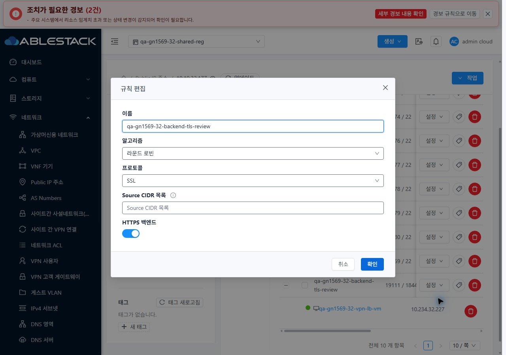
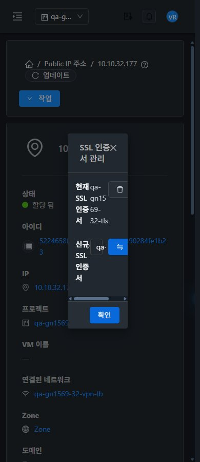

<!--
Licensed to the Apache Software Foundation (ASF) under one
or more contributor license agreements. See the NOTICE file
distributed with this work for additional information
regarding copyright ownership. The ASF licenses this file
to you under the Apache License, Version 2.0 (the
"License"); you may not use this file except in compliance
with the License. You may obtain a copy of the License at

  http://www.apache.org/licenses/LICENSE-2.0

Unless required by applicable law or agreed to in writing,
software distributed under the License is distributed on an
"AS IS" BASIS, WITHOUT WARRANTIES OR CONDITIONS OF ANY
KIND, either express or implied. See the License for the
specific language governing permissions and limitations
under the License.
-->

# #1569 VPN 철회·SSL·오퍼링 통합 회귀 — 2026-11-11

31 GFS2·32 Glue RBD에서 준비된 조건의 실제 UI/API/통신·실패 복구를 검증했다. **VPN 철회·복구, SSL 인증서 지문 전환, 단일 TLS 백엔드, 오퍼링 변경/복구는 확인했다. 새 결함 #1619·#1620·#1621 때문에 전체 회귀 통과나 #1569 종료로 처리하지 않는다.**

- VPN 사용자 UI 철회 → 기존 ppp69 고정 통신 차단 → 신규 PPP 인증 거부 → 소유자 UI 복구 후 ICMP5/5·SSH3/3. 서비스 UI 비활성/재생성도 양쪽에서 차단/복구했다. 재생성 PSK는 서버가 새로 발급하며 문서에는 남기지 않았다.
- SSL UI 교체 → 실제 새 인증서 지문 → 연결 제거 후 인증서 수0/TLS 실패 → 원래 인증서 복구/지문 일치. 신규 단일 HTTPS 백엔드도 정상 응답, backendssl 해제 시 curl56/응답 실패, 재활성 시 HTTP200/본문 복구를 확인했다. **부하분산·성능 측정은 제외했다.**
- UI 기본 복제의 서비스/provider/capability/접근/false 등19항목 대조. 복제본8192/Keepalive=true를 시험망에 적용해 실제HAProxy maxconn8192/no option httpclose·HTTPS를 확인하고 원래4096/false로 복구했다.
- **추가 교차 실패 #1621:** 양쪽 지속 VPN 시험에서 인증서 교체 약3초 뒤 PPP가 소실됐다(23샘플 중교체전7회만성공). VR journal의xl2tpd재시작/pppd SIGTERM과같은시각이며,같은PSK를써도변경으로판정하는CsFile.empty 호출이원인이다. 인증서복구만으로세션은복귀하지않고새VPN접속후5 ICMP/3 SSH가복구됐다. 제품수정은아직하지않았다.
- 새 **#1619(UI)**: 읽기 전용 SSL 버튼 가드 누락,401 후 버튼 잠김,390px에서30vw 대화상자 약117px/입력 잘림. 새 **#1620(API)**: 명시 projectid는 역할deny로401, 생략하면 같은 구성원의 인증서 할당job1. UI 요청은 공통 처리로 projectid를 보내므로 UI 우회 성공으로 표현하지 않는다.
- 실제 VM 목록·상세·NIC·연결창·breadcrumb 기준을 비교하고 프로젝트 왕복/관리자 즉시 테마·읽기 전용 테마 상속/390·768·1280을 확인했다.36개 고유 배치(반복 포함45기록), 원본JPEG83장을 검증했다. SSL 창의 모바일 실패를 가로 페이지 overflow0으로 덮지 않았다.

이번에는 제품 UI/API 소스를 바꾸거나 재배포하지 않았다. 기존 #1618 UI 정적670파일과 #1617 JAR/PID가 양쪽 활성 경로에서 동일하다. 신규 실제 Cloud API 결과와 캡처·설계를 기존 Epic 브랜치/Draft PR #1577에 반영한다. 보호 Native8/12,447파일·WSL14/107파일이 동일하다.

기존72 LB 규칙 정의/backend·모든 기존 사용자VM/NIC/host/power·망/VPC/IP·Internal LB controller를 보존했다. VPN 전용 서비스/철회용 사용자만 재생성했고 원래 오퍼링과 인증서를 복구했다. 임시 SSL deny2개씩은 정확히 삭제했다. 승인받은 시험 소유자 계정2개의 로그인 인증을 재설정했다. 새 LB·인증서·복제 오퍼링 각1개씩과 HTTPS 백엔드를 확인용으로 남겼다.

**후속 순서: #1620 API 권한 경계 → #1621 VPN 연속성 → #1619 SSL UI 가드/실패 복구/모바일 표준 → #1569 역할·TLS·오퍼링 잔여 → 환경 조건 →63행 통합.** C06/C07/P07/P09은 양쪽 실패로 갱신한다(실패4·부분50·환경차단6·적용제외3·완료0).

[검증·예외](test-results.ko.md) · [검토 설계](design.ko.md) · [확인용 자원](resources.ko.md) · [캡처83장](capture-matrix.ko.md) · [후속 순서](followups.ko.md)

