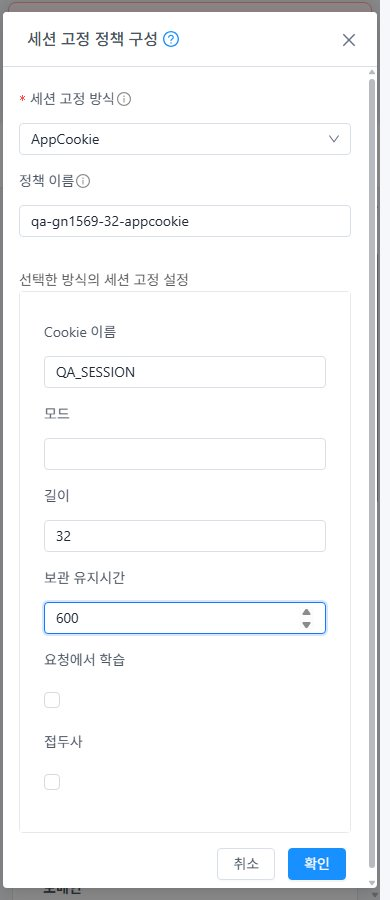

<!--
Licensed to the Apache Software Foundation (ASF) under one
or more contributor license agreements. See the NOTICE file
distributed with this work for additional information
regarding copyright ownership. The ASF licenses this file
to you under the Apache License, Version 2.0 (the
"License"); you may not use this file except in compliance
with the License. You may obtain a copy of the License at

  http://www.apache.org/licenses/LICENSE-2.0

Unless required by applicable law or agreed to in writing,
software distributed under the License is distributed on an
"AS IS" BASIS, WITHOUT WARRANTIES OR CONDITIONS OF ANY
KIND, either express or implied. See the License for the
specific language governing permissions and limitations
under the License.
-->

# #1569 VPN 역할·철회 및 TLS CA·체인·정책·오퍼링 후속 검증 — 2026-11-11

<!-- gn1569-upstream-status:start -->
PR 최종 조회에서 최신 upstream `45944c40dedef7ff6b377db94225cf598c82739d`와의 merge-tree가4개 UI 파일 충돌을 확인했다: `ui/public/locales/en.json`, `ui/public/locales/ko_KR.json`, `ui/src/components/view/DetailsTab.vue`, `ui/src/components/view/ListView.vue`. upstream 변화에는 백업·VM 배포·공통 UI 등 514경로가 있어 이번 검증 전용 실행에 통합하지 않았다. working tree는 그대로이며 실환경 결과는 검증한 Epic 코드 기준이다. PR1577은 Draft/Open/CONFLICTING이다.

**선행 순서: 최신 upstream 동기화(검증된 현재 UI 우선 보존·충돌 검토)와 필요한 회귀 → #1625 → #1626 → #1569 재검증 → 준비 조건 →63행 판정.** 이전 본문의 구현 순서 앞에 이 통합 단계를 둔다. 문서 head d2c3c937a138 조회 당시 양 저장소의 commit statuses는0, upstream check/run은 Merge Conflict Check1개였다. License/Lint 성공을 주장하지 않는다. 이번 실행에 제품 빌드/수동 Actions/코드 병합은 없다. [읽기 전용 충돌 검토](evidence/upstream-conflict-review.json) · [당시 checks](evidence/pr-checks-d2c3.json).
<!-- gn1569-upstream-status:end -->

31 GFS2·32 Glue RBD에서 #1569의 준비된 VPN 역할·사용자/서비스 철회, CA 체인·만료·LB 정책·오퍼링 조합을 실제 UI/API/통신으로 검증했다. **이번에는 제품 소스/UI 수정·재배포 없이 검증과 결함 분리를 진행했다.** Epic 브랜치와 Draft PR1577을 유지한다.

- VPN 역할 API56건과 LB 정책 역할 거부8건을 확인했다. root·프로젝트 소유자·일반 구성원·도메인 관리자·기존 읽기 전용·비구성원을 대조했다. 권한 없는 변경은401/432이며 job이 없다. 기존 역할 정책은 바꾸지 않았다. 실제 UI에서도 역할별 버튼/접근 제한을 확인했다.
- 일반 구성원·도메인 관리자의 실제 API 서비스 철회/복구4사이클과 소유자 UI2사이클, 양쪽 UI 사용자 철회/복구를 검증했다. 철회 후 기존 통신 차단, 사용자 철회 후 신규 PPP 인증 거부, 서비스 철회 후 신규 접속 불가, 복구 후 ping5/5·SSH TCP3/3이다. 소유자 UI 최종8작업은 별도 job1 조회로 확인했다. 서비스 재생성으로 PSK는 의도적으로 회전했으며 새 비공개 시험 설정을 갱신했다. 원래 client range·기존 사용자와 서비스 범위는 복원/유지했다.
- 사용자 확인에 따라 **같은 VPN의 동시 사용자 간 실제 통신 영향은 환경 조건으로 남겼다.** 단일 WSL의 겹치는 PPP 경로/strict rp_filter와 같은 NAT/IKE 경로를 보정했지만 독립 클라이언트2대의 안정된 판정을 대체하지 못한다. 두 세션의 PPP 성공을 동시 통신 성공으로 합산하지 않았다. 특정 시험 PPP 인터페이스만 loose rp_filter를 사용했으며 VR·호스트·전역 보안 설정은 바꾸지 않았다.
- 전용 Root CA→중간 CA→SAN leaf로 양쪽 실제 UI 인증서 교체8작업 job1, Root CA 신뢰/호스트명 검사와 TLS HTTP200·본문을 확인했다. 중간 체인을 빼면 curl60/TLS 검증 실패, 올바른 체인으로 복구하면 성공한다. 이미 만료/유효기간 전/키 불일치/잘못된 체인은 API가 거부한다. client 검증 시점만 leaf 만료 후로 이동하면 실제 TLS 검증도 거부했다. 서버 시계나 만료 인증서를 live에 적용한 시험은 아니다.
- 인증서 API20건에서 기본 enabledrevocationcheck=true인 사설 CA 체인은 거부됐고, 명시적 false 시험 업로드는 허용됐다. 기존 기본값/전역 정책/기존 인증서는 변경하지 않았다. 별도 CRL/OCSP가 없는 상태의 기본 정책 거부를 체인 구현 결함으로 판정하지 않는다. **폐기 목록을 갖춘 기본 정책의 정상/철회 인증서 검증은 남는다.**
- **새 결함 #1625:** UI에서 AppCookie를 선택할 수 있으나 실제 생성은 양쪽 job2/530. HAProxy2.6.12가 후보 appsession 구문을 HAProxy1.6 이후 미지원으로 거부한다. 31은 API로도 재현했다. 후보 검사 덕분에 실행 설정·통신은 유지됐다. SourceBased는 job1·stick-table/stick on src·TLS 정상이다.
- **새 결함 #1626:** 정책 대화상자가 jobid 접수 직후 닫히고, 실제 job2 후에도 초안/창을 복구하지 않는다. VM 공통 MoldDialog/MoldDialogActions 대신 기존 a-modal 경로다. 모바일의 overflow는 재현하지 않았으며 비동기 입력 유실과 공통 구성 적용을 개선 대상으로 기록했다.
- CA 체인+SourceBased 상태로 기존 NAT 복제 오퍼링8192/keepalive=true를 실제 적용하고, HAProxy maxconn8192/no option httpclose·TLS와 VPN 재접속을 확인했다. 원래4096/false로 복원했다. 재생성/재배치된 VR은 backend VM과 같은 호스트로 옮겨 검사했다. 처음32의 다른 호스트 표본과 이를 겹친 접속 표본은 성공에서 제외했다.
- 기존 SSL/VPN 창의 VM 표준과 프로젝트 왕복, 동일 timeOrigin 즉시 밝음/다크, SSL12+VPN 본문/창24배치를 확인했다. VM 목록·상세·NIC·연결창·breadcrumb·모바일도 대조했다. **JPEG91장**의 실제 viewport/디코딩 치수/signature/해시가 일치한다. 정책 UI는 앞의 결함으로 별도 기록했다.

최종 기존76 LB 정의/backend·인증서 매핑·VM/NIC/host/power·망/VPC/IP·기존 VPN 사용자·프로젝트 멤버/역할/읽기 전용 정책을 보존했다. 원래 오퍼링/인증서 매핑/정책 없음/client range를 복원했다. 서비스 시험 PSK 회전과 오퍼링 전환의 시험 VR 교체는 의도된 변경이다. 최종 r-1022-VM/r-494-VM은 backend와 같은 호스트이며, 원래 TLS 지문/HTTP200 및 상태 체크15/15가 모두 정상이다. 관리 JAR/PID·WEB-INF·671 UI 파일과 #1621/#1624 VR 소스는 그대로다. 시험 VPN 사용자2명·CA 시험 인증서2개씩과 기존 자원을 별도 삭제 지시까지 보관한다.

**후속 #1625 → #1626 → #1569 해당 조합 재검증 → 준비된 나머지·독립 클라이언트/CRL 등 조건 →63행 최종 판정.** P07을 AppCookie/UI 결함으로 실패로 되돌렸다. 양쪽 실패1·부분53·환경차단6·적용제외3·완료0이며 #1569/Epic/두 새 이슈는 열린 상태다. LB backend 부하분산 측정은 제외했다.

[검증/한계](test-results.ko.md) · [후속 설계](design.ko.md) · [보관 자원](resources.ko.md) · [캡처91장](capture-matrix.ko.md) · [남은 항목/순서](followups.ko.md)

