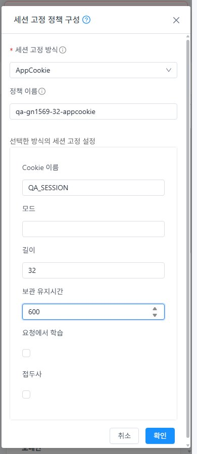
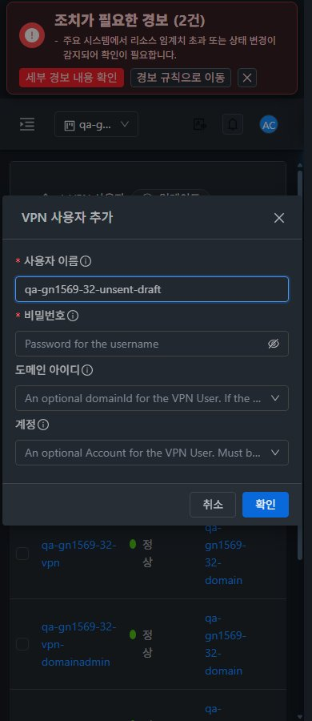

<!--
Licensed to the Apache Software Foundation (ASF) under one
or more contributor license agreements. See the NOTICE file
distributed with this work for additional information
regarding copyright ownership. The ASF licenses this file
to you under the Apache License, Version 2.0 (the
"License"); you may not use this file except in compliance
with the License. You may obtain a copy of the License at

  http://www.apache.org/licenses/LICENSE-2.0

Unless required by applicable law or agreed to in writing,
software distributed under the License is distributed on an
"AS IS" BASIS, WITHOUT WARRANTIES OR CONDITIONS OF ANY
KIND, either express or implied. See the License for the
specific language governing permissions and limitations
under the License.
-->

# UI 캡처91장

실제 viewport·native JPEG signature·디코딩 치수·SHA256을 [감사](evidence/capture-audit.json)했다. SSL12배치·VPN본문/창24배치·VM 기준/역할/프로젝트·실패 초안 유실을 포함한다.

| 캡처 | 크기 | 테마 |
| --- | --- | --- |
| [31-project-return](screenshots/31-project-return.jpg) | 1280×900 | light |
| [31-vpn-user-withdraw-confirm](screenshots/31-vpn-user-withdraw-confirm.jpg) | 1280×900 | light |
| [31-vpn-user-withdrawn](screenshots/31-vpn-user-withdrawn.jpg) | 1280×900 | light |
| [31-vpn-user-recovered](screenshots/31-vpn-user-recovered.jpg) | 1920×871 | light |
| [32-project-return](screenshots/32-project-return.jpg) | 1280×900 | light |
| [31-ca-chain-assigned](screenshots/31-ca-chain-assigned.jpg) | 1920×871 | light |
| [31-missing-chain-assigned](screenshots/31-missing-chain-assigned.jpg) | 1920×871 | light |
| [31-chain-recovered](screenshots/31-chain-recovered.jpg) | 1920×871 | light |
| [31-ssl-chain-1280-dark](screenshots/31-ssl-chain-1280-dark.jpg) | 1280×900 | dark |
| [31-ssl-chain-768-dark](screenshots/31-ssl-chain-768-dark.jpg) | 768×900 | dark |
| [31-ssl-chain-390-dark](screenshots/31-ssl-chain-390-dark.jpg) | 390×900 | dark |
| [31-ssl-chain-1280-light](screenshots/31-ssl-chain-1280-light.jpg) | 1280×900 | light |
| [31-ssl-chain-768-light](screenshots/31-ssl-chain-768-light.jpg) | 768×900 | light |
| [31-ssl-chain-390-light](screenshots/31-ssl-chain-390-light.jpg) | 390×900 | light |
| [32-ca-chain-assigned](screenshots/32-ca-chain-assigned.jpg) | 1280×900 | light |
| [32-missing-chain-assigned](screenshots/32-missing-chain-assigned.jpg) | 1280×900 | light |
| [32-chain-recovered](screenshots/32-chain-recovered.jpg) | 1280×900 | light |
| [32-ssl-chain-1280-dark](screenshots/32-ssl-chain-1280-dark.jpg) | 1280×900 | dark |
| [32-ssl-chain-768-dark](screenshots/32-ssl-chain-768-dark.jpg) | 768×900 | dark |
| [32-ssl-chain-390-dark](screenshots/32-ssl-chain-390-dark.jpg) | 390×900 | dark |
| [32-ssl-chain-1280-light](screenshots/32-ssl-chain-1280-light.jpg) | 1280×900 | light |
| [32-ssl-chain-768-light](screenshots/32-ssl-chain-768-light.jpg) | 768×900 | light |
| [32-ssl-chain-390-light](screenshots/32-ssl-chain-390-light.jpg) | 390×900 | light |
| [31-appcookie-ui-input](screenshots/31-appcookie-ui-input.jpg) | 1280×900 | light |
| [31-appcookie-390-light](screenshots/31-appcookie-390-light.jpg) | 390×900 | light |
| [31-appcookie-early-closed](screenshots/31-appcookie-early-closed.jpg) | 1280×900 | light |
| [32-appcookie-ui-input](screenshots/32-appcookie-ui-input.jpg) | 1280×900 | light |
| [32-appcookie-390-light](screenshots/32-appcookie-390-light.jpg) | 390×900 | light |
| [32-appcookie-early-closed](screenshots/32-appcookie-early-closed.jpg) | 1280×900 | light |
| [31-vpn-service-withdraw-confirm](screenshots/31-vpn-service-withdraw-confirm.jpg) | 1280×900 | light |
| [31-vpn-service-withdrawn](screenshots/31-vpn-service-withdrawn.jpg) | 1280×900 | light |
| [31-vpn-service-default-restored](screenshots/31-vpn-service-default-restored.jpg) | 1280×900 | light |
| [32-vpn-service-withdraw-confirm](screenshots/32-vpn-service-withdraw-confirm.jpg) | 1280×900 | light |
| [32-vpn-service-withdrawn](screenshots/32-vpn-service-withdrawn.jpg) | 1280×900 | light |
| [32-vpn-service-default-restored](screenshots/32-vpn-service-default-restored.jpg) | 1280×900 | light |
| [31-vpn-body-1280-dark](screenshots/31-vpn-body-1280-dark.jpg) | 1280×900 | dark |
| [31-vpn-body-768-dark](screenshots/31-vpn-body-768-dark.jpg) | 768×900 | dark |
| [31-vpn-body-390-dark](screenshots/31-vpn-body-390-dark.jpg) | 390×900 | dark |
| [31-vpn-user-dialog-1280-dark](screenshots/31-vpn-user-dialog-1280-dark.jpg) | 1280×900 | dark |
| [31-vpn-user-dialog-768-dark](screenshots/31-vpn-user-dialog-768-dark.jpg) | 768×900 | dark |
| [31-vpn-user-dialog-390-dark](screenshots/31-vpn-user-dialog-390-dark.jpg) | 390×900 | dark |
| [31-vpn-body-1280-light](screenshots/31-vpn-body-1280-light.jpg) | 1280×900 | light |
| [31-vpn-body-768-light](screenshots/31-vpn-body-768-light.jpg) | 768×900 | light |
| [31-vpn-body-390-light](screenshots/31-vpn-body-390-light.jpg) | 390×900 | light |
| [31-vpn-user-dialog-1280-light](screenshots/31-vpn-user-dialog-1280-light.jpg) | 1280×900 | light |
| [31-vpn-user-dialog-768-light](screenshots/31-vpn-user-dialog-768-light.jpg) | 768×900 | light |
| [31-vpn-user-dialog-390-light](screenshots/31-vpn-user-dialog-390-light.jpg) | 390×900 | light |
| [31-project-default](screenshots/31-project-default.jpg) | 1280×900 | light |
| [31-vm-standard-detail](screenshots/31-vm-standard-detail.jpg) | 1280×900 | light |
| [31-vm-standard-nic-tab](screenshots/31-vm-standard-nic-tab.jpg) | 1280×900 | light |
| [31-vm-standard-connect-dialog](screenshots/31-vm-standard-connect-dialog.jpg) | 1280×900 | light |
| [31-vm-standard-390-dark](screenshots/31-vm-standard-390-dark.jpg) | 390×900 | dark |
| [31-vm-breadcrumb-return](screenshots/31-vm-breadcrumb-return.jpg) | 1280×900 | light |
| [31-readOnly-vpn-users](screenshots/31-readOnly-vpn-users.jpg) | 1280×900 | light |
| [31-readOnly-vpn-service](screenshots/31-readOnly-vpn-service.jpg) | 1280×900 | light |
| [31-peer-vpn-users](screenshots/31-peer-vpn-users.jpg) | 1280×900 | light |
| [31-peer-vpn-service](screenshots/31-peer-vpn-service.jpg) | 1280×900 | light |
| [31-original-restored](screenshots/31-original-restored.jpg) | 1280×900 | light |
| [32-vpn-user-withdraw-confirm](screenshots/32-vpn-user-withdraw-confirm.jpg) | 1280×900 | light |
| [32-vpn-user-withdrawn](screenshots/32-vpn-user-withdrawn.jpg) | 1280×900 | light |
| [31-domainAdmin-vpn-users](screenshots/31-domainAdmin-vpn-users.jpg) | 1280×900 | light |
| [31-domainAdmin-vpn-service](screenshots/31-domainAdmin-vpn-service.jpg) | 1280×900 | light |
| [32-vpn-user-recovered](screenshots/32-vpn-user-recovered.jpg) | 1920×871 | light |
| [32-vpn-body-1280-dark](screenshots/32-vpn-body-1280-dark.jpg) | 1280×900 | dark |
| [32-vpn-body-768-dark](screenshots/32-vpn-body-768-dark.jpg) | 768×900 | dark |
| [32-vpn-body-390-dark](screenshots/32-vpn-body-390-dark.jpg) | 390×900 | dark |
| [32-vpn-user-dialog-1280-dark](screenshots/32-vpn-user-dialog-1280-dark.jpg) | 1280×900 | dark |
| [32-vpn-user-dialog-768-dark](screenshots/32-vpn-user-dialog-768-dark.jpg) | 768×900 | dark |
| [32-vpn-user-dialog-390-dark](screenshots/32-vpn-user-dialog-390-dark.jpg) | 390×900 | dark |
| [32-vpn-body-1280-light](screenshots/32-vpn-body-1280-light.jpg) | 1280×900 | light |
| [32-vpn-body-768-light](screenshots/32-vpn-body-768-light.jpg) | 768×900 | light |
| [32-vpn-body-390-light](screenshots/32-vpn-body-390-light.jpg) | 390×900 | light |
| [32-vpn-user-dialog-1280-light](screenshots/32-vpn-user-dialog-1280-light.jpg) | 1280×900 | light |
| [32-vpn-user-dialog-768-light](screenshots/32-vpn-user-dialog-768-light.jpg) | 768×900 | light |
| [32-vpn-user-dialog-390-light](screenshots/32-vpn-user-dialog-390-light.jpg) | 390×900 | light |
| [32-project-default](screenshots/32-project-default.jpg) | 1280×900 | light |
| [32-vm-standard-detail](screenshots/32-vm-standard-detail.jpg) | 1280×900 | light |
| [32-vm-standard-nic-tab](screenshots/32-vm-standard-nic-tab.jpg) | 1280×900 | light |
| [32-vm-standard-connect-dialog](screenshots/32-vm-standard-connect-dialog.jpg) | 1280×900 | light |
| [32-vm-standard-390-dark](screenshots/32-vm-standard-390-dark.jpg) | 390×900 | dark |
| [32-vm-breadcrumb-return](screenshots/32-vm-breadcrumb-return.jpg) | 1280×900 | light |
| [32-readOnly-vpn-users](screenshots/32-readOnly-vpn-users.jpg) | 1280×900 | light |
| [32-readOnly-vpn-service](screenshots/32-readOnly-vpn-service.jpg) | 1280×900 | light |
| [32-peer-vpn-users](screenshots/32-peer-vpn-users.jpg) | 1280×900 | light |
| [32-peer-vpn-service](screenshots/32-peer-vpn-service.jpg) | 1280×900 | light |
| [32-domainAdmin-vpn-users](screenshots/32-domainAdmin-vpn-users.jpg) | 1280×900 | light |
| [32-domainAdmin-vpn-service](screenshots/32-domainAdmin-vpn-service.jpg) | 1280×900 | light |
| [31-nonmember-vpn-denied](screenshots/31-nonmember-vpn-denied.jpg) | 1920×871 | light |
| [32-nonmember-vpn-denied](screenshots/32-nonmember-vpn-denied.jpg) | 1920×871 | light |
| [32-original-restored](screenshots/32-original-restored.jpg) | 1280×900 | light |
| [32-final-ssl-review](screenshots/32-final-ssl-review.jpg) | 1280×900 | light |
