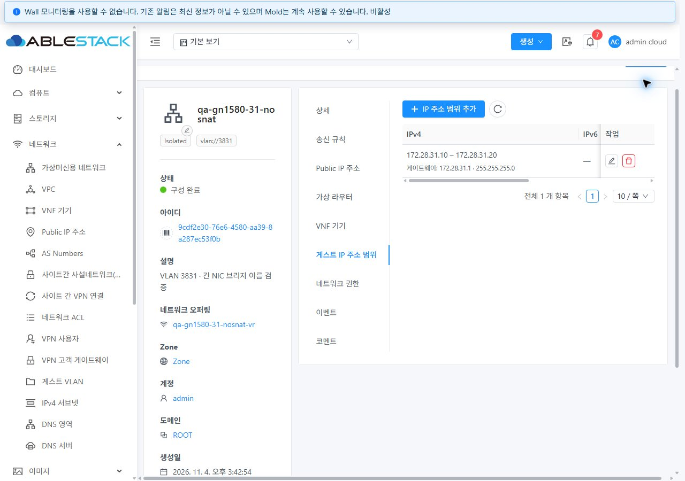
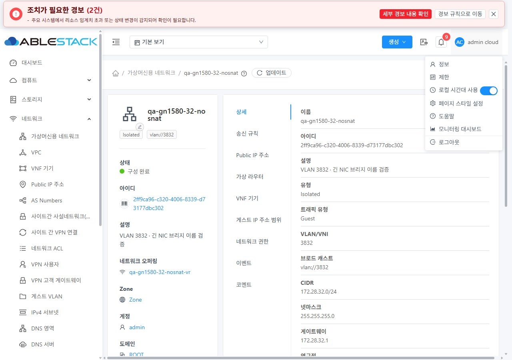
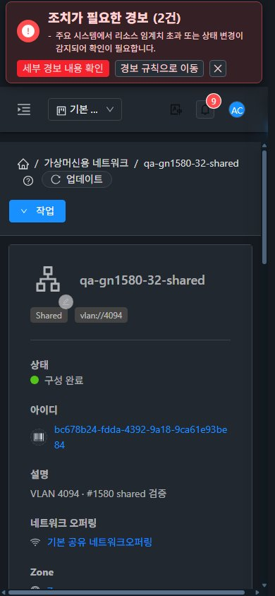

# #1580 KVM VLAN 이름 길이 개선 — 31·32 실환경 검증

2026-11-04 · Epic [#1554](https://github.com/ablecloud-team/ablestack-cloud/issues/1554) · Draft PR [#1577](https://github.com/ablecloud-team/ablestack-cloud/pull/1577)

4자리 VLAN에서 Linux의 인터페이스 이름 15바이트 제한을 초과하던 VM·라우터 시작을 수정했다. 시작뿐 아니라 실제 UI 마이그레이션에서 발견한 **libvirt qemu hook의 긴 이름 재생성**도 수정했다. 31 GFS2와 32 Glue(Ceph) RBD의 Isolated/no-SourceNat/L2/Shared VM 8대가 Running이며, 검토 자원은 삭제 지시까지 유지한다.

생산 소스: `0e97fc3db20` → `b11cc39c43c`. 추가 검증 코드: `48a57f41d94`. 같은 `dhslove/epic-1554-guest-networks` 브랜치와 Draft PR을 유지한다. 전체 Cloud 빌드·수동 Actions·PR 병합·Epic 종료는 수행하지 않았다. Epic 구현 완료는 **8/23**, 다음 순서는 **#1565 네트워크 고급 검색과 오퍼링 사용 네트워크 조회 연계**다.

## 변경 내용과 호환성

| 경로 | 변경 |
|---|---|
| BridgeVifDriver / IvsVifDriver | 유효한 기존 `br<PIF>-<VID>` 이름은 유지한다. 초과할 때만 PIF SHA-256의 40비트를 8자리 base32로 변환해 `br<token>-<VID>`를 사용한다. VXLAN/OVS의 기존 방식과 물리 NIC 이름은 바꾸지 않는다. |
| modifyvlan.sh | VLAN 하위 장치도 15자를 넘으면 `vlan` + 부모/VID 해시 11자리로 축약한다. 실제 부모·VID, 기존 bridge 종류/alias/구성원/master를 확인하고 충돌·다른 bridge 소속·사용 중 삭제를 거부한다. 프로세스 간 생성은 flock으로 직렬화한다. 생성 실패 시 이번 호출에서 만든 장치만 정리한다. |
| 조회·정리 | 축약 이름에서 PIF를 역추측하지 않고 실제 VLAN 구성원과 생성 소속 정보를 사용한다. VLAN 조회는 `/proc/net/vlan`의 VID를 읽는다. 영구성 조회는 마지막 구분자 뒤 VID를 사용해 hyphen이 있는 기존 NIC 이름도 처리한다. 오류에는 PIF·VID·계산된 이름·길이를 남긴다. |
| libvirt qemu hook | 목적지 준비 단계가 확인한 bridge alias의 실제 부모를 재사용하고, 서로 다른 PIF로 이동할 때도 동일한 이름 생성 규칙을 적용한다. 기존 native/VXLAN은 유지한다. |

32번의 `brens1f0np0-3832` **16자**는 `brlhfblgjc-3832` **15자**가 된다. 31번의 `breno12399-3831`은 원래 15자여서 그대로 유지됐다. 31번의 과거 VLAN 3831 호스트 간 DHCP 문제를 이름 길이 결함으로 소급 판정하지 않는다.

해시 충돌을 불가능하다고 가정하지 않는다. 같은 이름의 장치가 있어도 실제 부모/VID와 bridge 소속이 다르면 재사용·삭제하지 않는다. 유효한 기존 bridge/VM/관리 네트워크를 일괄 rename하거나 교체하지 않는다.

## 실제 UI에서 검증한 경로와 UI 표준

**이번 이슈의 프런트엔드·CSS 변경은 없다.** 네트워크 VLAN 입력을 3자리로 제한하는 우회도 하지 않았다. 기존 「컴퓨트 > 가상머신」 표준의 목록·요약/상세·NIC 탭·시작/재시작/이동/분리 대화상자·breadcrumb를 실제로 사용해 Agent 변경을 검증했다. 이전 Epic UI 배치는 유지한다.

- 31 VLAN 3831, 32 VLAN 3832 no-SourceNat 망을 **UI 네트워크 추가**로 생성했다. 나머지 유형은 전용 API fixture로 생성하고, 모든 VM은 API에서 Stopped로 준비한 뒤 **8대 모두 UI 시작**을 실행했다. 완료 이벤트 8개와 최종 API/host XML을 대조했다.
- SourceNat Isolated VLAN 1000, L2 VLAN 3833, Shared VLAN 4094에서도 VM 시작을 확인했다. 서비스가 있는 네트워크의 라우터 6대도 Running이다. L2 VM의 Cloud IP 미관리 표시는 정상 계약이다.
- no-SourceNat VM을 양쪽 3번 호스트로 **UI 마이그레이션**했다. 32번 최초 이동 실패를 보존하고 hook 수정 후 새 작업이 성공한 것을 확인했다.
- 임시 VLAN 4093 NIC를 live VM에 추가한 뒤 **UI NIC 탭·확인 대화상자에서 분리**했다. API 작업 성공, NIC 제거, 해당 bridge와 VLAN 장치 삭제, 기본 NIC 보존을 확인하고 임시 망도 삭제했다.
- UI 재시작 후 VM/라우터·NIC 상태를 다시 대조했다. VM→망 상세, 망→연관 VM 목록, 뒤로/앞으로 및 직접 URL 진입을 확인했다.
- 31 no-SourceNat / 32 Shared 상세를 **1280·768·390px × light/dark = 12조건**으로 캡처했다. 실제 사용자 설정으로 테마를 즉시 전환했고 VM 모바일 표준 화면도 비교했다. 페이지 document 너비는 각 viewport 안에 있었다. 기존 테이블의 내부 스크롤·많은 열의 줄바꿈은 유지된다.
- 임시 viewport·네트워크 추적 설정을 복원하고 light 테마의 두 검토 탭을 남겼다.

42개 원본 JPEG의 실제 형식·크기·SHA-256을 검증했다. [캡처 목록](evidence/screenshots.json), [UI 시작 이벤트 31](evidence/31-ui-start-events.json), [32](evidence/32-ui-start-events.json), [수정 후 이동 요청](evidence/32-ui-trace-migration-final.json), [최종 비동기 작업 결과](evidence/32-final-audit.json).

### 대표 캡처

31 no-SourceNat 게스트 IP 범위 검토 화면:

32 no-SourceNat VLAN 3832 검토 화면:

32 Shared VLAN 4094 모바일 다크모드:

32 VM 시작 결과 및 최초 이동 결함 증적은 [VM 목록](evidence/32-four-types-running.jpg), [hook 수정 전 이동 오류](evidence/32-migration-before-hook-failure.jpg), [수정 후 이동 대화상자](evidence/32-migrate-final-dialog.jpg)에 있다.

## 로컬 시험·배포·보존 확인

| 검증 | 결과 |
|---|---|
| WSL ext4 변경 Maven 모듈 | `mvn -pl plugins/hypervisors/kvm -Dcheckstyle.skip package`: **1,215 tests / 0 failures / 0 errors / 3 skipped**, package 성공. 전체 Cloud 빌드가 아니다. |
| WSL ext4 Agent 모듈 | hook 생성 소스가 속한 `mvn -pl agent -Dcheckstyle.skip package`: **64 tests / 0 failures / 0 errors / 0 skipped**, package 성공. |
| Hook | Python 시험 **7개 성공**. 구형/짧은/긴 이름, 다른 목적 PIF, 준비된 비-Guest 부모, alias 위조/VID 불일치, native/VXLAN 보존을 확인했다. |
| 실제 Linux namespace | 각 클러스터 **35 시나리오 성공**. `eth0`, `ens1f0np0`, bond와 15자 부모 × VLAN 1/631/1000/3832/4094, 중복 생성·사용 중 거부·정리·충돌·동시 생성·범위 경계를 시험했다. 설치된 Agent의 실제 Java VLAN 조회도 5가지 부모에서 실행했다. |
| Checkstyle | 모듈 전체는 기존 파일의 **19건**으로 실패. 변경 Java 파일은 **0건**. [빌드 결과](evidence/build.json)에 기존 파일 목록을 분리했다. |
| 6개 호스트 | Agent JAR의 Bridge/Ivs/이름 helper와 VLAN 스크립트, `/etc/libvirt/hooks/qemu`의 해당 함수만 반영했다. Agent 재시작 후 서비스 active, API 연결 및 설치 바이트를 확인했다. |
| 기존 Agent 차이 보존 | 31/32 기존 LibvirtComputingResource에 GFS2 코드 차이가 있어 전체 클래스를 덮어쓰지 않았다. WSL 빌드에서 나온 **VLAN 조회 2개 메서드만** 원래 클래스에 이식했다. 나머지 **444개 method_info 바이트가 각 호스트에서 동일**하다. 다른 JAR 엔트리와 기존 FTCTL·스토리지·custom hook 함수도 보존했다. |
| 관리 서버 | 관리 JAR·UI 정적 자산은 변경하지 않았다. 기존 SHA-256, WEB-INF와 양쪽 `/client/` HTTP **200**을 확인했다. |
| 기존 자원 | 양쪽 기존 네트워크·오퍼링·VM·라우터·물리망·VPC의 선정 구성 필드에서 누락/변경 **0**. 기존 실행 VM XML 보존. 주 작업 트리의 FT 변경 HEAD·staged/unstaged SHA 동일. |

[31 최종 감사](evidence/31-final-audit.json), [32 최종 감사](evidence/32-final-audit.json), [메서드 바이트 보존](evidence/resource-method-byte-preservation.json), [주 작업 트리](evidence/protected-worktree.json), [31 namespace](evidence/31-namespace-tests.json), [32 namespace](evidence/32-namespace-tests.json).

기존 호스트의 전체 JAR 백업은 WSL ext4 `/home/ablecloud/work/guest-network-1580-validation/backups-original/`(최초 원본)·`backups/`·`backups-final/`, 각 호스트 `/root/qa-gn1580-backup-*`에 있다. 정확한 원본 해시는 [원본 백업 목록](evidence/original-backups.json), 실행 해시는 최종 감사 JSON에 기록했다. `final-hook` 배포 라벨의 생산 내용은 `b11cc39c43c` 소스와 대응한다. 메서드 이식 도구와 배포 코드는 evidence에 보관했다.

rollback은 **새 축약 이름을 쓰는 시험 VM/NIC/라우터를 먼저 정지·분리하고 새 스크립트로 해당 장치를 정리한 뒤**, 백업 Agent JAR·VLAN 스크립트·hook을 함께 복원하고 Agent를 재시작한다. 실행 중 bridge를 강제로 rename하지 않는다. 모든 대상 호스트에 Agent/스크립트/hook을 맞추기 전에는 4자리 VLAN의 혼합 버전 마이그레이션을 진행하지 않는다. 이번에는 rollback을 실행하지 않았다.

namespace 시험은 mount/network namespace 안에서 sysfs를 별도로 마운트해 운영 장치를 격리한다. `test_modifyvlan.py`는 기본 30개, `VLAN_PROBE_CLASSPATH`에 WSL에서 컴파일한 `VlanLookupProbe`와 설치 Agent 라이브러리를 주면 실제 조회 5개를 추가한다. hook 시험은 `python3 scripts/vm/network/vnet/test_qemuhook_vlan.py`로 실행한다.

## 패킷 결과와 검증 경계

- 양쪽 no-SourceNat/Shared에서 **같은 호스트**의 라우터→게스트 ICMP 3/3, MAC 일치, DHCP 설정과 QGA 실제 IPv4 주소를 확인했다. no-SourceNat 양쪽과 31 Shared는 시험 계정 SSH 및 게스트→라우터 ping도 성공했다. [31](evidence/31-packet-qga.json), [32](evidence/32-packet-qga.json).
- 32 Shared는 IPv4·ICMP·QGA 확인에 성공했지만 시험 SSH 키 인증이 거부됐다. 인증 거부의 원인은 확정하지 않았다. 이 결과를 게스트 SSH/UserData 성공으로 계산하지 않는다. Shared/UserData 회귀는 #1572/#1576에 남긴다.
- **호스트 간 외부 스위치 trunk 통신, 외부 게이트웨이, IPv6/RA, NAT·LB 등 전체 서비스 엔진, 전 역할/project, Ivs/OVS 실환경은 이 이슈의 PASS에 포함하지 않는다.** Ivs 공통 이름 경로는 코드·단위 시험, OVS는 별도 방식임을 확인했다. 32 Shared 구형 다중 subnet DB 스키마와 IPv6 전달 등 이전 제한도 그대로 별도다.
- 초기 장시간 CDP 추적은 버퍼가 만료돼 완전한 요청 로그로 사용하지 않았다. UI 시작은 캡처·Cloud 완료 이벤트·API·호스트 결과로 대조했고, 최종 이동/NIC 분리/재시작은 별도 짧은 추적으로 POST·jobid·결과를 연결했다.
- 로컬 모듈·실환경 결과와 저장소 전체 CI는 구분한다. 기존 License/PNG 검사 실패가 남아 있으며 전체 Cloud CI 성공을 주장하지 않는다.

## 남겨 둔 검토 자원

이전 #1557의 **망 4개·VM 4대·오퍼링 2개**와 관련 범위를 삭제했다. 전체 6개 호스트에서 해당 VM 도메인·GFS2 루트 디스크·RBD 이미지/매핑 잔여가 없음을 확인했다. 이번 임시 VLAN 4093 망/NIC도 삭제했다. [정리 결과](evidence/cleanup.json).

| 클러스터 | 네트워크 | VLAN | 검토 VM 호스트 | 실제 bridge |
|---|---|---:|---|---|
| 31 GFS2 | qa-gn1580-31-nosnat | 3831 | ablecube31-3 | breno12399-3831 |
| 31 | qa-gn1580-31-nat | 1000 | ablecube31-1 | breno12399-1000 |
| 31 | qa-gn1580-31-l2 | 3833 | ablecube31-2 | breno12399-3833 |
| 31 | qa-gn1580-31-shared | 4094 | ablecube31-2 | breno12399-4094 |
| 32 Glue RBD | qa-gn1580-32-nosnat | 3832 | ablecube32-3 | brlhfblgjc-3832 |
| 32 | qa-gn1580-32-nat | 1000 | ablecube32-1 | brlhfblgjc-1000 |
| 32 | qa-gn1580-32-l2 | 3833 | ablecube32-1 | brlhfblgjc-3833 |
| 32 | qa-gn1580-32-shared | 4094 | ablecube32-1 | brlhfblgjc-4094 |

총 **망 8개·Running VM 8대·전용 오퍼링 4개·라우터 6대**를 유지한다. VM 이름은 각 망 이름 뒤 `-review`다. 기본 Shared/L2 오퍼링은 기존 자원이며 삭제 대상이 아니다. [정확한 UUID·NIC·주소·bridge 목록](evidence/retained-resources.json)으로 대조할 수 있다. 사용자 확인 뒤 별도 지시가 있을 때 정리한다.

직접 확인: [31 no-SourceNat 범위 탭](http://10.10.31.10:8080/client/#/guestnetwork/9cdf2e30-76e6-4580-aa39-8a287ec53f0b?tab=guest.ip.range), [32 no-SourceNat 상세](http://10.10.32.10:8080/client/#/guestnetwork/2ff9ca96-c320-4006-8339-d73177dbc302). 이후 작업은 [#1565](https://github.com/ablecloud-team/ablestack-cloud/issues/1565)이며 자동 착수하지 않는다.
