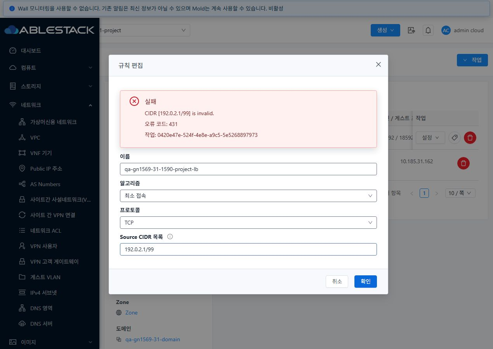
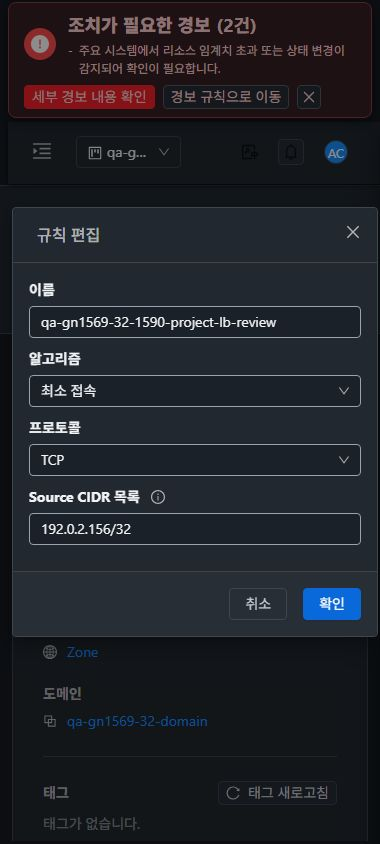

<!--
Licensed to the Apache Software Foundation (ASF) under one
or more contributor license agreements.  See the NOTICE file
distributed with this work for additional information
regarding copyright ownership.  The ASF licenses this file
to you under the Apache License, Version 2.0 (the
"License"); you may not use this file except in compliance
with the License.  You may obtain a copy of the License at

  http://www.apache.org/licenses/LICENSE-2.0

Unless required by applicable law or agreed to in writing,
software distributed under the License is distributed on an
"AS IS" BASIS, WITHOUT WARRANTIES OR CONDITIONS OF ANY
KIND, either express or implied.  See the License for the
specific language governing permissions and limitations
under the License.
 -->

# #1590 프로토콜 기본값과 LB 편집 실패 복구

2026-11-08, 31 GFS2·32 Glue RBD에서 구현·배포·실제 UI/API/DB 검증을 완료했다. 기존 Epic 브랜치 `dhslove/epic-1554-guest-networks`와 Draft PR #1577을 유지한다. 구현 커밋은 `302281ab72e`다.

## 변경과 설계

`LoadBalancingRulesManagerImpl`의 생성·수정은 생략/공백 프로토콜을 TCP로 정규화하고, API 조회도 기존 NULL 행을 TCP로 응답한다. 기존 DB 행은 조회만으로 일괄 변경하지 않으며 다음 성공한 수정에서 정규화한다. 재적용 전 값을 별도로 저장해 DAO가 같은 객체를 반환해도 이전 값을 잃지 않는다. 적용 false 반환·리소스 불가·런타임 예외를 실패로 처리하며 기존 롤백 지원 제공자는 이름/설명/알고리즘/NULL 프로토콜/CIDR/UUID/display/상태/backendssl을 복원한다. 인증서는 성공한 실제 SSL→비SSL 전환에만 해제한다. Add 상태의 동일 값 수정도 재적용할 수 있고, 반환 값은 제공자 처리 후 DB를 다시 읽는다.

백엔드 VM이 없는 규칙의 **Add는 정상적인 연결 대기 상태**다. 이를 무조건 Active로 바꾸지 않았다. 원래 오류는 NULL 참조 예외와 실패 후 변경 값이 남는 문제였으며, 양쪽 모두 기존/신규 규칙에 백엔드를 연결한 뒤 Active를 확인했다.

## UI 변경과 VM 표준 적용

- 변경 화면은 **네트워크 → Public IP → 부하 분산 → 설정 → 규칙 편집**이다. 목록·상세·탭·breadcrumb의 기존 공통 구조를 유지하며 VM 메뉴의 실제 목록/NIC 탭/연결 대화상자와 대조했다.
- VM과 같은 `MoldDialog`의 세로 입력·공통 헤더/하단 취소·확인 버튼을 유지했다. 기존/빈 프로토콜은 TCP로 표시하고, SSL에서 HTTPS 백엔드를 정확히 표시한다. 입력에 접근성 이름을 추가했다.
- 기존 공통 네트워크 작업 상태 표시를 편집 안에 연결했다. 실패 시 대화상자·입력·오류 코드·작업 ID를 유지한다. 결과 미확정 시 확인 버튼을 차단하고 **작업 결과 다시 조회**로 같은 job만 확인한다. 같은 규칙을 다시 열어도 미확정 입력/작업을 보존한다.
- 진행 중 입력/취소/닫기·중복 전송을 차단한다. 프로젝트/사용자/역할/경로가 바뀌면 이전 편집 상태를 닫고 늦게 도착한 완료 콜백을 무시한다.
- 양쪽 실제 390·768·1280px 라이트/다크, 모바일 프로젝트 기본 보기↔QA 왕복과 화면 복귀를 확인했다. 31 소유자·32 일반 프로젝트 멤버가 UI 저장을 수행했다. 테마는 원래의 31 라이트·32 다크로, 임시 뷰포트와 네트워크 차단은 해제했다.

## 검증 결과

| 검증 | 31 | 32 | 증적 |
| --- | --- | --- | --- |
| 기존 NULL 행 조회 TCP 호환, 알고리즘 수정, 실제 DB 정규화 | 통과 | 통과 | legacy-read / api / final-api |
| protocol 생략 신규 생성→수정→백엔드 연결→Active | 통과 | 통과 | api / final-api |
| TCP·HTTP(대소문자/공백)·SSL, backendssl·인증서 유무, SSL→TCP 해제 | 통과 | 통과 | api / final-api |
| 잘못된 CIDR/backendssl 거부 후 기존 값 보존·정상 재시도 | 통과 | 통과 | api / UI 오류·재시도 캡처 |
| UI SSL 저장 후 인증서·backendssl 유지 | 통과 | 통과 | SSL 편집 캡처 / final-api |
| 프로젝트 owner/member/DomainAdmin 수정 허용, peer/외부 거부(API) | 통과 | 통과 | api |
| 실제 UI 실패 입력 보존·정상 저장·프로젝트 왕복 | 통과 | 통과 | 캡처 |
| 비동기 결과 조회 차단→미확정→동일 job 재조회 복구 | 통과 | 통과 | unknown-job 캡처 / ui-mutations |
| 390/768/1280px 라이트/다크 편집 및 모바일 프로젝트 왕복 | 통과 | 통과 | edit-* / project-* 캡처 |

작업 결과 조회 차단은 개발자 도구로 이 시험 탭의 `queryAsyncJobResult` 요청에만 적용했다. 실제 변경 요청은 차단하지 않았다. 캡처 후 차단을 해제하고 같은 작업 ID로 완료를 확인했으며 재전송이 없음을 요청 기록으로 대조했다. 프로젝트 전환의 늦은 콜백 억제는 집중 단위 테스트로도 검증했다.

새 실패 복구 서버 테스트 10개를 포함한 server 집중 31개, UI 집중 45개가 통과했다. 변경 Java 4개 Checkstyle 0건, UI ESLint 통과. WSL ext4에서 `server` 모듈만 Maven package 했고 UI를 로컬 production build했다. 전체 Cloud 빌드/GitHub Actions를 실행한 결과가 아니다. [서버 테스트](evidence/server-test-suites.json) · [UI 로그](evidence/ui-tests.log) · [빌드](evidence/ui-build-result.json) · [변경 파일 스타일](evidence/changed-checkstyle-result.json).

제공자 false/예외의 DB 복원·실패 SSL 전환의 인증서 유지·같은 값 재시도는 실제 VO/DAO 경계를 사용한 집중 테스트에서 확인했다. 실제 클러스터의 제공자를 강제로 고장 내거나, 부분 적용된 외부 장비 설정의 자동 롤백을 검증한 것은 아니다. 실클러스터 검증 제공자는 VirtualRouter다. LB 백엔드 데이터 평면은 사용자 지시에 따라 제외했다. 다른 제공자·health/autoscale 등의 전체 조건부 회귀는 #1569에 남긴다.

## 배포·보존

양쪽 활성 관리 JAR은 SHA256 `05f9c10e31d5755cb5d024b7ad7468501d349c658cfc305b0905e46c5fe77add`다. 두 클래스 계열의 11개 클래스만 교체했고 다른 204,646개 JAR 항목은 바이트가 동일하다. UI 정적 파일 662개 해시를 확인했다. WEB-INF/META-INF와 런타임 설정 파일을 보존했고 HTTP 200·mold active·FTCTL 표식·링크 오류 0건을 확인했다. [31 런타임](evidence/31-runtime-after.json) · [32 런타임](evidence/32-runtime-after.json).

32번은 최초 배포 전 루트 여유 공간 검사에서 중단돼 기존 서비스/JAR을 유지했다. 이전 snapshot 회귀의 명시한 배포 백업 4개를 WSL에 아카이브하고 파일별 SHA256을 대조한 뒤 원격 복사본만 정리했다. 이후 1.2GiB를 확보해 정상 반영했다. [복구 가능한 백업 경로·해시](evidence/disk-space-recovery.json). 이번 확인용 네트워크/VM/LB는 정리하지 않았다.

운영 자원은 31번 망 28·VM 121·오퍼링 30, 32번 망 11·VM 58·오퍼링 21의 UUID/내용을 보존했다. QA 프로젝트 기존 망·역할·멤버십과 원래 7개 NIC/default/IP/MAC/호스트를 보존했다. 기존 전용 NAT에 비기본 NIC 1개를 추가해 각 VM NIC는 8개다. 각 클러스터 개인망 LB 4개와 프로젝트 LB 1개가 모두 Active이고 SSL 시험 인증서, Public IP, 확인용 네트워크/VM은 유지했다. [현재 자원과 직접 링크](resources.ko.md).

## 남은 순서

**#1590 완료 → #1592 공유 회수 후 VM 요약 링크 → #1591 미등록 제공자 조회 → #1569 남은 역할·조건부 회귀**. #1586 RBD 물리 정리는 별도 후속이다. Epic #1554·#1569와 Draft PR #1577은 열린 상태로 유지한다. 통합 63행 검토표의 P05는 결함 해소 후 부분 검증으로 갱신하며 전체 행 성공으로 올리지 않는다. 현재 실패 1(M02), 부분 48, 미실행 5, 환경 차단 6, 적용 제외 3이다.

[원본 캡처 전체](capture-matrix.ko.md) · [전체 63행 검토표](../guest-network-1569-integrated/coverage.ko.md)
