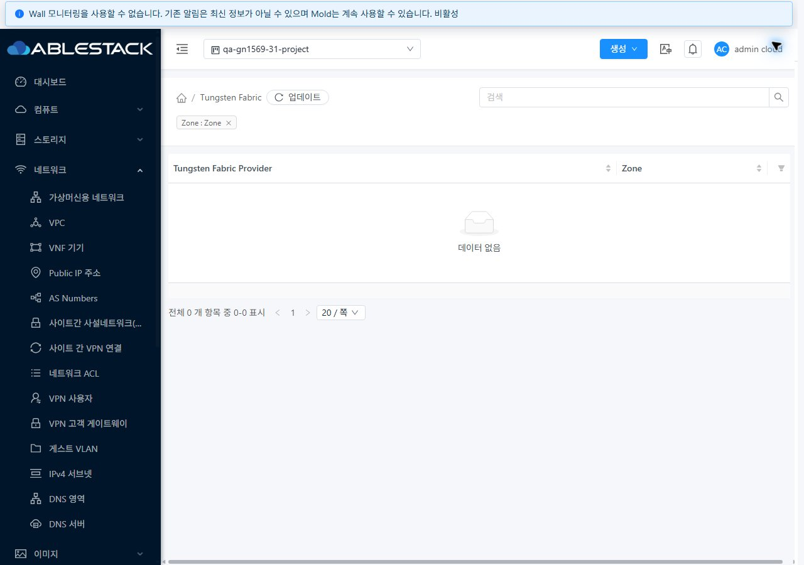
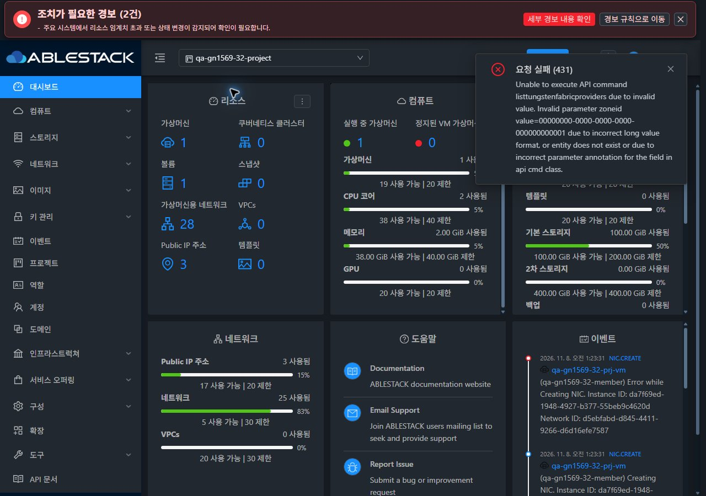
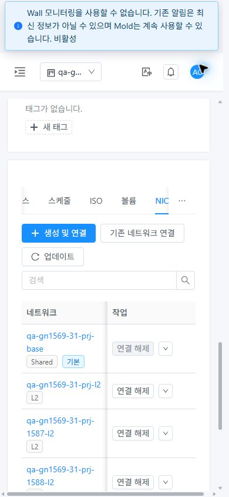
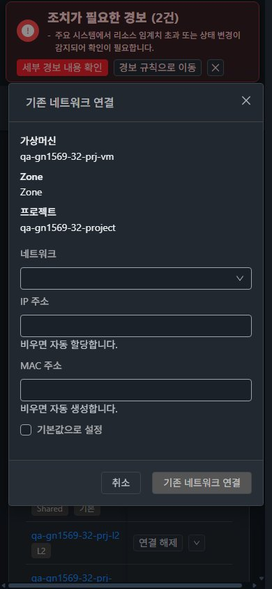

<!--
Licensed to the Apache Software Foundation (ASF) under one
or more contributor license agreements.  See the NOTICE file
distributed with this work for additional information
regarding copyright ownership.  The ASF licenses this file
to you under the Apache License, Version 2.0 (the
"License"); you may not use this file except in compliance
with the License.  You may obtain a copy of the License at

  http://www.apache.org/licenses/LICENSE-2.0

Unless required by applicable law or agreed to in writing,
software distributed under the License is distributed on an
"AS IS" BASIS, WITHOUT WARRANTIES OR CONDITIONS OF ANY
KIND, either express or implied.  See the License for the
specific language governing permissions and limitations
under the License.
 -->

# #1591 미등록 Tungsten 제공자의 Zone 조회 NPE 수정

2026-11-08, 31 GFS2·32 Glue RBD에서 재현·구현·배포 후 실제 UI/API로 검증했다. 구현 `8fc52194ff78c1360dffad8dc30536021c2fd4fc`, 기존 Epic #1554 브랜치 `dhslove/epic-1554-guest-networks`와 Draft PR #1577을 유지한다.

## 변경 내용

`TungstenProviderServiceImpl.listTungstenProvider`에서 Zone에 제공자가 없으면 응답 생성기를 호출하지 않고 빈 목록을 반환한다. 기존 제공자 응답 필드·전체 목록·Zone 필터·페이지 처리·권한·잘못된 UUID 검증은 유지한다. 변경은 서비스의 null 분기와 Java 회귀 테스트 2개 파일이다.

**UI 소스·레이아웃·테마는 변경하지 않았다.** 서버 오류가 정상 빈 목록으로 바뀌어 기존 UI가 빈 결과를 표시하도록 개선했다. 제공자 목록의 공통 ListView, 네트워크 상세의 조건부 탭, VM 목록/요약/NIC/대화상자/breadcrumb/모바일 테마를 기존 표준 그대로 대조했다. 목록·상세·탭·대화상자의 재배치나 새 스타일 적용을 완료한 것으로 보고하지 않는다.

정상 Zone의 미등록 제공자와 잘못된 Zone은 구분한다. API의 UUID→엔티티 변환 단계가 존재하지 않는 Zone을 431로 거부하므로 서비스에 별도 예외/권한 우회 분기를 추가하지 않았다. 응답 생성기의 인접 Zone 참조와 생성 경로도 확인했으며, 등록 실패는 기존 예외로 종료되고 등록되지 않은 제공자의 조회가 이번 재현 경로였다. 실제 영향이 확인되지 않은 다른 Tungsten API로 수정 범위를 확장하지 않았다.

## 실제 API 결과

관리자·소유자·일반 멤버·제한 멤버·도메인 관리자·peer·외부 계정 7개 역할 × 4조건 × 2클러스터 = 배포 전 56개, 배포 후 56개를 실행했다. [31 전](evidence/31-api-before.json)·[후](evidence/31-api-after.json), [32 전](evidence/32-api-before.json)·[후](evidence/32-api-after.json).

| 조건 | 수정 전 31/32 | 수정 후 31/32 |
| --- | --- | --- |
| 관리자·Zone 미지정·제공자 0 | 빈 목록 | 빈 목록 |
| 관리자·유효한 Zone·제공자 0 | 530 null 역참조 | 정상 빈 응답 `{}` (0개) |
| 관리자·존재하지 않는 UUID / 형식 오류 | 431 | 431 |
| 조회 권한이 없는 나머지 6개 역할 | 432 | 432 |

등록된 제공자의 응답 필드·2개 제공자의 전체 조회·다른 Zone의 빈 결과·빈 API 응답 count/이름은 로컬 Java 테스트로 검증했다. 실제 클러스터에는 제공자가 없으므로 등록된 Tungsten 제공자의 실환경 동작이나 정책·논리 라우터 데이터 평면의 성공을 주장하지 않는다. 환경 활성화나 가짜 제공자 등록 없이 결함을 해결했다.

## UI·표준 회귀

관리자 브라우저에서 Zone 필터 URL을 열어 실제 `listTungstenFabricProviders` 요청의 zoneid와 HTTP 200을 확인했다. [31 요청](evidence/31-ui-zone-provider-responses.json)·[32 요청](evidence/32-ui-zone-provider-responses.json). 두 화면 모두 데이터 없음·전체 0개를 표시한다. 존재하지 않는 Zone을 전달하면 양쪽 UI가 **요청 실패 (431)** 알림을 표시하고, 정상 Zone으로 돌아오면 빈 목록을 표시한다.

물리 네트워크 → 네트워크 서비스 제공자 → Tungsten은 비활성 상태다. 현재 플러그인이 꺼져 해당 탭은 목록 API를 생략한다. 이 화면의 데이터 없음과 실제 Zone 조회 API 성공을 혼동하지 않았고, 위의 Zone 필터 제공자 목록으로 별도 검증했다.

Isolated·L2·Shared 각 상세의 탭을 양쪽에서 확인했다. 현재 vlan 네트워크에는 Tungsten 정책/논리 라우터 탭이 표시되지 않고 VNF 연관 조회는 유지된다. 미구성 조건을 기능 오류로 집계하지 않았다. [유형별 탭](evidence/ui-conditional-tabs.json).

기본 보기↔QA 프로젝트 왕복, 네트워크 목록→상세, VM 목록→상세→NIC, breadcrumb의 VM 목록 복귀, NIC 네트워크 링크→네트워크 상세→VM 복귀를 실행했다. VM 복귀 시 필요하면 NIC 탭을 다시 선택했다. [프로젝트 전환](evidence/ui-project-switches.json)·[실제 링크 이동](evidence/ui-navigation.json).

제공자 목록은 390×844·768×1024·1280×900에서 양쪽 라이트/다크를 확인했다. 네트워크 상세/조건부 탭과 VM NIC/기존 네트워크 연결 대화상자도 모바일에서 대조했다. 버튼은 기존 VM의 주 작업→갱신 배치, 표 내부 가로 스크롤, 세로 폼과 취소/실행 footer를 유지한다. 대화상자는 열기·읽기·취소까지만 실행했으며 NIC를 추가하지 않았다. 관리자 UI 실행과 7개 역할 API 실행의 범위가 다르며 모든 역할×모든 폭의 UI 전수 회귀를 뜻하지 않는다.

원본 JPEG 48장과 치수·해시를 [캡처 목록](capture-matrix.ko.md)에 수록했다. 임시 뷰포트/네트워크 차단을 해제했고 31 라이트·32 다크, QA 프로젝트의 VM NIC 화면을 남겼다. 31에서 수행한 별도 브라우저 통신 차단 시험은 전역 Network Error/로그인 복귀 후 정상 로그인으로 복구했으며 Zone API의 응답 오류·복구 검증으로 대체 집계하지 않았다.

## 로컬 검증과 배포

- WSL ext4 `/home/ablecloud/work/dhslove/cloud-epic-1554`에서 변경 Tungsten Maven 모듈만 package, 관련 Java 10개 통과. [로그](evidence/module-build.log).
- 변경 Java 3개 파일의 cloud-style Checkstyle 위반 0. [결과](evidence/changed-checkstyle-result.json).
- 기존 조건부 탭·VM 네트워크 접근 UI 테스트 2 suites/21개 통과. [로그](evidence/ui-tests.log). UI 소스 변경이 없어 UI 재빌드·재배포는 수행하지 않았다.
- 전체 Cloud 빌드·GitHub Actions는 실행하지 않았다. 로컬 집중 검증을 전체 CI 성공으로 표시하지 않는다.
- 활성 `/usr/share/cloudstack-management/lib/cloudstack-4.23.0.0-ABLESTACK.Mold.jar`의 해당 클래스 1개를 반영하고 서비스 재시작. 나머지 204,656개 엔트리와 UI/서버 파일 665개의 동일성을 대조했다. 원본 JAR은 WSL ext4와 원격 작업 디렉터리에 보관했다.
- 양쪽 활성 JAR SHA256 `2faddb218741a22b1e83ff89337adb73e0a981d525c2bdc32c313b7bb33b8592`, 변경 클래스 SHA256 `bb103e774ca65ac62957bb4f910323d54d0224ed3917b7b13cbdee286b330219`.
- mold active·HTTP 200·WEB-INF 존재·기존 정적 자산 662개 해시 일치·FTCTL/최근 VM 네트워크 표식·최근 로그 linkage 오류 0을 확인했다. [31 배포](evidence/31-deployment.json)·[후](evidence/31-runtime-after.json), [32 배포](evidence/32-deployment.json)·[후](evidence/32-runtime-after.json).

## 보존과 후속

기존 확인용 자원은 모두 유지했다. 양쪽 VM Running·NIC 8개 UUID/IP/MAC/default·호스트·프로젝트 멤버/역할·프로젝트망 27/28개·프로젝트/peer 공유 2행을 대조했다. 이전 LB 각 5개 Active·SSL 인증서·FW/PF도 동일하다. 운영 망/사용자 VM/오퍼링 fingerprint는 31번 28/121/30, 32번 11/58/21에서 추가·누락·변경 0이다. [31 보존](evidence/31-preservation.json)·[32 보존](evidence/32-preservation.json), [추가 자원 31](evidence/31-extra-preservation.json)·[32](evidence/32-extra-preservation.json). 보호 대상 Windows FT 수정 diff SHA256도 전후 동일하다.

[확인용 자원·직접 링크](resources.ko.md). 별도 삭제 지시 전까지 남겨둔다.

**다음 #1569 남은 역할 통합 회귀·조건부 검증**이다. 우선 유형별 UI 생성·NIC 역할 조합과 기존 수정 이슈의 통합 회귀를 진행하고, 이후 LB health/AutoScale·TLS/제공자별 남은 조합 및 환경이 준비된 IPv6/BGP/Tungsten 항목을 검증한다. #1586은 별도 RBD 정리 후속이다. #1591만 완료 처리하며 Epic #1554·#1569와 Draft PR #1577은 유지한다.

전체 검토표 63행의 실패0·부분49·미실행5·환경차단6·적용 제외3 및 전체 행 성공0 집계는 유지한다. 가용성 API 결함을 수정했다고 미구성 Tungsten 기능을 성공으로 승격하지 않았다. [전체 검토표](../guest-network-1569-integrated/coverage.ko.md).
