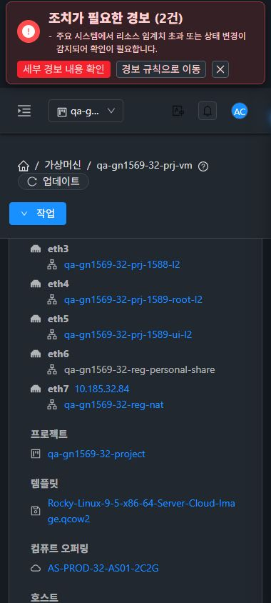
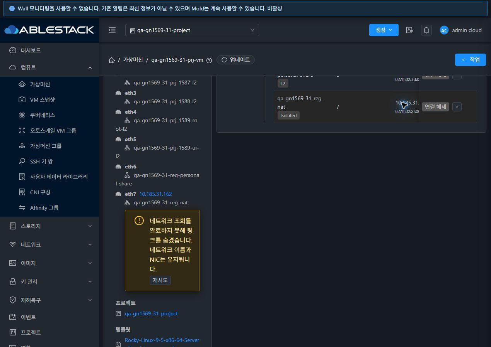

<!--
Licensed to the Apache Software Foundation (ASF) under one
or more contributor license agreements.  See the NOTICE file
distributed with this work for additional information
regarding copyright ownership.  The ASF licenses this file
to you under the Apache License, Version 2.0 (the
"License"); you may not use this file except in compliance
with the License.  You may obtain a copy of the License at

  http://www.apache.org/licenses/LICENSE-2.0

Unless required by applicable law or agreed to in writing,
software distributed under the License is distributed on an
"AS IS" BASIS, WITHOUT WARRANTIES OR CONDITIONS OF ANY
KIND, either express or implied.  See the License for the
specific language governing permissions and limitations
under the License.
 -->

# #1592 VM 요약과 NIC 탭의 네트워크 탐색 권한 일치

2026-11-08, 31 GFS2·32 Glue RBD에 UI 개선을 반영하고 실제 UI/API로 검증했다. 구현은 9a21bea91d1 → c16dde55511 → `018daa3cef89b505828a9c946b3a57312ce2d1cb`이며 기존 `dhslove/epic-1554-guest-networks`와 Draft PR #1577을 유지한다.

## 변경과 설계

변경 화면은 **컴퓨트 → 가상머신 상세 → 네트워크 요약(eth별 이름)**과 **NIC 탭의 네트워크 이름**이다. VM 공통 요약 필드·아이콘·기본 망 태그·목록/탭/작업 버튼·breadcrumb·기존 대화상자 구조를 유지했다. 새 화면이나 별도 테마를 만들지 않았다.

`vmNetworkAccess` 공통 조회를 두 위치에서 사용한다. 현재 사용자/세션/역할/API 목록/프로젝트/VM/Zone/경로를 키로, 마운트된 소비자끼리만 결과와 진행 중 요청을 공유한다. VM 소유 프로젝트를 명시하고 `ignoreproject`로 요청 범위를 고정한다. 선택 프로젝트나 경로의 VM ID가 리소스와 맞지 않으면 링크를 만들지 않는다. 늦은 응답은 세대와 소비자 생존 여부로 폐기하고 마지막 소비자가 사라지면 캐시를 제거한다.

조회는 NIC마다 실행하지 않고 현재 범위의 `listNetworks`를 500개 단위로 완전히 읽은 후 게시한다. NIC 탭 갱신도 요약에 즉시 반영된다. 실제 [31 요청 기록](evidence/31-batch-network-requests.json)·[32 요청 기록](evidence/32-batch-network-requests.json)은 자동 갱신을 포함하며 개별 network id 조회가 0건이다. 진행 중 중복 조회 공유와 페이지 중간 실패의 비게시도 단위 테스트로 검증했다.

정상 조회에서 대상 망이 없으면 아이콘/이름/NIC/default/IP/MAC는 유지하고 이름을 일반 텍스트로 표시한다. 로딩 표시와 조회 오류를 구분하며, 오류 시 이전 허용 링크도 숨기고 요약에 안내·재시도 버튼을 표시한다. 재시도 성공은 두 위치에 함께 반영되고 NIC 탭에 오래된 오류 안내가 남지 않는다. VM 수정/연결 해제 권한은 기존 API·NIC 작업 판정을 유지한다.

## 실제 검증 결과

| 상태 | 31 요약/NIC 링크 | 32 요약/NIC 링크 | 확인 |
| --- | --- | --- | --- |
| 미공유(프로젝트 공유 없음, 기존 NIC 유지) | 0/0 | 0/0 | 이름과 8개 NIC 보존·정상 조회이므로 오류 안내 없음 |
| 프로젝트 공유 부여 | 1/1 | 1/1 | API 조회 가능과 UI 링크 일치 |
| 공유 회수 | 0/0 | 0/0 | 기존 NIC 보존·신규 연결 API permission denied |
| 공유 재부여 | 1/1 | 1/1 | 제한 멤버의 실제 요약 링크 이동→상세→VM 복귀 |
| 조회 통신 실패 | 0/0 | 0/0 | 이름/NIC 유지·오류 안내와 재시도 |
| 통신 복구 후 재시도 | 1/1 | 1/1 | 요약/NIC 함께 복구·NIC 오류 안내 0개 |

미공유는 이번 회귀 시작 시 프로젝트 공유가 없는 상태다. 이미 연결된 확인용 NIC를 보존한 조건이며 최초 미연결 VM 배포와 같은 의미로 보지 않는다.

API는 관리자·소유자·일반 멤버·제한 멤버·도메인 관리자·비멤버(peer)·외부 계정의 7개 역할로 각 상태를 대조했다. 프로젝트 멤버 5개 역할은 VM/NIC 조회가 유지되고 망은 공유 부여/회수에 따라 1/0이다. peer/외부 계정은 해당 프로젝트 망/VM 요청이 거부됐다. 회수 후 새 NIC 연결 시 양쪽 530 `permission denied`를 확인했고 8개 NIC의 동일성을 다시 대조했다. 중복 NIC 오류를 권한 거부로 대체하지 않았다.

UI는 관리자·소유자·일반/제한 멤버·도메인 관리자·peer를 양쪽에서 확인했다. peer의 프로젝트 선택 항목은 없고 VM 직접 URL은 대시보드로 복귀했다. 일반 멤버의 회수된 네트워크 직접 URL도 상세 데이터 없이 복귀했다. 재부여 후 제한 멤버는 실제 링크로 네트워크 상세를 열고 뒤로 돌아와 1/1을 확인했다. 외부 계정은 API로 확인했으며 모든 역할×모든 화면 폭의 전수 실행을 뜻하지 않는다.

관리자 UI의 390/768/1280px 라이트/다크, 모바일 프로젝트 기본 보기↔QA 왕복, VM 목록→상세→NIC 및 breadcrumb 복귀를 확인했다. 다른 프로젝트로 이동할 때 이전 VM 이름/NIC가 남지 않고, 돌아오면 새 조회 결과를 사용한다. 폼/목록 구조 변경은 없으며 모바일 내부 스크롤과 표의 가로 스크롤을 기존 VM 표준대로 유지한다.

조회 실패는 이 시험 탭의 `listNetworks`만 개발자 도구로 잠시 차단해 실행했다. 실패와 복구를 캡처하고 차단은 해제했다. 페이지 테마는 원래의 31 라이트·32 다크로, 뷰포트도 원복했다. 경로/프로젝트/로그인/역할 전환 중 늦은 응답 차단과 이전 VM 데이터가 로딩 중일 때의 경로 불일치는 집중 테스트로 추가 확인했다.

## 빌드·배포·보존

최종 UI 집중 4개 suite·33개 테스트와 변경 UI lint, WSL ext4의 로컬 production build가 통과했다. [테스트 로그](evidence/ui-tests.log) · [명령/종료 코드](evidence/ui-tests-result.json) · [UI 빌드](evidence/ui-build-result.json). 서버 소스/JAR 변경·Maven·전체 Cloud 빌드·Actions는 실행하지 않았다.

양쪽 활성 webapp의 정적 파일 662개 해시를 대조했다. WEB-INF/META-INF·런타임 설정·mold PID를 보존했고 HTTP 200·FTCTL 표식을 확인했다. 활성 JAR SHA256은 배포 전후 모두 `05f9c10e31d5755cb5d024b7ad7468501d349c658cfc305b0905e46c5fe77add`다. [31 런타임](evidence/31-runtime-after.json) · [32 런타임](evidence/32-runtime-after.json).

운영 망/VM/오퍼링은 31번 28/121/30, 32번 11/58/21의 UUID/내용을 보존했다. 시험 프로젝트 망 27/28개·VM 각 1대·원래 8개 NIC·호스트/default/IP/MAC·멤버십/역할과 이전 LB/FW/PF/인증서를 보존했다. 해당 프로젝트/peer 공유 2행을 복원했다. 네트워크/VM/NIC를 새로 생성하거나 삭제하지 않았다. [확인용 자원](resources.ko.md).

## 후속 순서

**#1592 완료 → #1591 미등록 제공자 조회 개선 → #1569 남은 역할·조건부 회귀**. #1586 RBD 물리 정리는 별도 후속이다. Epic #1554·#1569와 Draft PR #1577은 열린 상태를 유지한다. M02의 알려진 결함을 해소해 부분 검증으로 갱신한다. 전체 63행은 실패 0·부분 49·미실행 5·환경 차단 6·적용 제외 3이며 전체 행 성공은 0이다.

[원본 캡처 82장](capture-matrix.ko.md) · [전체 63행 검토표](../guest-network-1569-integrated/coverage.ko.md)
