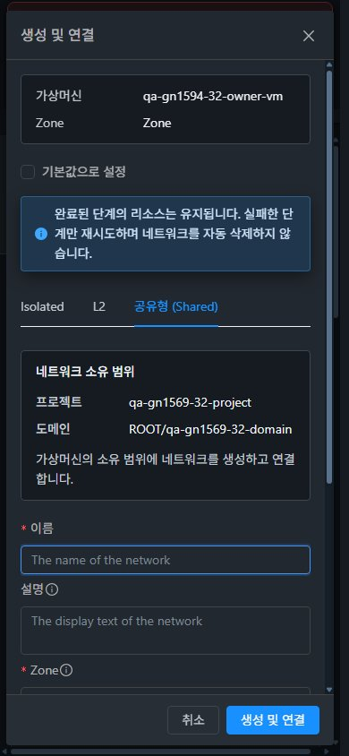

# #1594 네트워크 생성 소유 문맥 UI 개선 (2026-11-08)

Isolated·L2·Shared의 생성 대화상자에 **실제로 생성할 소유 계정·프로젝트·도메인**을 표시했다. 관리자 owner 선택과 VM 내 고정 소유 범위를 함께 지원하며 목록 조회 필터를 생성 소유자로 오해하지 않게 설명한다. **API/Java 소스 수정·JAR 배포는 없다.** 구현 커밋은 `31e140aa7846e81a275227de58ca5fd77775094e`이다.

## 변경 UI와 VM 표준 적용

| 화면 | 변경 내용 | 반영한 VM 표준 |
| --- | --- | --- |
| 네트워크 추가 → Isolated/L2/Shared | 이름 입력 위에 공통 소유 범위 metadata를 표시. 기본 보기의 개인 계정, 선택 프로젝트, 관리자 owner 선택을 실제 form 소유값에 맞춰 갱신 | VM NIC 연결 대화상자의 metadata/설명·기존 MoldDialog·세로 양식 순서 |
| VM → NIC → 생성 및 연결 | 상단 VM/Zone을 유지하고 중복된 기존 owner metadata를 제거. 각 유형 양식 안에서 VM 소유 프로젝트/도메인을 한 번만 표시 | 기존 VM 탭의 버튼·검색·표 배치와 대화상자 폭·footer 동작 |
| Shared All/Domain | 생성 소유자는 시스템 계정, 사용 범위는 전체/도메인으로 구별. 도메인·하위 도메인 허용 표시 | 동일한 metadata label/value 구조와 설명 색상 |
| 소유 문맥 변경 | active project·로그인 역할·고정 VM 소유 범위 변경 시 기존 생성창 닫기, 자식 양식 비활성화 및 제출 차단 | 기존 화면 이동의 대화상자 정리 정책 |

공통 `NetworkOwnerContext.vue`는 표시 전용이며 API 조회를 추가하지 않는다. `projectid`가 일치하는 현재 프로젝트/VM/이미 조회한 선택지에서만 이름을 표시한다. route query의 문자열은 소유자로 사용하지 않는다. 추가 권한 조회나 접근 불가 프로젝트 이름 조회를 하지 않는다. 준비 중에는 과거 owner를 보여주지 않는다. 이름이 현재 데이터에 없는 도메인은 정확한 UUID를 표시한다. 예를 들어 root가 QA 프로젝트를 선택한 일반 생성창은 도메인 UUID, VM 내 생성은 VM이 가진 `ROOT/qa-gn1569-…-domain`을 표시한다.

기존 `--ui-bg-page`, `--ui-border`, `--ui-text-primary/secondary`를 사용했다. metadata grid는 104px/나머지 너비, 모바일 96px/나머지 너비이며 긴 이름·UUID는 줄바꿈한다. 별도 리본·전역 테마를 만들지 않았다. 목록·상세·탭·breadcrumb·툴바·기존 연결 대화상자의 배치는 유지했다. #1593의 다크 NIC 고정 작업 열 수정도 유지한다.

## 실제 UI 생성·연결과 소유권 대조

| 실제 UI 경로 | 클러스터별 Isolated/L2/Shared | 양쪽 합계 |
| --- | --- | --- |
| root 기본 보기 → QA owner 계정 선택 → 개인 생성 | 각 3건 | 6건 |
| root QA 프로젝트 선택 → 네트워크 생성 | 각 3건 | 6건 |
| root **기본 보기** → QA 프로젝트 VM → 생성 및 연결 | 각 3건 생성 + 3건 NIC 연결 | 6건 생성 + 6건 NIC 연결 |

**네트워크 생성 18건·NIC 연결 6건을 실제 UI에서 제출**했다. 브라우저 요청 24건 모두 HTTP 200·오류 0이다. 제출 전 소유 문맥, 브라우저의 실제 owner/project 요청값, 생성 결과의 project/account/domain/offering을 18건 모두 대조했다. 6개 NIC 비동기 작업은 모두 성공이며 job의 VM/호출자 admin/네트워크가 일치한다. 기본 NIC와 IP/MAC을 보존했다. 특히 VM 내 생성은 헤더가 기본 보기여도 **VM의 QA 프로젝트**에 생성·연결됐다.

검증용 새 VM 2대의 최초 1 NIC 배포 준비에는 기존 API를 사용했다. 이 준비와 위의 실제 UI 생성/연결을 구분한다. VM별 최종 4 NIC의 API MAC은 호스트 libvirt 인터페이스와 일치한다. 이 이슈에서는 DHCP/DNS/게스트 통신이나 LB 백엔드 트래픽을 새로 시험하지 않았다.

[18건 소유 문맥](evidence/ui-owner-contexts.json) · [실제 UI 요청 24건](evidence/ui-wire.json) · [31 UI/API 결과](evidence/31-ui-api-audit.json) · [32 UI/API 결과](evidence/32-ui-api-audit.json).

## 역할·프로젝트 전환·화면 이동

| 역할 | 양쪽 실제 UI 결과 |
| --- | --- |
| Admin·owner·member·직접 멤버 아닌 DomainAdmin | 생성·생성 및 연결·기존 연결 버튼 허용, 4 NIC 읽기. 프로젝트 생성창 3유형의 QA 소유 표시 |
| readonly·user-only | 생성·연결 버튼 숨김, 4 NIC 읽기 유지 |
| peer·outsider | QA VM 직접 URL은 대시보드로 이동, VM 상세 없음. 접근 불가 QA 프로젝트 목록 필터는 읽기 오류. 기본 보기의 개인 생성은 허용되고 3유형 모두 **현재 개인 계정** 표시 |

8역할 × 31/32 = **16개 고유 역할 UI 사례**와 **48개 고유 역할/소유 범위/유형 미리보기**를 확인했다. 개인/프로젝트 owner·member 전환도 포함한다. peer/outsider의 접근 불가 프로젝트 필터에서 제출은 하지 않았다. 31 peer의 listZones는 projectid 없는 정상 HTTP 200으로, 필터가 생성 소유권으로 전파되지 않는다. 기존 서버 권한 검사는 그대로이며, 직접 거부 API 48건은 [직전 통합 역할 결과](../guest-network-1569-roles-20261108/README.ko.md)에 남겼다. 이번 새 쓰기 요청은 위 root UI 24건이다.

기본 보기↔QA 및 다른 하위 프로젝트로 실제 헤더를 전환하고 새 생성창에 해당 프로젝트 이름이 표시됨을 확인했다. 대시보드 이동 시 생성 대화상자가 사라지고 이전 NIC 화면이 제거된다. breadcrumb → VM 목록 → 같은 VM → NIC로 돌아온 후 4행 표시와 대화상자 0개를 확인했다. navigation 기록의 최초 rows=0은 초기 비동기 로딩 시점이며 `breadcrumb-return-settled-NIC`의 rows=4가 최종 상태다. 열린 modal이 헤더를 가리므로 숨은 store를 브라우저에서 조작하지 않았다. **열린 상태의 project 변경 즉시 비활성화/닫기/제출 차단은 집중 단위 테스트로 별도 검증**했다.

역할 raw 기록 18건/미리보기 raw57건은 일부 읽기 재시도 관찰을 포함한다. `(cluster, role[, scope, type])`별 마지막 관찰로 중복을 제거한 16/48건과 raw 자료를 모두 보관했다. 실제 생성/연결에는 중복 요청이 없다.

[역할](evidence/ui-role-gates.json) · [48 미리보기](evidence/ui-role-previews.json) · [프로젝트 전환](evidence/ui-project-switches.json) · [화면 이동](evidence/ui-navigation.json) · [최종 화면](evidence/ui-final-state.json).

## 반응형·다크모드와 캡처

31/32 × 세 유형 × 390×844·768×1024·1280×900 × 라이트/다크 = **36조합**을 확인했다. owner metadata 좌우 경계가 viewport 안에 있고 grid 가로 넘침은 1px 이내다. 라이트 배경 `rgb(245,247,250)`·문자 `rgb(31,41,55)`, 다크 배경 `rgb(22,27,34)`·문자 `rgb(240,243,246)`를 실제 계산 스타일로 기록했다. 긴 도메인 UUID가 줄바꿈되고 모바일/다크에서 label·설명·입력·footer를 읽을 수 있다. VM 내 고정 소유 모바일 다크도 별도 캡처했다.

**원본 JPEG 140장**을 편집/리사이즈 없이 보관하고 실제 viewport·픽셀 크기·시그니처·해시를 대조했다. 32 배포 전 비교 1장과 배포 후 139장이다. 반복 캡처 149기록은 `(cluster,label)`별 마지막 140장으로 정리했다. 최종 브라우저는 관리자/QA 프로젝트/새 VM NIC 4개이며 임시 viewport override를 해제했다. 31 라이트·32 다크의 실제 크기는 모두 1680×841이다.

[36조합 측정](evidence/ui-viewport-checks.json) · [전체 캡처 목록](capture-matrix.ko.md).

## 로컬 빌드·정적 UI 배포

WSL ext4 `/home/ablecloud/work/dhslove/cloud-epic-1554`에서 변경 Vue/JS lint와 **집중 UI 테스트 4 suites/26개**가 통과했다. 그중 새 8개는 표시/개인·프로젝트·VM 소유·Shared 시스템/범위·pending·프로젝트 변경 제출 차단·목록 필터 유지 계약을 검증한다. UI 로컬 production 빌드도 성공했으며 기존 asset/entrypoint 크기 경고 2개가 있다. 전체 Cloud/Maven 빌드·Actions 수동 실행은 하지 않았다.

양쪽 활성 `/usr/share/cloudstack-management/webapp`에 정적 자산 **662개·29,956,684 bytes**만 반영했다. 파일별 SHA256 불일치 0, `index.html`은 `fea420a479a95d7242bed6d2cf07dce2d554116064eefdbcac755eeaec3f349a`다. WEB-INF/META-INF·실제 config·기존 이미지·서버 파일·mold PID를 보존했고 전후 HTTP 200이다. webapp 루트 교체/삭제나 rsync --delete는 사용하지 않았다. 백업은 WSL ext4 `/home/ablecloud/work/guest-network-1594-validation/backups/20261108-143856/31` 및 `/32`에 있다.

관리 JAR은 기존 `2faddb218741a22b1e83ff89337adb73e0a981d525c2bdc32c313b7bb33b8592`와 동일하다. 서버 파일 204,656항목/기존 클래스 해시가 동일하고 mold active·HTTP 200·WEB-INF·기존 FTCTL 및 새 `network-owner-context`/`scopeInvalidated` 표식, 최근 15,000 로그 행의 linkage 오류 0을 확인했다. [31 배포](evidence/31-deployment.json) · [32 배포](evidence/32-deployment.json) · [31 런타임](evidence/31-runtime-after.json) · [32 런타임](evidence/32-runtime-after.json) · [테스트](evidence/tests.log) · [빌드](evidence/ui-build.log).

## 보관 자원·후속

이번 **네트워크 18개·VM 2개(각 4 NIC)**를 확인용으로 남긴다. 기존 원래 VM 각8 NIC·직전 r2 VM 각4 NIC·IP/MAC/default·호스트·멤버/역할/한도·LB 각5개 Active·인증서·FW/PF·공유2행·운영 자원을 보존했다. QA 프로젝트 네트워크는 39→45/40→46, QA owner 개인 네트워크는 양쪽8→11개이며 망 한도50은 그대로다. 이전 자원은 삭제하지 않았다. [자원 목록과 직접 링크](resources.ko.md).

**#1594는 완료 처리하고 다음은 #1569의 Skudonet 실제 UI 배포·연관 장비/NIC·실패 복구 및 남은 역할·조건부 조합**이다. 이후 L2 ConfigDrive/PVLAN·VPC·제공자 조건을 넓히며 IPv6/BGP/Tungsten은 실환경 준비 후 검증한다. #1586은 별도 RBD 정리 후속이다. [63행 커버리지](../guest-network-1569-integrated/coverage.ko.md)는 실패0·부분49·미실행5·환경차단6·제외3·전체행성공0을 유지한다. 소유 문맥 개선만으로 광범위 행 전체를 성공 처리하지 않는다. Epic 브랜치 `dhslove/epic-1554-guest-networks`·기존 Draft PR #1577 및 Epic/#1569 Open을 유지한다.
