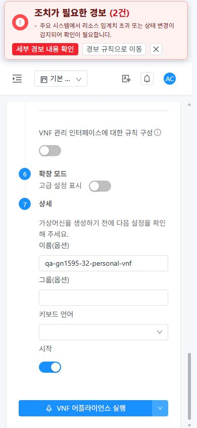
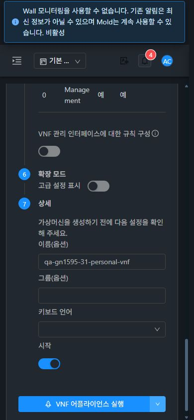

# #1595 VNF 기본 배포 실행 차단 개선·31/32 검증 (2026-11-08)

**고급 설정을 열지 않아도 User Data 기본 ‘설정 안함’으로 VNF를 배포할 수 있도록 개선했다.** 31 GFS2·32 Glue RBD에서 프로젝트/개인 배포를 실제 UI로 각각 실행했고 **새 VNF4대 모두 Running, 비동기 작업4건 성공**이다. 확인용 자원은 삭제하지 않았다.

구현 커밋 `f2935ac7153`은 `DeployVnfAppliance.vue`와 집중 테스트만 변경한다. **API/Java·관리 JAR·공통 User Data consumer·CSS 변경은 없다.** Epic 브랜치 `dhslove/epic-1554-guest-networks`와 기존 Draft PR #1577을 유지한다.

## 변경한 UI와 VM 표준

- **VNF 어플라이언스 추가 → 데스크톱 요약 카드/모바일 하단 실행 버튼:** 선택 UUID가 없는 기본 ‘설정 안함’은 선택기가 고급 영역에 mount되기 전에도 실행 가능하다. 고급 영역 열기/닫기만으로 활성 상태가 바뀌지 않는다.
- **고급 → 저장된 User Data:** 요청한 UUID 또는 prefill이 있으면 기존 공통 ready 검사를 유지한다. 조회 중·실패·삭제된 UUID는 차단하며, 고급 영역을 닫아 오류를 숨겨도 미해결 선택을 제출하지 않는다. ‘설정 안함’ 선택은 prefill·기존 UUID·변수값을 정리한다.
- **소유/Zone/템플릿 전환:** 양식의 최초 소유를 고정 비교하고 프로젝트 변경 중 이전 양식의 제출을 막는다. Zone/템플릿 변경 시 이전 User Data/변수값을 정리하며, 비동기 form 검증을 마친 뒤에도 소유·Zone·템플릿을 다시 비교한다.

VM과 같은 **DeployButtons·InfoCard·세로 배포 단계·모바일 footer**를 유지했다. 이번 개선은 실행 상태 판정과 선택 수명 관리이며 새 레이아웃을 만들지 않았다. 양쪽 실제 VM 메뉴의 목록→상세→NIC→기존 연결창→취소→breadcrumb 목록 복귀를 비교했다. 390px 연결창은 31 다크/32 라이트 모두 폭366·높이606, x12~378/y119~725로 화면 안에 들어간다. 기존 MoldDialog metadata/세로 입력/하단 버튼/테마 배경을 확인했다.

## 실제 UI·API·작업 검증

| 검증 | 31 | 32 |
| --- | --- | --- |
| 프로젝트 기본 배포, 고급 설정 미사용 | UI 제출→Running / GFS2 | UI 제출→Running / RBD |
| 개인(admin/기본 보기) 기본 배포, 고급 설정 미사용 | 모바일 다크 UI 제출→Running | 모바일 라이트 UI 제출→Running |
| 개인 배포 양식 1280×900 / 768×1024 / 390×844 × 라이트/다크 | 6조합, 버튼 활성/화면 안/문서 넘침 없음 | 동일6조합 |
| None에서 고급 열기→닫기 | 실행 활성 유지 | 동일 |
| 등록 UUID 선택 후 읽기 대기·503 오류 | 선택 보존·실행 차단 | 동일 |
| 오류 상태에서 고급 닫기 | 선택기 unmount 뒤에도 실행 차단 | 동일 |
| 고급 다시 열기·정상 서버 재조회 | 같은 UUID 재검증·실행 복구 | 동일 |
| 선택한 User Data가 있는 양식에서 QA→다른 프로젝트→QA | dashboard/이전 선택기·버튼 제거, QA VNF2 복귀 | 동일 |
| 390px VM 화면에서 QA→기본 보기→QA | 이전 NIC/창0, 개인 VNF Running 확인 | 동일 |
| VM 표준 목록·상세·NIC·연결창·breadcrumb | 다크/모바일 포함 | 라이트/모바일 포함 |

실제 UI 배포의 template/owner/network 및 job 결과를 대조했다. 네 VM은 기본 NIC1·올바른 소유와 템플릿·Ready 루트 볼륨이며 31은 SharedMountPoint(GFS2),32는 RBD다. **원본 배포 POST/응답은3건을 보존했다. 32 개인 배포의 원본은 로그인 후 CDP 관찰이 끊겨 보존되지 않았다.** 해당 실행은 UI 제출/진행/Running 목록, 관리 DB의 원래 DeployVnf 작업 UUID·호출자 admin·API 성공 결과·VM/NIC/볼륨으로 대조했으며 요청4건 모두 보존했다고 주장하지 않는다.

선택 데이터 오류 시험은 **브라우저의 listUserData XHR 한 건만** 대기시킨 후 HTTP503 JSON을 응답했다. 서버·권한·API 구현을 중단/변경하지 않았다. 양쪽 raw interception을 해제한 뒤 실제200 조회로 복구했다. 기본 None은 User Data 조회가 불필요하고 실제 기본 배포 POST3건에 userdataid가 없다. User Data 준비용 등록·개인 템플릿/망 생성은 API이고, **VNF 배포4건은 UI**다.

프로젝트 선택 직후 첫 DOM 표본에는 이전 버튼 속성이 한 프레임 남아 있었고 전환 완료 후 양식이 제거됐다. **상태 변경 즉시의 제출 가드·비동기 검증 도중 문맥 변경·삭제 UUID 차단은 집중 테스트**, 실제 프로젝트 화면 정리·복귀는 브라우저로 확인했다. 이를 역할 전체 API 회귀나 선택 User Data를 포함한 실제 추가 배포로 확대하지 않는다.

[31 배포/작업/볼륨](evidence/31-deployments-audit.json) · [32 배포/작업/볼륨](evidence/32-deployments-audit.json) · [UI 동작](evidence/ui-actions.json) · [UI 요청](evidence/ui-wire.json) · [12개 viewport 측정](evidence/ui-layouts.json) · [원본46캡처](capture-matrix.ko.md).

## 로컬 검증·배포·자원 보존

WSL ext4에서 lint와 집중 테스트 **3 suites/104개**, production UI 빌드가 통과했다. 기본 None/선택 UUID/prefill/대기·실패·삭제/재조회/숨김/Zone·템플릿·프로젝트 전환/검증 대기 중 변경과 기존 VM·Reset·AutoScale 공통 선택 계약을 검증했다. 빌드의 기존 asset/entrypoint 크기 경고2와 테스트의 기존 아이콘 중복 등록 경고를 기록했다. 전체 Cloud/Maven 빌드·GitHub Actions 수동 실행은 없다.

활성 `/usr/share/cloudstack-management/webapp`의 **정적662개 / 29,957,844bytes**만 갱신했고 해시 불일치0이다. index는 마지막에 교체했다. WEB-INF/META-INF 서버 파일·실제 config·이미지·mold PID를 보존하고 배포 전후 HTTP200을 확인했다. WSL ext4에 교체 전 정적 백업을 보관했다. 최신 VNF 가드와 기존 FTCTL/네트워크 표식이 활성 번들에 있다. 관리 JAR SHA256 `2faddb218741a22b1e83ff89337adb73e0a981d525c2bdc32c313b7bb33b8592`는 그대로이고, 양쪽 mold active·최근15,000행 linkage 오류0이다.

기존 각 QA 프로젝트 VM4/19 NIC와 운영·개인 VM/NIC/호스트/상태를 대조해 보존했다. 기존 망45/46개와 다른 개인 망의 ID/소유/오퍼링/상태/주소, 멤버십·한도도 그대로다. 새 VNF는 각 프로젝트1/개인1이며 프로젝트는 현재 VM5/20 NIC다. 새 개인 망/템플릿과 등록 User Data는 각각 양쪽1개씩 보관한다. 이전 #1569 VNF는 각3 NIC를 유지한다. LB 백엔드 분산·DHCP/DNS/게스트 통신을 이번 UI 결함의 성공 조건으로 추가하지 않았다.

캡처는 실제 viewport·JPEG 디코딩 크기·SHA256을 대조했다. 초기31 VM 모바일 파일명의1280px 표본은 데스크톱 기록으로 구분하고 실제390px로 재촬영했다. 테마/크기 변경 직후 affix 위치가 갱신되기 전 표본은12조합에 넣지 않았다. 임시 크기/가로챔을 해제하고 31은1680×897,32는1680×841의 새 프로젝트 VNF NIC 화면을 남겼다.

[테스트 결과](evidence/tests-result.json) · [테스트 로그](evidence/tests.log) · [빌드 결과](evidence/ui-build-result.json) · [빌드 로그](evidence/ui-build.log) · [31 배포](evidence/31-deployment.json) · [32 배포](evidence/32-deployment.json) · [31 런타임](evidence/31-runtime-after.json) · [32 런타임](evidence/32-runtime-after.json) · [31 보존](evidence/31-preservation.json) · [32 보존](evidence/32-preservation.json) · [확인 자원/직접 링크](resources.ko.md).

## 후속 순서

**#1595 완료 → #1596 VNF 요약/NIC 네트워크 링크 → #1597 프로젝트 IP 후보 조회 계약 → #1598 중복 NIC 추가창 → #1569 잔여 역할·실패·조건부 회귀** 순서다. #1597의 root 프로젝트 IP 후보531은 이번에도 남았고 자동 IP 기본 배포는 성공했다. 정책 플래그를 바꾸지 않았다.

#1569에는 32 일반 VM 전용 L2 대조군 VNF0 UI, L2 ConfigDrive/PVLAN·VPC 및 VNF의 남은 역할/실패 조건이 남는다. IPv6/BGP/Tungsten은 실제 환경 준비 후, #1586 RBD 정리는 별도다. #1596/#1598이 남으므로 C06/M02 실패와 X06 부분은 유지하며 **63행 실패2·부분47·미실행5·환경차단6·제외3·전체행성공0**이다. #1595만 완료 처리하고 Epic/#1569는 Open으로 유지한다.
