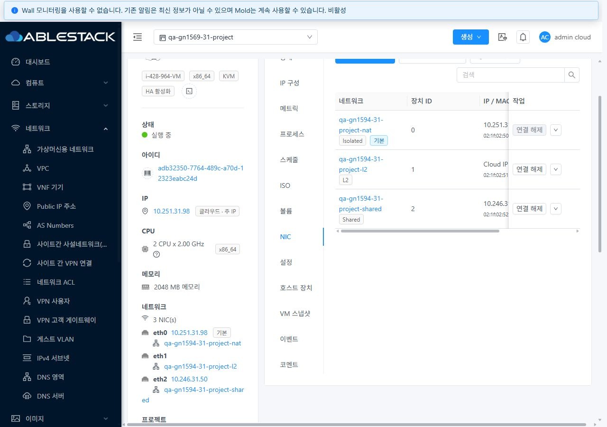
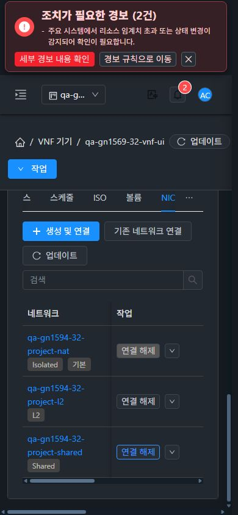

# #1596 VNF 요약·NIC 네트워크 링크 개선 및 31/32 검증

**VNF 요약과 NIC가 같은 접근 가능한 네트워크 목록을 사용하도록 개선했다.** 31 GFS2·32 Glue RBD에서 Isolated/L2/Shared의 요약3개·NIC3개 링크 표시와 실제 상세 이동, 공유 회수/복원, 조회 실패/재시도, 역할·프로젝트·화면 이동을 확인했다. 기존 Epic 브랜치 `dhslove/epic-1554-guest-networks`와 Draft PR #1577을 유지한다.

구현 커밋은 `7a6714b50e8b73fc03e4800543ce7eb19b06ea0a`이다. UI source3개와 집중 테스트2개만 변경했다. **API/Java/JAR/CSS 변경은 없다.** 시험 자원은 삭제하지 않았다.

## 변경 UI와 VM 표준

| UI | 개선 내용 | 적용한 표준 |
| --- | --- | --- |
| VNF 상세 왼쪽 요약 → 네트워크 | VNF 경로에서 무조건 링크를 표시하던 우회를 제거하고 실제 조회 결과로 판정 | 기존 VM InfoCard의 장치명·IP·유형·기본 NIC 표시와 링크 스타일 |
| VNF 상세 → NIC 탭 → 네트워크 이름 | `/vnfapp/:id`도 VM과 같은 scope로 조회하여 허용된 네트워크 상세 링크 표시 | 기존 VmNicsTab 표·주 버튼 뒤 갱신·검색·고정 작업 열·모바일 수평 스크롤·테마 배경 |
| VNF NIC 업데이트 | `listVnfAppliances`의 `virtualmachine` 응답으로 갱신. 일반 VM은 기존 `listVirtualMachines` 유지 | 기존 버튼/로딩/행 보존·오류 안내/재시도 흐름 |
| 링크 조회 실패·권한/문맥 변경 | 요약/NIC의 링크를 함께 숨기고 기존 NIC 데이터 유지, 재조회 성공 시 함께 복구 | #1592의 VM 공통 접근 판정/수명 관리 재사용 |

VM/VNF route family와 실제 resource ID·Zone·프로젝트·로그인 사용자/역할/token/API 목록을 scope에 포함한다. 임의 경로, meta/param ID 충돌, 다른 리소스 또는 프로젝트에는 기존 snapshot을 사용하지 않는다. VNF 응답이 거부/비정상일 때 일반 VM API로 우회하지 않는다.

새 리본이나 레이아웃을 만들지 않았다. 양쪽 **VM 목록→상세→NIC→기존 네트워크 연결창→취소→breadcrumb 목록 복귀**를 실제 UI로 비교했다. 모바일 VM 연결창은 390×844에서 폭366·높이606이고, VNF에서 L2를 선택한 연결창은 폭366·높이626으로 설명 문구만큼 높이가 늘지만 화면 안에 들어간다. 소유/Zone 메타데이터·세로 입력·하단 버튼과 테마 스타일을 유지한다. VM은4 NIC/링크8개로 그대로이며 갱신 API도 유지된다.

## 수정 전 사실 확인

원래 #1596은 요약/NIC 모두 링크가 없다고 기록했지만 **이번 배포 직전 두 클러스터의 실제 DOM은 요약3개 / NIC0개 / NIC3행이었다.** InfoCard가 VNF에서 권한 조회를 우회하는 분기와 `/vm` 전용 scope가 함께 있었다. 따라서 이번 변경은 NIC 링크 복구와 요약의 무조건 표시 제거를 함께 처리한다. 이전 이슈의 재현 문장을 현재 측정으로 덮어 성공 근거로 삼지 않는다.

[31 수정 전](screenshots/31-before-summary3-NIC0.jpg) · [32 수정 전](screenshots/32-before-summary3-NIC0.jpg).

## 실제 UI·API 검증

| 검증 | 31 | 32 |
| --- | --- | --- |
| 기존 Skudonet 3 NIC VNF | 요약3/NIC3 링크, NIC3행 | 동일 |
| Isolated/L2/Shared × 요약/NIC 클릭·뒤로·상세 | 실제 이동6건, 목적 UUID/이름 일치 | 동일6건 |
| NIC 업데이트 읽기 API | VNF 전용 API200, 일반 VM fallback 없음 | 동일 |
| 네트워크 목록 XHR 한 건 대기/HTTP503 | 링크0+0, NIC3/IP/MAC 보존 | 동일 |
| 오류 안내의 재조회 → 실제 서버200 | 요약3/NIC3 링크 복구 | 동일 |
| #1595 시험 VNF에 기존 공유 L2 NIC 연결 | UI POST/job1 성공, 1→2 NIC | 동일 |
| 프로젝트 공유 회수 → 업데이트 → 복원 | 링크2+2 → 1+1 → 2+2, NIC2행 유지 | 동일 |
| 읽기 전용 실제 UI 로그인 | 요약3/NIC3, 생성·연결 버튼 없음 | 동일 |
| 비회원 실제 UI 로그인·VNF 직접 URL | dashboard로 차단, 이전 링크/NIC0 | 동일 |
| 관리자 → 읽기 전용 → 비회원 → 관리자 | 세션별 링크 분리·관리자 복귀 | 동일 |
| QA → 기본 보기 → QA | dashboard로 이동, 이전 NIC0, 복귀 후3+3 | 동일,390px 포함 |
| VNF breadcrumb 목록 → 실제 행 → 상세 → NIC | 프로젝트 VNF2대/현재 자원 복귀 | 동일 |
| 일반 VM 표준/갱신/모바일 창/breadcrumb | 기존4 NIC/링크8개, VM API 유지 | 동일 |
| 1280×900 / 768×1024 / 390×844 × 라이트/다크 | 6조합 × 요약/NIC 2위치 | 동일 |

12개 viewport/테마 조합에서 위치별 24개 화면을 측정했다. 각 화면의 유형별 링크3개가 viewport 안에 있고 fragment 중앙 hit-test가 실제 링크를 가리킨다(총72개). 문서 자체 가로 넘침은 없고, 모바일 NIC 표는 VM 표준대로 내부 수평 스크롤을 제공한다. 네트워크명 줄바꿈과 다크모드의 링크/고정 작업 열을 원본 캡처로 확인했다.

프로젝트 전환 첫 관찰 한 프레임에는 **상단 ‘기본 보기’와 이전 VNF DOM/링크가 같이 남았다.** 전환 완료 후 dashboard/이전 NIC0을 확인했으며 화면이 원자적으로 한 프레임에 바뀐다고 주장하지 않는다. scope 변경 직후 기존 허용 snapshot 배제와 이전 응답 무시/로그인·역할/프로젝트/route 전환은 집중 테스트로 검증했다. 이 시험에서 전환 도중 링크 클릭·새 쓰기 요청은 실행하지 않았다.

7역할(admin/owner/member/readonly/domainadmin/peer/outsider) × `listVnfAppliances`/`listNetworks` × 공유 있음/회수/복원 × 양쪽 = **84개 API 조회**를 실행했다. 허용5역할은 VNF3 NIC 조회가 유지되고 공유 망은 회수 시 목록에서 제외됐다. peer/outsider는 두 API 모두432로 거부됐다. 실제 UI 역할 세션은 양쪽 admin/readonly/outsider이며 7역할 전부를 UI 로그인했다고 확대하지 않는다.

실패 주입은 해당 브라우저의 `listNetworks` XHR 한 건에만503을 반환했다. 서버/권한/API 코드를 중단하지 않았고 interception은 해제했다. 공유 회수/복원은 전용 소유자 API로 수행했고 **원래 프로젝트+peer 공유2항목을 복원**했다. NIC 연결2건은 실제 UI POST·job·최종 API NIC를 대조했다. LB 백엔드 분산·게스트 통신을 이 UI 결함의 성공 조건으로 추가하지 않았다.

원본70장 중 상세 이동 직후의 전환 중/뒤로 이동 렌더12장은 시각 증적으로 제외했다. **최종 원본58장**을 수록하며 링크 이동12건은 별도의 URL/heading 기록을 사용한다. 실제 viewport와 JPEG 치수·서명·해시를 대조했고 원본을 확대/재인코딩하지 않았다.

[UI 동작](evidence/ui-actions.json) · [UI 요청/응답 요약](evidence/ui-wire.json) · [24개 위치별 측정](evidence/ui-layouts.json) · [원본58캡처](capture-matrix.ko.md) · [확인용 자원](resources.ko.md).

## 빌드·배포·보존

WSL ext4에서 변경 UI lint·집중 **3 suites/53 tests**와 production UI 빌드가 통과했다. route family/ID 위조·정적 요약·VNF 응답 계약/거부 시 fallback 금지·조회 실패/회수/재시도·늦은 프로젝트/역할/로그인/API 응답·기존 VM NIC 동작을 검증했다. 기존 아이콘 중복 경고 및 빌드 크기 경고2건을 기록했다. 전체 Cloud/Maven 빌드·GitHub Actions를 실행하지 않았다.

31/32 활성 `/usr/share/cloudstack-management/webapp`의 **정적662개/29,958,380bytes**만 배포했고 해시 불일치0이다. index는 마지막에 교체했고 WEB-INF/META-INF·실제 config·서버 파일을 보존했다. 배포 전후 `/client/` HTTP200·mold active를 확인했다. 활성 번들에 VNF/접근 판정과 FTCTL 표식이 있고 관리 JAR SHA256 `2faddb218741a22b1e83ff89337adb73e0a981d525c2bdc32c313b7bb33b8592`는 그대로다. 최근15,000행 linkage 오류0이다.

양쪽 기존 전체/프로젝트 VM/NIC·망 ID/소유/오퍼링/상태/주소와 프로젝트 멤버·역할·한도를 대조했다. **허용된 변경은 #1595 프로젝트 VNF의 추가 비기본 NIC1개씩뿐**이다. 기존 NIC/IP/MAC/default·호스트/상태와 공유 권한은 원상 유지했다. 각 프로젝트는 VM5대/NIC21개, 망31=45개·32=46개다. 원래3 NIC VNF와 이전 개인/프로젝트 시험 자원을 모두 남겼다.

[31 보존/연결 작업](evidence/31-preservation.json) · [32 보존/연결 작업](evidence/32-preservation.json) · [31 배포](evidence/31-deployment.json) · [32 배포](evidence/32-deployment.json) · [로컬 검사](evidence/tests.log) · [빌드](evidence/ui-build.log).

## 남은 범위와 다음 순서

1. **#1597**: 프로젝트 VNF IP 후보 조회531을 정책 우회 없이 개선. `admin.is.allowed.to.deploy.anywhere=false` 유지.
2. **#1598**: VNF 템플릿 NIC 추가 대화상자 중복 경로 정리.
3. **#1569**: 나머지 역할/조건부 통합 회귀. L2 제어 UI·ConfigDrive/PVLAN/VPC 등 미실행 조건을 순서대로 검증.
4. IPv6/BGP/Tungsten은 실제 구성/상대 피어가 필요한 환경 차단 항목. #1586은 별도 범위.

#1596 범위는 완료다. M02는 VNF 링크 실패를 해소했지만 넓은 VM 생성/연결 조합이 남아 **부분**으로 변경한다. C06은 #1598로 **실패**, X06은 #1597/#1598과 잔여 조건으로 **부분**을 유지한다. 63행 집계는 실패1·부분48·미실행5·환경차단6·제외3·전체행성공0이며 Epic/#1569 전체 완료로 간주하지 않는다.
