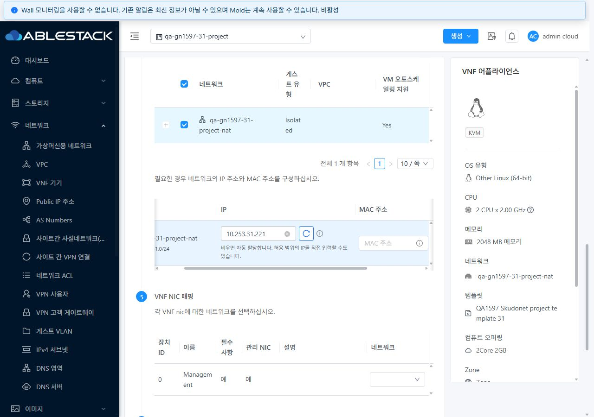
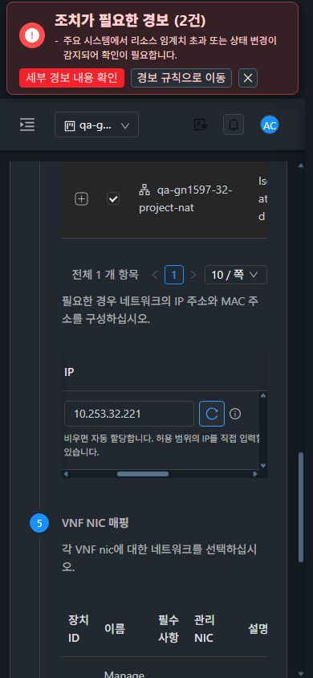

# #1597 프로젝트 VNF IP 후보 조회 권한 정합성 개선·31/32 검증

검증 기간: 2026-11-08~09.

**명시적으로 선택한 프로젝트의 배포 소유자를 검증한 뒤 IP 후보를 조회하도록 개선했다.** `admin.is.allowed.to.deploy.anywhere=false`를 유지하면서 31 GFS2·32 Glue RBD의 관리자 프로젝트 조회와 실제 VNF 배포가 일치한다. Epic 브랜치 `dhslove/epic-1554-guest-networks`와 기존 Draft PR #1577을 유지한다.

API·서버 구현은 `2a8fce6fb7c`, 최종 UI는 `25eb4bb1e4e`을 포함한다. API 명령/서버 소유자 처리와 VM/VNF 공통 네트워크 설정 표·영문/한글 안내를 변경했다. NetworkModel·프로젝트 접근 검사·전역 배포 정책은 변경하지 않았다.

## 변경 UI와 VM 표준

| 변경 화면 | 최종 동작·표준 |
| --- | --- |
| VNF 추가 → 네트워크 → IP | VM 생성과 **같은 NetworkConfiguration 컴포넌트**를 사용한다. 자동 할당(빈 값), 후보 선택, 허용 범위 수동 입력을 제공한다. |
| IP 입력 우측 | Ant Design 아이콘 전용 갱신 버튼(32px), 접근성 이름·tooltip·로딩/중복 클릭 방지를 적용했다. 버튼을 입력 아래로 분리하지 않았다. |
| 후보 조회 실패 | 같은 셀 안의 테마 대응 경고와 명시적 재조회. IP·MAC을 보존하며 입력 수정만으로 요청·전역 알림을 반복하지 않는다. |
| API 미노출 역할 | 지원 범위를 인라인 안내하고 조회 버튼/요청을 생략한다. 자동 할당·수동 입력과 기존 CIDR 검증은 유지한다. |
| 모바일 표 | IP 열의 최소 공간과 220px 입력 줄을 확보했다. VM 위자드의 다른 반응형 표와 같이 이 표의 공통500px 최소 폭을 해제했다. IP 입력·32px 갱신 버튼이 상위 영역에 잘리지 않고 표 내부 스크롤 영역에 모두 들어오는지 측정했다. |
| 프로젝트·역할·화면 전환 | 요청을 프로젝트/로그인/역할/API 목록/경로로 구분하고 오래된 응답을 버린다. 이전 후보를 다른 문맥에서 사용하지 않는다. |

양쪽 VM 메뉴의 **목록→상세→NIC→기존 네트워크 연결창→취소→breadcrumb 목록 복귀**를 실제 UI로 비교했다. 390×844의 표준 연결창은 폭366·높이606으로 31 다크·32 라이트에서 같은 소유/Zone 메타데이터·세로 입력·하단 버튼을 유지한다. 새 리본이나 별도 VNF 레이아웃을 만들지 않았다.

## 권한 계약과 보안 정책

기존 API는 `projectid`를 받지 않아 브라우저가 전달해도 로그인 계정으로만 망 사용권한을 검사했다. 반면 배포는 프로젝트 접근을 검증하고 프로젝트 소유자를 사용했다. 수정 전 양쪽 root 프로젝트 조회531과 기존 시험 역할 API 미노출432를 다시 확인했다.

`ListAvailableGuestIpsCmd`에 단일 프로젝트 UUID를 추가했다. 서버는 기존 `finalizeOwner(caller, ..., projectid)`로 호출자의 프로젝트 접근을 검증한 뒤, **기존 `checkNetworkPermissions(effectiveOwner, network)`를 그대로 수행**한다. 프로젝트가 없으면 기존 calling account 판정을 유지하며 `projectid=-1/0`은 허용하지 않는다. 잘못된 프로젝트, 다른 소유자의 망, 회수된 공유를 무조건 허용하는 admin 분기를 추가하지 않았다.

실제 API 권한 조회는 **54건**이다. 기존 역할6개의 미노출 결과와, IP 조회 API 하나만 허용한 전용 읽기 역할의 멤버/비멤버/외부 계정을 구분했다. 전용 역할에는 쓰기 API가 없다. 기존 전역 역할의 permission과 프로젝트 읽기 전용 역할은 변경하지 않았다.

| 실제 API 경로 | 31·32 결과 |
| --- | --- |
| root + 명시적/접근 가능한 QA 프로젝트 | 200 |
| root + 프로젝트 없이 같은 프로젝트 망 | 531 유지 |
| IP 읽기 전용 멤버 + 올바른 프로젝트 | 200 |
| 비멤버·외부 도메인 + 프로젝트 | 432 거부 |
| 존재하지 않는 프로젝트 / `-1` | 431 거부 |
| 접근 가능한 잘못된 프로젝트로 다른 프로젝트 망 조회 | 531 거부 |
| 프로젝트에서 다른 도메인 개인 비공개 망 조회 | 531 거부 |
| 같은 도메인 개인 망 공유 전 → 프로젝트 공유 → 회수 | 531 → 200 → 531 |
| 기존 owner/member/readonly/domainadmin/peer/outsider의 미노출 API | 432 유지 |

공유 시험은 기존 전용 개인 NAT 망을 사용했고 프로젝트 공유를 추가한 뒤 **원래 공유 목록(빈 목록)으로 복원**했다. 기존 #1596의 프로젝트+peer 공유2항목도 그대로다. 새 배포 프로젝트에서도 root는 멤버가 아니며, 기존 QA 프로젝트의 IP 읽기 멤버가 새 프로젝트를 지정하면432, root가 잘못된 QA 프로젝트 문맥을 지정하면531이다.

[31 권한21건](evidence/31-ip-api-results.json) · [32 권한21건](evidence/32-ip-api-results.json) · [31 새 프로젝트6건](evidence/31-new-project-api.json) · [32 새 프로젝트6건](evidence/32-new-project-api.json).

## 실제 UI·배포·실패 복구

양쪽 root의 후보 목록을 실제로 열고 IP를 선택했다. 실패 시험은 브라우저 `listAvailableGuestIps` XHR 한 건에 HTTP503을 주입했으며 서버/권한을 중단하지 않았다. 두 위치에서 IP·MAC을 유지했고, 실패 후 MAC 수정이 새 후보 요청을 만들지 않았으며 전역 오류 알림이 누적되지 않았다. 우측 갱신 버튼의 실제200 응답으로 복구했다. interception과 viewport override는 해제했다.

일반 owner로 다시 로그인해 VM 생성의 같은 입력 표를 확인했다. API 미노출 안내·조회 버튼 없음·수동 IP 유지가 양쪽에서 일치하며, 32에서는 CIDR 밖 수동 입력을 거부하고 정상 범위로 복구하는 것도 확인했다. 해당 VM 양식은 제출하지 않았다. 수동 입력은 정상 포커스 이동 후에도 유지되며, 최종 owner 캡처는 입력 영역이 보이는 데스크톱에서 다시 촬영했다.

31·32 각각 1280×900 / 768×1024 / 390×844 × 라이트/다크, **총12개 조합**을 확인했다. 문서 자체 가로 넘침이 없고 IP 입력·갱신 버튼의 전체 경계와 클릭 위치가 실제 내부 스크롤 영역에 들어오는지 최종 측정했다. 모바일에서는 VM 표준대로 표 내부를 좌우로 이동한다. 프로젝트 변경 완료 후 dashboard/이전 IP 양식0과 새 프로젝트 복귀를 실제 UI로 확인했다. scope 변경과 늦은 응답 폐기의 즉시성은 집중 테스트로 검증하며, 전체 페이지 전환이 한 프레임에 원자적으로 바뀐다고 주장하지 않는다.

**첫 실제 배포는 기존 `qa-gn1569-31-project`의 primary storage500GB가 이미 소진돼 535로 거부됐다.** 이 요청에는 비동기 job이 없고 기존 VM/NIC는 그대로다. 이를 배포 성공으로 계산하지 않았다. 기존 자원을 삭제하거나 한도를 올리는 대신, 각 클러스터에 별도 `qa-gn1597-{31,32}-project`·Isolated 망·비공개 Skudonet 템플릿을 준비했다. 새 프로젝트의 primary storage 한도는150GB이며 기존 프로젝트500GB는 유지했다. 템플릿은 제공된 URL에서 등록했고 양쪽 Download Complete/Management device0/필수 NIC다.

| 실제 UI 배포 | 31 GFS2 | 32 Glue RBD |
| --- | --- | --- |
| 프로젝트 | qa-gn1597-31-project | qa-gn1597-32-project |
| VNF | qa-gn1597-31-project-vnf | qa-gn1597-32-project-vnf |
| 선택 IP / MAC | 10.253.31.220 / 02:19:97:31:00:01 | 10.253.32.220 / 02:19:97:32:00:01 |
| 최종 상태 | Running / NIC1 / 루트 볼륨 Ready | 동일 |
| 비동기 job | 8f112e7c-3329-49c0-96a9-63c8a14cd5f0, 성공1 | 4089c686-0180-4ae3-afb1-fb21e9cbe677, 성공1 |
| 요청·결과 대조 | UI POST의 project/network/IP와 실제 NIC 일치 | 동일 |
| 할당 후 IP 후보 | .220 제외 확인 | 동일 |

API 프로젝트/네트워크 준비와 비공개 템플릿 등록은 API로 수행했으며 **VNF 배포2건은 실제 UI**다. UI POST/응답·관리 작업 UUID/호출자 admin·API job 성공·NIC/IP/MAC·Ready 볼륨과 Running 목록/상세를 대조했다. LB 백엔드 분산·DHCP/DNS·게스트 통신을 이 IP 후보 권한 개선의 성공 조건으로 확대하지 않았다.

[UI 동작](evidence/ui-actions.json) · [UI 요청/응답](evidence/ui-wire.json) · [12개 최종 측정](evidence/ui-layouts.json) · [원본35캡처](capture-matrix.ko.md) · [기존 한도535 차단](screenshots/31-original-project-quota-535.jpg).

## 로컬 빌드·배포·실행 확인

WSL ext4에서 **API 모듈 빌드/설치, 서버 집중103 tests와 모듈 package, UI lint·87 tests/3 suites·production 빌드**를 수행했다. 전체 Cloud reactor/Maven 빌드나 GitHub Actions 수동 실행은 없다. API 모듈 자체 테스트는 skip했고 API 필드와 프로젝트 검사 계약을 서버 집중 테스트 및 실제 API로 검증했다. 서버 모델/서비스 기존 회귀를 포함한다. 기존 Maven 의존 중복·SLF4J/아이콘 중복·UI 크기 경고를 기록했으며 최종 검사들은 통과했다.

활성 관리 JAR의 API/NetworkServiceImpl 클래스 군16개를 교체 대상으로 대조했다. 실제 바이트가 바뀐 항목은12개이고 **나머지204,645개 JAR 항목은 동일**하다. 활성 JAR SHA256은 `a3b88784bc6be42b5e95e7a3ef347381653eff78166d4ec379dfeda667bce365`다. 관리 서비스를 재시작한 뒤 API/클래스 해시·mold active·최근15,000행 linkage 오류0을 확인했다.

최종 정적 UI662개/29,971,975bytes를 활성 `/usr/share/cloudstack-management/webapp`에 배포했다. WEB-INF/META-INF·실제 config·서버 파일을 보존했고 정적 해시 불일치0, 배포 전후 HTTP200을 확인했다. 최종 입력/조회 표식과 기존 FTCTL 표식도 활성 번들에서 확인했다. 교체 전 JAR·정적 파일은 WSL ext4와 원격 단계 디렉터리에 백업했다. 모듈 산출물과 최종 UI 소스 해시를 기록했으며 protected 기본 FT 작업 트리는 수정하지 않았다.

## 보관 자원과 검증 범위

기존 QA 프로젝트의 **VM5/21 NIC·망31=45개/32=46개·한도500GB**, 기본 보기 VM/NIC, 기존 망 소유/오퍼링/상태/주소와 역할·한도를 기준 상태와 비교했다. 비교 범위는 기존 QA 프로젝트와 기본 보기이며, 모든 타 프로젝트의 이전 상태까지 수집했다고 확대하지 않는다. 기존 멤버는 보존했고 전용 API 읽기 시험 멤버1명씩만 기존 QA 프로젝트에 추가했다. 원래 공유 권한은 정확히 복원했다.

확인용으로 양쪽 **새 프로젝트1·망1·비공개 VNF 템플릿1·VNF1/루트 볼륨1·기본 NIC1**을 남겼다. 전용 IP 읽기 역할1개와 시험 계정3개도 각각 보관했다. 기존 #1569의3 NIC VNF와 #1595의2 NIC VNF·이전 시험 자원은 삭제하지 않았다. [확인 방법·자원 목록](resources.ko.md).

## 다음 순서

1. **#1598**: VNF 템플릿 NIC 추가 대화상자 중복을 단일 MoldDialog로 정리.
2. **#1569**: 나머지 역할/조건부 통합 회귀. L2 제어·ConfigDrive/PVLAN/VPC 등 미실행 조건을 이어서 확인.
3. IPv6/BGP/Tungsten은 실제 구성/상대 피어가 필요한 환경 항목. #1586은 별도 범위.

#1597 범위는 완료이며 C07/X06은 넓은 미실행 조건 때문에 부분을 유지한다. #1598이 남아 C06 실패도 유지한다. 63행 집계는 실패1·부분48·미실행5·환경차단6·제외3·전체행성공0이며 Epic/#1569 전체 완료가 아니다.
