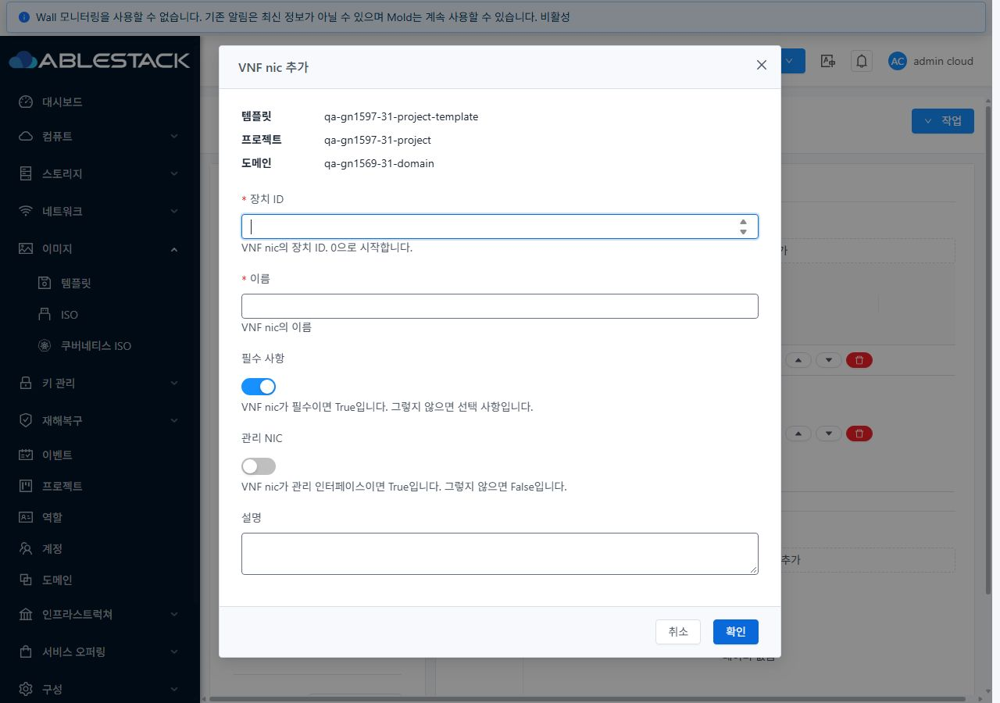
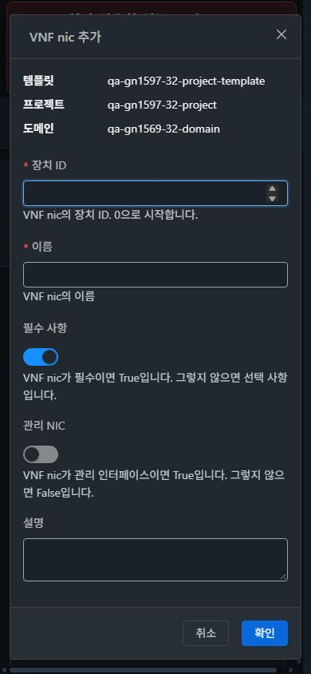

# #1598 VNF 템플릿 NIC 대화상자 통합·31/32 검증

2026-11-09, 31 GFS2·32 Glue RBD. **중복된 NIC 추가 모달을 제거하고 추가·편집을 하나의 VM 표준 MoldDialog로 통합했다.** UI와 집중 테스트만 변경했다. API·Java·JAR·전역 보안 정책 변경은 없다. Epic 브랜치 `dhslove/epic-1554-guest-networks`와 기존 Draft PR #1577을 유지한다.

## 변경 UI와 VM 표준

| 화면/상태 | 변경 내용 |
| --- | --- |
| 이미지 → 템플릿 → VNF 설정 → NIC 추가/편집 | 같은 필드·제출 상태를 가진 MoldDialog 1개. 수정 전 양쪽 실제 visible dialog2를 확인했고 수정 후1이다. |
| 상단 문맥 | 템플릿·프로젝트 또는 계정·도메인을 VM NIC 연결창과 같은 메타데이터 형태로 표시한다. |
| 세로 입력 | 장치 ID·이름·필수 사항·관리 NIC·설명 순서. 라벨5개를 입력 ID에 연결하고 도움말은 해당 항목 아래에 둔다. 장치 ID는 편집 시 고정한다. |
| 하단 버튼 | 공통 footer의 취소/확인. 저장 중 입력·버튼·닫기·ESC 잠금과 loading. 연속 제출은 요청1건으로 제한한다. |
| 실패와 재시도 | 저장 전 목록을 직접 변경하지 않는다. 실패하면 기존 정의와 입력을 유지하고 재시도한다. |
| 취소/ESC/다시 열기 | 추가 양식을 초기화하고 호출 버튼으로 포커스를 복귀한다. 마스크·스크롤 잠금 잔류0. |
| 화면/프로젝트/로그인 변경 | 열린 양식을 종료하고 기존 요청의 늦은 응답을 새 문맥에 반영하지 않는다. |
| 반응형·다크 | 공통 md 크기·헤더/footer·본문 스크롤·테마 토큰 사용. 데스크톱/태블릿 폭720px, 모바일366px. 공통 VM 스타일/CSS는 변경하지 않았다. |

양쪽 일반 VM의 **목록 → 상세 → NIC 탭 → 기존 네트워크 연결 대화상자 → 취소 → breadcrumb 목록 복귀**를 실제 UI로 비교했다. 31 다크·32 라이트의390px VM 연결창도 캡처했다. 이번 변경 범위는 VNF 템플릿 NIC 대화상자와 그 제출 처리이며, VM 목록·상세·탭·breadcrumb 자체를 새로 디자인하지 않았다.

## 실제 UI 동작과 API 결과 대조

각 클러스터의 기존 #1597 비공개 Skudonet 템플릿에서 실행했다. 배포된 VNF/VM의 실제 NIC를 수정한 시험이 아니라 **템플릿 NIC 정의** 시험이다.

| 실제 UI 작업 | 31 | 32 |
| --- | --- | --- |
| 한 번 추가 버튼 클릭 | 모달1/마스크1/장치 ID 초점 | 동일 |
| 선택 NIC 추가 중 HTTP503 1건 주입 | 기존 Management 정의와 입력 보존 | 동일 |
| 더블클릭으로 재시도, XHR 보류 중 검사 | 요청1·입력/닫기 잠금 → 실제200 | 동일 |
| 저장 완료 | 정의2·모달0·마스크0·호출 버튼 초점 | 동일 |
| 취소/재열기/ESC | 새 양식 기본값, 값 잔류0·잠금0·호출 버튼 초점 | 동일 |
| 선택 정의 편집 | 설명 수정200, 기존 Management 보존 | 동일 |
| 임시 정의 추가/위로/아래로/삭제 | 각200, 임시 정의 제거·순서 복원 | 동일 |
| 프로젝트 왕복/열린 양식에서 목록 이동 | dashboard/목록에 이전 모달·마스크0 | 동일 |

**실제 서버 저장 성공은6건씩 총12건**이다: 보관용 선택 정의 추가1·편집1·임시 정의 추가1·순서 변경2·임시 정의 삭제1. 브라우저에서 서버 도달 전에 주입한503은2건이며 성공/실제 서버 쓰기로 계산하지 않았다. `ui-wire.json`에는 총14개 요청의 대상 ID·NIC 파라미터·HTTP·응답 정의만 보존했다. 별도 새 API를 구현하지 않았다.

양쪽의390/768/1280px × 라이트/다크 × 추가/편집 **총24개 조합**에서 실제 viewport, 모달/본문/footer 경계, 가로 넘침, 단일 마스크, 라벨 연결과 초기 초점을 확인했다. 모바일은366×808px이며 모든 항목과 하단 버튼에 접근할 수 있다. 모바일 장치 ID에서 이름→필수→관리→설명→취소→확인의6단계씩 총12단계 Tab 이동을 확인했다. 전체 숨은 focus sentinel 한 바퀴 자동화 검증까지 확대하지 않는다.

실제 프로젝트 선택 완료 후 dashboard와 새 프로젝트 복귀, 양식이 열린 상태에서 브라우저 경로 이동 후0모달/0마스크를 확인했다. 문맥 변경 즉시 요청 무효화·늦은 응답 폐기는 집중 테스트로 확인했다. 전체 페이지가 한 프레임 안에 원자적으로 바뀐다거나, 저장 중 마스크 뒤의 프로젝트 선택기를 실제 클릭했다고 주장하지 않는다. 저장 잠금 직후 첫 초점 표본은 BODY일 수 있었고 안정화 후 공통 focus guard가 창 내부로 복귀했다. 31의 임시 정의 첫 자동화 클릭에는 POST가 관찰되지 않아 성공으로 집계하지 않았으며, 표시/활성 상태를 재확인한 다음 클릭의 단일200을 집계했다.

실패 주입과 viewport override는 해제했다. 마지막 브라우저 콘솔 관찰에서 예상하지 못한 TypeError/ReferenceError/Uncaught/Unhandled는0이다. 기존 Wall/시스템 경보 배너와 주입한503 알림은 이번 중복 모달 결함과 구분했다.

[UI 동작](evidence/ui-actions.json) · [실제 저장 요청/응답](evidence/ui-wire.json) · [24개 배치](evidence/ui-layouts.json) · [원본47캡처](capture-matrix.ko.md).

## 로컬 검증과 배포

WSL ext4에서 변경 파일 lint, 집중 **61 tests/4 suites**, UI production build가 통과했다. 대화상자 단일 인스턴스·연속 저장·불변 목록·실패 재시도·장치 ID0/중복 검증·문맥 변경/언마운트·기존 관리 정의 보존과 공통 MoldDialog/기존 VNF 배포/IP 후보 회귀를 포함한다. API 미노출/비소유자 저장 차단도 집중 테스트로 확인했다. 전체 Cloud·Maven·GitHub Actions 빌드는 실행하지 않았다. 기존 Browserslist·아이콘 중복·번들 크기 경고는 로그에 보존했다.

소스 `0829490494b`. 최종 정적662개/29,967,130bytes를 활성 `/usr/share/cloudstack-management/webapp`에 배포했다. 해시 불일치0, 배포 전후 WEB-INF/META-INF·config·서버 파일과 관리 PID를 보존하고 HTTP200·mold active를 확인했다. 교체 전 정적 파일을 WSL ext4에 백업했다. 활성 번들에 NIC 대화상자/문맥/닫기 처리와 기존 FTCTL/IP 후보 표식이 있다.

양쪽 활성 JAR SHA256은 배포 전후 `a3b88784bc6be42b5e95e7a3ef347381653eff78166d4ec379dfeda667bce365`로 동일하다. 관리 서비스 재시작·JAR 배포는 없다. 기본 FT 작업 트리의3개 기존 변경도 보존했다.

[테스트 로그](evidence/tests.log) · [빌드 로그](evidence/ui-build.log) · [31 배포](evidence/31-deployment.json) · [32 배포](evidence/32-deployment.json) · [31 실행 확인](evidence/31-runtime-after.json) · [32 실행 확인](evidence/32-runtime-after.json).

## 확인용 보관 자원

| 클러스터 | 프로젝트 | 템플릿 | NIC 정의 |
| --- | --- | --- | --- |
| 31 | qa-gn1597-31-project | qa-gn1597-31-project-template | 기존 Management0·필수/관리=true + QA1598 Data1·선택/관리=false |
| 32 | qa-gn1597-32-project | qa-gn1597-32-project-template | 동일 |

각 템플릿의 VNF 설정 탭에서 추가/편집 창을 확인할 수 있다. 새 VM·네트워크·역할·한도를 만들거나 바꾸지 않았다. 기존 QA 프로젝트의 VM5/NIC21·망31=45/32=46, #1597 프로젝트의 VM1/NIC1·망1과 기본 보기의 VM/NIC·망을 기준 상태와 대조했다. 두 #1597 VNF도 Running 상태와 IP/MAC을 유지한다. 비교 범위는 이 두 프로젝트와 기본 보기이며 모든 타 프로젝트의 이전 상태까지 수집했다고 확대하지 않는다. [31 보존 대조](evidence/31-preservation.json) · [32 보존 대조](evidence/32-preservation.json).

임시 순서 시험 정의만 UI로 제거했고, **확인용 선택 NIC 정의와 모든 기존 시험 자원은 남겼다.** 삭제는 별도 지시 후 수행한다.

## 후속 순서

1. **#1569 잔여 역할·조건부 통합 회귀**: L2 실제 제어/프레임 전달, ConfigDrive/PVLAN/VPC 및 잔여 VNF 역할/실패·서비스 조건.
2. IPv6/BGP/Tungsten은 해당 제공자/주소/상대 피어가 있는 환경에서 이어서 확인. #1586은 별도 범위다.

#1598의 중복 창 실패는 해소했다. 통합 표의 C06은 넓은 미실행 사용성 조건 때문에 부분으로 바꾸고 X06도 부분을 유지한다. **63행 집계: 실패0·부분49·미실행5·환경차단6·제외3·전체행성공0**이다. Epic/#1569 전체 완료로 집계하지 않는다.
