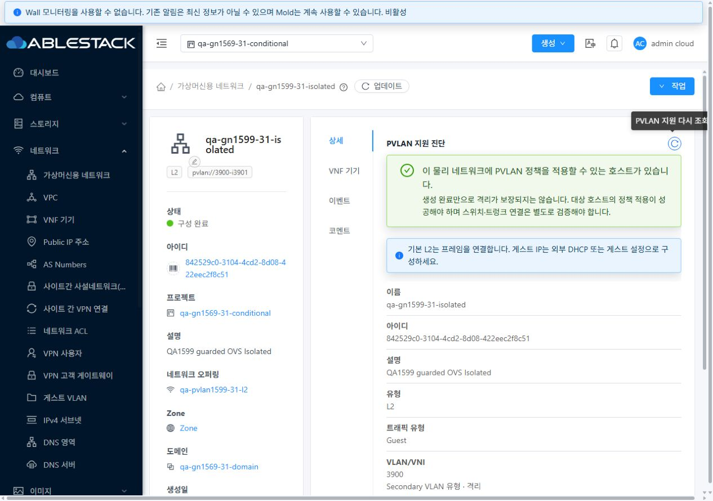
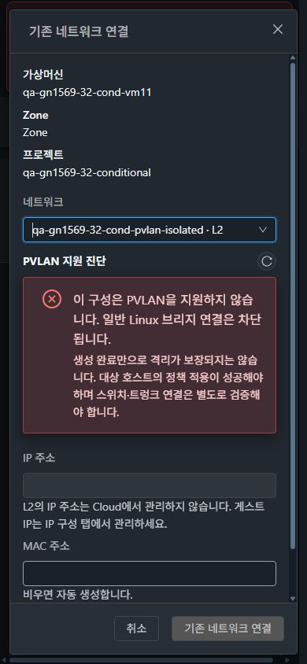
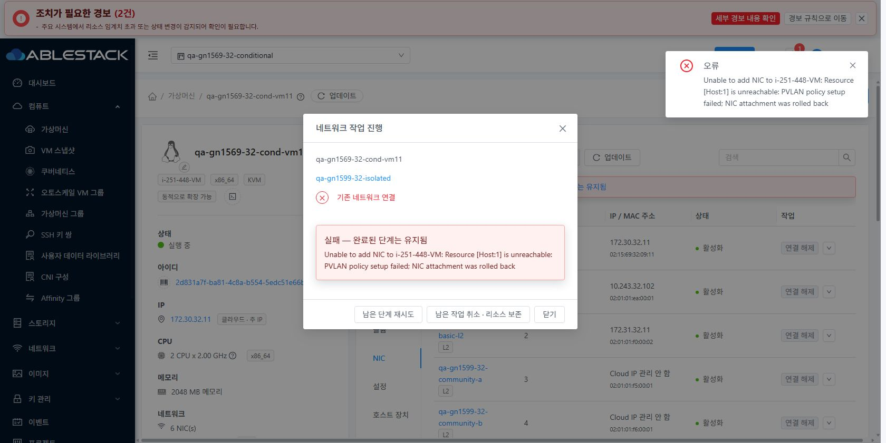

<!--
Licensed to the Apache Software Foundation (ASF) under one
or more contributor license agreements. See the NOTICE file
distributed with this work for additional information
regarding copyright ownership. The ASF licenses this file
to you under the Apache License, Version 2.0 (the
"License"); you may not use this file except in compliance
with the License. You may obtain a copy of the License at

  http://www.apache.org/licenses/LICENSE-2.0

Unless required by applicable law or agreed to in writing,
software distributed under the License is distributed on an
"AS IS" BASIS, WITHOUT WARRANTIES OR CONDITIONS OF ANY
KIND, either express or implied. See the License for the
specific language governing permissions and limitations
under the License.
-->

# #1599 PVLAN 일반 브리지 우회 차단·31/32 검증

2026-11-09, 31 GFS2·32 Glue RBD. **Linux Bridge에서는 PVLAN 생성·KVM VM 배포·NIC 연결을 거부하고, 명시적으로 준비한 전용 OvS 경로에서는 같은 호스트의 PVLAN 전달 행렬을 확인했다.** 기존 일반 BridgeVifDriver/bridge0와 운영 물리 NIC는 유지했다. Epic 브랜치 `dhslove/epic-1554-guest-networks`, Draft PR [#1577](https://github.com/ablecloud-team/ablestack-cloud/pull/1577)을 유지한다. [지원 계약·활성화 설계](../../design/guest-network-1599-pvlan-guard.ko.md).

## 변경 UI와 VM 표준

| 화면 | 변경 내용·표준 반영 |
|---|---|
| 네트워크 추가 → L2 / Shared | PVLAN 선택 시 물리망·호스트 지원 진단. VM 메뉴의 공통 MoldDialog, 소유 문맥, 세로 폼, 하단 취소/확인을 유지한다. 조회 중·미지원·조회 실패는 제출을 막고 다시 조회한다. |
| 가상머신용 네트워크 → 상세 | 진단 제목과 우측 새로고침 아이콘을 안내 영역보다 먼저 배치한다. 지원 결과와 실제 격리·스위치 검증의 차이를 설명한다. 기존 상세 카드·탭·breadcrumb을 재사용한다. |
| 컴퓨트 → 가상머신 → NIC → 기존 네트워크 연결 | 실제 VM 호스트를 기준으로 진단한다. 미지원 PVLAN은 연결 버튼을 비활성화한다. 기존 세로 입력·공통 footer·모바일 스크롤을 유지한다. |
| 실패·재시도 | hotplug 뒤 정책 적용 실패 시 NIC를 원복하고 원인을 표시한다. 실제 UI의 `남은 단계 재시도`로 복구했다. 기본 NIC와 다른 NIC는 유지했다. |
| 프로젝트·역할·테마 | 프로젝트/경로/사용자/오퍼링/호스트 변경 시 이전 응답을 폐기한다. 읽기 전용 생성·연결 버튼과 기존 VLAN 정보 마스킹을 유지한다. 390/768/1280, 밝은/어두운 테마를 양쪽에서 확인했다. |

VM 목록·상세·NIC 탭을 실제 비교 화면으로 확인했다. 공통 VM 목록/테마 자체를 새로 변경하지 않았다. 탭 안의 제목/아이콘 동작을 위에 두고 안내와 내용을 아래에 둔다. 테마 색상 변수와 기존 반응형 배치를 사용한다.

## 실제 OvS 활성화 경로

1. **31-2·32-1에만** 공식 CentOS NFV 서명 패키지 Open vSwitch 3.5.3을 설치했다. 배포 키·패키지 서명을 검증했고, 32번은 `aspm`/`aspkg`를 사용했다.
2. 전용 `qa-pvlan1599`를 `fail_mode=secure`, 외부 controller 없음, guard=1, mode=local로 만들었다. 물리 NIC·외부 업링크·IPv4 주소가 없다.
3. 두 호스트에만 `libvirt.vif.driver.extra=...OvsVifDriver`를 추가했다. 기본/per-traffic 드라이버는 변경하지 않았다.
4. 별도 물리 네트워크 `qa-pvlan1599-31`/`qa-pvlan1599-32`, 일치하는 오퍼링 태그, KVM Guest 레이블 `qa-pvlan1599`로 이 경로를 선택한다. UI가 자동 설치·전환하는 기능은 아니다.
5. 나머지 네 호스트는 Zone 전체의 물리망 연결 검사 때문에 같은 이름의 **native 시험 브리지 + dummy 포트 `ensqa1599`**를 준비했다. 물리 업링크/IP가 없고 PVLAN 지원 목록은 비어 있다. OvS 설치·활성화 대상이 아니다.

추가 물리망 레이블이 없는 호스트에서 `CheckNetworkAnswer: Can not find network: qa-pvlan1599`로 재연결이 반복되는 배포 구성 문제를 최종 점검에서 발견했다. 빈 native 브리지만으로는 기존 PIF 검사를 통과하지 못하므로 dummy 포트를 추가했다. 이후 6대 모두 Up/Enabled, 실제 OvS 지원 표시는 두 시험 호스트에만 존재함을 재검증했다. 임시 시험 레이블/dummy는 검토 후 시험망과 함께 정리할 대상이며 호스트 재부팅 후 자동 복원은 검증 범위가 아니다.

## UI·API·호스트 결과

| 검증 | 31 | 32 |
|---|---|---|
| native L2 PVLAN I/C/P 생성·기존 NIC 연결 거부 | 통과 | 통과 |
| native Shared PVLAN I/C/P 생성 거부 | 통과 | 통과 |
| native PVLAN VM 배포 거부, VM·볼륨 목록 보존 | 통과 | 통과 |
| 정지 VM의 미지원 NIC 연결 거부, 재시작/기본 NIC 보존 | 통과 | 통과 |
| 실제 UI L2 생성·지원 진단 / Shared 미지원 차단 | 통과 | 통과 |
| 실제 UI NIC 연결 후 정책 실패 주입 → 원복 → UI 재시도 | 통과 | 통과 |
| 프로젝트 역할 API 기대 결과 일치 | 15/15 | 15/15 |
| 읽기 전용 실제 UI의 생성/연결 버튼 비활성화·VLAN 정보 마스킹 | 통과 | 통과 |
| 에이전트 재연결: 정책 삭제 중 기본 차단 → 정책 복구 후 허용 | 통과 | 통과 |
| 과거 Promiscuous Interface UUID를 가진 MAC 상태의 재승인 없는 차단 | 통과 | 통과 |
| 보강된 정책으로 시험 VM 2대 정지/시작, 7 NIC/기본 NIC/호스트 보존 | 통과 | 통과 |
| 최종 실제 전달 행렬 | 32/32 방향 | 32/32 방향 |
| 3개 호스트 Up, 원래 IPv4/라우팅/기본 설정 보존, 배포 해시 | 통과 | 통과 |

프로젝트 owner/member/domainadmin/readonly/peer/outsider의 PVLAN 생성은 기존 Root 관리자 전용 정책에 따라 거부했다. 허용된 프로젝트 owner/member/domainadmin의 기존 NIC 연결·분리와 readonly/peer/outsider의 거부를 API로 확인했다. Root 및 읽기 전용 역할은 실제 UI에서도 확인했다. 일반 역할의 API가 VLAN/broadcast URI를 마스킹하면 이를 추정해 관리자 진단 정보를 노출하지 않는다.

미지원 생성/배포는 서버 사전 검사, 최종 KVM VIF 생성은 agent 검사로 방어한다. broadcast type/URI 불일치도 일반 브리지로 우회하지 못한다. hotplug 뒤 정책 실패는 libvirt/API 양쪽의 추가 NIC 제거와 기본 NIC/VM 보존으로 확인했다. 과거 잘못 연결된 native 시험 PVLAN NIC 4개는 분리했고 네트워크 정의는 미지원 UI 확인용으로 남겼다.

## 실제 통신 방식과 결과

각 클러스터의 같은 호스트에 VM 2대, 각 VM에 Isolated·Community A·Community B·Promiscuous NIC를 하나씩 연결했다. 4×4 역할 조합을 양방향으로 검사해 클러스터당 32개 방향이다. 각 방향에서 **cold ARP ICMP, 목적지 MAC 고정 ICMP, 출발 인터페이스/IP에 묶은 TCP15999**를 각각 검사했다.

| 출발/도착 | Isolated | 같은 Community | 다른 Community | Promiscuous |
|---|---|---|---|---|
| Isolated | 차단 | 차단 | 차단 | 허용 |
| Community | 차단 | 허용 | 차단 | 허용 |
| Promiscuous | 허용 | 허용 | 허용 | 허용 |

최종 `post-abi`는 **양쪽 합계 64개 방향, 192개 프로브 기대 결과 일치**다. 이전 qualified/after-stop-start/final/identity-final도 각각 같은 행렬을 반복 통과했다. 실제 포트/MAC/Interface UUID와 owned OpenFlow cookie, PVLAN primary/secondary는 [31 최종 런타임](evidence/31-final-runtime.json)·[32 최종 런타임](evidence/32-final-runtime.json)에서 대조한다. 순수 전달 컴파일 집중 테스트는 서로 다른 primary, 위조/태그/미등록 포트, QinQ 구문도 검사하며 실환경 통신 결과와 구분한다.

정책은 `NORMAL`을 사용하지 않고 `in_port + 출발 MAC + 미태그`를 제한한다. root 전용 상태와 lock, owned-cookie 원자 bundle을 사용한다. Interface UUID가 바뀌면 같은 MAC의 과거 권한을 자동 승계하지 않고 Cloud의 명시적인 add로 새 UUID를 승인한다. UUID 없는 이전 정책은 검토한 Cloud NIC 인벤토리로 재적용해야 한다.

시험 게스트의 제한된 TCP 방화벽 허용과 MAC 기준 NetworkManager 설정을 준비했다. 초기 시험 서버의 구문 오류·방화벽 거부가 있던 initial/baseline 실행은 통과 결과에서 제외했다. VM 재시작 때 SSH 호스트 키가 바뀌어 읽기 전용 디스크 조회로 공개 호스트 키를 대조한 뒤 **시험 전용 known_hosts**에 다시 고정했다. SSH 인증을 끄거나 QGA 명령을 추가 허용하지 않았다. 키 변경 원인은 확정하지 않았다.

## 빌드·배포 증거

- WSL ext4 `/home/ablecloud/work/dhslove/cloud-epic-1554`에서 변경 Maven 모듈만 로컬 빌드했다. KVM 14개, server 83개, Python 정책 14개, UI 42개 **총 153개 집중 테스트 통과**. UI lint/production build 통과이며 기존 webpack 크기 경고 2개가 있다.
- orchestration 모듈은 package 성공, 단위 테스트는 생략했다. 해당 NIC 실패 원복은 양쪽 실제 UI/API/libvirt에서 검증했다. 전체 Cloud 빌드나 GitHub Actions를 실행하지 않았다. 로컬 결과를 전체 CI 성공으로 해석하지 않는다.
- 관리 JAR/agent JAR는 변경한 클래스 계열만 갱신하고 나머지 엔트리를 보존했다. 정책 스크립트는 6대에 반영하되 지원 활성화는 두 대만 했다. 이전 JAR는 SHA 검증한 WSL 백업에 보관했다.
- 최종 로그 검사에서 31번의 기존 `KvmBoundedStats`에 새 caller가 필요한 3인자 `freeMemory`가 없어 통계 수집이 실패하는 바이너리 의존성 누락을 발견했다. 현재 브랜치의 해당 helper 클래스와 집중 테스트 2개를 함께 포함해 다시 배포했다. 소스의 기존 통계 정책은 변경하지 않았다. 배포 이후 로그 구간에서 정상 `GetVmStatsAnswer`와 새 linkage 오류 0, 양쪽 VM 메트릭 API 응답을 확인했다. 이후 PVLAN 통신 행렬도 다시 검사했다.
- 관리 UI의 static 662개 파일 해시 불일치 0. active webapp의 현재 manifest 파일에서 PVLAN·FTCTL 마커를 확인했다. `WEB-INF`·`META-INF` 보존, `/client/` HTTP200, mold/mold-agent active를 확인했다.
- 호스트의 원래 IPv4 주소·라우팅·기본 VIF/네트워크 설정을 배포 전과 대조했다. 시험용 SSH 접근 주소 `172.30.31.254/24`·`172.30.32.254/24`만 제거했다. 시험 VM·NIC·정책·게스트 TCP 검증 서비스는 남겼다.

세부 명령/결과는 [집중 검증 요약](evidence/focused-results.json), [캡처 목록·크기](capture-matrix.ko.md), evidence의 API·통신·배포 JSON을 참고한다. 네이티브 브라우저 캡처가 일부 화면을 비례 축소해 반환하므로 CSS viewport와 실제 JPEG 크기를 각각 기록했다. 이미지를 재가공하지 않았다. 모바일에서 보이는 전역 1px 수평 스크롤은 VM 공통 화면에서도 관찰됐으며 새 진단 영역은 화면 폭 안에 있다.

## 검토용 자원과 후속 순서

| 클러스터 | 프로젝트 | 시험 VM / 호스트 | 전용 PVLAN |
|---|---|---|---|
| 31 GFS2 | `qa-gn1569-31-conditional` | `qa-gn1569-31-cond-vm11`·`vm12` / 31-2 | primary3900, I3901, C3902/C3903, P3900 |
| 32 Glue RBD | `qa-gn1569-32-conditional` | `qa-gn1569-32-cond-vm11`·`vm12` / 32-1 | primary3110, I3111, C3112/C3113, P3110 |

각 VM은 Running/7 NIC이며 기본 ConfigDrive·기존 L2·VPC NIC 3개와 전용 PVLAN NIC 4개를 유지한다. 네트워크 이름은 `qa-gn1599-{31,32}-{isolated,community-a,community-b,promiscuous}`다. 실제 UI로 생성한 별도 `qa-gn1599-{31,32}-ui-isolated`도 남겼다. [31 인벤토리](evidence/31-final-runtime.json)·[32 인벤토리](evidence/32-final-runtime.json)에 UUID를 기록했다. 검토 후 별도 삭제 지시에 따라 정리한다.

이 이슈의 실환경 지원 검증은 **같은 호스트의 전용 local OvS L2**다. 스위치 미설정으로 호스트 간/QinQ 트렁크, Shared PVLAN DHCP 라우터 실제 통신, 호스트 전체 재부팅, 라이브 마이그레이션은 통과 항목이 아니다. 기존 운영 VM의 모든 애플리케이션을 회귀한 결과도 아니다.

다음 구현 순서: **[#1600 VPC Tier 오퍼링 적합성·입력 보존](https://github.com/ablecloud-team/ablestack-cloud/issues/1600) → [#1601 읽기 전용 VPC ACL 가드](https://github.com/ablecloud-team/ablestack-cloud/issues/1601) → [#1569 남은 역할·조건부 회귀](https://github.com/ablecloud-team/ablestack-cloud/issues/1569)**. 이번 PVLAN 개선으로 과거 #1569 전체 결과를 일괄 PASS로 바꾸지 않는다. 스위치 준비가 필요한 검증은 환경 조건과 함께 별도로 유지한다.
