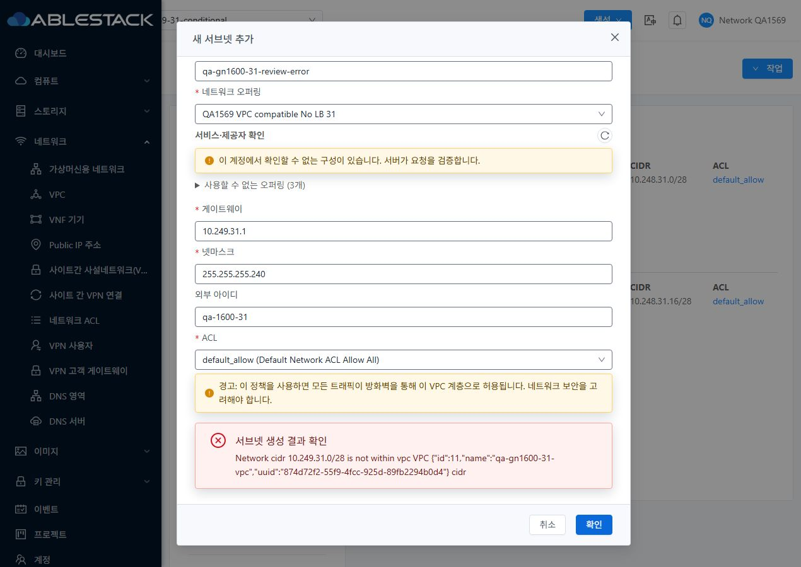
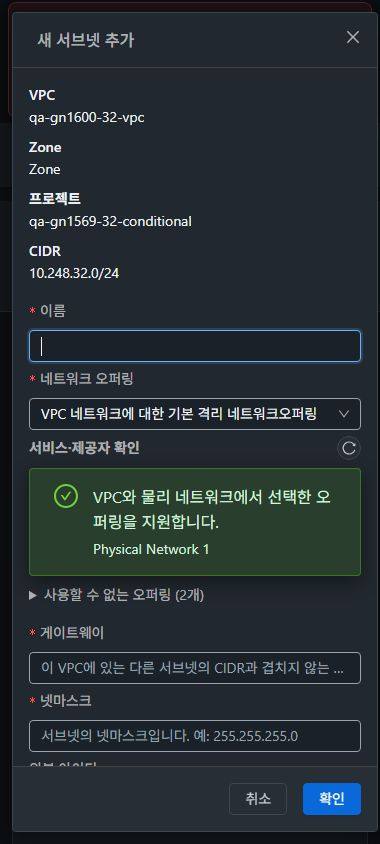

<!--
Licensed to the Apache Software Foundation (ASF) under one
or more contributor license agreements. See the NOTICE file
distributed with this work for additional information
regarding copyright ownership. The ASF licenses this file
to you under the Apache License, Version 2.0 (the
"License"); you may not use this file except in compliance
with the License. You may obtain a copy of the License at

  http://www.apache.org/licenses/LICENSE-2.0

Unless required by applicable law or agreed to in writing,
software distributed under the License is distributed on an
"AS IS" BASIS, WITHOUT WARRANTIES OR CONDITIONS OF ANY
KIND, either express or implied. See the License for the
specific language governing permissions and limitations
under the License.
-->

# #1600 VPC Tier 오퍼링과 생성 실패 복구

2026-11-09에 31 GFS2·32 Glue RBD에 반영했다. 두 시험 VPC에서 기존 기본 NoLB의 `Firewall / VpcVirtualRouter` 조합이 31번 431, 32번 530으로 거부되고 대화상자가 닫히는 현상을 실제 UI로 재현했다. 같은 조건을 API에서도 확인했다.

## UI 변경

- 네트워크 탭의 **새 서브넷 추가**를 VM NIC 탭과 같은 상단 기본 작업으로 배치했다. 공통 MoldDialog에 VPC·Zone·프로젝트 또는 계정·CIDR을 표시한다. 입력은 세로로 배치하고 취소·확인은 하단에 둔다. 취소와 성공 후에는 생성 버튼으로 포커스가 돌아간다.
- VPC의 서비스·제공자 쌍과 NAT/라우팅 모드, 공용 LB·전용 NetScaler 조건을 확인한다. 권한 범위 안에서 기존 물리망 진단을 재사용한다. 기본 NoLB는 비활성화하며 접이식 목록에 Firewall 조합의 거부 사유를 표시한다. 우측 아이콘으로 다시 조회한다.
- owner·member·DomainAdmin에게 물리망 조회 API가 보이지 않을 때도 확인 가능한 VPC 부적합 사유는 표시한다. 그 외 물리망 정보는 부분 진단으로 표시하고 서버 검증을 따른다. 빈 후보와 조회 실패는 구분한다.
- 생성 요청이 실패하면 이름·오퍼링·게이트웨이·넷마스크·ACL·외부 ID를 보존하고 오류에 포커스를 둔다. 접수 여부가 불명확하면 같은 VPC의 Tier를 조회하고, 작업 ID가 있으면 기존 작업을 조회한다. 사용자가 다시 제출하기 전 결과 확인을 요구한다. 현재 문맥의 성공을 확인하면 대화상자를 닫고 Tier 목록을 갱신한다.

## 실환경 검증

| 검증 | 31 GFS2 | 32 Glue RBD |
|---|---|---|
| 배포 전 기본 NoLB 요청 | 431, 창 닫힘 | 530, 창 닫힘 |
| 배포 후 기본 NoLB 선택 | 비활성, Firewall 사유 확인 | 비활성, Firewall 사유 확인 |
| 시험 응답 431·530·전송 오류·async 실패 | 입력 유지, 작업 재조회에서 중복 POST 0 | 입력 유지, 작업 처리 중 새 제출 차단 |
| 실제 CIDR 431 후 수정·재시도 | 창 유지, POST 1회, 실제 생성 | 창 유지, POST 1회, 실제 생성 |
| 성공 후 목록·포커스 | 자동 갱신, 생성 버튼 복귀 | 자동 갱신, 생성 버튼 복귀 |
| 프로젝트·권한 | owner 실제 생성, readonly API 401 | readonly 생성 버튼 비활성, API 401 |
| 라이트·다크와 화면 크기 | 390/768/1280 각각 확인 | 390/768/1280 각각 확인 |

두 클러스터의 시험 요청에만 브라우저 네트워크 응답을 재현했다. 기본 NoLB의 431·530은 배포 전 실제 서버 오류와 대조했고, 호환 후보를 선택한 개선 UI의 오류 복구는 별도 시험 응답으로 확인했다. 전송 중단은 시험 POST를 차단해 재현했다. 31번의 첫 비동기 조회는 시험 응답 제어가 끝나 미확인 상태로 남았고, 같은 작업의 재조회에 실패 응답을 돌려 입력 보존과 새 POST 0을 확인했다. 32번은 접수부터 실패까지 같은 흐름에서 재현했다. 실제 서버의 생성은 동기 응답이었다.

실제 CIDR 오류는 양쪽에서 재현하고 올바른 게이트웨이로 다시 제출했다. API에서 새 Tier의 VPC·프로젝트·CIDR·호환 오퍼링·`default_allow` ACL을 대조했다. 최종 시험 VPC에는 성공한 Tier 세 개만 있다. 이전 VPC·Tier·ACL과 오퍼링·서비스 제공자 설정·프로젝트 역할은 배포 전 인벤토리와 대조했다.

컴퓨트 메뉴 VM 상세의 NIC 탭과 기존 네트워크 연결창을 비교했다. 열린 Tier 폼에서 VM으로 이동한 뒤 기본 보기와 시험 프로젝트를 왕복했다. 다시 연 폼에 이전 입력이 남지 않았다. 늦은 응답 폐기는 집중 테스트에서도 검증했다. 브라우저 viewport와 JPEG 원본 크기를 각각 기록했으며 스크롤바를 제외한 전체 페이지 캡처는 폭이 다를 수 있다.

[31번 API 대조](evidence/31-verified.json) · [32번 API 대조](evidence/32-verified.json) · [브라우저 확인 기록](evidence/ui-results.json) · [원본 캡처 목록](capture-matrix.ko.md)

## 배포와 확인용 자원

WSL ext4에서 UI lint·집중 테스트 41개·production 빌드를 통과했다. 관리 webapp 정적 파일 662개의 해시, `WEB-INF`·`META-INF` 보존, `/client/` HTTP200, 활성 VPC·FTCTL 마커를 확인했다. 배포 전 정적 파일 백업을 WSL에 보관했다. PR의 등록된 체크와 로컬 테스트를 구분한다.

| 클러스터 | 프로젝트 | 시험 VPC | 남겨 둔 Tier |
|---|---|---|---|
| 31 | `qa-gn1569-31-conditional` | `qa-gn1600-31-vpc` | `qa-gn1600-31-ui-tier` · `qa-gn1600-31-owner-tier` |
| 32 | `qa-gn1569-32-conditional` | `qa-gn1600-32-vpc` | `qa-gn1600-32-ui-tier` |

확인 경로는 **네트워크 → VPC → 시험 VPC → 네트워크**다. VPC 라우터를 기동하지 않은 시험 VPC에서 Tier 생성과 ACL 연결 결과를 검증했다.

[31번 배포 영수증](evidence/31-deployment.json) · [32번 배포 영수증](evidence/32-deployment.json) · [Epic PR #1577](https://github.com/ablecloud-team/ablestack-cloud/pull/1577)

후속 작업은 읽기 전용 VPC ACL UI 가드와 남은 역할·조건부 회귀다. [#1601](https://github.com/ablecloud-team/ablestack-cloud/issues/1601) → [#1569](https://github.com/ablecloud-team/ablestack-cloud/issues/1569)
