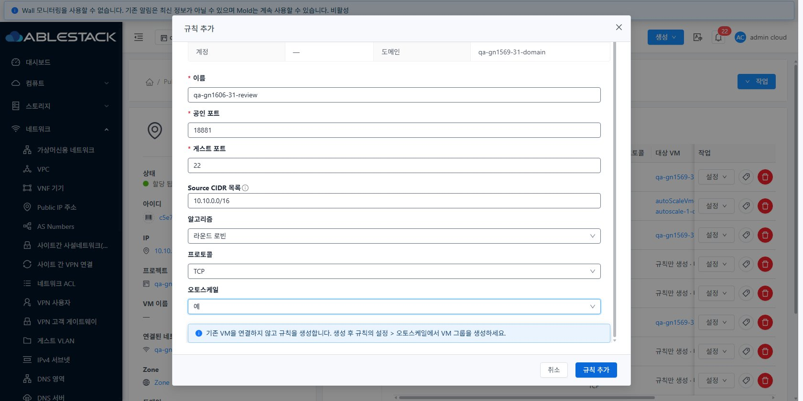
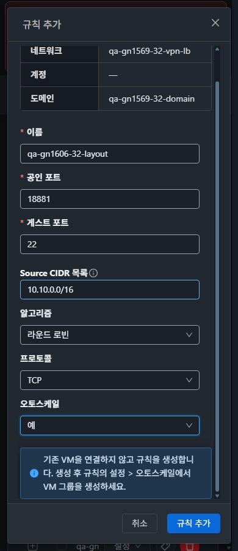

<!--
Licensed to the Apache Software Foundation (ASF) under one
or more contributor license agreements.  See the NOTICE file
distributed with this work for additional information
regarding copyright ownership.  The ASF licenses this file
to you under the Apache License, Version 2.0 (the
"License"); you may not use this file except in compliance
with the License.  You may obtain a copy of the License at

  http://www.apache.org/licenses/LICENSE-2.0

Unless required by applicable law or agreed to in writing,
software distributed under the License is distributed on an
"AS IS" BASIS, WITHOUT WARRANTIES OR CONDITIONS OF ANY
KIND, either express or implied.  See the License for the
specific language governing permissions and limitations
under the License.
-->

# #1606 AutoScale LB 생성 무응답 개선

2026-11-09. **UI만 수정**해 31 GFS2·32 Glue(Ceph) RBD에 반영하고 실제 UI 생성·실패 복구·API·VR 설정을 대조했다. Epic 브랜치 `dhslove/epic-1554-guest-networks`와 Draft PR [#1577](https://github.com/ablecloud-team/ablestack-cloud/pull/1577)을 유지한다. 제품 소스 `386247ffd137d617499ea89da2a3f650a4ff2d90`. #1606 구현 범위는 완료이며 #1607/#1608 및 #1569 조건부 통합 검증은 별도다.

[원본 캡처 108장](capture-matrix.ko.md) · [확인용 자원](resources.ko.md) · [요약](evidence/summary.json) · [60개 화면 행렬](evidence/ui-matrix.json) · [UI/DOM 상태](evidence/ui-state.json) · [요청 횟수](evidence/request-summary.json) · [로컬 테스트](test-results.ko.md).

## 변경한 UI와 원인

`Public IP 주소 > 상세 > 부하 분산 탭 > 규칙 추가`에서 기본 대상 모드가 VM 선택일 때 AutoScale을 예로 바꾸면 선택 영역은 숨겨지지만 handler가 빈 VM 선택을 계속 검사했다. 개선 전 양쪽 버튼 실행 후 생성 API0건을 재현했다.

- AutoScale 예에서는 기존 VM/NIC 선택·숨겨진 조회 대기를 생성 조건에서 제외한다. 이름·포트 등 공통 입력 검증과 로딩·권한·프로젝트 가드는 유지한다. 수동 VM/IP 연결은 선택 필수 검증을 유지한다.
- 본문 안의 별도 추가 버튼을 없애고 **VM 메뉴의 MoldDialog 하단 취소·기본 작업 버튼**으로 통일했다. 예/아니오 모두 같은 `규칙 추가` 버튼을 사용한다. VPC는 필요한 Tier 선택을 먼저 수행한다.
- 예 선택 시 기존 VM을 연결하지 않고 규칙을 만든다는 안내와 **생성 후 설정 > 오토스케일** 경로를 표시한다. 이번 변경이 VM 그룹을 자동으로 생성하지는 않는다.
- 모드 변경 때 이전 백엔드/Tier 선택을 비우고 프로젝트/네트워크 범위 변경 때 대화상자·pending 상태를 정리한다. 진행 중 모드 변경/중복 제출은 차단하며 537 실패 후 입력 보존·수정 재시도 경로를 유지한다.
- UI utility·LoadBalancing.vue·ko/en 문구·회귀 spec만 수정했다. API/Java/보안 정책과 기존 오퍼링은 변경하지 않았다.

## 31·32 기능 검증

아래는 양쪽에서 각각 실행했다. CDP는 실제 UI가 보낸 요청을 관찰했고 API는 생성된 UUID·job·NIC 연결을 확인하는 데 사용했다.

| UI 경로 | 생성/연결 API 횟수 | 최종 상태 |
| --- | --- | --- |
| 기본 VM 선택 모드에서 AutoScale 예 | 생성1·연결0 | 18876→22, Add, backend0. pending 중 클릭+CtrlEnter를 반복해도 생성1건 |
| 수동 VM/NIC 선택→예→아니오→예 | 생성1·연결0 | 이전 체크 해제·manual 버튼 비활성 확인 후18877 생성, backend0 |
| AutoScale 아니오·VM 선택 후 연결 | 생성1·연결1 | 18878→22, Active, 기존 시험 VM/NIC1개 |
| AutoScale 아니오·규칙만 생성/나중에 연결 | 생성1·연결0 | 18879→22, Add, backend0 |
| 공인 포트18876 중복→실제537→18880으로 수정 | 생성2(거부1+성공1)·연결0 | 대화상자/예/이름/포트/CIDR 보존. 최종 규칙1개, Add, backend0 |
| 입력 중 VM 목록 이동→LB 재진입 | 생성0·연결0 | 이전 창 소멸, 새 창 초기값/빈 선택/버튼 비활성 |
| 새 규칙 설정 > 오토스케일 | 그룹 생성 미제출 | 생성 화면의 프로젝트·네트워크·LB UUID/IP·포트가 새 규칙으로 연결됨 |

성공 생성 job은 양쪽 status1이다. 수동 연결은 UI 요청1건·API 대상1/Active·VR HAProxy18878의 실제 대상 IP:22를 대조했다. 빈 규칙 Add는 VM 미연결 상태이며 AutoScale 그룹 준비 전 정상 상태다. Add를 백엔드 통신 성공으로 해석하지 않는다. 기존 VPN Running·AutoScale DISABLED/멤버1·이전 TCP/AutoScale/SSL LB 설정과 대상도 유지했다. **LB 백엔드 분산 비율·성능 측정은 실행하지 않았다.**

## VM UI 표준·즉시 전환·반응형

양쪽에서 실제 VM 목록·상세·NIC 탭·기존 네트워크 연결 창과 비교했다. 공통 목록/요약/탭 도구막대/breadcrumb는 유지하고 변경된 생성 창에 공통 MoldDialog·세로 입력·본문 스크롤·하단 작업/취소 버튼·테마 색상을 적용했다. LB 탭의 주 작업은 앞쪽, 아이콘+텍스트 업데이트는 뒤쪽 배치를 유지한다.

**31/32 ×라이트/다크 ×390/768/1280px ×5화면(LB 탭·AutoScale 창·수동 창·VM NIC 탭·VM 연결 창)=60개 배치 검사 통과**. 페이지 가로 넘침0, sticky breadcrumb 폭, 모달·footer의 viewport 범위, footer2버튼/본문 중복 기본버튼0을 확인했다. 모바일은 본문만 세로 스크롤되고 하단 작업 버튼이 유지된다. 원본 모바일/데스크톱 이미지를 열어 안내문·입력·버튼 대비를 점검했다. 표 내부 스크롤은 전체 페이지 가로 넘침과 구분했다.

실제 관리자 스타일 메뉴에서 라이트↔다크 즉시 전환했고 performance.timeOrigin이 같아 새로고침 없음을 확인했다. 기본 보기 대시보드/VM 목록→시험 프로젝트→LB 규칙 복귀, VM 목록 화면 이동 후 창 초기화도 양쪽 확인했다. 이번 프로젝트 왕복은 **Root 관리자 문맥**이며 역할 전체 권한 통합 회귀의 완료를 주장하지 않는다. API 세션 주입/Vuex·localStorage/DOM 테마 조작은 사용하지 않았다. 캡처 **108장 모두 native JPEG 실제 viewport/디코딩 치수/해시 일치**다.

## 빌드·배포·보존

- 로컬 ESLint 성공, 6 suites/79 tests(신규11) 성공, WSL ext4 production UI 빌드 성공. 전체 Cloud 빌드·Java/JAR 배포는 없다.
- 정적 파일662개를 활성 `/usr/share/cloudstack-management/webapp`에 갱신했다. WEB-INF/META-INF·서버 설정·대형 템플릿·management JAR·PID는 보존했고 파일662개 해시 불일치0·HTTP200이다. 마지막 API/SSH 확인에서도 WEB-INF·새 bundle 표식·index 해시가 일치한다.
- 원격 백업 `/var/tmp/gn1606-ui-20261109-230450`, WSL 백업 `/home/ablecloud/work/gn1606-ui/backups/20261109-230450/{31,32}/static-backup.tar.gz`. [31 배포](evidence/31-deployment.json), [32 배포](evidence/32-deployment.json), [파일 manifest](evidence/manifest.json).
- 시작 기준 31 VM155/망115,32 VM83/망98의 식별자·상태·NIC·호스트·오퍼링과 모든 기존 AS그룹 범위/주기/참조에 변화가 없다. 기존 LB3개의 설정과 backend identity도 같다(실시간 CPU/통신 통계 제외). 기존 자원 삭제·VM/AS그룹 추가0이다.
- 각 클러스터 새 LB5개와 기존 리뷰망/VM/그룹을 **삭제하지 않고 보관**했다. 브라우저 임시 폭/지연은 해제하고 최종 확인 창은 제출 전 상태로 남겼다. 보호된 main FT tracked diff 해시는 `db27ddd8eaf8f8fe3f48e017d75633649f8391d3d8fe8152ad10a1e6b322319e`로 유지했다.

## 후속 순서와 한계

다음 구현은 **[#1607](https://github.com/ablecloud-team/ablestack-cloud/issues/1607) AutoScale User Data 초기화/기본 생성**, 이어서 **[#1608](https://github.com/ablecloud-team/ablestack-cloud/issues/1608) 업데이트 job 실패 시 입력 보존**이다. 이후 #1569의 VPN 실제 클라이언트/VPC S2S·제공자 준비된 Health Monitor·외부/VPC/Internal LB·오퍼링 조합, 나머지 환경 조건과63행 통합을 진행한다. 이번 실환경 positive는 전용 Isolated LB다. VPC Tier 선행/hidden pending/권한 변경은 component 회귀로 검증했으며 VPC LB 실제 생성까지 했다고 주장하지 않는다. #1607/#1608이 남아 C06/P08 실패·전체 완료0은 유지한다.

