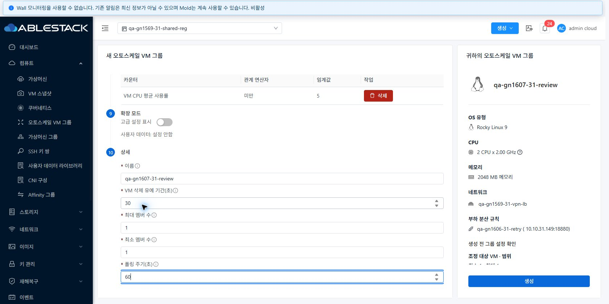
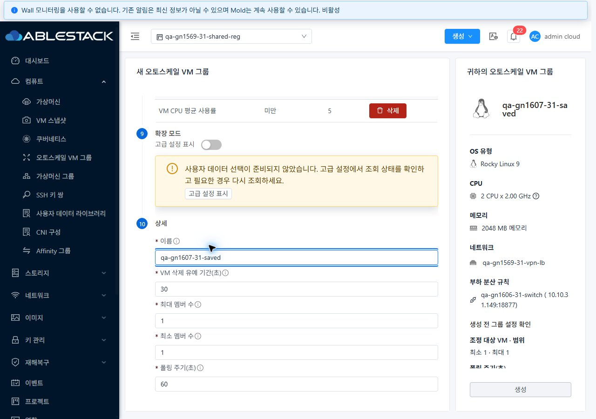

<!--
Licensed to the Apache Software Foundation (ASF) under one
or more contributor license agreements.  See the NOTICE file
distributed with this work for additional information
regarding copyright ownership.  The ASF licenses this file
to you under the Apache License, Version 2.0 (the
"License"); you may not use this file except in compliance
with the License.  You may obtain a copy of the License at

  http://www.apache.org/licenses/LICENSE-2.0

Unless required by applicable law or agreed to in writing,
software distributed under the License is distributed on an
"AS IS" BASIS, WITHOUT WARRANTIES OR CONDITIONS OF ANY
KIND, either express or implied.  See the License for the
specific language governing permissions and limitations
under the License.
-->

# #1607 AutoScale 기본 생성 초기화 개선

2026-11-09~10. **31 GFS2·32 Glue(Ceph) RBD에 UI만 반영**하고 실제 생성·조회 실패/복구·프로젝트 왕복·VM 배포를 확인했다. 제품 커밋 `3d0a5effdfff8b7af3f5c4c4d304c31a6f407a0a`. Epic 브랜치 `dhslove/epic-1554-guest-networks`·Draft PR [#1577](https://github.com/ablecloud-team/ablestack-cloud/pull/1577)을 유지한다. #1607 구현 범위는 완료이며 #1608과 #1569 조건부 통합 검증은 남아 있다.

[원본 캡처 100장](capture-matrix.ko.md) · [확인용 자원/직접 링크](resources.ko.md) · [요약](evidence/summary.json) · [60개 화면 행렬](evidence/ui-matrix.json) · [UI/DOM](evidence/ui-state.json) · [API 횟수](evidence/request-summary.json) · [로컬 테스트](test-results.ko.md).

## 변경한 화면과 원인

`컴퓨트 > 오토스케일 VM 그룹 > 생성`의 고급 설정 아래 User Data 선택기가 `v-if`로 늦게 마운트돼 준비 완료를 전달하지 못했다. 양쪽에서 필수 입력을 채워도 생성 버튼 비활성, 고급 설정만 열면 활성화되는 것을 개선 전 캡처로 다시 확인했다.

- User Data 선택기의 수명을 고급 설정 표시 여부와 분리했다. Zone·템플릿 정책 조건은 유지하고 User Data 영역은 `v-show`로 접는다. **고급 설정을 열지 않아도 ‘설정 안함’ 초기화가 완료**되고 생성할 수 있다.
- SSH·Affinity 선택 영역은 기존 `v-if`를 유지해 숨겨진 다른 선택기를 모두 선행 마운트하지 않는다. 고급 설정을 접어도 이미 선택한 User Data와 변수 값·조회 오류 상태를 보존한다.
- 접힌 기본 화면에는 `사용자 데이터: 설정 안함`을 명시한다. 준비가 끝나지 않았거나 조회가 실패해 제출이 막힌 경우 **이유와 ‘고급 설정 표시’ 버튼**을 같은 단계에 표시한다.
- **공유 소비자·선택기의 fail-closed 검사와 API/권한 정책은 변경하지 않았다.** 선택 데이터 조회 실패·권한 없음·소유 범위 변경 시 기존 차단을 유지하며, 프로젝트 변경은 선택/변수를 비우고 이전 응답을 폐기한다.
- 변경 파일은 CreateAutoScaleVmGroup.vue·ko/en 문구·새 회귀 spec이다. Java/API·오퍼링·운영 설정 변경은 없다. 생성 중 표시와 모바일/요약 footer 등 기존 VM 배포 화면 구조를 유지한다.

## 31·32 실 UI/API 결과

| 경로 | 양쪽 결과 |
| --- | --- |
| 기본 None·고급 설정 한 번도 열지 않음 | 초기화 완료·설정 안함 표시·생성 활성. UI 클릭으로 각 profile1/condition2/policy2/group1 생성. 6개 서버 job 각각 status1. 두 기본 profile 모두 userdataid 없음 |
| 저장 데이터 선택→고급 설정 닫기/다시 열기 | 프로젝트 전용 `qa-gn1607-{31,32}-init` 선택 및 REVIEW 변수 입력이 그대로 유지됨. 접힌 상태에서도 제출 가능 |
| 선택 데이터의 목록 조회 503 | 브라우저 CDP의 **현재 프로젝트 listUserData XHR 한 건에만 통제된503**을 적용. 고급 설정을 닫아도 경고/진입 버튼·생성 비활성 유지. Ctrl+Enter 후 생성 관련 API0건. 이전 목록·선택·변수 보존 |
| 조회 복구 후 저장 데이터 생성 | 실제 선택기의 업데이트 버튼으로 재조회 성공→기존 선택/변수 유지→고급 설정 접고 생성. 각 profile1/condition2/policy2/group1·6개 job status1. 서버 profile userdataid와 REVIEW 값이 입력과 일치 |
| 프로젝트→기본 보기→원 프로젝트 | 선택 데이터와 `old-project-draft` 변수가 새 생성 폼에 남지 않음. None 선택·빈 변수 상태 확인, 프로젝트 왕복 중 생성 관련 API0건. 이전 프로젝트 데이터가 제출되지 않음 |
| 생성과 실행 결과 구분 | 그룹 생성 job 완료를 먼저 기록하고 이후 **각 그룹 실제 멤버1/Running·LB 대상1**을 별도로 확인. 총4 VM은 호스트 `virsh domstate`와 domain UUID도 대조 |

전용 User Data는 API로 등록한 시험 라이브러리 개체이며, 그룹 생성·선택·오류/재조회·프로젝트 전환·배포 조건 보정은 UI에서 실행했다. 브라우저 조회 실패 대체는 시험 종료 시 제거했고 서버 API를 변경하거나 권한을 완화하지 않았다. 실제 저장된 권한/데이터 조회 실패를 성공으로 처리하는 구현은 없다. 이번 검증은 **Root 관리자·전용 Isolated LB** 문맥이며 전체 역할·VPC·외부 LB 조건의 완료를 주장하지 않는다. User Data 서버 연결/변수 저장은 확인했지만 게스트 내부 파일 실행 결과까지 검증한 것으로 표현하지 않는다. LB 백엔드 분산 비율·성능 측정은 제외했다.

### 32번 최초 배포 입력 보정

32번 최초 기본 생성에서는 검증 자동화가 전용 고정 오퍼링 선택을 명시하지 않아 기존 **E1335-No-Matching-Storage-Tag** 시험 오퍼링이 선택됐다. 그룹 생성은 성공했으나 최소 VM 배포 조건이 부적합했다. 이 시점을 VM 배포 성공으로 판정하지 않았다. 해당 새 그룹을 UI 비활성화하고 VM 프로필에서 전용 `qa-gn1569-32-vpn-lb-2c2g`로 수정, 이전 `overridediskofferingid` 매개변수를 제거한 뒤 UI 재활성화했다. 이후 Running1/LB1·실제 호스트 실행을 확인했다. 저장 데이터 그룹은 처음부터 전용 오퍼링과 연결 디스크를 명시해 생성했다. 이 보정은 #1607 초기화 수정과 구분하며 운영 오퍼링 자체를 수정하지 않았다.

## VM 메뉴 UI 표준과 화면 전환

실제 VM 목록·상세·NIC 탭·기존 네트워크 연결 창을 비교 기준으로 사용했다. AutoScale 생성 화면은 VM 배포의 세로 폼·오른쪽 요약·하단 생성 버튼·모바일 footer 구조를 유지하고, 새 상태/안내만 표준 Alert·Button·상속된 테마 색상으로 표시한다. 별도 리본이나 중복 생성 버튼을 추가하지 않았다. 그룹 상세/운영 탭·VM NIC 탭의 toolbar와 sticky breadcrumb도 대조했다.

**31/32 ×라이트/다크 ×390/768/1280px ×5화면(기본 생성·고급 생성·그룹 운영 탭·VM NIC 기준·VM 연결 대화상자)=60개 배치 검사 통과**. 페이지 가로 넘침0, breadcrumb 폭/위치, 대화상자와 footer의 viewport 범위를 확인했다. 표 내부 스크롤과 폼 본문 세로 스크롤은 허용한다. 모바일 footer가 유지되고 사용자 데이터 선택/입력·상태/경고의 라이트·다크 가독성을 원본 캡처로 점검했다.

양쪽 실제 스타일 설정 메뉴로 라이트↔다크를 전환했고 `performance.timeOrigin` 동일로 새로고침 없음을 확인했다. 프로젝트 왕복·생성→상세/VM 프로필/운영 탭·VM 목록/NIC 화면 이동을 실행했다. UI/DOM/테마를 주입해 성공 화면을 만들지 않았다. 브라우저 자동화 세션 한 차례 초기화 후 저장된 증적·현재 화면을 확인해 이어갔으며 완료된 그룹을 재생성하지 않았다. 캡처 **100장 모두 native JPEG·실제 live viewport·디코딩 치수·해시 일치**다.

## 로컬 검증·배포·보관

- WSL rocky ext4 `/home/ablecloud/work/dhslove/cloud-epic-1554/ui`에서 변경 파일 lint, **6 suites/160 tests(새5개)**, production UI 빌드 성공. 전체 Cloud/Java 빌드·수동 Actions 실행은 없다.
- 활성 `/usr/share/cloudstack-management/webapp`의 정적 파일662개를 갱신했다. WEB-INF/META-INF·관리 JAR·PID·서버 설정·대형 템플릿을 보존하고 해시 불일치0·HTTP200을 확인했다. 마지막 SSH 확인에서도 새 bundle 표식·index 해시·WEB-INF·HTTP200이 일치한다.
- 원격 백업 `/var/tmp/gn1607-ui-20261109-234346`, WSL `/home/ablecloud/work/gn1607-ui/backups/20261109-234346/{31,32}/static-backup.tar.gz`. [31 배포](evidence/31-deployment.json) · [32 배포](evidence/32-deployment.json) · [정적 manifest](evidence/manifest.json).
- 기존 31 VM155/망115,32 VM83/망98의 식별자·상태·NIC·호스트와 기존 AutoScale 그룹 범위/주기/참조를 유지했다. 새 VM은 각2개다. LB8개를 보존하되, 이번 시험에 사용한 기본/전환 규칙18876·18877에 각 새 멤버1개가 의도대로 연결됐다. 다른6개 규칙 설정은 동일하다.
- **각 클러스터 그룹2·프로필2·정책4·조건4·User Data1·Running VM2를 보관**했다. 그룹만 최종 DISABLED/최소1·최대1로 고정해 자동 증감을 멈췄고 VM/LB는 남겼다. 네트워크·기존 리뷰 자원을 삭제하지 않았다. 최종 기본 생성 리뷰 폼은 미제출이다. 임시 viewport·XHR 응답 대체는 제거했다.

## 남은 순서

다음 구현은 **[#1608](https://github.com/ablecloud-team/ablestack-cloud/issues/1608) AutoScale 그룹 업데이트 job 실패 시 대화상자/입력 보존**이다. 이어서 #1569의 VPN 실제 클라이언트/VPC S2S·제공자 준비된 Health Monitor·외부/VPC/Internal LB 및 오퍼링/환경 조건→63행 최종 통합 순이다. #1608이 남아 C06/P08 실패·전체 완료0을 유지하며 Epic #1554/#1569는 닫지 않는다. 자동 CI와 실환경/로컬 테스트는 별도 상태로 보고한다.

