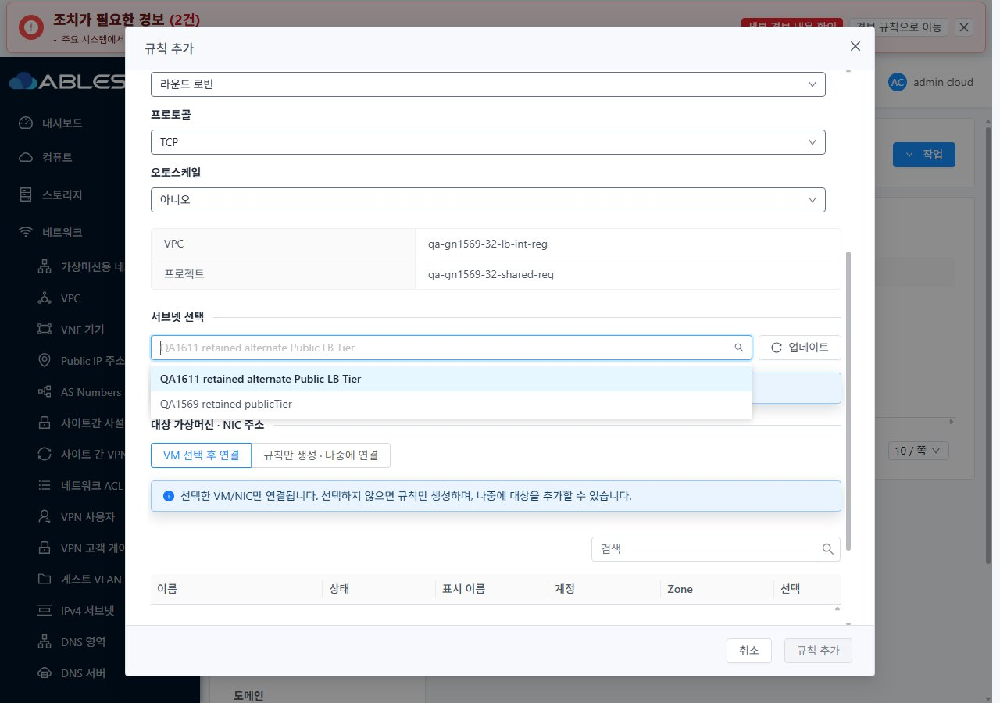
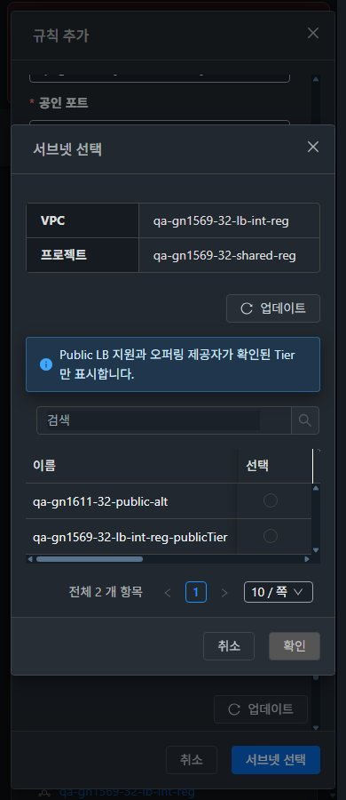

<!--
Licensed to the Apache Software Foundation (ASF) under one
or more contributor license agreements. See the NOTICE file
distributed with this work for additional information
regarding copyright ownership. The ASF licenses this file
to you under the Apache License, Version 2.0 (the
"License"); you may not use this file except in compliance
with the License. You may obtain a copy of the License at

  http://www.apache.org/licenses/LICENSE-2.0

Unless required by applicable law or agreed to in writing,
software distributed under the License is distributed on an
"AS IS" BASIS, WITHOUT WARRANTIES OR CONDITIONS OF ANY
KIND, either express or implied. See the License for the
specific language governing permissions and limitations
under the License.
-->

# #1611 VPC Public LB Tier 후보 UI 개선·실환경 검증

2026-11-10, 31 GFS2·32 Glue RBD에 **UI만** 구현·배포했다. 제품 커밋 `a12e293dca862c528ff9356e38ab570c396ac2ea`. API/Java/DB/역할 정책은 변경하지 않았다. 기존 Epic 브랜치 `dhslove/epic-1554-guest-networks`와 Draft PR #1577을 유지한다.

## 변경한 UI와 VM 표준

- Public IP → 부하 분산 → 규칙 추가/VM 연결의 Tier 후보를 공통화했다. 실제 `listNetworks.service.Lb.capability.LbSchemes`에 Public이 있고 연결 오퍼링의 Lb provider가 일치하는 같은 VPC·프로젝트 Tier만 표시한다. API에 없는 `supportspubliclb`나 의미가 다른 `supportspublicaccess`는 사용하지 않는다.
- 전체 페이지를 수집·검증한 적합 후보에 대해 로컬 검색·페이지·총계를 계산한다. 조회 중/실패/후보 없음/기존 선택 부적합을 구분하고 잘못된 제출을 차단한다. **업데이트 아이콘+텍스트 버튼**, VPC·프로젝트 요약, 안내문을 제공한다.
- Tier를 바꾸면 이전 VM/NIC 선택을 해제하고 이름·포트·CIDR 초안은 보존한다. 생성/연결 직전에 현재 역할·프로젝트·VPC·Tier·오퍼링을 재검사한다. 프로젝트 전환 시작과 늦은 후보/VM/job 응답을 무효화한다.
- AutoScale의 서브넷 선택 창을 VM 표준 **MoldDialog, 본문 스크롤, 고정 footer**로 전환했다. 세로 폼·VPC/프로젝트 문맥, 표 내부 가로 스크롤·고정 선택 열·상태 표시를 적용했다. 모바일 캡처에서 발견한 열 겹침과 투명 고정 열은 VM NIC 표의 배경 스타일로 수정했다.
- 공통 breadcrumb/VM 목록·상세·NIC 탭/연결 대화상자를 실제 UI로 비교했다. 기존 toolbar 순서·화면 이동을 유지하며 390/768/1280px, 즉시 light/dark, 프로젝트 왕복을 검증했다. VM 화면 소스 자체는 변경하지 않았다.

## 결과와 범위

32번 실제 API의 Lb Tier 3개(Public2/Internal1) 중 UI에는 Public2개만 노출됐다. 관리자·멤버·도메인 관리자에게 같은 후보가 표시됐다. 실제 일반 LB 생성/기존 Public NIC1개 연결 후 Active, AutoScale 경로의 규칙만 생성 후 Add, 역할별 생성 성공을 확인했다. **AutoScale 그룹 생성 및 LB 백엔드 부하분산 측정은 이번 범위가 아니다.**

31번은 Public IP 풀이 가득 찬 조건을 유지했다. 준비된 기존 VPC/Public IP를 변경 없이 열어 후보·갱신·실패/빈 응답 복구·6개 화면 배치를 확인했고, 본 작업 전용 Isolated IP에서는 실제 규칙 생성 job 성공을 확인했다. **31번 신규 VPC Public LB 생성 성공으로 확대 집계하지 않는다.** 기존 확인 자원/IP를 해제하지 않았다.

153개 로컬 단위 테스트(9개 suite)·변경 파일 lint·WSL ext4 UI 빌드 통과. 양쪽 정적 자산 664파일 배포/해시와 HTTP200, WEB-INF·META-INF·설정·관리 JAR/PID 보존을 확인했다. 전체 Cloud 빌드/수동 Actions 실행은 없다. 자동 CI 결과는 로컬/실환경 검증과 별도로 보고한다.

확인용 네트워크·IP·LB·기존 VM/NIC는 남겼다. 31번에서 작업 범위 밖 `rocky-95-airgap-repo-test-2`의 UUID 교체를 관찰했다. 이 작업은 VM 생성/삭제를 실행하지 않았으며 해당 자원을 복원·정리하지 않았다. 기존 QA VM/NIC와 기존 네트워크/LB/VPN/AS 설정 비교는 변경0이다.

[실행 결과·통제 응답의 한계](test-results.ko.md) · [원본 JPEG 79장](capture-matrix.ko.md) · [확인 자원/직접 UI 링크](resources.ko.md) · [남은 항목과 순서](followups.ko.md) · [63행 통합](../guest-network-1569-integrated/coverage.ko.md).

