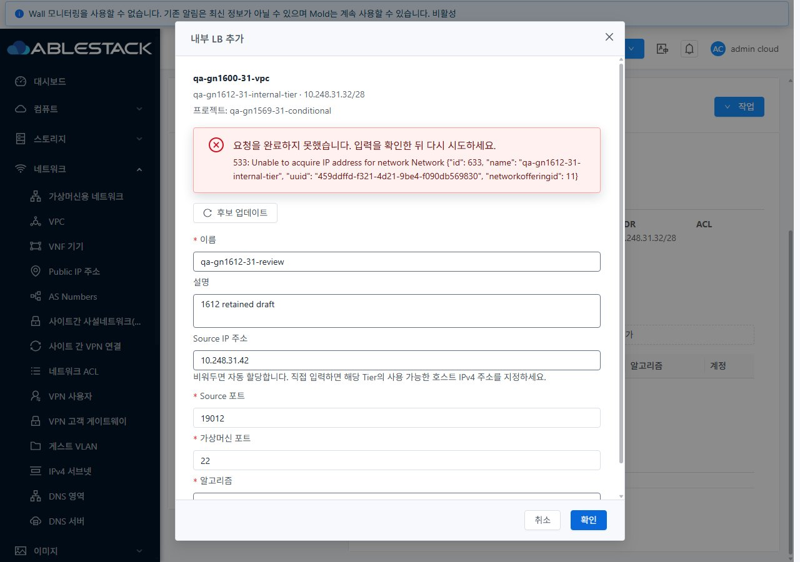
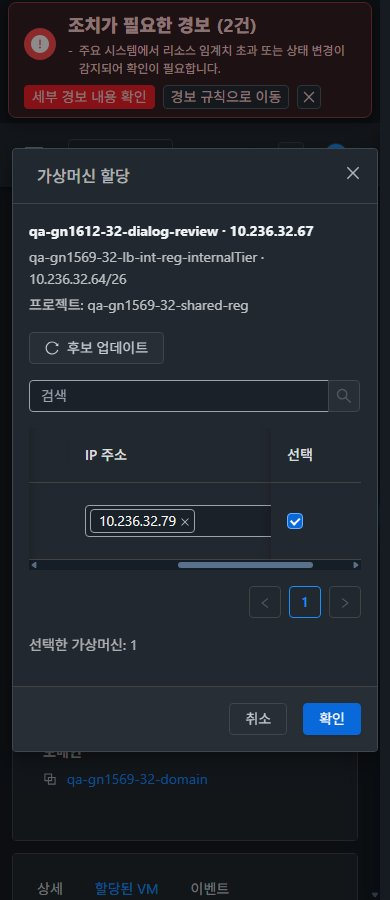

<!--
Licensed to the Apache Software Foundation (ASF) under one
or more contributor license agreements. See the NOTICE file
distributed with this work for additional information
regarding copyright ownership. The ASF licenses this file
to you under the Apache License, Version 2.0 (the
"License"); you may not use this file except in compliance
with the License. You may obtain a copy of the License at

  http://www.apache.org/licenses/LICENSE-2.0

Unless required by applicable law or agreed to in writing,
software distributed under the License is distributed on an
"AS IS" BASIS, WITHOUT WARRANTIES OR CONDITIONS OF ANY
KIND, either express or implied. See the License for the
specific language governing permissions and limitations
under the License.
-->

# #1612 Internal LB 생성·VM 할당 대화상자 개선

2026-11-10, **API/Java/DB/권한 정책 변경 없이 UI만** 개선해 31 GFS2·32 Glue RBD에 배포했다. 최종 제품 `c94767fb0c55909b82fd70ed91bfdc5b77b8167e`, Epic 브랜치 `dhslove/epic-1554-guest-networks`와 기존 Draft PR #1577을 유지한다.

## 바꾼 UI와 VM 표준

- **VPC → 네트워크 → Internal Tier → 내부 LB 추가:** legacy 520px 창을 **MoldDialog md720**으로 바꿨다. 이름·설명·소스 IP·서비스 포트·VM 포트·알고리즘을 세로로 배치하고 VPC/프로젝트/Tier/CIDR을 표시한다. 본문 스크롤, 고정 하단 취소/확인, 아이콘+텍스트 후보 업데이트를 적용했다.
- **Internal LB 상세 → 작업 → 가상머신 할당:** **MoldDialog lg960**, 이름/상태/IP/선택 4열, 내부 가로 스크롤과 고정 선택 열, 검색/페이지 이동을 적용했다. 행 번호 대신 VM ID로 선택을 유지하고 새 NIC/IP와 기존 연결을 제출 직전 다시 조회한다.
- **Internal LB 목록 → 추가:** Internal 지원 Tier 선택 → 같은 생성창을 사용하도록 통합했다. 일반 API 입력 폼으로 우회하지 않는다. Public 전용 Tier는 후보에서 제외한다.
- **상태 처리:** 사전 조회/검증/제출/job 진행/성공/확정 실패/결과 미확정을 구분한다. job1과 실제 생성 객체/연결을 확인해야 닫는다. 거부·job2는 입력/선택과 단일 오류를 보존한다. 바깥 클릭으로 닫히지 않으며 busy 중 취소/X/Escape·중복 클릭/Ctrl+Enter를 차단한다.
- **미확정 복구:** 제출 전 customjobid와 비밀값 없는 초안을 사용자/역할/소유자/프로젝트별로 저장한다. 접수/조회 유실·120초 경과 때 자동 재전송하지 않고 같은 작업만 다시 조회한다. 프로젝트/경로/권한/사용자 변경 및 unmount 이후의 응답은 폐기한다.

실제 양쪽 VM 목록·상세·NIC·기존 네트워크 연결창 및 breadcrumb 이동을 비교했다. 세 대화상자×두 클러스터×390/768/1280px×라이트/다크 **36배치**, 새로고침 없는 테마 전환, 프로젝트 기본 보기 왕복, 모바일 IP 스크롤과 선택 열 가독성을 확인했다. VM 메뉴 자체의 코드는 바꾸지 않았다.

## 검증 결과와 남은 서버 조건

- **31·32 실제 생성:** 사용 중인 시험 NIC IP의 실제 API **533** 거부 후 창/6필드·편집 가능 상태/오류1·spinner0을 유지했고, IP를 자동 할당으로 고쳐 각각 **POST1/job1/목록1**에 성공했다. 원래 이슈의 범위 밖 IP는 이제 로컬 CIDR 검사에서 **POST0**으로 막는다. 실제533과 통제431을 구분한다.
- **비동기/조회 실패:** 양쪽 생성·할당의 통제431/job0→job2/접수 유실+503×3/동일job 재조회에서 입력·선택과 잠금을 검증했다. 후보503은 마지막 입력/선택을 유지하고 제출을 차단하며 업데이트 후 복구한다. 통제 POST는 서버로 전달하지 않았다.
- **32 실제 할당:** Ctrl+Enter POST1, job1, b-482-VM Running, VM/IP1개, 자동 종료/목록 갱신을 확인했다. 별도 정상 생성의 접수 응답만 비워도 실제 customjobid `b720a891-4327-4daf-8811-1f0b9435b3cd`의 job1을 찾아 POST1로 복구했다.
- **31 실제 할당은 서버 미완료:** b-1006-VM이 Starting, job `9717c435-3a02-4040-afb7-8ffab5d2475b`는 0이며 호스트에는 도메인이 없다. 네트워크는 이후 Shutdown으로 관측돼 새 생성은 UI 사전 검사로 차단된다. UI는 timeout/spinner 종료·작업/선택 보존·동일job 재개를 확인했다. **DB 매핑1을 runtime 성공으로 집계하지 않는다.** 선기동 대조 VM도 배치530으로 실패했다. API/DB/VM 상태를 강제로 바꾸지 않았으며 [별도 후속 #1616](https://github.com/ablecloud-team/ablestack-cloud/issues/1616)에 증거/조사·복구 설계를 등록했다.
- **보안/보존:** 읽기 전용 직접 생성/할당 API는 31 각432,32 각401 거부. 32 실제 UI 목록 생성·상세 할당 작업 숨김/POST0. 기존 65개 LB 매핑·기존 VM/NIC/호스트·네트워크/VPC·역할/프로젝트 멤버십은 그대로다.

최종 **221검사/11 suite·변경 파일 lint·WSL ext4 UI 빌드 통과**. 활성 정적668파일/해시·HTTP200·WEB-INF/META-INF·설정·관리 JAR/PID 보존. 원본 JPEG **116장**의 실제 viewport/치수/해시를 대조했다. 전체 Cloud 빌드·수동 Actions 실행과 LB 분산/성능 측정은 하지 않았다. 자동 CI는 로컬/실환경 검증과 따로 판정한다.

[검증 상세·한계](test-results.ko.md) · [캡처 116장](capture-matrix.ko.md) · [확인 자원과 UI 주소](resources.ko.md) · [후속 순서](followups.ko.md) · [63행 통합](../guest-network-1569-integrated/coverage.ko.md).

