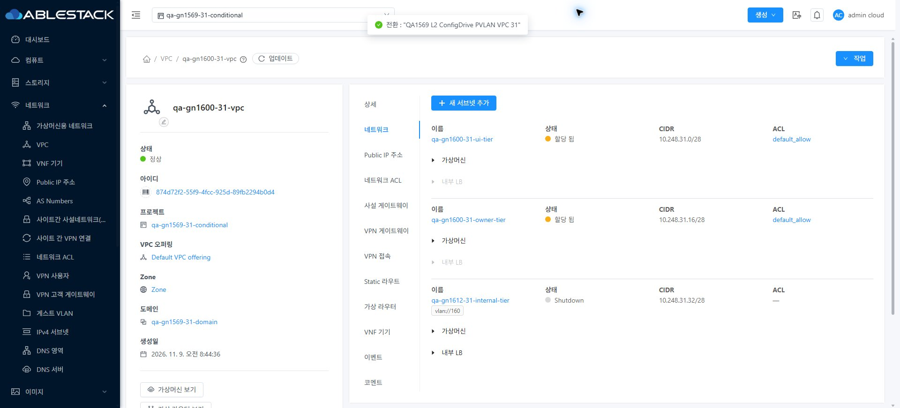
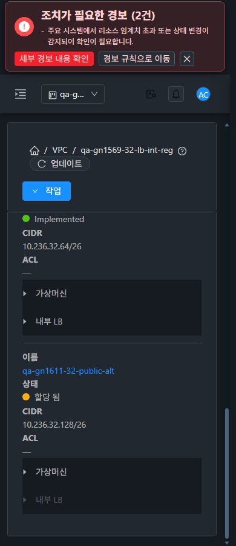

<!--
Licensed to the Apache Software Foundation (ASF) under one
or more contributor license agreements. See the NOTICE file
distributed with this work for additional information
regarding copyright ownership. The ASF licenses this file
to you under the Apache License, Version 2.0 (the
"License"); you may not use this file except in compliance
with the License. You may obtain a copy of the License at

  http://www.apache.org/licenses/LICENSE-2.0

Unless required by applicable law or agreed to in writing,
software distributed under the License is distributed on an
"AS IS" BASIS, WITHOUT WARRANTIES OR CONDITIONS OF ANY
KIND, either express or implied. See the License for the
specific language governing permissions and limitations
under the License.
-->

# #1613 VPC Tier ACL 빈 링크 개선과 Europa 동기화

2026-11-10, 기존 Epic 브랜치 `dhslove/epic-1554-guest-networks`에 upstream `ablestack-europa` **2d34af8f8a9**를 병합했다. 충돌 때 기존 UI 변경을 보존했다. 이후 **API/Java/DB/권한 정책 수정 없이** Tier ACL 표시를 개선해 31 GFS2·32 Glue RBD에 정적 UI를 배포했다. 제품 `295d82fe0f5a4266b69c9d8ba4d7fe8dff196f8e`, 병합 `5030bdde519`, 기존 Draft PR #1577을 유지한다.

## 변경한 화면과 VM 표준

- **VPC 상세 → 네트워크 탭 → Tier의 ACL 값:** 식별자가 없거나 잘못되면 **—**, 유효 UUID가 있으면 기존 ACL 상세 링크를 유지한다. 이름만 없으면 UUID를 읽을 수 있는 링크 이름으로 표시한다. 기본 ACL을 추정하거나 ACL 조회 API를 추가하지 않는다.
- **상태 갱신:** 최신 VPC 응답의 네트워크 ID로 ACL을 찾는다. 부모/자식 조회 실패·진행 중·프로젝트 전환·문맥 불일치 때 이전 링크를 재사용하지 않고 성공한 현재 문맥에서만 복구한다.
- **표준:** VM 상세의 값/링크, 탭 툴바와 breadcrumb 스타일을 그대로 사용하며 긴 UUID는 줄바꿈한다. 별도 리본·버튼·새 대화상자를 추가하지 않았다. 실제 양쪽 VM 목록·상세·NIC·기존 연결 대화상자·breadcrumb와 비교했다.
- **upstream 충돌:** en/ko의 기존 변경 359키씩을 유지하고 신규 47키씩을 통합했다. 사용자 저장소의 기존 API 메타데이터 처리를 유지하면서 upstream Wall 초기화를 추가했다. Epic 전용 UI186파일은 병합 시 동일하다. 전체 회귀가 잡은 PCI Running 상태 동작 차이는 기존 **Stopped 전용 UI 가드로 복원**했다. [동기화 상세](upstream-sync.ko.md).

## 검증 결과

- **실제 데이터:**31 프로젝트 VPC는 정상 ACL2·누락1,32 프로젝트 VPC는 누락3 모두 정확히 표시한다. 양쪽 기본 보기 사용자 지정 ACL의 실제 상세 이동/뒤로 복귀가 정상이다. undefined 링크0.
- **이름 누락·실패 분기:** 실제 읽기 응답을 브라우저에서 통제해 이름만 생략한 UUID 링크의 실제 이동을 확인했다. 부모 listVPCs·자식 VM 조회503 후 이전 링크0·spinner 종료→실제 업데이트 복구, 지연 조회와 프로젝트 기본 보기 왕복을 확인했다. 통제 읽기 응답은 서버 데이터/정책을 변경하지 않는다.
- **역할:** 회원·읽기 전용의 실제 ACL 상세 이동/복귀, 읽기 전용 누락 대시/생성 비활성, 비회원 무노출을 양쪽 UI에서 확인했다. 직접 API는 관리자/회원/읽기 전용 조회 허용, 비회원 VPC/ACL 각각432 거부 **16건**이며 기존 정책을 유지한다.
- **화면:** 유효/누락 VPC×31·32×390/768/1280×라이트/다크 **24배치**, 새로고침 없는 즉시 테마(timeOrigin 동일), 프로젝트 왕복, 추가 읽기 전용/VM 모바일 비교를 포함해 **28건**의 overflow/breadcrumb 검사를 통과했다. 읽기 전용 계정의 테마 설정 메뉴는 기존 정책상 제공하지 않는다.
- **검사:** 최종 **264검사/13 suite·변경 파일 lint·WSL ext4 UI 빌드 통과**. 전체 UI lint 통과, 최초 전체311 suite는 실패10건이었다. PCI1건을 복원/재검증했고 나머지9건은 동기화 전 커밋에서도 재현됐다. 전체 최종 재실행 성공으로 표현하지 않는다. [검증 한계](test-results.ko.md).
- **배포/보존:** 양쪽 활성 정적670파일 해시·HTTP200·WEB-INF/META-INF·설정·관리JAR/PID 보존. 시험 자원 생성/삭제/변경0. 기존67개 안정 LB 연결 결과와 역할/멤버십 동일. 이전31 #1616 진행 중 할당1건은 서버에서 job2/530으로 끝나 매핑이 철회됐다. 별도 후속에 인계한다.

[원본 캡처 79장](capture-matrix.ko.md) · [남겨둔 확인 자원과 UI 주소](resources.ko.md) · [후속 순서](followups.ko.md) · [63행 통합](../guest-network-1569-integrated/coverage.ko.md).

