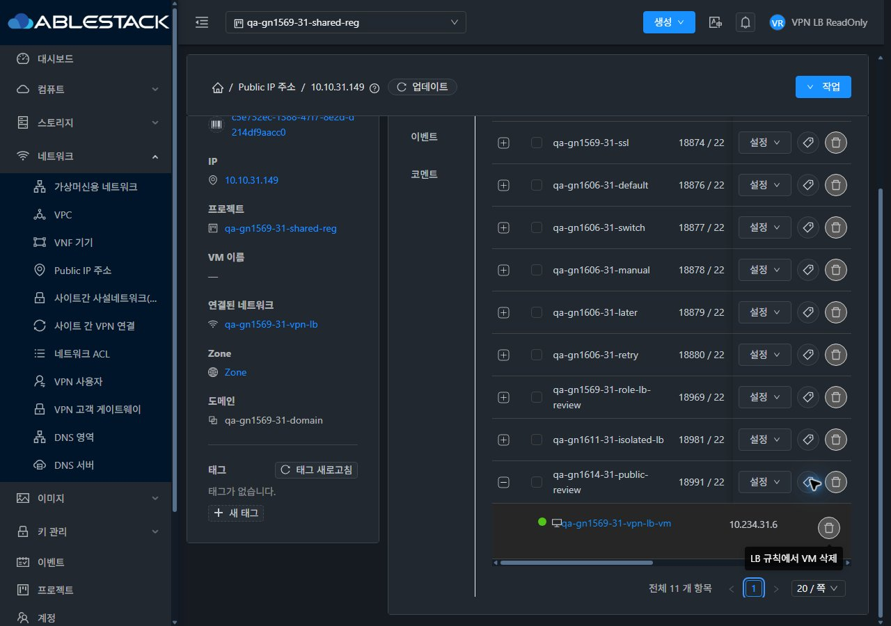
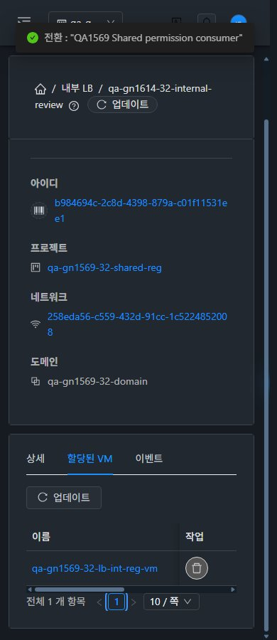

<!--
Licensed to the Apache Software Foundation (ASF) under one
or more contributor license agreements. See the NOTICE file
distributed with this work for additional information
regarding copyright ownership. The ASF licenses this file
to you under the Apache License, Version 2.0 (the
"License"); you may not use this file except in compliance
with the License. You may obtain a copy of the License at

  http://www.apache.org/licenses/LICENSE-2.0

Unless required by applicable law or agreed to in writing,
software distributed under the License is distributed on an
"AS IS" BASIS, WITHOUT WARRANTIES OR CONDITIONS OF ANY
KIND, either express or implied. See the License for the
specific language governing permissions and limitations
under the License.
-->

# #1614 읽기 전용 Public/Internal LB 백엔드 해제 UI 가드

2026-11-10, **API/Java/DB/역할 정책 변경 없이 UI만** 개선해 31 GFS2·32 Glue RBD에 반영했다. 제품 `4643d1e70470e6025d61d77ce14954342cfeaae9`. Epic 브랜치 `dhslove/epic-1554-guest-networks`와 기존 Draft PR #1577을 유지한다.

## 바꾼 UI와 VM 표준

- **Public IP → 부하 분산 → 펼친 백엔드 행:** `removeFromLoadBalancerRule`/job 조회 권한과 최신 대상·프로젝트·사용자·역할을 검사해 읽기 전용 해제 아이콘을 비활성화했다. 직접/이전 핸들러도 같은 검사를 거친다. 기존 AutoScale/Kubernetes 보호와 busy·오래된 목록 가드를 유지한다.
- **Internal LB → 할당된 VM 탭:** 같은 해제 가드와 단일 인라인 작업 상태를 적용했다. 거부/비동기 실패는 행을 보존하고 spinner를 종료한다. VM NIC 탭처럼 **아이콘+텍스트 업데이트 toolbar를 먼저 배치**, 표 내부 가로 스크롤·고정 작업 열·라이트/다크 배경을 적용했다.
- **공통 상태/문맥:** 중복 POST를 차단하고 접수/결과 미확정 때 자동 재전송하지 않는다. job ID가 있으면 같은 job만 다시 조회한다. 프로젝트 전환 시작부터 이전 결과를 폐기하고, 전환 종료 이벤트로 현재 UI를 다시 갱신한다. 전환 실패에도 잠금이 남지 않는 것을 단위 테스트로 확인했다.
- 검증 중 확인한 기존 Public LB Zone 초기 조회의 `this.column.push` 예외를 제거했다. 알고리즘/프로토콜 표시는 기존 `compactColumns`를 유지한다.

실제 VM 목록·상세·NIC 탭·MoldDialog 연결창을 비교했고 breadcrumb→목록→상세→탭 이동, 390/768/1280px×2테마×3화면 **18배치**, 새로고침 없는 즉시 테마·프로젝트 왕복을 확인했다. VM 화면 소스 자체는 바꾸지 않았다. 이번 새 UI는 백엔드 목록/작업 상태이며, 기존 Internal 생성·할당 대화상자 전체 표준화까지 완료로 확장하지 않는다.

## 결과

31 Public / 32 Public·Internal에서 읽기 전용 native 버튼 비활성, 화면 안의 실제 포인터 좌표·Tab 건너뛰기/Enter 경로에서 **해제 POST0**을 확인했다. 관리자·멤버·도메인 관리자는 전용 새 규칙에서 실제 UI로 해제→동일 NIC 재연결에 성공했다. 실제 job1과 연결0→1, 최종 정확한 VM/IP1개를 확인했다. 양쪽 실제 AutoScale 규칙의 해제 차단/POST0도 유지됐다.

직접 역할 API는 **27기록(조회15·읽기 전용/비회원 변경 거부12)**이고 기존 프로젝트 멤버십·읽기 전용 역할 규칙이 정확히 일치한다. UI가 서버 보안 검사를 대신하거나 권한을 확대하지 않는다. 이슈 원인은 UI 일관성/실패 상태이며 API 권한 우회로 판정하지 않는다.

최종 185테스트/10 suite·변경 파일 lint·WSL ext4 UI 빌드 통과. 양쪽 활성 정적665파일/해시·HTTP200·WEB-INF/META-INF·설정·관리JAR/PID 보존 확인. 원본 JPEG 95장 치수·해시를 대조했다. 전체 Cloud 빌드/수동 Actions 실행은 없고 자동 CI는 별도로 확인한다.

기존 **62개 LB 규칙의 적용 백엔드 매핑**, 기존 QA VM/NIC/호스트·네트워크/VPN/AS·권한을 보존했다. 신규 확인용 LB3개는 연결된 상태로 남겼다. 새 네트워크·사용자 VM은 만들지 않았다. 범위 밖 `GFS-TEST-VM`의 Running→Stopped/host 해제는 별도 관측으로 기록하고 원복하지 않았다.

[실행 결과와 범위](test-results.ko.md) · [원본 캡처 95장](capture-matrix.ko.md) · [확인 자원/직접 UI](resources.ko.md) · [후속 순서](followups.ko.md) · [63행 통합](../guest-network-1569-integrated/coverage.ko.md).

