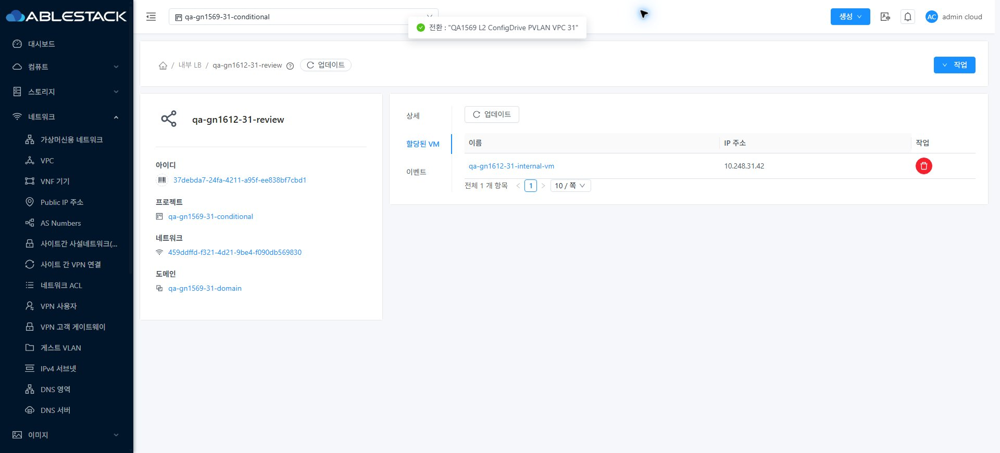
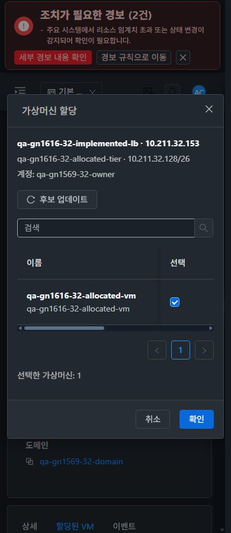

<!--
Licensed to the Apache Software Foundation (ASF) under one
or more contributor license agreements. See the NOTICE file
distributed with this work for additional information
regarding copyright ownership. The ASF licenses this file
to you under the Apache License, Version 2.0 (the
"License"); you may not use this file except in compliance
with the License. You may obtain a copy of the License at

  http://www.apache.org/licenses/LICENSE-2.0

Unless required by applicable law or agreed to in writing,
software distributed under the License is distributed on an
"AS IS" BASIS, WITHOUT WARRANTIES OR CONDITIONS OF ANY
KIND, either express or implied. See the License for the
specific language governing permissions and limitations
under the License.
-->

# #1616 Internal LB 최초 시작·실패 복구

2026-11-10, 31 GFS2·32 Glue RBD에 제품 `a1a44f1827256cf2e24c503486609e69a5640cec`의 Internal LB 두 클래스를 반영했다. 기존 Epic 브랜치 `dhslove/epic-1554-guest-networks`와 Draft PR #1577을 유지한다. 31 최초 실패는 Public IP 풀 부족이며, 실패 정리와 최초 Tier 구현 중 동일 VM 시작 재진입이 장기 Starting 대기를 만들었다. 정상 정리·시작 직렬화·재시도 경계를 수정했다.

## 변경 내용과 UI 표준

- **서버:** Revoke-only 정리는 실행 중인 LB VM에만 전달하고 VM을 새로 시작하지 않는다. 자기 `VmWorkStart`의 `Starting` 재진입만 식별해 정상 시작 마무리에서 규칙을 적용한다. 실패 후 `Shutdown` Tier는 활성 User NIC·진행 VM job·불안정 controller가 없을 때만 정상 shutdown 작업으로 `Allocated`까지 정리한다. DB state 강제 변경은 없다.
- **UI 변경:** 이번에는 UI 코드를 수정하지 않았다. 기존 #1612의 VM 표준 Internal LB 생성·가상머신 할당 대화상자, 탭 툴바·breadcrumb·모바일·다크 테마를 유지했다. 실제 실패 때 선택한 VM1개/창/오류를 보존하고, 자원 확보 후 같은 창에서 재시도해 job1 이후 자동 종료하는 동작을 확인했다.
- **보안/범위:** API endpoint·요청/응답 스키마·역할 정책·호스트 패키지는 바꾸지 않았다. LB 백엔드 분산/성능 측정은 제외한다.

## 검증 결과

- **31 원래 실패 자원:** 최종 패치에서 실제 Public IP 부족을 재현해 API job2/530·UI job2/530으로 종료했다. UI는 **3.812초** 후 입력을 유지하고 spinner0이다. Tier는 `Allocated`/broadcastURI 없음으로 복구됐고 실패 controller1008/1013/1014의 활성 VM·volume·NIC·pending job은 모두0이다. 임시 Public IP 예약2개는 정상 반환했다.
- **31 정상 복구:** 자원 확보 후 원래 규칙 `qa-gn1612-31-review`를 실제 UI로 재시도했다. POST1/job `e85c5ae0…`가1, **b-1015-VM Running**, Tier Implemented·VLAN160, backend `10.248.31.42:22`와 실제 LB listener `10.248.31.39:19012`가 일치한다. backend와 VPC router는31.1 같은 호스트에 배치했다.
- **양쪽 상태 행렬:** Allocated 첫 할당과 Implemented 추가 할당 **4건 모두 실제 UI job1**, b1010/b1012/b484/b486 Running·게스트 NIC·HAProxy listener/backend가 일치한다. 최종 패치 후 Implemented 양쪽 재할당 job1과 기존 controller 재사용도 확인했다. 초기 양성4건은 b31 패치에서 수행했고 a1 최종 패치에서는 실제 잔여 runtime·매핑4건과 양쪽 재할당/31 원래 자원 전체 경로를 다시 검증했다.
- **화면/역할:** 양쪽 생성/할당×390·768·1280×light/dark **24배치**, VM 모바일 비교2개를 더한 **26배치**에서 페이지 overflow·breadcrumb·창 경계가 정상이다. 즉시 테마(timeOrigin 동일), 프로젝트 기본 보기/Shared/31 conditional 왕복·VM 목록/상세/NIC/기존 연결창/뒤로 이동을 확인했다. 읽기 전용 버튼 native 비활성 및 양쪽 직접 생성/할당 API4건 거부로 기존 정책을 유지했다.
- **로컬/배포:** WSL ext4의 변경 Maven 모듈 **62검사/8 suite·Checkstyle0·package 성공**, 새 회귀22건. 활성 JAR은 두 클래스만 교체하고 나머지204,655 entries 동일. 양쪽 정적670파일 해시 동일·WEB-INF 보존·서비스 active·HTTP200·API 로그인 확인. 전체 Cloud 빌드/수동 Actions/UI 재빌드는 실행하지 않았다.
- **승인된 정리/보존:** 가장 오래된 `qa-gn1569-31-nat`을 삭제해 Public IP3개/VLAN176을 확보했다. 연결돼 있던 VM은 기존 L2 NIC를 기본 NIC로 바꿔 Running으로 보존했다. 그 네트워크의 LB4개만 함께 제거됐으며 다른 기존 VM/VPC·NIC/안정 backend·역할/멤버십을 보존했다. 확인용 새 자원은 남겼다.

## 후속 결함과 통합 판정

**#1617:**31 같은 Tier·같은 Source IP의 다른 포트 Internal LB 생성이537로 거부된다. `Long` 네트워크 ID의 객체 비교를 실제 배포 bytecode에서 확인했다. 이번 시작 복구와 별도로 남겼으며 32 같은 IP 재현은 미실행이다. 생성 실패 입력 보존은 정상이다.

다음 **#1617 → #1569 잔여 owner/VPN 철회·LB SSL/오퍼링 조건 → 환경 준비 후 조건부 →63행 통합**. P05는31 실패1로 기록하고 양쪽 P06은 부분을 유지한다. 최신 집계31 **실패1·부분53·환경차단6·적용제외3·완료0**,32 **실패0·부분54·환경차단6·적용제외3·완료0**이다. Epic/#1569/PR은 완료하지 않는다.

[원인·설계](design.ko.md) · [job/runtime/검사](test-results.ko.md) · [원본 JPEG75장](capture-matrix.ko.md) · [남겨둔 자원/UI 주소](resources.ko.md) · [후속 순서](followups.ko.md).

