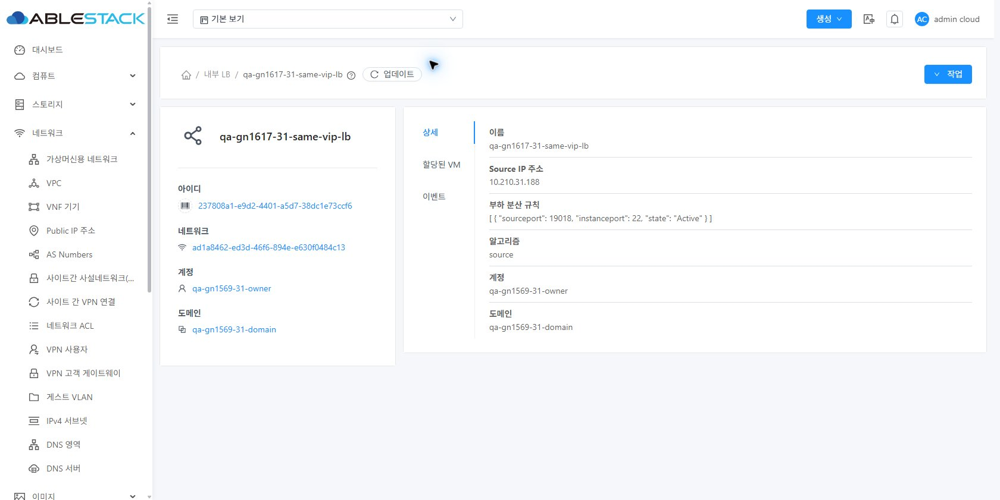
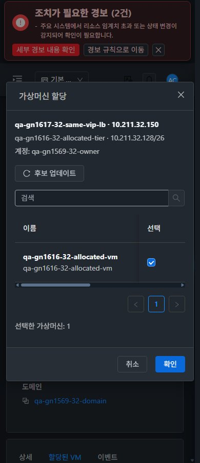

<!--
Licensed to the Apache Software Foundation (ASF) under one
or more contributor license agreements. See the NOTICE file
distributed with this work for additional information
regarding copyright ownership. The ASF licenses this file
to you under the Apache License, Version 2.0 (the
"License"); you may not use this file except in compliance
with the License. You may obtain a copy of the License at

  http://www.apache.org/licenses/LICENSE-2.0

Unless required by applicable law or agreed to in writing,
software distributed under the License is distributed on an
"AS IS" BASIS, WITHOUT WARRANTIES OR CONDITIONS OF ANY
KIND, either express or implied. See the License for the
specific language governing permissions and limitations
under the License.
-->

# #1617 동일 VIP의 다른 포트 Internal LB 생성537 개선

2026-11-10, 제품 `05555f0074f280f61df776597cb500df5ef31824`를31 GFS2·32 Glue RBD에 반영했다. 기존 Epic 브랜치 `dhslove/epic-1554-guest-networks`와 Draft PR #1577을 유지한다. 같은 네트워크 ID인 `Long`을 객체 identity로 비교해 다른 네트워크로 오판하던 조건을 **null 안전한 값 비교**로 수정했다. API 계약·권한 정책·UI 소스는 유지한다.

## 변경 내용과 검증

- **재현:** 배포 전 양쪽 직접 API와32 실제 UI에서 같은 VIP/다른 포트537을 확인했다. 수정 전 소스에 새 테스트를 실행해 동일 NetworkRuleConflictException을 재현했다.
- **정상 생성/할당:** 양쪽 실제 UI에서 기존19016 중복 포트는537로 거부하고, 같은 창의 입력을 유지한 채19018로 수정해 **POST1/create job1/자동 닫힘·VM 할당 job1**을 확인했다. 직접 API로 같은 VIP의19019 생성/할당도 양쪽 job1이다. 총 성공 job8개를 API/실제 UI 응답과 대조했다.
- **격리/충돌:** 양쪽 직접 API의 동일 포트537(포트 범위 충돌)·다른 backend 네트워크537(다른 네트워크)을 유지했다. 원래 상태 오판이던 에러와 정상 충돌 거부를 메시지/요청으로 구분했다. 읽기 전용의 실제 생성/할당 API4건은31 각각432/32 각각401로 계속 거부된다.
- **실제 런타임/NIC:**31 기존 **b-1010-VM**,32 기존 **b-484-VM**을 재사용했다. controller 개수/ID·호스트·virsh NIC/MAC/브리지가 동일하며 게스트의 기존19016·새19018/19019 listener와 HAProxy backend IP:22가 모두 일치한다. backend VM의 QGA IP/MAC와 VPC router 같은 호스트 배치도 확인했다. 새 VM·NIC는 생성하지 않았다.
- **UI 표준:** 이번 UI 코드/스타일 변경은 없다. 기존 VM 표준 생성·할당 대화상자·탭 툴바/breadcrumb를 유지했다. 양쪽 생성/할당×390/768/1280×light/dark24개와 VM 모바일2개, 총 **26배치**의 페이지 overflow/창/breadcrumb 경계를 확인했다. 즉시 테마(timeOrigin 동일), 기본 보기↔Shared 왕복, 실제 VM 목록·상세·NIC·연결창·breadcrumb 이동을 비교했다. 관리 서비스 재시작 후에는 실제 UI로 재로그인했다.
- **검사/배포:** WSL ext4 변경 **server 모듈 package·관련23검사/2 suite·Checkstyle0 통과**(신규12). 활성 JAR의 한 클래스만 교체하고 다른204,656 entries는 동일하다. 양쪽 정적670파일/WEB-INF·HTTP200·서비스 active·API 로그인을 확인했다. 전체 Cloud 빌드/수동 Actions/UI 재빌드/호스트 패키지 변경은 없다.
- **보존:** 기존68규칙의 연결 결과와 모든 VM/VPC/망/controller ID·User NIC·역할/멤버십을 유지했다. 이번 신규 시험 LB4개만 추가했고 확인용으로 남겼다. 이전 시험 네트워크 삭제는 이번에 수행하지 않았다.

## 후속과 한계

같은 VIP 기능의 생성537은 해소했다. **#1569 준비된 owner/VPN 철회·LB SSL/오퍼링 잔여 회귀 → #1618 Internal LB 상세 원시 JSON 가독성 개선 → 환경 준비 후 조건부 →63행 통합** 순서다. #1618은 값/기능 오류가 아닌 기존 상세 표현의 UI 개선 항목이며 이번에 수정하지 않았다. 제공자 없는 Health Monitor 정상/복구는 환경 차단, LB 분산/성능 측정은 제외한다.

최신 통합은 양쪽 **실패0·부분54·환경차단6·적용제외3·완료0**. 이번 조건 성공을 전체 LB/역할 조합 완료로 확대하지 않는다. Epic #1554/#1569와 Draft PR #1577은 Open 유지한다.

[설계](design.ko.md) · [실제job/런타임/검사](test-results.ko.md) · [원본 JPEG52장](capture-matrix.ko.md) · [확인용 자원/UI 주소](resources.ko.md) · [후속 순서](followups.ko.md).

