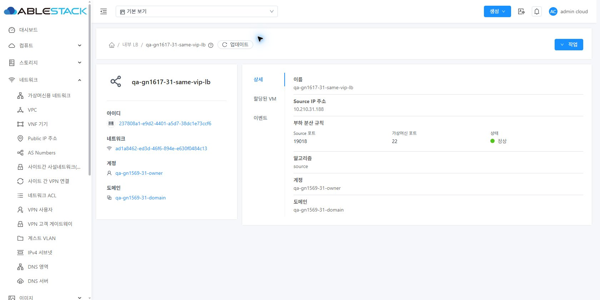
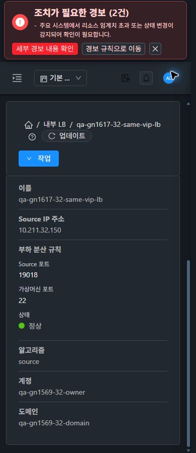

<!--
Licensed to the Apache Software Foundation (ASF) under one
or more contributor license agreements. See the NOTICE file
distributed with this work for additional information
regarding copyright ownership. The ASF licenses this file
to you under the Apache License, Version 2.0 (the
"License"); you may not use this file except in compliance
with the License. You may obtain a copy of the License at

  http://www.apache.org/licenses/LICENSE-2.0

Unless required by applicable law or agreed to in writing,
software distributed under the License is distributed on an
"AS IS" BASIS, WITHOUT WARRANTIES OR CONDITIONS OF ANY
KIND, either express or implied. See the License for the
specific language governing permissions and limitations
under the License.
-->

# #1618 Internal LB 규칙 표시 개선

2026-11-10, 제품 `e4b008d6b5a6ec42f680c796babbf66c0b5771db`의 UI를31 GFS2·32 Glue RBD에 반영했다. **API/Java/권한 정책을 수정하지 않았다.** 기존 Epic 브랜치 `dhslove/epic-1554-guest-networks`와 Draft PR #1577을 유지한다.

## 변경한 UI와 VM 표준

- **Internal LB 상세 → 상세 탭 → 부하 분산 규칙:** 원시 JSON 대신 **Source 포트·가상머신 포트·상태**로 표시한다. 데스크톱은3열, 모바일은 세로 배치한다. 여러 항목은 구분선으로 나눈다.
- **Internal LB 목록 → 부하 분산 규칙 열:** 상세와 같은 공통 컴포넌트로 표시한다. 다른 리소스의 같은 이름 필드는 기존 처리를 유지한다.
- **VM 표준:** 기존 Status 배지·테마 변수·레이블/값 스타일을 재사용한다. 실제 Active는 초록 배지의‘정상’으로 보이고 Add 등은 기존 공통 상태 처리를 따른다. 탭 툴바·breadcrumb·기존 대화상자를 재배치하거나 새 리본/작업 버튼을 추가하지 않았다.
- **값/문맥:** 누락/빈 배열/잘못된 포트는 대시, 부분 규칙은 유효 값과 개별 대시를 표시한다. HTML을 해석하거나 원시 객체를 문자열로 출력하지 않는다. 조회 진행/실패·권한 준비 전·route id 불일치·프로젝트 전환 때 이전 규칙을 숨기고 현재 응답 성공 후 복구한다. 표시 컴포넌트의 추가 API 호출은 없다.

## 실제 검증

- 양쪽 실제 API는 계속 `sourceport19018/instanceport22/stateActive`를 반환하고 UI는 **19018·22·정상**으로 표시한다. 기존 여러 LB 항목19016/19018/19019가 목록에서 각각 읽히며 네트워크 링크 실제 이동·브라우저 뒤로 복귀도 정상이다.
- 현재 생성 API는 **LB 항목당 포트 규칙1개**를 반환한다. 한 항목의 복수 배열은 브라우저의 읽기 응답만 통제해2행·Active/Add·포트/상태 배치를 검증했다. 실제 목록의 여러 항목과 통제 배열을 구분하며 DB/API를 바꾸지 않았다.
- 양쪽 빈 배열·필드 누락·부분 규칙, listLoadBalancers503 후 이전 규칙 숨김→실제 업데이트 복구를 확인했다. 실제 응답을 잡아둔 채 프로젝트를 바꾼 후 늦게 전달해도 이전 규칙0이며, 정상 프로젝트 왕복도 통과했다.
- **상세/목록/통제 복수×31·32×390/768/1280×2테마36배치**, VM 모바일2개·실제 규칙 모바일 가독성2개를 더한 **40배치**를 확인했다. 즉시 테마(timeOrigin 동일), VM 목록/상세/NIC/연결창/취소/breadcrumb를 비교했다. 실제 텍스트 대비는 라이트 레이블7.56:1·값14.68:1, 다크9.18:1·13.35:1이다.
- 32 읽기 전용 프로젝트의 실제4개 규칙 표시와31의 해당 범위 빈 목록을 확인했다. 직접 생성/할당4건은31 각각432/32 각각401로 거부됐고 역할/멤버십은 같다. 관리자 검토 화면으로 복귀했다.
- 최종 **263검사/11 suite·변경 파일 lint·WSL ext4 UI 빌드 통과**. 신규30검사와 기존 Status/PSK/공통 상세/링크/Internal LB/프로젝트 회귀를 포함한다. 전체 UI suite/Cloud 빌드·수동 Actions·서버/호스트 패키지 빌드는 실행하지 않았다.
- 양쪽 활성 정적670파일 해시·HTTP200을 확인했고 **WEB-INF/설정/JAR/PID를 보존**했다. 기존72개 규칙·backend/IP와 VM/망/VPC/controller/NIC·권한은 그대로다. 이번 서버 시험 자원 생성·삭제·변경은0이다.

[설계](design.ko.md) · [검증/한계](test-results.ko.md) · [원본 JPEG82장](capture-matrix.ko.md) · [남겨둔 확인 자원/UI](resources.ko.md) · [후속 순서](followups.ko.md).

