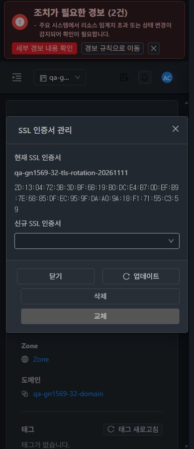
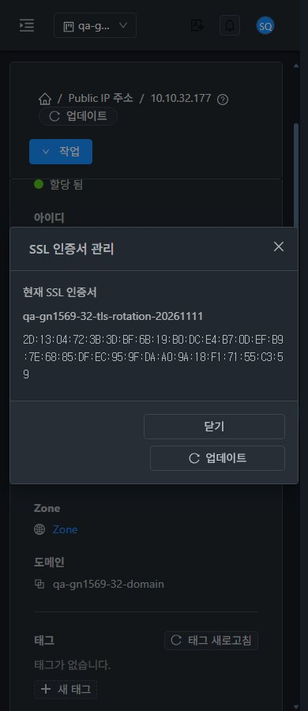

<!--
Licensed to the Apache Software Foundation (ASF) under one
or more contributor license agreements. See the NOTICE file
distributed with this work for additional information
regarding copyright ownership. The ASF licenses this file
to you under the Apache License, Version 2.0 (the
"License"); you may not use this file except in compliance
with the License. You may obtain a copy of the License at

  http://www.apache.org/licenses/LICENSE-2.0

Unless required by applicable law or agreed to in writing,
software distributed under the License is distributed on an
"AS IS" BASIS, WITHOUT WARRANTIES OR CONDITIONS OF ANY
KIND, either express or implied. See the License for the
specific language governing permissions and limitations
under the License.
-->

# #1619 SSL 인증서 대화상자 개선 — 2026-11-11

31 GFS2·32 Glue RBD에 **UI만 반영**했다. Public IP > 부하 분산 > 설정 > SSL 인증서 관리의 역할별 버튼·실패 복구·모바일 배치를 개선했다. API·보안 정책·관리 JAR·SystemVM 소스는 변경하지 않았다.

- VM 표준 MoldDialog md·세로 폼·전체 폭 드롭다운·하단 버튼·모바일 줄바꿈·긴 이름/지문 줄바꿈을 적용했다. 현재 인증서와 신규 선택을 구분한다.
- 유효 API 메타데이터로 조회·할당·해제를 각각 검사하고 메뉴/실행 메서드를 함께 보호한다. SSL 읽기 전용 역할에는 현재 정보와 닫기/업데이트만 보인다. 프로젝트 소유 범위를 명시한다.
- 동기 거부·job2 실패 뒤 같은 창/선택값과 재시도를 유지한다. 조회 실패는 쓰기를 잠그며 재조회 성공 후 복구한다. 중복 제출을 막고 결과 불명 시 동일 job을 다시 조회한다. 프로젝트·역할·세션·리소스·탭·경로 변경의 늦은 응답은 초안을 복원하지 않는다.
- 양쪽 관리자·소유자·구성원·도메인 관리자·SSL 제한 역할·비구성원 UI를 확인했다. 할당 전용/해제 전용 시험 권한도 독립 검증 후 원래 두 거부 규칙으로 원복했다. 제한 UI 쓰기0·직접 API401/작업0이다.
- **실제 UI16작업 job1**: 클러스터별 관리자 교체, 소유자 해제/할당, 구성원 교체/복원, 할당 전용 교체, 해제 전용 해제, 소유자 최종 할당의8건. 교체 지문/단일 TLS backend HTTP200, 해제 후 TLS 부재, 최종 원래 인증서 지문/HTTP200을 대조했다. LB 부하분산 측정은 제외했다.
- 통제 응답503·job0→2·조회 실패/복구·결과 조회3회 장애→동일 job 재조회, 프로젝트/탭 이동 중 실제 늦은 응답을 확인했다. 이 통제 실패는 서버 장애와 구분한다. 신규 규칙의 인증서 선택/부모 창 반환도 양쪽 UI로 확인했으며 선택 자체는 쓰기0이다.
- WSL ext4 로컬 lint·8묶음106시험(신규16)·UI 빌드가 성공했다. 정적670파일의 원격 해시·WEB-INF·HTTP200과 관리 JAR/PID/설정 보존을 확인했다. 전체 Cloud 빌드·수동 Actions는 실행하지 않았다.
- VM 목록·상세·NIC·연결 대화상자·breadcrumb 귀환과 비교했다. 관리자/SSL 제한 역할 ×390/768/1280×밝음/다크의24 SSL 배치, 동일 timeOrigin의 즉시 테마·프로젝트 왕복을 확인했다. 원본 JPEG88장의 실제 viewport/치수/해시를 감사했다.

기존76 LB 규칙과 backend, 모든 기존 VM/NIC/host/power·네트워크/VPC/IP/라우터/사용자·멤버/역할을 보존했다. 원래 인증서와 시험 권한을 복원했고 확인용 자원을 남겼다. #1622 서명 SSL 조회와 #1624 VR HAProxy 점검 오판정은 별도 미해결이다. 32번의 기존 경보 이력은 유지했다.

**후속: #1622 → #1624 → #1569 준비된 잔여 → 환경 조건 →63행 통합.** C06은 실패→부분, 양쪽 실패2·부분52·환경차단6·적용제외3·완료0이다. #1619만 종료하며 Epic/#1569 전체 완료를 의미하지 않는다.

[설계](design.ko.md) · [검증/한계](test-results.ko.md) · [보관 자원](resources.ko.md) · [캡처88장](capture-matrix.ko.md) · [후속 순서](followups.ko.md)

