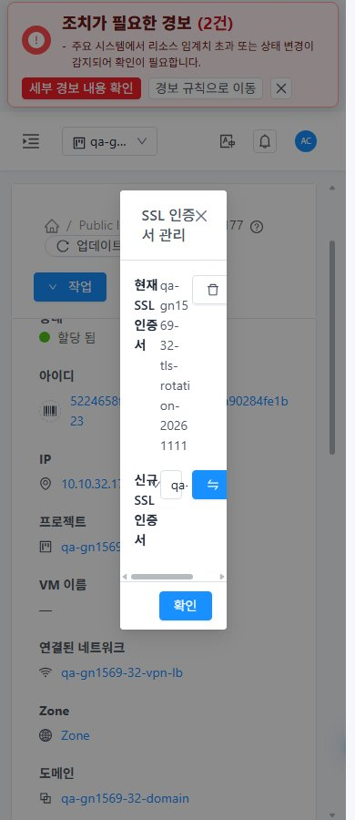
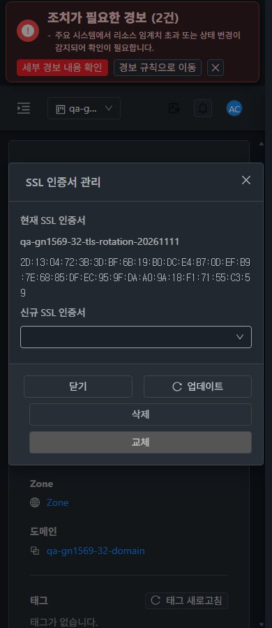
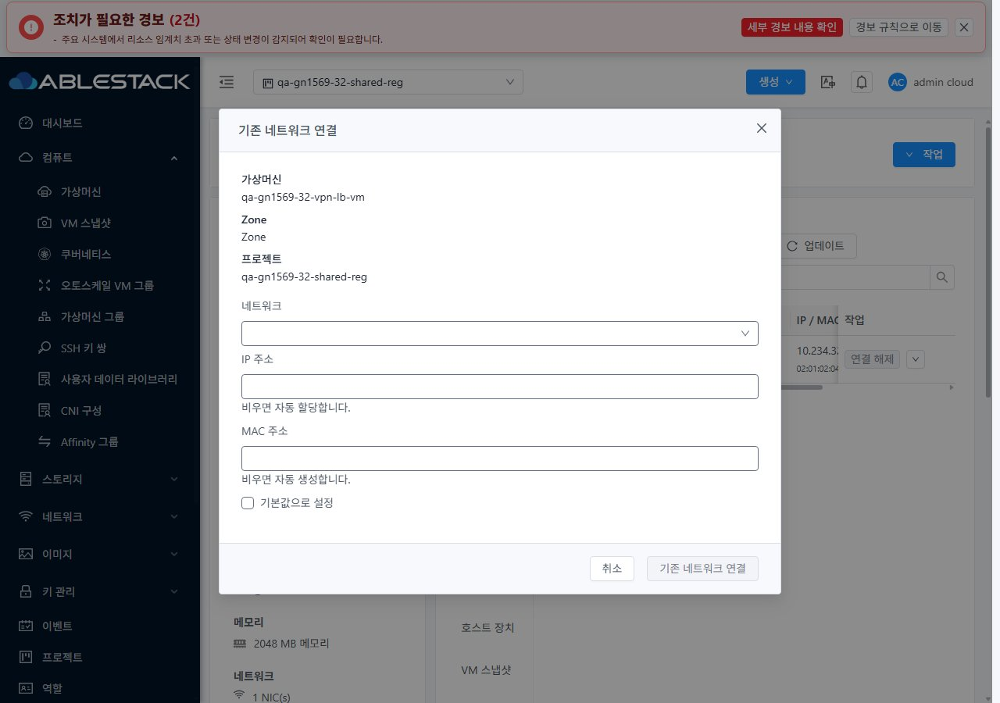
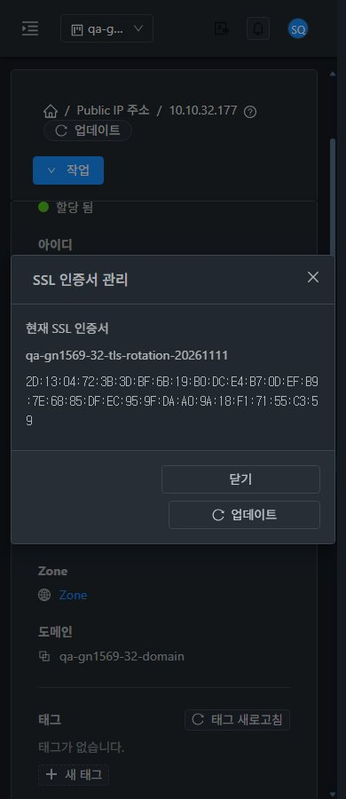

<!--
Licensed to the Apache Software Foundation (ASF) under one
or more contributor license agreements. See the NOTICE file
distributed with this work for additional information
regarding copyright ownership. The ASF licenses this file
to you under the Apache License, Version 2.0 (the
"License"); you may not use this file except in compliance
with the License. You may obtain a copy of the License at

  http://www.apache.org/licenses/LICENSE-2.0

Unless required by applicable law or agreed to in writing,
software distributed under the License is distributed on an
"AS IS" BASIS, WITHOUT WARRANTIES OR CONDITIONS OF ANY
KIND, either express or implied. See the License for the
specific language governing permissions and limitations
under the License.
-->

# UI 캡처88장

실제 브라우저 viewport의 원본 JPEG다. 통제 응답은 서버 장애와 구분한다. [원본 크기·SHA256](evidence/capture-audit.json).

## 대표 비교

## 전체 목록

| 캡처 | 크기 | 테마 |
| --- | --- | --- |
| [31-before-mobile](screenshots/31-before-mobile.jpg) | 390×900 | light |
| [32-before-mobile](screenshots/32-before-mobile.jpg) | 390×900 | light |
| [31-failure-503-preserved](screenshots/31-failure-503-preserved.jpg) | 1280×900 | light |
| [31-read-failure-locked](screenshots/31-read-failure-locked.jpg) | 1280×900 | light |
| [31-read-recovered](screenshots/31-read-recovered.jpg) | 1280×900 | light |
| [31-job0-pending](screenshots/31-job0-pending.jpg) | 1280×900 | light |
| [31-failure-job2-preserved](screenshots/31-failure-job2-preserved.jpg) | 1280×900 | light |
| [31-replace-retry-success](screenshots/31-replace-retry-success.jpg) | 1280×900 | light |
| [32-failure-503-preserved](screenshots/32-failure-503-preserved.jpg) | 1280×900 | light |
| [32-read-failure-locked](screenshots/32-read-failure-locked.jpg) | 1280×900 | light |
| [32-read-recovered](screenshots/32-read-recovered.jpg) | 1280×900 | light |
| [32-job0-pending](screenshots/32-job0-pending.jpg) | 1280×900 | light |
| [32-failure-job2-preserved](screenshots/32-failure-job2-preserved.jpg) | 1280×900 | light |
| [32-replace-retry-success](screenshots/32-replace-retry-success.jpg) | 1280×900 | light |
| [31-owner-remove](screenshots/31-owner-remove.jpg) | 1280×900 | light |
| [32-owner-remove](screenshots/32-owner-remove.jpg) | 1280×900 | light |
| [31-owner-restored](screenshots/31-owner-restored.jpg) | 1280×900 | light |
| [32-owner-restored](screenshots/32-owner-restored.jpg) | 1280×900 | light |
| [31-ssl-deny-readonly](screenshots/31-ssl-deny-readonly.jpg) | 1280×900 | light |
| [31-readonly-role](screenshots/31-readonly-role.jpg) | 1280×900 | light |
| [31-member-replace](screenshots/31-member-replace.jpg) | 1280×900 | light |
| [31-member-restored](screenshots/31-member-restored.jpg) | 1280×900 | light |
| [31-domain-admin-guard](screenshots/31-domain-admin-guard.jpg) | 1280×900 | light |
| [32-ssl-deny-readonly](screenshots/32-ssl-deny-readonly.jpg) | 1280×900 | light |
| [32-member-replace](screenshots/32-member-replace.jpg) | 1280×900 | light |
| [32-member-restored](screenshots/32-member-restored.jpg) | 1280×900 | light |
| [31-nonmember-project-denied](screenshots/31-nonmember-project-denied.jpg) | 1680×841 | light |
| [32-domain-admin-guard](screenshots/32-domain-admin-guard.jpg) | 1280×900 | light |
| [32-legacy-readonly-name-allows-ssl](screenshots/32-legacy-readonly-name-allows-ssl.jpg) | 1280×900 | light |
| [32-nonmember-project-denied](screenshots/32-nonmember-project-denied.jpg) | 1680×841 | light |
| [31-assign-only-guard](screenshots/31-assign-only-guard.jpg) | 1280×900 | light |
| [31-assign-only-success](screenshots/31-assign-only-success.jpg) | 1280×900 | light |
| [32-project-return](screenshots/32-project-return.jpg) | 1280×900 | light |
| [32-assign-only-guard](screenshots/32-assign-only-guard.jpg) | 1280×900 | light |
| [32-assign-only-success](screenshots/32-assign-only-success.jpg) | 1280×900 | light |
| [31-remove-only-guard](screenshots/31-remove-only-guard.jpg) | 1280×900 | light |
| [31-remove-only-success](screenshots/31-remove-only-success.jpg) | 1280×900 | light |
| [32-remove-only-guard](screenshots/32-remove-only-guard.jpg) | 1280×900 | light |
| [32-remove-only-success](screenshots/32-remove-only-success.jpg) | 1280×900 | light |
| [31-granular-role-restored-cert](screenshots/31-granular-role-restored-cert.jpg) | 1280×900 | light |
| [32-granular-role-restored-cert](screenshots/32-granular-role-restored-cert.jpg) | 1280×900 | light |
| [31-admin-light-1280](screenshots/31-admin-light-1280.jpg) | 1280×900 | light |
| [31-admin-light-768](screenshots/31-admin-light-768.jpg) | 768×900 | light |
| [31-admin-light-390](screenshots/31-admin-light-390.jpg) | 390×900 | light |
| [31-admin-dark-1280](screenshots/31-admin-dark-1280.jpg) | 1280×900 | dark |
| [31-admin-dark-768](screenshots/31-admin-dark-768.jpg) | 768×900 | dark |
| [31-admin-dark-390](screenshots/31-admin-dark-390.jpg) | 390×900 | dark |
| [31-ssl-deny-dark-1280](screenshots/31-ssl-deny-dark-1280.jpg) | 1280×900 | dark |
| [31-ssl-deny-dark-768](screenshots/31-ssl-deny-dark-768.jpg) | 768×900 | dark |
| [31-ssl-deny-dark-390](screenshots/31-ssl-deny-dark-390.jpg) | 390×900 | dark |
| [31-project-return](screenshots/31-project-return.jpg) | 1280×900 | light |
| [31-ssl-deny-light-1280](screenshots/31-ssl-deny-light-1280.jpg) | 1280×900 | light |
| [31-ssl-deny-light-768](screenshots/31-ssl-deny-light-768.jpg) | 768×900 | light |
| [31-ssl-deny-light-390](screenshots/31-ssl-deny-light-390.jpg) | 390×900 | light |
| [32-admin-light-1280](screenshots/32-admin-light-1280.jpg) | 1280×900 | light |
| [32-admin-light-768](screenshots/32-admin-light-768.jpg) | 768×900 | light |
| [32-admin-light-390](screenshots/32-admin-light-390.jpg) | 390×900 | light |
| [32-admin-dark-1280](screenshots/32-admin-dark-1280.jpg) | 1280×900 | dark |
| [32-admin-dark-768](screenshots/32-admin-dark-768.jpg) | 768×900 | dark |
| [32-admin-dark-390](screenshots/32-admin-dark-390.jpg) | 390×900 | dark |
| [32-ssl-deny-dark-1280](screenshots/32-ssl-deny-dark-1280.jpg) | 1280×900 | dark |
| [32-ssl-deny-dark-768](screenshots/32-ssl-deny-dark-768.jpg) | 768×900 | dark |
| [32-ssl-deny-dark-390](screenshots/32-ssl-deny-dark-390.jpg) | 390×900 | dark |
| [32-ssl-deny-light-1280](screenshots/32-ssl-deny-light-1280.jpg) | 1280×900 | light |
| [32-ssl-deny-light-768](screenshots/32-ssl-deny-light-768.jpg) | 768×900 | light |
| [32-ssl-deny-light-390](screenshots/32-ssl-deny-light-390.jpg) | 390×900 | light |
| [31-unknown-job-recheck](screenshots/31-unknown-job-recheck.jpg) | 1280×900 | light |
| [31-recheck-failure-retry-ready](screenshots/31-recheck-failure-retry-ready.jpg) | 1280×900 | light |
| [31-project-default](screenshots/31-project-default.jpg) | 1280×900 | light |
| [31-late-project-safe](screenshots/31-late-project-safe.jpg) | 1280×900 | light |
| [31-late-navigation-safe](screenshots/31-late-navigation-safe.jpg) | 1280×900 | light |
| [32-unknown-job-recheck](screenshots/32-unknown-job-recheck.jpg) | 1280×900 | light |
| [32-recheck-failure-retry-ready](screenshots/32-recheck-failure-retry-ready.jpg) | 1280×900 | light |
| [32-project-default](screenshots/32-project-default.jpg) | 1280×900 | light |
| [32-late-project-safe](screenshots/32-late-project-safe.jpg) | 1280×900 | light |
| [32-late-navigation-safe](screenshots/32-late-navigation-safe.jpg) | 1280×900 | light |
| [31-vm-standard-detail](screenshots/31-vm-standard-detail.jpg) | 1280×900 | light |
| [31-vm-standard-nic-tab](screenshots/31-vm-standard-nic-tab.jpg) | 1280×900 | light |
| [31-vm-standard-connect-dialog](screenshots/31-vm-standard-connect-dialog.jpg) | 1280×900 | light |
| [31-vm-standard-390-dark](screenshots/31-vm-standard-390-dark.jpg) | 390×900 | dark |
| [31-vm-breadcrumb-return](screenshots/31-vm-breadcrumb-return.jpg) | 1280×900 | light |
| [32-vm-standard-detail](screenshots/32-vm-standard-detail.jpg) | 1280×900 | light |
| [32-vm-standard-nic-tab](screenshots/32-vm-standard-nic-tab.jpg) | 1280×900 | light |
| [32-vm-standard-connect-dialog](screenshots/32-vm-standard-connect-dialog.jpg) | 1280×900 | light |
| [32-vm-standard-390-dark](screenshots/32-vm-standard-390-dark.jpg) | 390×900 | dark |
| [32-vm-breadcrumb-return](screenshots/32-vm-breadcrumb-return.jpg) | 1280×900 | light |
| [31-create-picker-returned](screenshots/31-create-picker-returned.jpg) | 1280×900 | light |
| [32-create-picker-returned](screenshots/32-create-picker-returned.jpg) | 1280×900 | light |
