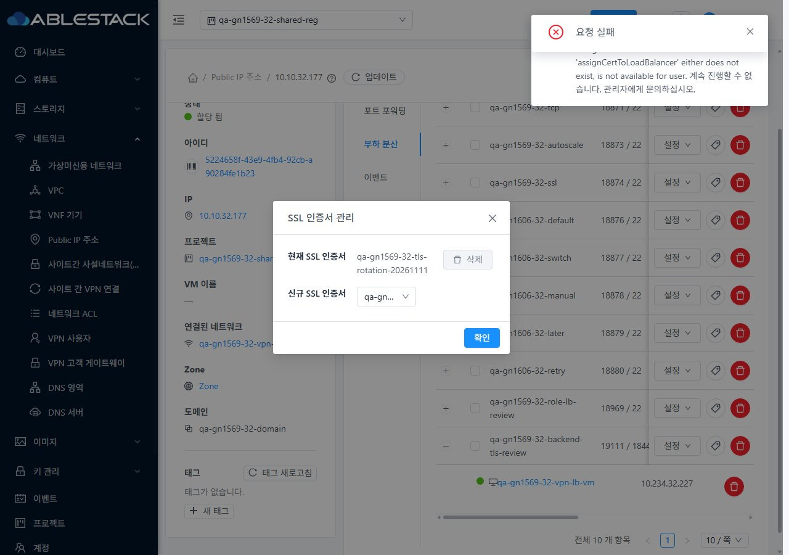
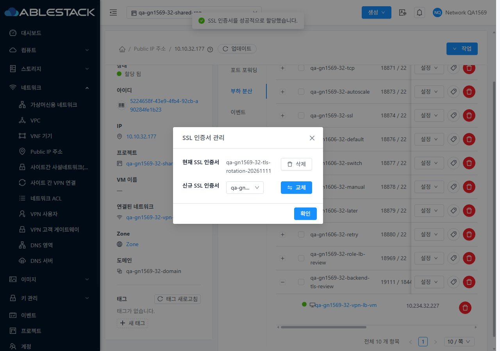

<!--
Licensed to the Apache Software Foundation (ASF) under one
or more contributor license agreements. See the NOTICE file
distributed with this work for additional information
regarding copyright ownership. The ASF licenses this file
to you under the Apache License, Version 2.0 (the
"License"); you may not use this file except in compliance
with the License. You may obtain a copy of the License at

  http://www.apache.org/licenses/LICENSE-2.0

Unless required by applicable law or agreed to in writing,
software distributed under the License is distributed on an
"AS IS" BASIS, WITHOUT WARRANTIES OR CONDITIONS OF ANY
KIND, either express or implied. See the License for the
specific language governing permissions and limitations
under the License.
-->

# #1620 SSL 명령의 실제 프로젝트 권한 검사 — 2026-11-11

31 GFS2·32 Glue RBD에 서버 변경을 반영했다. **SSL 인증서 할당·해제 시 projectid를 생략해도 LB 소유 프로젝트의 기존 역할 거부를 검사한다. 거부 요청은 비동기 작업 등록 전에 401로 종료하며 인증서와 HAProxy를 변경하지 않는다.** 명시한 프로젝트가 실제 LB 소속과 다르면 거부한다.

- 제품 변경: `SpecificCmdValidationWorker`의 두 SSL 변경 명령에만 대상 LB → 소유 계정 → 프로젝트 해석과 기존 `checkAccess` 호출을 추가했다. 큐 등록 전과 실행 전의 문맥에 실제 프로젝트와 API 이름을 설정한다. API 입력 형식·전역 인증/보안 정책·UI 소스는 유지했다.
- WSL ext4에서 server Maven 모듈만 빌드했다. 신규 회귀 22건은 수정 전 22실패/오류0, 수정 후 22통과다. 관련 7개 suite 총62건과 package가 성공했다. 전체 Cloud 빌드나 수동 Actions는 실행하지 않았다.
- 클러스터별 API 행렬55건: 허용29·거부26. 관리자·소유자·구성원·도메인 관리자와 SSL 두 명령만 거부한 별도 역할·비구성원, projectid 생략/일치/불일치, 개인 LB를 대조했다. 서명 키에서도 SSL 쓰기4건씩 401/작업0, 서명 조회 성공과 키 제한 거부를 확인했다.
- 소유자 UI에서 인증서 교체·해제·원래 인증서 복구가 양쪽 모두 jobstatus=1로 끝났다. 최종 인증서 지문과 같은 호스트의 기존 단일 TLS 백엔드 HTTP200/본문을 확인했다. LB 분산/성능 측정은 제외했다.
- **UI 변경은 없다.** VM 상세·NIC·연결창·breadcrumb와 비교하고, 프로젝트 왕복·즉시 밝음↔다크 전환·390/768/1280을 확인했다. JPEG 38장의 실제 viewport·이미지 치수·해시를 대조했다. SSL 버튼 가드/401 후 잠김/390px 약117px 창은 **#1619 미해결**로 표시했다.
- 추가 관찰 **#1622**: 커스텀 프로젝트 역할의 서명 SSL 조회는 projectid를 주면401, 생략 및 같은 역할의 세션 조회는 성공한다. 이번 두 변경 명령의 우회 수정과 분리해 기록했다. 이 관찰이 수정 전에도 같았다고 단정하지 않는다. **#1621 SSL 변경 시 VPN 연속성**도 별도 미해결이다.

기존74 LB 규칙과 backend 연결, 모든 기존 사용자 VM/NIC/host/power·망/VPC/IP·Internal LB controller 및 기존 프로젝트 멤버/역할을 보존했다. 개인 LB 권한 확인용 규칙·인증서 각1개와 전용 SSL deny 역할/계정1개씩을 남겼다. 원래 프로젝트 인증서로 복구했고 기존 읽기 전용 역할과 새 역할의 두 deny를 정확히 보존했다. 활성 UI 정적670파일·WEB-INF·HTTP200을 확인했고 JAR의 변경 class 외204,656개 entry는 동일하다.

**후속: #1621 VPN 연속성 → #1619 SSL UI → #1622 서명 조회 문맥 → #1569 잔여 조합 → 환경 조건 →63행 통합.** C06/C07/P07/P09의 실패4·부분50·환경차단6·적용제외3·완료0을 유지한다. #1620 구현 범위만 종료하고 Epic/#1569/Draft PR은 유지한다.

[설계](design.ko.md) · [검증과 한계](test-results.ko.md) · [확인용 자원](resources.ko.md) · [캡처 38장](capture-matrix.ko.md) · [후속 순서](followups.ko.md)

