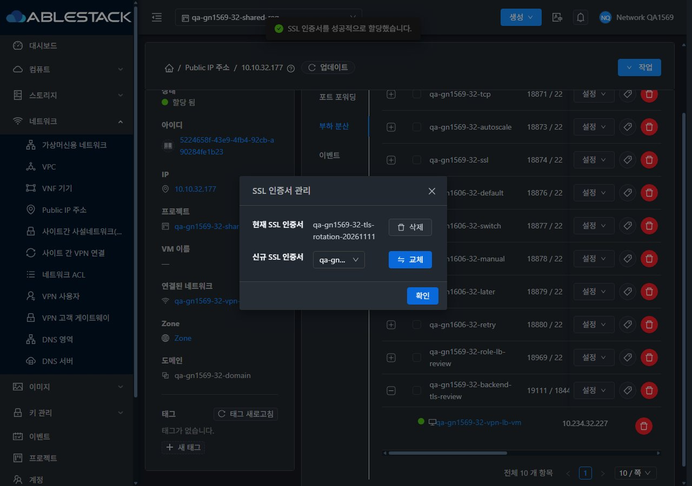
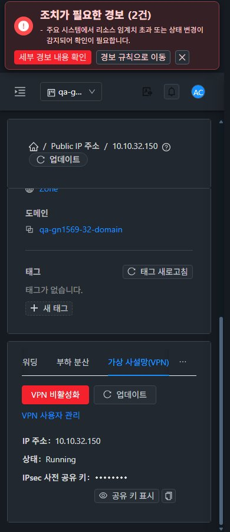

<!--
Licensed to the Apache Software Foundation (ASF) under one
or more contributor license agreements. See the NOTICE file
distributed with this work for additional information
regarding copyright ownership. The ASF licenses this file
to you under the Apache License, Version 2.0 (the
"License"); you may not use this file except in compliance
with the License. You may obtain a copy of the License at

  http://www.apache.org/licenses/LICENSE-2.0

Unless required by applicable law or agreed to in writing,
software distributed under the License is distributed on an
"AS IS" BASIS, WITHOUT WARRANTIES OR CONDITIONS OF ANY
KIND, either express or implied. See the License for the
specific language governing permissions and limitations
under the License.
-->

# #1621 SSL 변경 중 VPN PPP 단절 개선 — 2026-11-11

31 GFS2·32 Glue RBD에 수정본을 적용했다. **동일 VPN 설정을 재적용할 때 PSK 파일의 원본 비교 내용을 유지해, SSL 인증서 변경 때문에 xl2tpd와 기존 PPP 세션이 재시작되지 않도록 했다.** 실제 PSK·주소·범위 변경과 사용자/서비스 철회는 계속 적용한다.

- 제품 commit `70f1b32c2ebdb527fbd9c1e9df4b106acfbe7bb6`. `configure.py`의 `secret.empty()`를 `secret.repopulate()`로 바꿨다. 공통 CsFile 동작·UI/API 소스·권한 정책은 유지했다. 설치 configure SHA256은 `a41555faca012b94549b489d5f2399e998b824a0aaf291fc9ff34e91d058f7f4`다.
- WSL ext4의 Python 회귀9건과 저장소 flake8 규칙을 통과했다. 수정 전 멱등성 회귀는 실패했다. 정규 SystemVM Maven generate-sources는 변경하지 않은 console-proxy 의존성 캐시 누락으로 실패해, **같은 POM의 리소스 생성 태스크를 분리 실행**했다. 배포 산출물의 소스 해시를 대조했다. 전체 Cloud 빌드/수동 Actions는 실행하지 않았다.
- 실행 중 VR80대에 서비스 재시작 없이 해당 스크립트를 적용했다. 관리 서버2대·호스트6대의 재생성용 archive도 갱신하고 클러스터별 바이트/체크섬을 통일했다. configure 외 archive 항목의 내용·실효 권한·소유권·mtime은 유지했다.
- **SSL API6작업과 소유자 UI 교체·해제·복구를 포함한 연속 구간:** 31번212표본/약212초, 32번86표본/약86초에서 PPP 인터페이스·클라이언트/서버 pppd·xl2tpd PID가 유지됐다. 각 표본의 VPN 경유 ICMP와 SSH TCP 배너가 모두 성공했다. 재접속0, 해당 구간 xl2tpd stop/start journal0이다. IKE SA나 API의 Running만으로 통과를 판정하지 않았다.
- 양쪽에서 사용자·서비스 철회 후 기존 통신과 신규 접속이 차단됐고 복구 후 ICMP5/5·TCP3/3이 성공했다. 실제 새 PSK/대체 범위 적용도 확인했다. 네트워크 clean restart로 **r-1019-VM/r-489-VM을 새로 부팅**해 새 소스·archive/signature·업그레이드 불필요와 VM 동일 호스트를 확인했다. 새 VR에서 SSL 재적용 후에도 PID/통신이 유지됐다.
- 잘못된 인증서 API는 양쪽431/작업0, 정상 인증서 재시도는 job1이며 PPP/통신을 유지했다. 원래 인증서와 VPN 클라이언트 범위10.1.2.2–10.1.2.8로 복구했다. 서비스 재생성으로 PSK는 새로 발급됐으며 비공개 시험 클라이언트 설정을 갱신했다.
- **UI 변경은 없다.** VM 목록·상세·NIC·연결창·breadcrumb와 대조하고 프로젝트 왕복·즉시 테마·390/768/1280 및 VPN 본문 스크롤을 확인했다. JPEG 59장/배치22건의 실제 viewport·이미지 치수·해시를 대조했다. 기존 SSL 버튼 가드/실패 복구/117px 모바일 창은 #1619 미해결이다.

최종 상태 점검에서 **별도 #1624**를 재현했다. 양쪽 새 VR의15점검 중14성공, HAProxy 점검만 정상 SSL bind 옵션을 오구성으로 오판정한다. 설치된 점검 소스는 이번에 변경하지 않았으며 `haproxy -c`0·실제 TLS 지문/HTTP200은 정상이다. 경고 이력은 삭제하지 않았다. 이 VR 내장 점검과 외부 제공자가 없는 LB Health Monitor 환경 차단을 구분한다.

기존76 LB 규칙의 정의/backend, 기존 VM/NIC/host/power·망/VPC/IP·Internal LB controller 및 프로젝트 멤버/역할을 보존했다. 재생성 대상 VPN 사용자와 VR2개의 ID 변경은 의도한 검증 동작이다. 최종 VPN 서비스/사용자와 시험 VM은 정상이며 확인용 자원을 남겼다. 관리 JAR/PID·UI 정적670파일·WEB-INF/HTTP200은 그대로다. META-INF는 작업 전부터 없으며 그 상태를 유지했다.

**다음: #1619 SSL UI → #1622 서명 SSL 조회 → #1624 VR HAProxy 점검 → #1569 잔여 → 환경 조건 →63행 통합.** P09는 실패→부분으로 변경하고 전체는 실패3·부분51·환경차단6·적용제외3·완료0이다. #1621만 종료하고 Epic/#1569/Draft PR #1577은 유지한다.

[설계](design.ko.md) · [검증과 한계](test-results.ko.md) · [보관 자원](resources.ko.md) · [캡처 59장](capture-matrix.ko.md) · [후속 순서](followups.ko.md)

