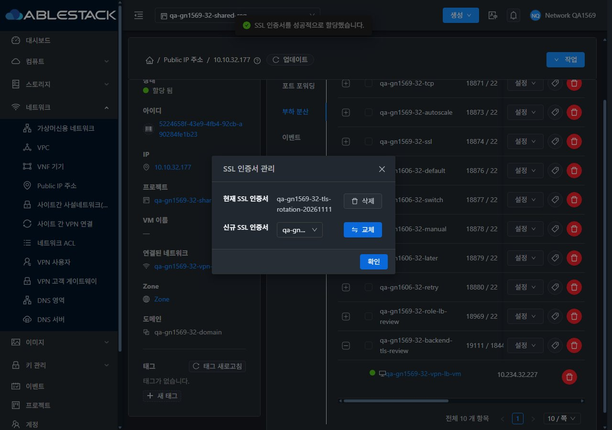
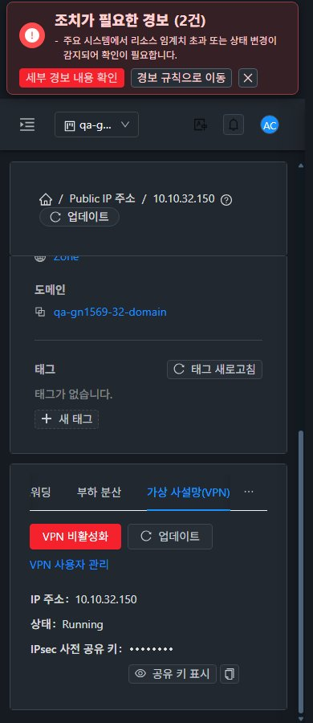
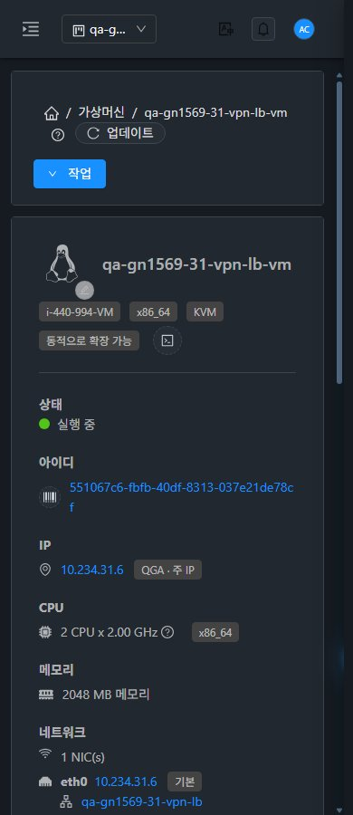
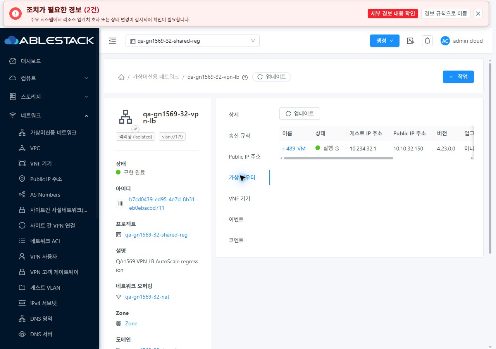
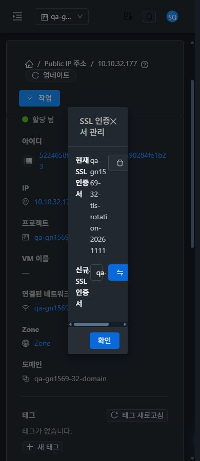

<!--
Licensed to the Apache Software Foundation (ASF) under one
or more contributor license agreements. See the NOTICE file
distributed with this work for additional information
regarding copyright ownership. The ASF licenses this file
to you under the Apache License, Version 2.0 (the
"License"); you may not use this file except in compliance
with the License. You may obtain a copy of the License at

  http://www.apache.org/licenses/LICENSE-2.0

Unless required by applicable law or agreed to in writing,
software distributed under the License is distributed on an
"AS IS" BASIS, WITHOUT WARRANTIES OR CONDITIONS OF ANY
KIND, either express or implied. See the License for the
specific language governing permissions and limitations
under the License.
-->

# UI 캡처와 실제 치수

고유 JPEG 59장, 배치22기록. [실제 viewport·디코딩 치수·SHA256](evidence/capture-audit.json). `31-fresh-router-network-loading`은 로딩 관찰이며 완료 결과와 구분한다. SSL 모바일 실패는 #1619로 유지한다.

| 화면 | 실제 폭×높이 | 테마 |
| --- | --- | --- |
| [31-project-return](screenshots/31-project-return.jpg) | 1280×900 | dark |
| [31-ui-restore-control](screenshots/31-ui-restore-control.jpg) | 1280×900 | dark |
| [31-ui-replace](screenshots/31-ui-replace.jpg) | 1280×900 | dark |
| [31-ui-remove](screenshots/31-ui-remove.jpg) | 1280×900 | dark |
| [31-ui-restore](screenshots/31-ui-restore.jpg) | 1280×900 | dark |
| [31-vpn-user-withdraw-confirm](screenshots/31-vpn-user-withdraw-confirm.jpg) | 1280×900 | dark |
| [31-vpn-user-withdrawn](screenshots/31-vpn-user-withdrawn.jpg) | 1280×900 | dark |
| [31-vpn-user-recovered](screenshots/31-vpn-user-recovered.jpg) | 1680×841 | dark |
| [31-vpn-service-withdraw-confirm](screenshots/31-vpn-service-withdraw-confirm.jpg) | 1680×841 | dark |
| [31-vpn-service-withdrawn](screenshots/31-vpn-service-withdrawn.jpg) | 1680×841 | dark |
| [31-vpn-alternate-range-recovered](screenshots/31-vpn-alternate-range-recovered.jpg) | 1680×841 | dark |
| [32-project-return](screenshots/32-project-return.jpg) | 1280×900 | dark |
| [31-vpn-service-default-restored](screenshots/31-vpn-service-default-restored.jpg) | 1680×841 | dark |
| [32-ui-replace](screenshots/32-ui-replace.jpg) | 1280×900 | dark |
| [32-ui-remove](screenshots/32-ui-remove.jpg) | 1280×900 | dark |
| [32-ui-restore](screenshots/32-ui-restore.jpg) | 1280×900 | dark |
| [32-vpn-user-withdraw-confirm](screenshots/32-vpn-user-withdraw-confirm.jpg) | 1280×900 | dark |
| [32-vpn-user-withdrawn](screenshots/32-vpn-user-withdrawn.jpg) | 1280×900 | dark |
| [31-vm-standard-detail](screenshots/31-vm-standard-detail.jpg) | 1280×900 | dark |
| [31-vm-standard-nic-tab](screenshots/31-vm-standard-nic-tab.jpg) | 1280×900 | dark |
| [31-vm-standard-connect-dialog](screenshots/31-vm-standard-connect-dialog.jpg) | 1280×900 | dark |
| [31-vm-standard-390-dark](screenshots/31-vm-standard-390-dark.jpg) | 390×900 | dark |
| [31-vm-breadcrumb-return](screenshots/31-vm-breadcrumb-return.jpg) | 1280×900 | light |
| [32-vpn-user-recovered](screenshots/32-vpn-user-recovered.jpg) | 1680×841 | dark |
| [32-vpn-service-withdraw-confirm](screenshots/32-vpn-service-withdraw-confirm.jpg) | 1680×841 | dark |
| [32-vpn-service-withdrawn](screenshots/32-vpn-service-withdrawn.jpg) | 1680×841 | dark |
| [31-ssl-deny-light-1280](screenshots/31-ssl-deny-light-1280.jpg) | 1280×900 | light |
| [31-ssl-deny-light-768](screenshots/31-ssl-deny-light-768.jpg) | 768×900 | light |
| [31-ssl-deny-light-390](screenshots/31-ssl-deny-light-390.jpg) | 390×900 | light |
| [31-ssl-deny-dark-1280](screenshots/31-ssl-deny-dark-1280.jpg) | 1280×900 | dark |
| [31-ssl-deny-dark-768](screenshots/31-ssl-deny-dark-768.jpg) | 768×900 | dark |
| [31-ssl-deny-dark-390](screenshots/31-ssl-deny-dark-390.jpg) | 390×900 | dark |
| [31-project-default](screenshots/31-project-default.jpg) | 1280×900 | dark |
| [32-vm-standard-detail](screenshots/32-vm-standard-detail.jpg) | 1280×900 | dark |
| [32-vm-standard-nic-tab](screenshots/32-vm-standard-nic-tab.jpg) | 1280×900 | dark |
| [32-vm-standard-connect-dialog](screenshots/32-vm-standard-connect-dialog.jpg) | 1280×900 | dark |
| [32-vm-standard-390-dark](screenshots/32-vm-standard-390-dark.jpg) | 390×900 | dark |
| [32-vm-breadcrumb-return](screenshots/32-vm-breadcrumb-return.jpg) | 1280×900 | light |
| [32-vpn-service-default-restored](screenshots/32-vpn-service-default-restored.jpg) | 1280×900 | light |
| [32-ssl-deny-light-1280](screenshots/32-ssl-deny-light-1280.jpg) | 1280×900 | light |
| [32-ssl-deny-light-768](screenshots/32-ssl-deny-light-768.jpg) | 768×900 | light |
| [32-ssl-deny-light-390](screenshots/32-ssl-deny-light-390.jpg) | 390×900 | light |
| [32-ssl-deny-dark-1280](screenshots/32-ssl-deny-dark-1280.jpg) | 1280×900 | dark |
| [32-ssl-deny-dark-768](screenshots/32-ssl-deny-dark-768.jpg) | 768×900 | dark |
| [32-ssl-deny-dark-390](screenshots/32-ssl-deny-dark-390.jpg) | 390×900 | dark |
| [32-project-default](screenshots/32-project-default.jpg) | 1280×900 | dark |
| [31-admin-vpn-body-light-768](screenshots/31-admin-vpn-body-light-768.jpg) | 768×900 | light |
| [31-admin-vpn-body-light-390](screenshots/31-admin-vpn-body-light-390.jpg) | 390×900 | light |
| [31-admin-vpn-body-dark-768](screenshots/31-admin-vpn-body-dark-768.jpg) | 768×900 | dark |
| [31-admin-vpn-body-dark-390](screenshots/31-admin-vpn-body-dark-390.jpg) | 390×900 | dark |
| [32-admin-vpn-body-light-768](screenshots/32-admin-vpn-body-light-768.jpg) | 768×900 | light |
| [32-admin-vpn-body-light-390](screenshots/32-admin-vpn-body-light-390.jpg) | 390×900 | light |
| [32-admin-vpn-body-dark-768](screenshots/32-admin-vpn-body-dark-768.jpg) | 768×900 | dark |
| [32-admin-vpn-body-dark-390](screenshots/32-admin-vpn-body-dark-390.jpg) | 390×900 | dark |
| [31-fresh-router-network-loading](screenshots/31-fresh-router-network-loading.jpg) | 1280×900 | light |
| [31-fresh-router-network-tab](screenshots/31-fresh-router-network-tab.jpg) | 1280×900 | light |
| [32-fresh-router-network-tab](screenshots/32-fresh-router-network-tab.jpg) | 1280×900 | light |
| [31-final-admin-vpn-review](screenshots/31-final-admin-vpn-review.jpg) | 1280×900 | light |
| [32-final-admin-vpn-review](screenshots/32-final-admin-vpn-review.jpg) | 1280×900 | light |

