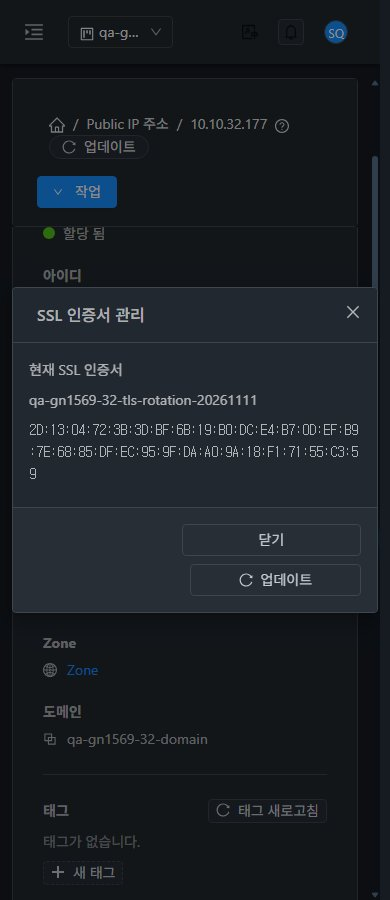

<!--
Licensed to the Apache Software Foundation (ASF) under one
or more contributor license agreements. See the NOTICE file
distributed with this work for additional information
regarding copyright ownership. The ASF licenses this file
to you under the Apache License, Version 2.0 (the
"License"); you may not use this file except in compliance
with the License. You may obtain a copy of the License at

  http://www.apache.org/licenses/LICENSE-2.0

Unless required by applicable law or agreed to in writing,
software distributed under the License is distributed on an
"AS IS" BASIS, WITHOUT WARRANTIES OR CONDITIONS OF ANY
KIND, either express or implied. See the License for the
specific language governing permissions and limitations
under the License.
-->

# #1622 서명 SSL 조회의 프로젝트 권한 문맥 개선 — 2026-11-11

31 GFS2·32 Glue RBD에서 프로젝트 커스텀 역할의 허용 SSL 조회가 세션과 서명 API에서 일치하도록 개선했다. **기존 계정·프로젝트·API 키 권한 검사를 모두 유지하며, UI 소스와 역할 정책은 변경하지 않았다.** 제품 commit `b66aea854e30cbcccd4d06f64e3553cdd3c2776a`.

- 원인: 서명 확인 전 계정 권한 검사에 요청 사용자를 전달하지만, 프로젝트 역할 조회의 CallContext는 아직 시스템 사용자였다. 후속 사용자 등록 때는 프로젝트 문맥도 사라졌다. 같은 대상의 세션/서명 생략 조회는200, 일치 projectid 서명 조회는401인 현상을 양쪽에서 재현했다.
- 수정: 유효 서명 확인 후 실제 사용자로 등록하고 요청 프로젝트·API 이름을 유지한 상태에서 **계정/프로젝트 검사 → API 키 검사**를 모두 실행한다. 키 allow가 계정/프로젝트 deny를 우회하지 못한다. 잘못된 서명·만료 요청·제거/만료 키·비활성 계정/사용자도 계속 거부한다.
- WSL ext4에서 변경된 server 모듈만 Maven package했다. 신규 인증10+기존62=72시험 통과. 수정 전 신규 시험6건은 잘못된 호출자/검사 순서로 실패했다. 수정 전 클래스는 설치본과 바이트가 같고, 상수 풀 인덱스를 정규화한 javap 대조에서 변경 메서드는 verifyRequest 하나다.
- 설치 ApiServer.class 하나만 교체하고 각 관리 서비스를 재시작했다. JAR 내 나머지204,656항목과 inner class는 그대로다. 최종 두 JAR SHA256은 `d876b4284dda557c185526a3610b752a89b25cf820a8f0f7679837a1b2ffeb98`. WEB-INF·UI670 정적 파일·설정·SystemVM은 보존했고 HTTP200/로그인/실제 API·UI를 확인했다. 전체 Cloud 빌드/수동 Actions는 실행하지 않았다.
- **역할·인증 API248건: 허용80/거부168**. 관리자급 프로젝트 소유자·일반 구성원·도메인 관리자·기존 SSL 제한·명시 조회 allow·조회 deny·비구성원을 대조했다. 클러스터별34쌍/총68쌍의 세션/서명 HTTP 상태·오류 코드·인증서 ID가 정확히 일치한다. 일치/생략/불일치 projectid, 프로젝트 목록/정당한 빈 결과, 키 자체 조회 deny·다른 명령 제한·잘못된 서명·만료 요청을 확인했다. 거부된 변경96건은 작업0이다.
- 양쪽 최종 읽기/거부 전용 구간에서는 라우터 HAProxy/SSL 설정·mtime·HAProxy/xl2tpd PID·인증서 매핑이 동일했다. 허용된 서명 소유자 작업2건과 실제 UI 교체/복원4건은 job1이며 원래 인증서를 복원했다. 최종 원래 TLS 지문·단일 backend HTTP200/본문도 확인했다. LB 분산/부하 측정은 제외했다.
- **UI 변경 없음.** 기존 #1619의 VM 표준 SSL 창을 유지했다. 명시 조회 allow/쓰기 deny는 정보와 닫기/업데이트만, 조회 deny는 SSL 메뉴 비활성이다. 프로젝트 왕복 후 일반 계정 쓰기 권한이 남지 않았다. VM 목록·상세·NIC·연결창·breadcrumb와 비교하고 390/768/1280×밝음/다크×관리자/조회 전용의24배치, 동일 timeOrigin의 즉시 테마를 확인했다. JPEG54장의 실제 viewport/디코딩 치수/해시를 감사했다.

기존76 LB 정의/backend·전체 기존 VM/NIC/호스트/전원·망/VPC/IP/라우터/VPN 사용자와 키·기존 멤버/역할/정책을 보존했다. 검토용 명시 조회 allow/deny 계정·역할을2개씩/클러스터 추가하고 SSL로 제한한 새 시험 API 키를 비공개 보관했다. 기존 키를 교체/삭제하지 않았다. 확인용 자원은 별도 지시까지 남긴다.

**다음: #1624 VR HAProxy 점검 오판정 → #1569 준비된 잔여 → 환경 조건 →63행 통합.** C07 실패→부분, 양쪽 실패1·부분53·환경차단6·적용제외3·완료0이다. #1622만 종료하며 Epic/#1569 전체 완료를 의미하지 않는다. #1624와32의 기존 경보는 남겼다.

[설계](design.ko.md) · [검증/한계](test-results.ko.md) · [보관 자원](resources.ko.md) · [캡처54장](capture-matrix.ko.md) · [후속](followups.ko.md)

