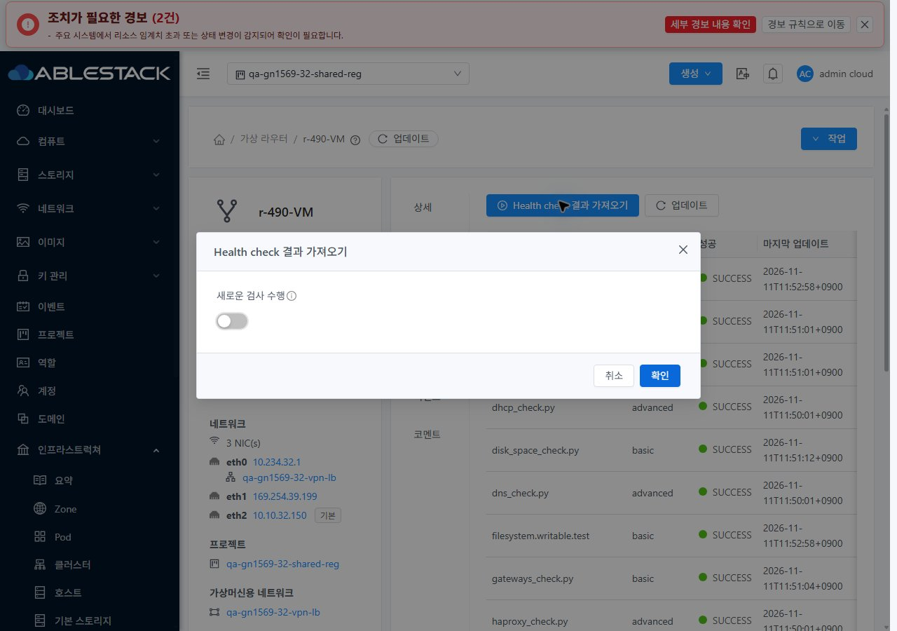

<!--
Licensed to the Apache Software Foundation (ASF) under one
or more contributor license agreements. See the NOTICE file
distributed with this work for additional information
regarding copyright ownership. The ASF licenses this file
to you under the Apache License, Version 2.0 (the
"License"); you may not use this file except in compliance
with the License. You may obtain a copy of the License at

  http://www.apache.org/licenses/LICENSE-2.0

Unless required by applicable law or agreed to in writing,
software distributed under the License is distributed on an
"AS IS" BASIS, WITHOUT WARRANTIES OR CONDITIONS OF ANY
KIND, either express or implied. See the License for the
specific language governing permissions and limitations
under the License.
-->

# #1624 정상 SSL bind의 HAProxy 점검 오판정 개선 — 2026-11-11

31 GFS2·32 Glue RBD에서 정상 SSL bind를 오구성으로 판정하던 VR HAProxy 점검을 수정했다. **점검 스크립트와 상태 체크 UI를 개선했으며 Cloud API/JAR·역할 정책은 변경하지 않았다.** 제품 commit `f9e4943547b`(점검), `d748ad0db91`(UI).

- 원인: `bind IP:port ssl crt … alpn … ciphers …` 전체를 `IP:port`와 비교했다. 문법과 TLS가 정상이어도 HAProxy 점검만 실패했다. 수정 전 양쪽 15개 중 이 검사만 실패하는 것을 API/UI에서 재현했다.
- 주소·포트 부분을 분리/정규화하고 여러 bind 줄·쉼표 endpoint를 모두 검증한다. SSL 옵션은 무조건 무시하지 않고 **실제 `/usr/sbin/haproxy -c -f` 문법 검사**로 확인한다. 실행시간10초·진단길이 제한, shell 미사용이며 소켓 bind/설정 변경/재시작을 하지 않는다. 없는 bind·backend·잘못된 대상은 계속 거부한다.
- 기존 80개 Running VR의 checker만 원자 교체했다. HAProxy/xl2tpd PID·권한을 보존했다. 관리2+호스트6의 배포 archive는 checker 항목만 교체하고 다른 tar 항목과 메타데이터를 보존했다. 전용 시험망의 라우터2개를 새로 생성해 새 archive/hash/signature·`requiresupgrade=false`·동일 호스트 배치를 확인했다.
- 실제 HAProxy2.6.12에서 정상 문법0·직접 점검0·원래 인증서 지문·단일 backend TLS HTTP200/본문을 확인했다. 잘못된 bind IP/port·추가/누락 bind·누락 backend·잘못된 backend IP/port·잘못된 SSL 옵션·없는 인증서·잘못된 문법 **10종/클러스터를 hotpatch와 새 부팅에서 각각 거부**했다. 오류 시험은 임시 설정 복사본만 사용해 라이브 설정/PEM/PID가 같았다. API/UI 새 상태 체크는 양쪽15/15정상이다.
- **UI 변경:** 가상 라우터 상세 > 상태 체크 탭의 전체 폭 버튼을 VM 상세 탭 toolbar로 교체했다. 주 실행 버튼 다음에 `reload+업데이트` 버튼을 배치했다. 표는 small·긴 상세 줄바꿈·표 내부 스크롤을 적용했다. 기존 a-modal을 VM 표준 `MoldDialog(md)/MoldDialogActions`와 세로 폼으로 바꾸고 실패 시 입력/기존 행을 보존한다. 성공 시 닫고, 중복 실행·프로젝트/역할/사용자/탭 전환의 늦은 응답을 막는다.
- WSL ext4에서 Python39(신규30)·UI51(신규8), Python 스타일/flake8·UI lint/build를 통과했다. 정상 systemvm Maven phase는 기존 console-proxy 의존성 부재로 막혔고, 원 POM의 동일 resource/antrun 작업을 분리 실행해 스크립트 자산을 생성했다. 정상 모듈 package나 전체 Cloud 빌드 성공으로 보고하지 않는다. 수동 Actions는 실행하지 않았다.
- VM 목록·상세·NIC 탭·연결창·breadcrumb/모바일과 대조했다. 양쪽390/768/1280×밝음/다크×탭/대화상자의24배치, 새로고침 없는 테마 전환, 프로젝트 기본 보기 왕복, 늦은 탭 응답 차단, 읽기 전용 계정의 기존 라우터 접근 제한을 확인했다. 조회503은 시험용 응답으로 명시하고 실제 재시도 성공과 구분했다. JPEG56장의 signature/실제 viewport/디코딩 치수/해시를 대조했다.

기존76 LB 정의/backend·인증서 연결·VM/NIC/호스트/전원·망/VPC/IP·VPN 사용자/키/범위·멤버/역할 정책을 보존했다. 시험 라우터만 r-1020-VM/r-490-VM으로 교체했다. 새 라우터의 VPN 재연결 ping/TCP3회와 TLS도 통과했다. 관리 JAR/PID/WEB-INF/서버 설정은 그대로이며 새 UI671정적 파일·HTTP200을 검증했다. **기존32 경보 이력2건은 삭제하지 않았다.**

확인용 자원은 별도 지시까지 보관한다. #1624만 종료한다. 다음은 **#1569 준비된 VPN 역할·동시 사용자/서비스 철회, LB TLS CA/체인/만료·정책/오퍼링 잔여 → 환경 차단 →63행 통합 판정**이다. P07 실패→부분으로 양쪽 실패0·부분54·환경차단6·적용제외3·완료0이며, Epic/#1569 전체 완료를 뜻하지 않는다.

[설계](design.ko.md) · [검증/한계](test-results.ko.md) · [확인 자원](resources.ko.md) · [캡처56장](capture-matrix.ko.md) · [후속 순서](followups.ko.md)

