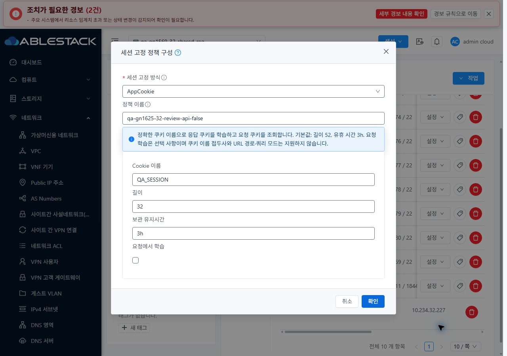
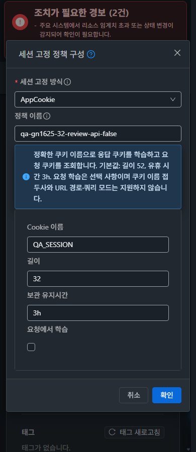

# #1625 AppCookie / upstream 병합·모듈 배포 검증

2026-11-11, Epic #1554 · 통합 회귀 #1569 · Draft PR #1577.

**upstream `ablestack-europa` 45944c40을 기존 Epic 브랜치에 병합하고, #1625를 구현해 31 GFS2·32 Glue RBD에 배포했다.** AppCookie의 실제 UI/API 생성 job1, HAProxy 2.6.12 문법0, 쿠키 학습·조회·만료와 단일 백엔드 TLS를 확인했다. 이 문서는 #1569 전체 완료나 전체 Cloud CI 성공을 뜻하지 않는다.

- 병합 커밋: `f22a53c775d18238bf5f0168c2831fd6c05a73a6`. 번역 2개·DetailsTab·ListView의 충돌은 현재 UI를 보존하면서 upstream의 독립 추가를 통합했다.
- 백엔드 빌드 소스: `12b9d2f958b25bea4ffb54cb80b5b8a2552059c0`. 이후 커밋은 UI·시험·문서 변경이다. 최종 제품 UI에는 `700a4e0290b`의 프로젝트별 고유 폼 ID와 `5502d84e9e3`의 요청 학습 false 복원이 포함된다.
- WSL ext4에서 변경 Maven 12개와 의존 모듈 1개를 빌드했다. 관리 서버 양쪽과 호스트 6대의 설치 모듈·런타임 스크립트, UI 정적 파일 675개를 배포했다. 전체 Cloud 빌드·수동 Actions 실행은 하지 않았다.
- UI는 VM 공통 MoldDialog/MoldDialogActions·세로 입력·의미별 설정 카드·하단 버튼을 적용했다. 지원하지 않는 AppCookie 접두사/URL 모드를 숨기고 실제 네트워크 capability 조회 실패 시 저장 차단·재조회를 제공한다. 유지시간에는 `3h` 같은 단위를 입력할 수 있다.
- 31·32에서 1280/768/390px × 밝음/다크, 즉시 테마 전환, 기본 보기↔프로젝트 왕복, 기존 값 재표시, 고유 입력 ID·라벨 연결, VM 목록/상세/NIC/연결창/breadcrumb를 비교했다. 읽기 전용 역할의 변경 버튼과 API 거부도 유지했다. **원본 JPEG 49장**을 보관했다.
- 원래 오퍼링/인증서/기존 TCP 정책/인바운드 방화벽을 복원했다. AppCookie 확인 정책과 기존 시험 VM·망·인증서·VPN 사용자는 남겼다. 원래 자원 ID·VM NIC·LB backend·SSL 매핑·역할 정책을 보존했고 대상 VR health15/15, 관리 HTTP200·WEB-INF·JAR 해시, 모든 호스트 Up을 확인했다.

[구현 설계](design.ko.md) · [빌드/실제 시험과 한계](test-results.ko.md) · [캡처 목록](capture-matrix.ko.md) · [확인 자원](resources.ko.md) · [후속 순서](followups.ko.md)

