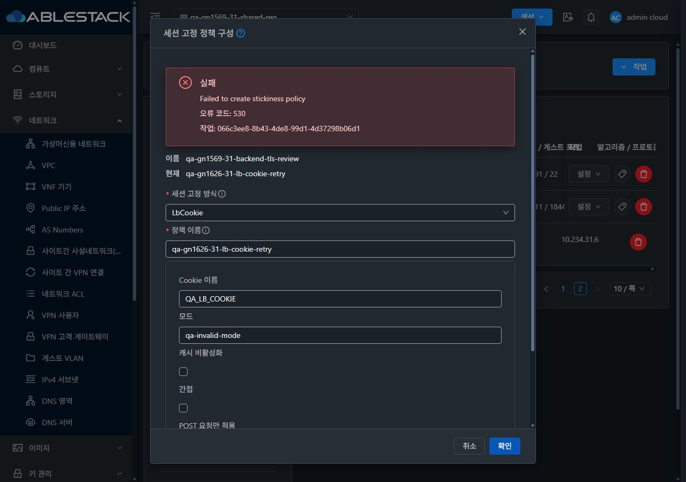
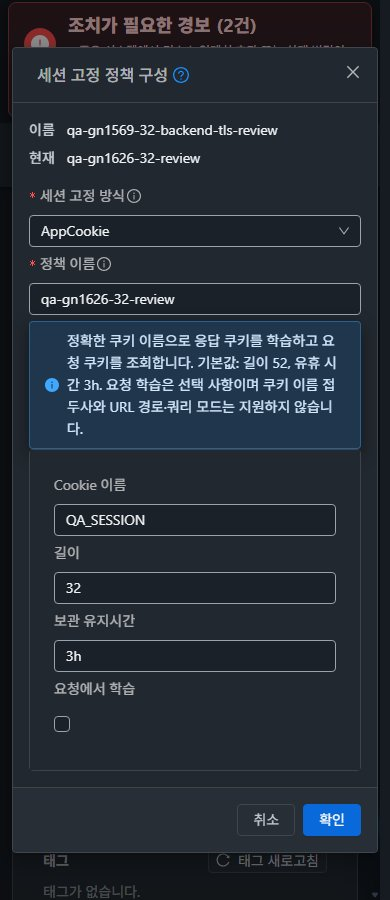

<!--
Licensed to the Apache Software Foundation (ASF) under one
or more contributor license agreements.  See the NOTICE file
distributed with this work for additional information
regarding copyright ownership.  The ASF licenses this file
to you under the Apache License, Version 2.0 (the
"License"); you may not use this file except in compliance
with the License.  You may obtain a copy of the License at

  http://www.apache.org/licenses/LICENSE-2.0

Unless required by applicable law or agreed to in writing,
software distributed under the License is distributed on an
"AS IS" BASIS, WITHOUT WARRANTIES OR CONDITIONS OF ANY
KIND, either express or implied.  See the License for the
specific language governing permissions and limitations
under the License.
 -->

# #1626 세션 고정 정책 비동기 UI 개선

31·32번 배포와 실제 UI 검증을 완료했다. API/Java/Maven 변경 없이 UI만 개선했으며, 기존 Epic 브랜치 `dhslove/epic-1554-guest-networks`와 Draft [PR #1577](https://github.com/ablecloud-team/ablestack-cloud/pull/1577)을 유지한다. 배포 소스는 `1f08ae1fa784368afc7aa095874ce40acff09fb6` (기능 코드669977f7edd와 동일하며 표준 라이선스 헤더만 보정)이다.

## 변경 화면

Public IP 상세 → 부하 분산 → 규칙의 설정 → **세션 고정** 대화상자를 별도 컴포넌트로 구성했다. VM 메뉴의 공통 MoldDialog/MoldDialogActions, 세로 폼·설정 카드·대상/현재 정책 요약·하단 취소/확인, 모바일 내부 스크롤과 테마 변수를 사용한다. 기존 VM 목록/상세/NIC 탭/연결 대화상자/breadcrumb와 실제 화면을 비교했다. VM 화면 자체는 변경하지 않았다.

요청 중/작업 중/실패/결과 미확인을 구분한다. 실제 job1 확인 후 창을 닫고 새로고침하며, job2·HTTP 실패에는 입력을 남긴다. 결과 조회 실패는 동일 job만 다시 조회하고 신규 요청을 차단한다. 접수 ID 없는 불확실한 요청도 자동 재전송하지 않는다. 창을 숨겼다가 같은 규칙으로 돌아와도 불확실 상태와 초안을 유지한다. 프로젝트·사용자·역할·탭·대상 변경 뒤 늦게 도착한 결과는 버린다. 현재 API가 함께 반환하는 Revoked 이력은 현재 정책에서 제외하고, 설정 팝업은 resize 때 닫아 좌표가 남지 않게 했다.

## 확인 결과

- 양쪽 실제 LbCookie 잘못된 모드 → job2/530 → 창/입력 유지 → 정책 재조회 → 보정 → job1/종료. AppCookie·SourceBased 생성과 삭제도 실제 서버 작업으로 확인했다. 감사한 작업 14건은 job1 11건, 의도적 job2 3건이며 중간 재현을 포함한다.
- HTTP431/503·전송 결과 소실·job0/조회503·접수ID 누락은 **브라우저 XHR 통제 주입**으로 별도 검증했다. 주입과 실제 서버 실패를 구분하며 API를 변경하지 않았다. 중복 클릭/CtrlEnter/Escape와 동일 job 재조회 중 새 POST가 발생하지 않았다.
- 밝음/다크 × 1280/768/390의 최종 12배치, 즉시 테마(timeOrigin 동일), 프로젝트 왕복·늦은 결과 취소, label/input ID 연결, 읽기 전용 세션 고정 버튼 비활성, 화면 이동·breadcrumb/가로 넘침 없음 확인.
- WSL ext4 로컬 lint·15개 집중 스위트 **229/229**, SourceBased 재열기 집중1건, Vue production build 통과. 전체 Cloud/수동 Actions/Maven 빌드는 실행하지 않았다.
- 양쪽 활성 정적 파일675개 해시 일치·HTTP200·WEB-INF/서버 파일 보존. 관리 JAR와 PID는 배포 전후 동일하다. VR 건강검사15/15·HAProxy 문법0·원래 인증서 지문/HTTPS200, 기존 자원/NIC/LB 연결/SSL 매핑/권한 보존을 확인했다. VPN 설정/mtime·xl2tpd/PPP 프로세스 동일, 활성 client slot2의 ICMP5/5·TCP3/3도 확인했다. backend 부하분산 측정은 하지 않았다.

[설계](design.ko.md) · [검증·배포·경계](test-results.ko.md) · [캡처 76장](capture-matrix.ko.md) · [확인용 자원](resources.ko.md) · [후속 순서](followups.ko.md)

이슈 #1626 범위는 완료했다. P07은 실패에서 부분으로 복귀하며 #1569/Epic 전체 완료를 뜻하지 않는다. 확인용 자원은 남긴다.
