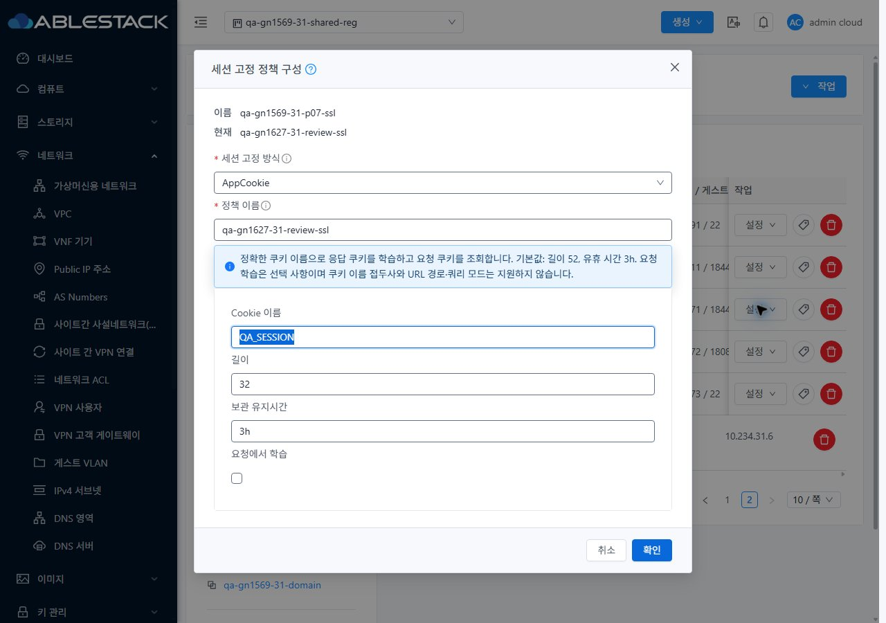
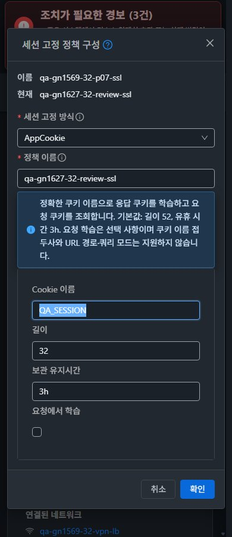

<!--
Licensed to the Apache Software Foundation (ASF) under one
or more contributor license agreements.  See the NOTICE file
distributed with this work for additional information
regarding copyright ownership.  The ASF licenses this file
to you under the Apache License, Version 2.0 (the
"License"); you may not use this file except in compliance
with the License.  You may obtain a copy of the License at

  http://www.apache.org/licenses/LICENSE-2.0

Unless required by applicable law or agreed to in writing,
software distributed under the License is distributed on an
"AS IS" BASIS, WITHOUT WARRANTIES OR CONDITIONS OF ANY
KIND, either express or implied.  See the License for the
specific language governing permissions and limitations
under the License.
 -->

# #1627 LB 세션 고정 정책 삭제 프로젝트 권한 검증

31·32번에 구현 commit d0e79561b0ccee011932a4f036bcea770e808961을 반영하고 역할별 UI·API·실제 통신을 검증했다. 프로젝트 ID를 생략해도 실제 정책 → LB → 소유 계정/프로젝트를 찾아 기존 프로젝트 역할을 평가하고, 거부 요청은 비동기 작업을 만들지 않는다. 허용 역할의 삭제·복원은 정상 동작한다.

- 기존 Epic 브랜치 dhslove/epic-1554-guest-networks와 [Draft PR #1577](https://github.com/ablecloud-team/ablestack-cloud/pull/1577)을 유지한다.
- UI 코드 변경은 없다. 기존 VM 공통 표준의 목록·상세·NIC 탭·연결창·breadcrumb·모바일을 실제 화면에서 비교하고 프로젝트 왕복과 즉시 테마를 확인했다.
- WSL ext4 로컬 api/server 두 모듈 package 및 집중 회귀 66/66 통과. 수정 전 새 17개 테스트는 14실패/3오류로 결함을 검출했다. 전체 Cloud/수동 Actions 빌드나 UI 재빌드는 하지 않았다.
- 양쪽 합계 API 행렬 260행, 실제 UI 삭제 6건·복원 6건 job1. 실제 HAProxy 문법·HTTP/HTTPS200·SSH 배너와 VR 점검15/15 통과. VPN 연속 표본은 사이트별 1,188회 ICMP/SSH 실패0이다.
- 확인용 네트워크·VM·NIC·LB·SSL·정책을 보관했다. 32번 별도 js Kubernetes 정리로 전역 자원 전체 불변은 성립하지 않으며, 이번 시험 자원 보존과 구분했다.

[설계](design.ko.md) · [검증·배포·제한](test-results.ko.md) · [캡처 80장](capture-matrix.ko.md) · [확인용 자원](resources.ko.md) · [후속 순서](followups.ko.md) · [발견 당시 P07 결과](../guest-network-1569-p07-20261111/README.ko.md)

