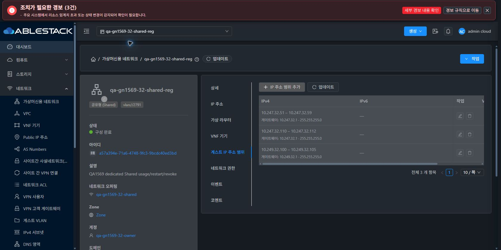

<!--
Licensed to the Apache Software Foundation (ASF) under one
or more contributor license agreements.  See the NOTICE file
distributed with this work for additional information
regarding copyright ownership.  The ASF licenses this file
to you under the Apache License, Version 2.0 (the
"License"); you may not use this file except in compliance
with the License.  You may obtain a copy of the License at

  http://www.apache.org/licenses/LICENSE-2.0

Unless required by applicable law or agreed to in writing,
software distributed under the License is distributed on an
"AS IS" BASIS, WITHOUT WARRANTIES OR CONDITIONS OF ANY
KIND, either express or implied.  See the License for the
specific language governing permissions and limitations
under the License.
 -->

# #1628 Shared 다중 서브넷 생성·재시작 개선 결과

2026-11-12 KST. 스키마 보정 `e237cb135eb9ae41e79787979ebd4b3b9329fc70`, 실제 재시작 검증에서 추가 확인한 부팅·DHCP 재적용 수정 `6b24e8b7946c47a45448eaab071161ade61a1ec2`를 31·32번에 반영했다. Epic 브랜치 `dhslove/epic-1554-guest-networks`와 Draft [PR #1577](https://github.com/ablecloud-team/ablestack-cloud/pull/1577)을 유지한다.

32번의 이미 완료된 4.23 설치에 남은 좁은 Shared CIDR/gateway 컬럼을 독립 체크포인트로 보정했다. 이어서 다중 CIDR을 단일 CIDR로 읽어 라우터 재시작이 실패하는 경로도 수정했다. **UI 소스·스타일 변경은 0**이며 기존 VM 목록·상세·탭·대화상자·breadcrumb·모바일 테마를 실제 화면에서 대조했다.

| 검증 | 31 GFS2 | 32 RBD |
| --- | --- | --- |
| 최종 IPv4 CIDR/gateway 폭 | 255 /255, 기존 확장값 보존 | 18/15 →255/255 |
| 최종 IPv6 CIDR/gateway 폭 | 1024 /1024, 보존 | 50/50 →1024/1024 |
| 두 번째 IPv4 서브넷 UI·API CRUD | 성공 | 성공, 기존530 해소 |
| 수정 후 라우터 재시작·새 boot ID | 성공 | 성공 |
| 시험 VM API /실제 NIC | 2 /2 | 2 /2 |
| 재시작 전·후 실제 DHCP | 각 DORA·unicast 갱신 성공 | 각 DORA·unicast 갱신 성공 |
| 재시작 전·후 DNS·라우터 통신 | 각 UDP/TCP12/12·ICMP10/10 | 각 UDP/TCP12/12·ICMP10/10 |
| 기존 Shared NIC 최종 정상 구간 | 1203표본 전부 성공 | 1160표본 전부 성공 |
| 원래 VM /NIC 데이터 보존 | 9 /28 | 10 /31 |

로컬 Java 96건, 실제 MySQL 격리10조건, 역할별 NIC 조회8경로와 읽기 전용 범위 생성 거부432/job없음, 읽기 전용 UI 쓰기 버튼0, VM NIC 12·Shared 범위/대화상자 12의 총 24개 반응형·테마 조합을 확인했다.

초기31 재시작 실패 때는 시험 라우터가 Stopped가 되어 DNS가 중단됐다. 이를 수정하고 같은 라우터·네트워크·NIC를 보존해 복구했다. 수정 후 재시작 때의 DNS 일시 중단도 정상 구간과 구분했다. **전체 과정을 무중단으로 판정하지 않는다.** 기존 Shared NIC 간 ICMP·SSH는 전체2093/2323표본에서 모두 유지됐다.

- [설계·업그레이드 경로·보안 계약](design.ko.md)
- [job·실제 DHCP·통신·배포·검증 한계](test-results.ko.md)
- [UI 표준·캡처 104장](capture-matrix.ko.md)
- [확인용 자원·임시 계측 정리](resources.ko.md)
- [후속 #1629 → #1631 → #1632 → #1569](followups.ko.md)

