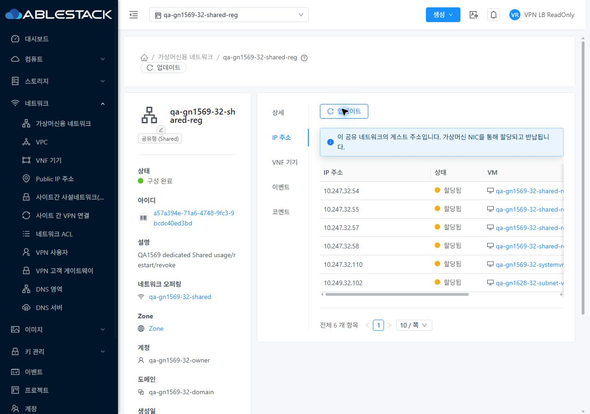

<!--
Licensed to the Apache Software Foundation (ASF) under one
or more contributor license agreements.  See the NOTICE file
distributed with this work for additional information
regarding copyright ownership.  The ASF licenses this file
to you under the Apache License, Version 2.0 (the
"License"); you may not use this file except in compliance
with the License.  You may obtain a copy of the License at

  http://www.apache.org/licenses/LICENSE-2.0

Unless required by applicable law or agreed to in writing,
software distributed under the License is distributed on an
"AS IS" BASIS, WITHOUT WARRANTIES OR CONDITIONS OF ANY
KIND, either express or implied.  See the License for the
specific language governing permissions and limitations
under the License.
 -->

# #1629 프로젝트 Shared IP 조회 권한 정합화

2026-11-12 KST. 구현 `9301805307f5787d803d8e2a49a0f710d012260e`를 31 GFS2·32 Glue RBD에 반영했다. Epic 브랜치 `dhslove/epic-1554-guest-networks`와 Draft [PR #1577](https://github.com/ablecloud-team/ablestack-cloud/pull/1577)을 유지한다. #1629의 구현·배포·검증을 완료했고 결과 게시 후 completed로 닫는다.

프로젝트에 명시적으로 공유된 Account 소유 Shared 망을 개인 계정으로 다시 검사하던 경로를 수정했다. 호출자의 프로젝트 접근을 검증한 뒤 그 프로젝트의 기존 공유 권한을 검사하고, 주소 검색의 원래 호출자·프로젝트 ACL 필터는 유지한다.

| 검증 | 31 GFS2 | 32 Glue RBD |
| --- | --- | --- |
| 구성원·읽기 전용의 올바른 프로젝트 IP 조회 | 531 →200, 할당 주소 6개 | 531 →200, 할당 주소 6개 |
| Root·소유자·DomainAdmin 조회 | 기존 18개 유지 | 기존 18개 유지 |
| 개인 문맥·비구성원·잘못된 프로젝트 | 기존 거부 유지 | 기존 거부 유지 |
| 프로젝트 역할의 명시 조회 거부·복구 | 401 →원래 규칙 복원/정상 조회 | 401 →원래 규칙 복원/정상 조회 |
| 읽기 전용 NIC·범위 생성 | 거부, job 없음 | 거부, job 없음 |
| 실제 DHCP 신규 임대·unicast 갱신 | 성공 | 성공 |
| VM26 DNS UDP/TCP·router ICMP | 각12/12·10/10 | 각12/12·10/10 |
| 기존 Shared NIC DNS UDP/TCP·ICMP·SSH | 각각1586/1586 | 각각1586/1586 |
| 원래 VM/NIC·범위 보존 | 10/30·3범위 | 11/33·3범위 |

**UI 소스·스타일 변경은 없다.** 기존 IP 주소 탭에서 허용된 주소·VM 링크가 정상 표시되도록 서버 조회 권한을 정합화했다. VM 목록·상세·NIC 탭·연결 대화상자·breadcrumb와 표/업데이트 버튼을 실제 대조했다. 구성원/읽기 전용의 390/768/1280×밝음/다크 총24조합, 실제 링크·프로젝트 전환을 확인했다. 관리자 UI에서 즉시 테마6전환을 확인했고 일반 역할에는 기존대로 테마 설정 메뉴를 노출하지 않았다.

로그인 세션 기반 직접 API의 수정 전후144행·주소 선택/필터/페이지20조건, 로컬 Java74건과 모듈 Checkstyle이 통과했다. 원본 JPEG90장과 역할별 결과를 보관한다. 전체 Cloud 빌드나 UI 재빌드는 실행하지 않았다.

- [설계·권한 계약](design.ko.md)
- [역할 행렬·실제 통신·배포·한계](test-results.ko.md)
- [VM UI 표준·90개 캡처](capture-matrix.ko.md)
- [보관 자원·임시 계측 정리](resources.ko.md)
- [다음 #1631 → #1632 → #1569](followups.ko.md)

