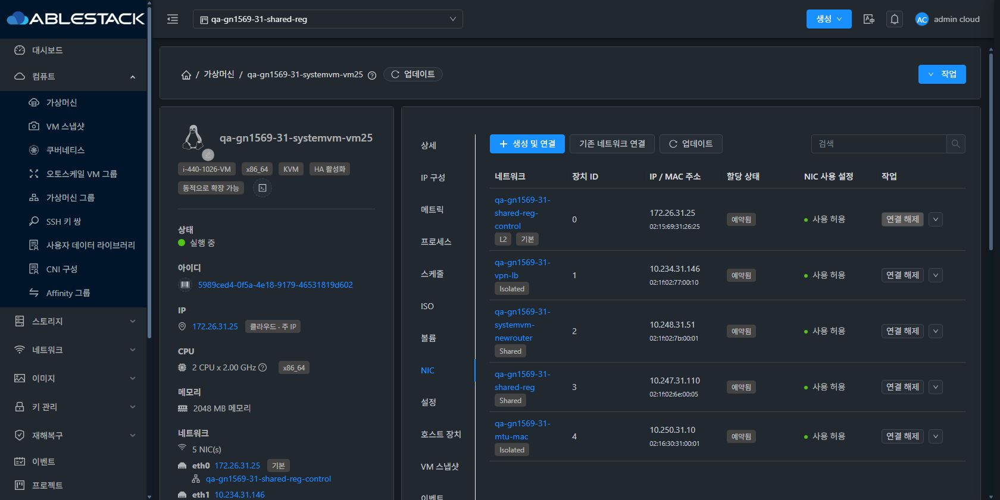
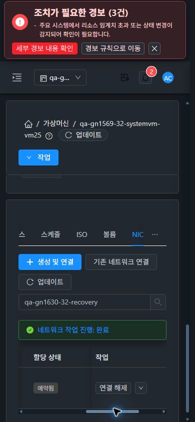

<!--
Licensed to the Apache Software Foundation (ASF) under one
or more contributor license agreements.  See the NOTICE file
distributed with this work for additional information
regarding copyright ownership.  The ASF licenses this file
to you under the Apache License, Version 2.0 (the
"License"); you may not use this file except in compliance
with the License.  You may obtain a copy of the License at

  http://www.apache.org/licenses/LICENSE-2.0

Unless required by applicable law or agreed to in writing,
software distributed under the License is distributed on an
"AS IS" BASIS, WITHOUT WARRANTIES OR CONDITIONS OF ANY
KIND, either express or implied.  See the License for the
specific language governing permissions and limitations
under the License.
 -->

# #1630 NIC 추가 실패 정리·상태 표시 개선

2026-11-11 착수, 11-12 KST 완료. 구현 commit `87dd587c1a119d75f581726fab6f48adfaca0a8f`. 기존 Epic 브랜치 `dhslove/epic-1554-guest-networks`와 Draft [PR #1577](https://github.com/ablecloud-team/ablestack-cloud/pull/1577)을 유지한다.

네트워크 구현·준비 단계 실패 시 이번 요청에서 만든 NIC/IP·매핑을 정리한다. 호스트 응답이 유실되어 연결 결과가 불명확한 경우에는 예약을 보존하고 `attachmentstate=Unknown`으로 복구 필요 상태를 알린다. 기존 NIC·기본 NIC·VM 전원 상태를 유지한다.

UI는 **VM 상세 > NIC 탭**의 `할당 상태`와 `NIC 사용 설정`을 분리했다. 종전의 `활성화`는 `사용 허용`으로 바꾸고, 실행 중인 VM의 미준비 할당·연결 결과 불명확에 경고와 변경 작업 가드를 적용했다. `Reserved`도 실제 하이퍼바이저 연결의 증명으로 표현하지 않는다. API·libvirt·게스트를 별도로 대조했다.

| 검증 | 31 GFS2 | 32 RBD |
| --- | --- | --- |
| 실제 UI 실패 | VLAN 소진 2회 | 전용 라우터 배치 불가 1회 |
| 실패 후 신규 사용자 NIC·매핑 잔류 | 0 | 0 |
| 조건 복구 후 UI 재시도 | jobstatus 1 | jobstatus 1 |
| 최종 API / libvirt NIC | 5 / 5 | 6 / 6 |
| 새 NIC DHCP·DNS·ICMP | 실제 임대, UDP/TCP 각12/12, ICMP10/10 | 실제 임대, UDP/TCP 각12/12, ICMP10/10 |
| 기존 NIC 연속 확인 | DNS UDP/TCP·ICMP·SSH 각각2027/2027 | DNS UDP/TCP·ICMP·SSH 각각2027/2027 |

집중 Java208건·UI34건, 변경 Maven 모듈과 UI 로컬 빌드·배포를 완료했다. 양쪽 실제 화면에서 프로젝트 왕복·화면 이동·390/768/1280·밝음/다크 12조합을 확인했다. 읽기 전용 UI 쓰기 버튼0, 실제 API 쓰기401이다. 전체 Cloud 빌드·LB 부하분산 측정은 수행하지 않았다.

- [설계·보안 계약](design.ko.md)
- [실제 job·실패 복구·배포·검증 한계](test-results.ko.md)
- [UI 표준·캡처 목록](capture-matrix.ko.md)
- [확인용 자원·임시 계측 정리](resources.ko.md)
- [후속 순서·#1569 종료 평가](followups.ko.md)

