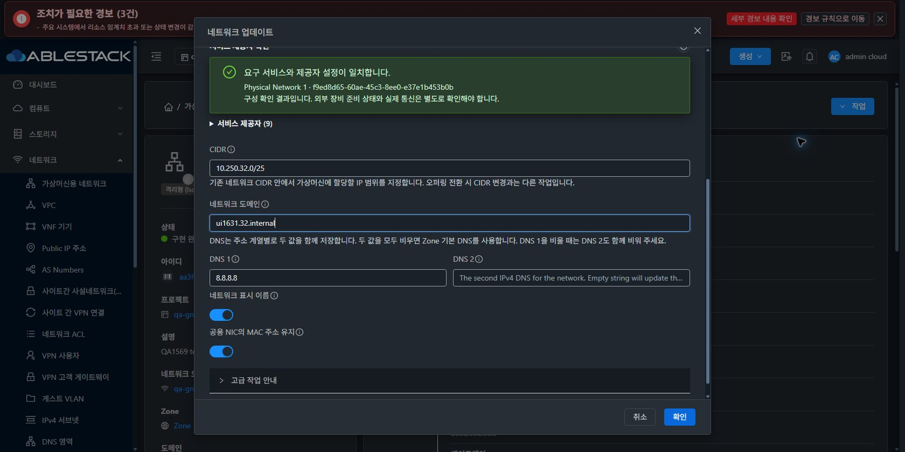

<!--
Licensed to the Apache Software Foundation (ASF) under one
or more contributor license agreements.  See the NOTICE file
distributed with this work for additional information
regarding copyright ownership.  The ASF licenses this file
to you under the Apache License, Version 2.0 (the
"License"); you may not use this file except in compliance
with the License.  You may obtain a copy of the License at

  http://www.apache.org/licenses/LICENSE-2.0

Unless required by applicable law or agreed to in writing,
software distributed under the License is distributed on an
"AS IS" BASIS, WITHOUT WARRANTIES OR CONDITIONS OF ANY
KIND, either express or implied.  See the License for the
specific language governing permissions and limitations
under the License.
 -->

# #1631 VR 재생성의 Public NIC MAC 유지

2026-11-12 KST. 구현 `7358e8aa80232d496251680fecfd78ff4890d355`를 31 GFS2·32 Glue RBD에 반영했다. Epic 브랜치 `dhslove/epic-1554-guest-networks`와 Draft [PR #1577](https://github.com/ablecloud-team/ablestack-cloud/pull/1577)을 유지한다. #1631의 재현·구현·배포·준비된 환경의 검증을 완료했다. 게시 후 해당 결함만 completed로 닫고 Epic #1554·통합 회귀 #1569는 OPEN으로 유지한다.

기존 VR이 삭제되면 peer Public NIC를 찾지 못하고 무작위 바이트가 들어간 MAC을 다시 생성했다. 이제 삭제 전에 실제 Public MAC을 현재 IP 할당 세대·소유자·네트워크/VPC·Public network/VLAN에 묶어 보존하고, 일치할 때만 새 VR에 적용한다. `keepMAC=false`는 새 MAC을 사용한다. 제거된 임의 NIC를 검색하지 않는다.

| 검증 | 31 GFS2 | 32 Glue RBD |
| --- | --- | --- |
| 수정 전 도메인만 변경, true인데 MAC 변경 | UI에서 재현 | API에서 재현 |
| 수정 후 실제 UI 도메인 변경·새 VR | job1, MAC 유지 | job1, MAC 유지 |
| true/false 도메인·오퍼링·cleanup·재시도 | 기대한 유지/변경 통과 | 기대한 유지/변경 통과 |
| 최종 DHCP 신규 임대/갱신 | DORA·unicast ACK 성공 | DORA·unicast ACK 성공 |
| DNS UDP/TCP·라우터 ICMP | 각12/12·10/10 | 각12/12·10/10 |
| Source NAT 수신측 Ethernet MAC/IP | 실제 패킷 일치 | 실제 패킷 일치 |
| 기존 Shared NIC DNS UDP/TCP·ICMP·SSH | 각각1454/1454 | 각각1454/1454 |
| 원래 VM/NIC 보존 | 10 VM/30 API NIC | 11 VM/33 API NIC |

**UI 소스·스타일 변경은 없다.** 네트워크 업데이트의 기존 ‘공용 NIC의 MAC 주소 유지’ 입력이 실제 VR 재생성과 일치하도록 백엔드를 수정했다. VM 목록·상세·NIC 탭·편집창을 기준으로 네트워크 목록·상세·업데이트창·breadcrumb를 대조했다. 양쪽 390/768/1280×밝음/다크12조합, 즉시 테마4전환·프로젝트 왕복·실제 목록 링크 이동을 확인했다. 정적675파일씩은 변경되지 않았다.

추가 읽기 전용 UI 캡처 중 Windows의 브라우저 URL 식별이 불확실해 Computer Use가 중단됐다. 이 추가 촬영은 미완료이며 다른 역할의 화면으로 대체하지 않았다. 읽기 전용 API 변경 차단과 소유자/구성원/읽기 전용 조회는 양쪽에서 검증했다. 관리자 UI·실제 UI 수정 경로·필수 반응형/테마/프로젝트 검증은 중단 전에 완료했다. 역할 전체 UI 통합은 #1569 잔여로 유지한다.

로컬 WSL ext4의 Maven api/server 빌드·Checkstyle·Java53건 통과다. 전체 Cloud 빌드·UI 재빌드·수동 Actions는 실행하지 않았다. 원본 JPEG 41개와 실제 job/DB/VR/libvirt/통신 증적을 보관한다.

- [원인·설계·보안 경계](design.ko.md)
- [실환경 행렬·통신·배포와 한계](test-results.ko.md)
- [UI 표준·캡처 목록](capture-matrix.ko.md)
- [확인용 자원과 임시 계측 정리](resources.ko.md)
- [후속 #1632 → #1569](followups.ko.md)

