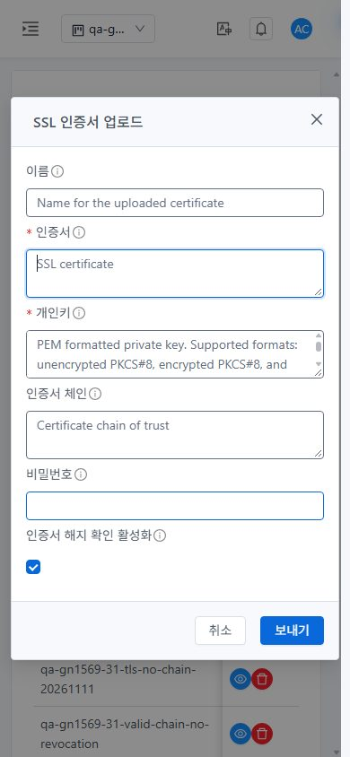
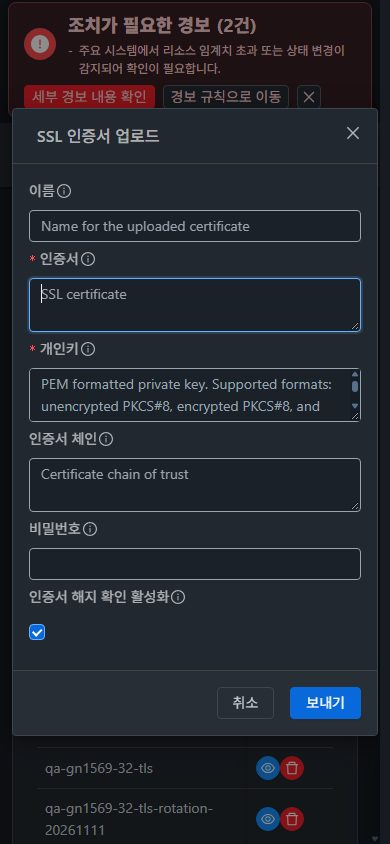

<!--
Licensed to the Apache Software Foundation (ASF) under one
or more contributor license agreements.  See the NOTICE file
distributed with this work for additional information
regarding copyright ownership.  The ASF licenses this file
to you under the Apache License, Version 2.0 (the
"License"); you may not use this file except in compliance
with the License.  You may obtain a copy of the License at

  http://www.apache.org/licenses/LICENSE-2.0

Unless required by applicable law or agreed to in writing,
software distributed under the License is distributed on an
"AS IS" BASIS, WITHOUT WARRANTIES OR CONDITIONS OF ANY
KIND, either express or implied.  See the License for the
specific language governing permissions and limitations
under the License.
 -->

# #1632 SSL 전체 체인·CRL/OCSP 폐기 검사 복원

2026-11-12 KST. 백엔드 `f7097be4d98bd94258120694d3a1fcbaf549209e`, UI `22ba7f5eab604aa4840fb7decc686d3e3192ba22`를31 GFS2·32 Glue RBD에 반영했다. #1632의 구현·배포·준비된 환경의 UI/API/실제 TLS 검증을 완료했다. Epic 브랜치 `dhslove/epic-1554-guest-networks`와 Draft [PR #1577](https://github.com/ablecloud-team/ablestack-cloud/pull/1577)을 유지한다. 게시 후 **#1632만 completed로 닫으며 #1554·#1569는 OPEN**으로 유지한다.

Root→Intermediate→leaf 체인에서 기존 파서가 첫 PEM만 읽어 Root를 누락했고, 기존 PKIX Collection CertStore에는 폐기 정보가 없었다. 전체 체인을 파싱하고, 서명·issuer·현재 유효성을 확인하는 제한된 CRL/OCSP 경로를 추가했다. 전역 JVM 검사 비활성이나 무검증 fallback을 사용하지 않았다.

| 검증 | 31 GFS2 | 32 Glue RBD |
| --- | --- | --- |
| 수정 전 같은 CA 정상/폐기 true | 둘 다530 재현 | 둘 다530 재현 |
| 수정 후 API 기본값 사용38회 | 정상6·거부13 | 정상6·거부13 |
| CRL 전용·OCSP 전용·혼합 정상 | 성공 | 성공 |
| 폐기·unknown·오래된/위조/다른 CertID 응답 | 구분 거부 | 구분 거부 |
| OCSP 미응답 시 서명된 CRL | 성공 | 성공 |
| 실제 응답 지연·서버 복구 | 약3초 거부·재시도 성공 | 약3초 거부·재시도 성공 |
| 실제 UI 실패 입력 보존·복구 | REVOKED530→정상 등록 | 지연530→동일 입력 정상 등록 |
| UI 등록 인증서 실제 LB 할당 | job1·API 연결 일치 | job1·API 연결 일치 |
| 실제 TLS 전체 체인·SNI/Root 검증·HTTP | 체인3·verify0·200 | 체인3·verify0·200 |
| HAProxy 문법·실제 점검 | 정상 | 정상 |
| SSL 변경 구간 기존 VPN ICMP/SSH | 911/911씩·동일 PPP | 212/212씩·동일 PPP |
| UI 반응형·즉시 테마·프로젝트 왕복 | 6조합·2전환·왕복 | 6조합·2전환·왕복 |

**변경한 UI:** 프로젝트/계정 공용 인증서 탭의 등록 기본 체크를 true로 맞췄다. 실패 시 대화상자·입력을 보존하고 성공할 때만 닫고 초기화한다. 중복 제출·scope 변경의 늦은 결과를 차단한다. VM 표준 `MoldDialog size=md`, 세로 폼·취소/기본 작업 footer·모바일 여백·테마 토큰, ‘등록→아이콘+텍스트 업데이트’ 툴바와 페이지 이동/표 내부 스크롤을 적용했다. API의 매개변수/권한 계약은 바꾸지 않았다.

신규 인덱스를 강제 갱신해 `app.e01a5204.js`를 확인했다. 이전 브라우저 캐시의 역할 화면은 검증에서 제외하고 새 자산으로 다시 검증했다. 관리자와 SSL 조회 허용/거부 비관리자 역할을 양쪽 실제 UI로 확인했다. API7역할은 실제 프로젝트 규칙과 대조했다. 역할 이름만으로 거부를 가정하지 않았다.

32 관리서버의 승인된 과거 시험 배포/백업228개를 정리해 **27.48GiB**를 확보했다. 활성 JAR·WEB-INF·DB/SSH 경로와 시험 VM/네트워크는 삭제하지 않았다. 최종21 VM/63 API NIC와 역할/구성원을 보존했다. 현재 배포 rollback 원본은 WSL에 검증 보관하고 관리서버의 임시 hardlink만 해제했다.

로컬 WSL ext4 Maven api/server·Java53건·Checkstyle0, UI ESLint·Jest28건·production build 통과다. 양쪽 정적675파일 해시·활성 JAR3클래스·HTTP200을 확인했다. 전체 Cloud 빌드/수동 Actions는 실행하지 않았고, 등록된 소스 체크는 Merge Conflict Check 성공이다. 원본 JPEG56개를 보관한다.

- [원인·설계·보안 경계](design.ko.md)
- [실환경 행렬·실제 통신·검증 한계](test-results.ko.md)
- [VM UI 표준·캡처56개](capture-matrix.ko.md)
- [확인용 자원·시험 응답자 수명](resources.ko.md)
- [#1569 후속 순서·종료 조건](followups.ko.md)

