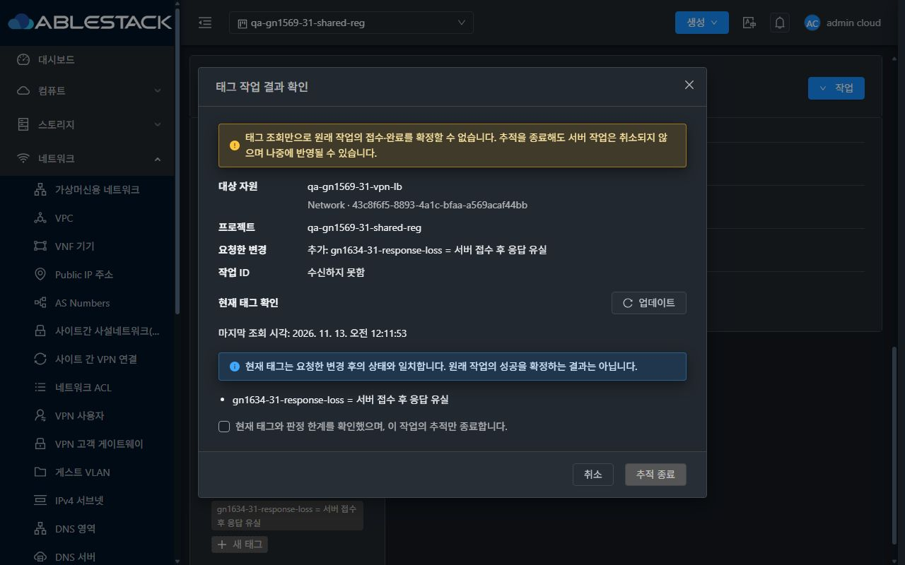
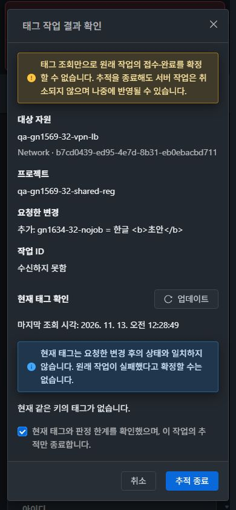

<!--
Licensed to the Apache Software Foundation (ASF) under one
or more contributor license agreements.  See the NOTICE file
distributed with this work for additional information
regarding copyright ownership.  The ASF licenses this file
to you under the Apache License, Version 2.0 (the
"License"); you may not use this file except in compliance
with the License.  You may obtain a copy of the License at

  http://www.apache.org/licenses/LICENSE-2.0

Unless required by applicable law or agreed to in writing,
software distributed under the License is distributed on an
"AS IS" BASIS, WITHOUT WARRANTIES OR CONDITIONS OF ANY
KIND, either express or implied.  See the License for the
specific language governing permissions and limitations
under the License.
 -->

# #1634 태그 미확인 결과 복구 UI 검증

2026-11-12~13 KST, Mold 31(GFS2)·32(Glue RBD)의 실제 UI에서 검증을 완료했다. 별도 브랜치 `dhslove/issue-1634-tag-recovery`, PR [#1637](https://github.com/ablecloud-team/ablestack-cloud/pull/1637)로 관리한다. API·백엔드·권한 정책을 변경하지 않았다.

## 변경한 UI와 VM 표준

- 공통 ResourceTags의 job ID 없는 미확인 알림에 **결과 확인 및 추적 종료**를 추가했다. VM·네트워크·Public IP 등 기존 사용 화면에 적용되는 컴포넌트다.
- **태그 작업 결과 확인** MoldDialog에 대상 이름·UUID·프로젝트·원래 키/값·작업 ID 수신 여부를 의미별로 나눴다. 마지막 조회 시각과 같은 키의 현재 태그를 함께 표시한다.
- VM 메뉴 표준의 md 대화상자, 본문 스크롤, 아이콘+텍스트 **업데이트**, 취소→주요 작업 순서와 공통 모바일 footer를 적용했다. 좁은 화면에서는 대상 요약을 세로로 배치하고 긴 값·UUID를 줄바꿈한다.
- 최신 조회와 확인란 선택 후 **추적만 종료**한다. 성공·실패 또는 서버 작업 취소로 표시하지 않는다. 원래 초안은 보존하며 다음 쓰기는 별도 사용자 실행이다.
- ID가 있으면 원래 job만 다시 조회한다. 응답 대기·조회 실패·범위 변경·오래된 확인·저장 실패의 중복 제출 가드를 유지한다.

## 실제 31·32 UI 결과

| 항목 | 31 | 32 | 판정 근거 |
| --- | --- | --- | --- |
| 제출 전 통제된 503, ID 없음 | 통과 | 통과 | 키/값 보존·쓰기 잠금·복구 버튼, API 미생성 대조 |
| 현재 결과 조회 실패와 재조회 | 통과 | 통과 | 실패 중 확인/종료 비활성, 최신 조회 후 확인 가능 |
| 조회·추적 종료 | 통과 | 통과 | createTags/deleteTags **0건**, 결과 미확정 정보 표시 |
| 추적 종료 뒤 별도 쓰기 | 통과 | 통과 | 사용자 실행 POST **1건**, 실제 jobstatus=1 |
| 서버 접수 후 응답만 유실 | 통과 | 통과 | 서버 job 성공·태그 반영, UI는 성공 단정 없이 조회·추적 종료 |
| ID 있는 작업의 조회 실패 후 복구 | 통과 | 통과 | 3회 조회 실패 후 같은 ID GET만 재조회, POST 0건 |
| 명확한 431 거부 후 명시적 재시도 | 통과 | 통과 | 실패·초안 보존, 자동 재제출 없음, 별도 재시도 job 성공 |
| 삭제 미확인 복구 | 통과 | 통과 | 종료까지 시험 태그 유지·POST 0건, 별도 삭제 1건 |
| 프로젝트·화면 왕복 | 통과 | 통과 | 다른 프로젝트에 원래 요청/확인 상태 미노출, 복귀 시 해당 범위 기록만 복원 |
| 새로고침·로그아웃/역할 변경 | 통과 | 통과 | 확인란 재사용 차단, 로그인 identity 간 기록·편집 상태 분리 |
| 허용 역할·거부 역할 | 통과 | 통과 | 프로젝트 메타데이터 허용 유지, 비구성원 UI 접근 거부·API 432/no job |
| 1280·768·390, 즉시 light/dark | 통과 | 통과 | 원본 캡처·가로 넘침 없음·모바일 footer·경고/입력 가독성 |

31의 최초 실패 주입·응답 유실·job 조회 실패는 첫 빌드 `49c759f3a21`에서 실행했다. 초기 화면 검사에서 번역 키와 모바일 footer를 수정한 최종 소스 `2b7ed538656`을 양쪽에 다시 배포했다. 추적 로직과 컴포넌트 메서드는 두 빌드에서 동일하다. 31의 동일 세션 복구·프로젝트/테마·삭제·Shared의 새 제출 및 별도 재시도는 최종 빌드로 재검증했다. 32의 최종 전체 경로도 같은 최종 빌드에서 검증했다. [변경 구분](evidence/presentation-followup.json).

32번은 검증 도중 세션 만료와 브라우저 제어 연결 해제가 발생했다. 기존 사용자 탭을 강제 초기화하지 않고 새 제어 탭으로 복구했으며 다시 로그인해 실패 조건을 재현했다. 브라우저 실패 주입은 지정된 시험 요청에만 적용했다. HTTP503/431을 실제 서버 장애·권한 변경으로 기록하지 않았다. 응답 본문의 base64 계측 처리도 수정 후 실제 job과 대조했다. 원본 크기 검사에서 높이가 부족한 8개 초기 캡처는 최종 시각 증적에서 제외했다. 시험 후 주입·계측·viewport override를 해제하고 관리자·원래 프로젝트·light 테마로 복원했다.

## 중복·권한·실제 job 대조

조회/추적 종료와 원래 job 재조회 구간에는 쓰기 요청이 없었다. 최종 신규·삭제·역할 재시도 구간별 쓰기는 각각 1건이다. [요청 횟수 검증](evidence/request-count-verification.json), [UI 요청 기록](evidence/ui-network.json), [주입 조건](evidence/ui-cases.json).

- 응답 유실의 실제 서버 job: 31 `42bfa3d1-e4a5-4a25-961f-e6866c15c607`, 32 `11a30651-f617-4c55-a55e-033a564073c1`; 양쪽 status=1 및 실제 태그 반영.
- 원래 job 재조회: 31 `7385f952-ca2e-488c-bbde-62b04f152d8e`, 32 `acae3962-3f00-4e52-a94b-526d29d97fd4`; 같은 ID만 재조회해 완료 확인.
- 32의 복구 후 새 쓰기를 서버 전달 전에 잠시 대기시켜 접수 중 버튼/입력 비활성·복구 종료 버튼 미노출을 확인했다. 전달한 실제 요청은 1건이며 job `f5ccba1d-7d9a-4cdc-9410-6dd49a2861a7`은 0→1로 완료했다.
- 프로젝트 역할명이 ReadOnly여도 기존 메타데이터 API가 허용된 프로젝트 자원에서는 변경 기능을 유지했다. 반면 계정 소유 Shared 읽기 화면에는 새 태그·삭제 아이콘을 노출하지 않았다. 비구성원은 양쪽 UI에서 대상 조회가 거부되어 대시보드로 돌아가며 태그 UI가 없었다. API list/create/delete는 기존 432 거부·job 미생성을 유지했다. [31 역할 API](evidence/31-role-api-regression.json), [32 역할 API](evidence/32-role-api-regression.json).

## 빌드·배포·원본 캡처

| 확인 | 결과 |
| --- | --- |
| 최종 소스 | `2b7ed5386564997cf9e833f2faf7fc3b9bca2ff1` |
| WSL ext4 로컬 집중 회귀 | **8 suites / 105 tests PASS**, 실패·보류 0 |
| 변경 JS/Vue/시험 파일 lint | 4개 파일 PASS, KO/EN 실제 locale 렌더링 확인 |
| UI production build | Node 20.20.2 / npm 10.8.2, 676.3초, exit 0 |
| 양쪽 활성 번들 | `app.20077043.js` |
| index SHA256 | `6793a81e4a6f252c7f3da42ca566b1a1c33ac57cca9eb981d90b865fc921f034` |
| 정적 배포 | 양쪽 689파일, 31,241,996bytes, 최종 해시 불일치 0 |
| 서버 보존 | WEB-INF·기존 META-INF·설정·관리 JAR·PID 보존, `/client/` HTTP200 |

빌드·lint·단위 회귀는 로컬 결과다. 전체 Cloud/Maven/Actions 빌드를 실행하지 않았다. 첫 회귀 실행은 coverage 보고 생성 중 제한 시간에 도달해 완료로 집계하지 않았고, 필요한 집중 회귀를 coverage=false로 다시 실행해 위 105건을 확인했다.

[빌드 결과](evidence/ui-build-result.json) · [단위 회귀/lint](evidence/local-checks.json) · [UI 전용 변경 경계](evidence/source-ui-boundary.json) · [31 최종 배포](evidence/31-final-deployment.json) · [32 최종 배포](evidence/32-final-deployment.json) · [전체 캡처 목록](captures.ko.md) · [원본 크기/해시 검증](evidence/capture-integrity.json).

### 31번 데스크톱 다크모드

### 32번 모바일 다크모드

## 확인용 자원과 범위

새 VM·네트워크·VPC는 생성/삭제하지 않았다. 기존 최신 회귀 자원과 NIC를 남겼으며 원래 태그도 모두 보존했다. 삭제 경로 시험을 위해 이번에 만든 `gn1634-*-delete` 태그만 명시적 UI 삭제로 제거했다. `gn1634-*-nojob`, `response-loss`, `role-retry`, VM의 `job-lookup`, 31 Shared의 `shared` 시험 태그는 확인용으로 유지한다.

| 클러스터 | 프로젝트 | 네트워크 | VM |
| --- | --- | --- | --- |
| 31 | qa-gn1569-31-shared-reg | [qa-gn1569-31-vpn-lb](http://10.10.31.10:8080/client/#/guestnetwork/43c8f6f5-8893-4a1c-bfaa-a569acaf44bb) | qa-gn1569-31-vpn-lb-vm |
| 32 | qa-gn1569-32-shared-reg | [qa-gn1569-32-vpn-lb](http://10.10.32.10:8080/client/#/guestnetwork/b7cd0439-ed95-4e7d-8b31-eb0ebacbd711) | qa-gn1569-32-vpn-lb-vm |

최종 API 대조는 전체 조회 범위의 자원 ID·상태·배치·네트워크 속성·NIC ID/IP/MAC/기본 여부가 시작 시점과 같음을 확인했다. 각 시험의 실제 tag job도 모두 status=1이다. [31 최종 API](evidence/31-final-api.json), [32 최종 API](evidence/32-final-api.json). 이 UI 태그 변경 범위에서 네트워크 통신을 변경하거나 DNS/VPN/LB 실통신을 새로 측정하지 않았다.

Public IP·L2는 공통 컴포넌트 적용 및 단위/원래 태그 보존 대조 범위다. 이번 실화면 실패·복구 동작은 Isolated·31 Shared·VM을 사용했다. VM 목록·상세·NIC 탭의 레이아웃·breadcrumb과 기존 화면 이동을 기준으로 새 대화상자의 배치와 테마를 비교했다.

## 종료와 후속

이슈 #1634의 구현·31/32 반영·UI/API 대조·캡처 완료 기준을 충족했다. 별도 PR #1637은 검토 대상으로 유지하며 이슈를 완료 종료한다. 종료된 Epic #1554·#1569를 다시 열지 않는다. 다음은 PR #1637 코드 검토·병합이고, 다른 독립 P3 UI 후속은 해당 이슈의 범위에서 별도로 진행한다. 이번 요청에 PR 병합은 포함되지 않는다.
