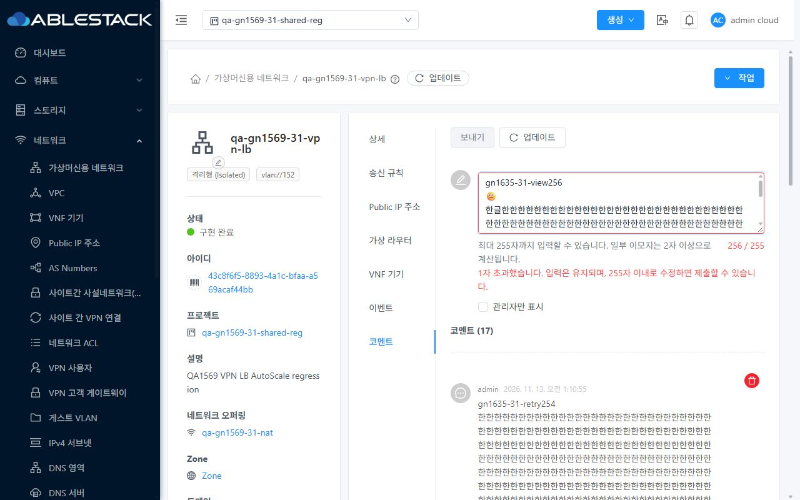
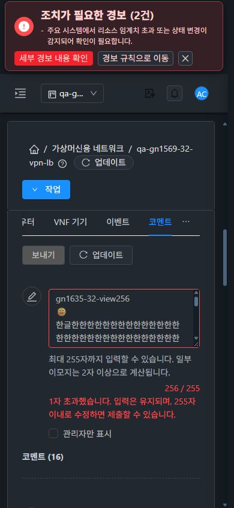

<!--
Licensed to the Apache Software Foundation (ASF) under one
or more contributor license agreements.  See the NOTICE file
distributed with this work for additional information
regarding copyright ownership.  The ASF licenses this file
to you under the Apache License, Version 2.0 (the
"License"); you may not use this file except in compliance
with the License.  You may obtain a copy of the License at

  http://www.apache.org/licenses/LICENSE-2.0

Unless required by applicable law or agreed to in writing,
software distributed under the License is distributed on an
"AS IS" BASIS, WITHOUT WARRANTIES OR CONDITIONS OF ANY
KIND, either express or implied.  See the License for the
specific language governing permissions and limitations
under the License.
 -->

# #1635 코멘트 길이 사전 안내·카운터 검증 완료

2026-11-13 KST, 31(GFS2)·32(Glue RBD)에 UI 개선을 반영하고 실제 UI/API 대조를 완료했다. #1634와 같은 `dhslove/issue-1634-tag-recovery` 브랜치와 [PR #1637](https://github.com/ablecloud-team/ablestack-cloud/pull/1637)에 포함한다. API·서버의 255자 제한·기존 보안 정책은 유지한다.

## 변경한 UI와 VM 표준

- 공통 **코멘트 탭 입력란** 바로 아래에 최대 255자 안내, **현재 / 최대 길이**, 초과 글자 수와 수정 안내를 추가했다. 네트워크·VM·Public IP에서 같은 컴포넌트를 사용한다.
- 255자를 넘으면 **보내기**와 **Ctrl+Enter**를 모두 POST 전에 차단한다. maxlength로 초안을 잘라내지 않아 장문 붙여넣기·실패 후 입력을 사용자가 직접 수정할 수 있다.
- VM 표준의 보내기→아이콘+텍스트 업데이트 툴바, 세로 입력 흐름을 사용한다. 좁은 화면에서는 안내·카운터를 줄바꿈하고 오류는 기존 테마 색상으로 표시한다. 입력과 안내를 aria-describedby로 연결하고 초과 시 aria-invalid를 제공한다.
- 서버의 Java String.length와 같은 UTF-16 길이로 계산한다. 앞뒤 공백과 LF 줄바꿈도 포함하며 일부 이모지는 2자 이상이다. 이를 사전 안내에 반영했다.
- 전송 중 중복 가드, 성공 시 제출 원문만 초기화, 변경 중인 새 초안 보존, 프로젝트·자원·로그인 범위 가드와 관리자 표시/작성자 삭제 정책을 유지했다. 역할 이름을 근거로 기존 메타데이터 권한을 제거하지 않는다.

## 실제 31·32 검증

| 항목 | 31 | 32 | 결과 |
| --- | --- | --- | --- |
| 254·255·256 경계 | 통과 | 통과 | 254/255 제출 가능, 256 차단·1자 초과 표시 |
| 한글·개행·이모지 | 통과 | 통과 | LF·이모지 포함 255 저장, 이모지 128개=256 차단 |
| 장문 붙여넣기·빈 입력 | 통과 | 통과 | 1,935자 원문 보존·차단, 공백/LF 입력 차단 |
| 초과 Ctrl+Enter | 통과 | 통과 | addAnnotation POST **0건** |
| 255자로 수정 후 제출 | 통과 | 통과 | POST **1건**·실제 저장 원문/길이 일치·0/255 초기화 |
| 503·쓰기 거부 후 복구 | 통과 | 통과 | 254자 초안·기존 목록 유지, 별도 재시도 1건 저장 |
| VM·Public IP 공통 탭 | 통과 | 통과 | VM 이모지 255·Public IP HTML 리터럴 255 저장 |
| HTML 텍스트 표시 | 통과 | 통과 | b 태그 요소 0개, 리터럴 원문과 줄바꿈 유지 |
| 프로젝트·자원 왕복 | 통과 | 통과 | 다른 프로젝트와 VM에 이전 초안 미노출·0/255, 원래 프로젝트 정상 복귀 |
| 1280·768·390 light/dark | 통과 | 통과 | 12개 조합의 원본 캡처, 가로 넘침 없음 |
| 즉시 테마 전환 | 통과 | 통과 | 새로고침 없이 256자 초안·카운터·제출 차단 유지 |

쓰기 오류 UI는 지정된 addAnnotation 요청만 **서버 전달 전** 통제된 503 또는 HTTP403/errorcode432로 응답했다. 원래 서버 장애나 보안 정책 변경으로 판정하지 않았다. 읽기 가능한 범위의 쓰기 거부 후 입력 보존을 확인한 것이다. 실제 비구성원 API addAnnotation은 양쪽 기존 432 거부를 확인했다. API의 ASCII·한글·LF·이모지 256자 거부는 기존 431이며 목록 불변을 확인했다. [31 API 경계](evidence/31-api-boundary-before.json), [32 API 경계](evidence/32-api-boundary-before.json).

초과/빈 입력 검사 구간에는 POST가 없고 정상 추가는 시험별 1건이다. 실패 주입 1건은 서버에 전달되지 않았으며 재시도만 실제 저장됐다. 각 저장 ID·대상·요청 길이와 API의 저장 원문 길이를 대조했다. [요청·저장 대조](evidence/request-and-storage-verification.json), [UI 요청 기록](evidence/ui-network.json), [UI 상태 검사](evidence/ui-cases.json).

## 빌드·배포

| 확인 | 결과 |
| --- | --- |
| 소스 | `aeb3390805d38c8e039ce6f4a6fd1677c8d3df4b` |
| 로컬 집중 회귀 | **9 suites / 132 tests PASS**, 실패·보류 0 |
| lint | AnnotationsTab·새 길이 회귀 파일 2개 PASS |
| UI production build | WSL ext4, Node 20.20.2 / npm 10.8.2, 667.6초, exit0 |
| 활성 번들 | `app.afbf5c9d.js`, 코멘트 chunk `chunk-1cd62392.c7917130.js` |
| index SHA256 | `04a27fb4e649e210a6dc807c94b3525671da1d137f3b69c207932bb1ae867040` |
| 양쪽 정적 배포 | **689파일 / 31,244,962bytes**, 최종 해시 불일치 0 |
| 서버 보존 | WEB-INF·기존 META-INF·설정·관리 JAR·PID 보존, `/client/` HTTP200 |
| 기존 기능 표식 | 태그 복구·FTCTL async 표식 유지 |

첫 회귀 실행의 새 시험 locale import 경로 오류를 고친 뒤 전체 집중 회귀를 다시 실행했다. 위 수치는 최종 성공 실행이다. 로컬 UI 검사·빌드 결과이며 전체 Cloud·Maven·Actions 빌드는 시작하지 않았다. [검사 결과](evidence/local-checks.json), [빌드](evidence/ui-build-result.json), [31 최종 배포](evidence/31-final-deployment.json), [32 최종 배포](evidence/32-final-deployment.json), [UI 전용 변경 경계](evidence/source-ui-boundary.json).

32번의 기존 운영 경보/Wall 조회 알림은 별도 환경 상태이며 이번 코멘트 UI의 오류로 분류하지 않았다. 실패 주입 알림은 확인 후 닫았고, 주입·계측·viewport override를 해제했다. 양쪽 관리자 세션의 원래 회귀 프로젝트·light 테마로 복원했다.

## 원본 캡처

실제 viewport와 일치하는 원본 JPEG **28개**를 포함한다. 12개 폭/테마 조합은 실제 스크롤 후 입력란·길이 안내·초과 경고가 화면 안에 함께 보이는 위치를 추가 대조해 재촬영했다. 캡처 보완 중 추가 제출은 0건이다. [전체 캡처 목록](captures.ko.md), [원본 크기·해시 검증](evidence/capture-integrity.json), [입력부 가시 영역 검증](evidence/capture-visibility-verification.json).

### 31번 데스크톱 light — 초과 안내·입력 보존

### 32번 모바일 dark — 길이·경고 줄바꿈

## 확인용 자원과 후속

기존 VM·네트워크·VPC·NIC와 코멘트 내용·공개 범위를 보존했다. 새 네트워크나 VM은 만들거나 삭제하지 않았다. 양쪽 **4개씩 총 8개**의 새 코멘트를 확인용으로 남겼으며 중복 저장은 없다. `gn1635-*-max255`, `retry254`, `vm-emoji255`, `public-html255`를 확인하면 된다.

| 클러스터 | 프로젝트 | 확인용 네트워크 코멘트 |
| --- | --- | --- |
| 31 | qa-gn1569-31-shared-reg | [qa-gn1569-31-vpn-lb](http://10.10.31.10:8080/client/#/guestnetwork/43c8f6f5-8893-4a1c-bfaa-a569acaf44bb?tab=comments) |
| 32 | qa-gn1569-32-shared-reg | [qa-gn1569-32-vpn-lb](http://10.10.32.10:8080/client/#/guestnetwork/b7cd0439-ed95-4e7d-8b31-eb0ebacbd711?tab=comments) |

[31 최종 원문·자원 대조](evidence/31-final-api.json), [32 최종 원문·자원 대조](evidence/32-final-api.json). 이번 UI 길이 개선은 실제 네트워크 데이터 경로를 변경하지 않으며 DNS/VPN/LB 통신을 새로 측정하는 범위는 아니다.

이슈 #1635의 구현·양쪽 반영·UI/API 대조·캡처 완료 기준을 충족했다. #1634와 함께 별도 PR #1637에서 검토하며, 후속은 해당 PR의 코드 검토·병합이다. 종료된 Epic #1554·#1569는 다시 열지 않고 독립 P3 UI 범위로 관리한다.
