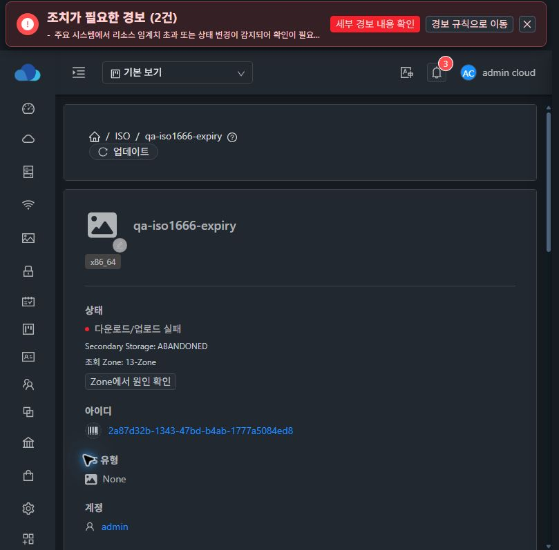
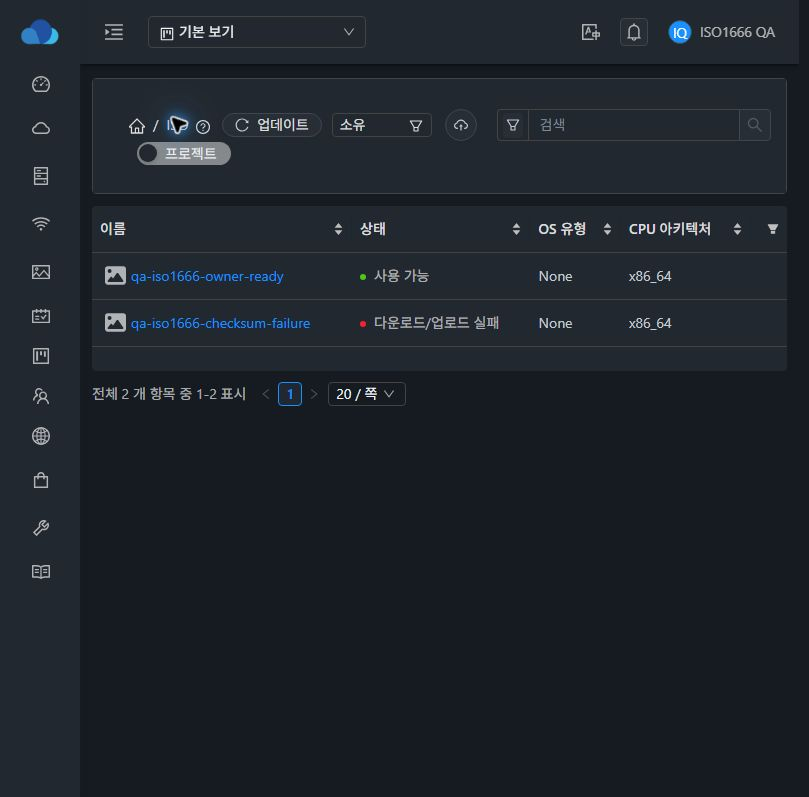
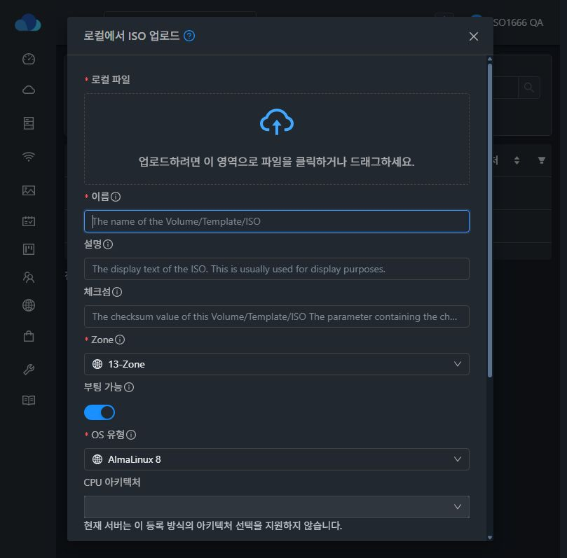
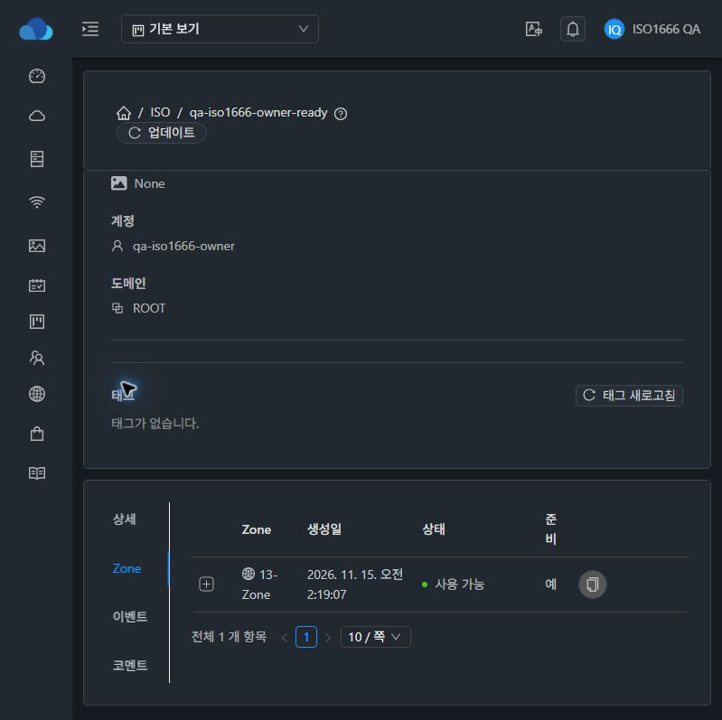

<!--
Licensed to the Apache Software Foundation (ASF) under one
or more contributor license agreements.  See the NOTICE file
distributed with this work for additional information
regarding copyright ownership.  The ASF licenses this file
to you under the Apache License, Version 2.0 (the
"License"); you may not use this file except in compliance
with the License.  You may obtain a copy of the License at

  http://www.apache.org/licenses/LICENSE-2.0

Unless required by applicable law or agreed to in writing,
software distributed under the License is distributed on an
"AS IS" BASIS, WITHOUT WARRANTIES OR CONDITIONS OF ANY
KIND, either express or implied.  See the License for the
specific language governing permissions and limitations
under the License.
 -->

# ISO-01 공통 계약 설계 및 검증 (#1666)

상위 Epic #1664. UI 정적 자산만 변경한다. 등록 전송/재시도는 #1667, 공유 응답 및 공유 Zone 렌더링은 #1668, 목록/상세/탭/대화상자의 본격적인 VM 스타일 정렬은 후속 이슈 범위다.

## 설계

- `isoModel.js`는 서버 원문을 변경하지 않고 표시용 복사본만 만든다. boolean true/false와 문자열 true/false를 해석하며 누락 값을 임의의 true로 만들지 않는다. 선택적 저장소 정보가 없어도 서버 Ready=true는 사용 가능이다.
- URL 등록과 로컬 업로드는 각각 registerIso / getUploadParamsForIso의 API 허용 여부와 파라미터 메타데이터를 확인한다. 버전 문자열로 추측하지 않는다. arch 미지원은 비활성 필드의 설명으로 표시하고, 메타데이터 미확인 상태의 제출은 차단한다.
- 기존 가용성 컴포넌트를 재사용해 목록·InfoCard·Zone의 표시를 통일한다. ABANDONED/UPLOAD_ERROR/DOWNLOAD_ERROR는 실패이며 다운로드 100%만으로 Ready를 만들지 않는다. 대표 Zone 응답은 전체 Zone 검증 결과로 표시하지 않는다.
- ISO 목록의 state를 공통 customRender로 덮어쓰지 않는다. ID·이름·원래 서버 필드와 관련 없는 값을 보존한다.
- 소유자/프로젝트/API/시스템 리소스/Ready/bootable 판단을 하나의 helper로 연결한다. 루트 도메인 숫자 비교를 사용하지 않는다. UI 판단은 서버 ACL을 대체하지 않는다.
- Zone 데이터는 계정·역할·API 목록·프로젝트·ISO 범위에 묶고, 범위가 바뀌거나 새로고침에 실패하면 이전 선택으로 작업을 실행하지 않는다. 실패 응답은 정상적인 빈 목록과 구분한다.

## 작업 조건

모든 작업은 해당 API의 실제 허용 항목과 ISO ID를 필요로 한다. 정보 부족은 허용 근거가 아니다.

| 작업 | 추가 조건 |
| --- | --- |
| URL 등록 | registerIso, 사용 가능한 Zone, 선택 모드의 파라미터 메타데이터 |
| 로컬 업로드 | getUploadParamsForIso, 사용 가능한 Zone, 선택 모드의 파라미터 메타데이터; registerIso와 독립 |
| 수정·공유·복사 | 비시스템 ISO 소유 범위 + Ready |
| 계정/프로젝트 공유 | 위 조건 + listIsoPermissions |
| 삭제 | 비시스템 ISO 소유 범위 + Ready 또는 확인된 실패; 전송 시작 대기/진행 상태 제외 |
| 다운로드 | 비시스템 ISO 소유 범위 + Ready + 루트 관리자 또는 isextractable=true |
| VM 생성 | listIsos + deployVirtualMachine + Ready + bootable=true; 읽을 수 있는 공유 ISO 사용 가능 |
| 일괄 삭제 | 각 행의 삭제 조건을 선택 시점·실행 시점에 재확인 |

루트 관리자는 타 계정의 일반 ISO를 관리할 수 있다. 개인 계정은 일치하는 account/domainid, 프로젝트는 현재 선택된 projectid를 요구한다. 시스템 ISO는 관리자에게도 수정·공유·복사·삭제·추출 작업을 제공하지 않는다. 비부팅 ISO의 VM 생성 버튼은 이유를 표시하고 비활성화한다.

## 배포 경계

기준 브랜치 1046a5dc3f21cb9cca0ab6881dd906d64b591e80. 배포 입력은 13번 실제 index SHA-256 a70a72b89234fc6d3b5592e17f0be63a7adbbe25b8fa2330aa2cf6fce57976c9와 일치하는 기존 UI 아카이브다. 여기에 이번 소스 차이와 네 개 번역 항목만 적용해 빌드한다. 전체 최신 브랜치의 무관한 UI 변경을 배포하지 않는다. backend JAR·DB·서비스·설정·테마 변수·이전 해시 자산을 보존하고 index는 마지막에 교체한다.

## 검증 결과

- 변경된 JS/Vue 9개 경로 ESLint 통과. 한국어/영어 번역 JSON 파싱 및 생산 빌드 통과.
- 관련 8개 테스트 묶음 103개 통과. 실제 운영 UI 입력 아카이브에서도 동일한 103개 통과.
- 운영 입력 UI 빌드 통과(871.9초). 신규 전역 UI 프레임워크·API/DB 변경 없음.

| 실제 13번 UI 사례 | 관측 결과 |
| --- | --- |
| 체크섬 오류·Ready=false·DOWNLOAD_ERROR | 기존 대기 중 오표시 → 목록·InfoCard·Zone 모두 다운로드/업로드 실패. 100%만으로 Ready가 되지 않음 |
| 시스템 vmware-tools, Ready=true·저장소 빈 배열 | 실제 목록에서 사용 가능. 조회된 정보 기준으로 표현하며 전체 Zone Ready로 과장하지 않음 |
| URL 등록 거부·로컬 업로드 허용 User 역할 | UI API 문서에서 registerIso 없음/getUploadParamsForIso 있음. 배포 전 두 메뉴 없음 → 배포 후 로컬만 표시·폼 정상 초기화 |
| 선택 모드의 arch 미지원 | 실제 로컬 업로드 메타데이터에 arch 없음. 선택 비활성화·폼 내부 미지원 안내 표시 |
| 일반 소유자의 Ready ISO | 설명 수정 저장·재조회 확인. 공개/추출 가능만 표시하고 추천 플래그 없음. 추출 가능 false→true일 때 다운로드 작업 노출 |
| 비부팅 ISO / 부팅 ISO | 비부팅 ISO의 VM 추가 비활성. 기존 Ready 부팅 ISO는 ID·Zone·arch를 유지해 생성 마법사로 전달. VM 생성은 실행하지 않음 |
| Ready 소유자 복사·선택 | 복사 대화상자 진입 및 취소, 일괄 선택 가능. 실제 복사 실행은 추가 Zone 없음으로 미실행 |
| 실패 ISO 일괄 삭제 | 일반 소유자 UI에서 실행, 완료 이벤트와 목록에서 제거됨을 확인 |
| 같은 소유 계정의 Read-Only User 역할 | 등록/업로드·상세 작업·삭제·선택 없음, 복사 비활성. Ready·Zone 조회 유지 |
| 루트 관리자·시스템 ISO | 시스템 ISO의 상세 수정/공유/다운로드 및 Zone 복사/삭제/선택 없음. 비부팅 VM 추가 비활성 |
| UUID 루트 관리자·타 계정 일반 ISO | 정상 관리 가능. 추출 가능=false에서도 관리자 다운로드 작업 표시. 시스템 ISO 조건과 구분 |
| 정상 만료 ABANDONED | PASS — 전역 timeout/DB 상태 변경 없이 기본 60분 정상 만료 관측. 서버 status=Processing이어도 저장소 ABANDONED 근거로 목록·InfoCard·Zone 모두 실패 표시. 상세 작업·복사·VM 추가 차단, 삭제 허용 및 실제 삭제 완료 |

대표 Zone과 다중 Zone의 불완전 관측, 다른 ISO 관측 거부, 누락/비배열 저장소 정보, 문자열 false, API 일부 허용/거부, 오류 응답과 정상 빈 목록, 계정/역할/프로젝트 변경·늦은 응답·기존 선택 재사용 차단은 단위 테스트로 대조했다. 실제 다중 Zone·비KVM·다른 서버 버전 및 실제 프로젝트 계정 행렬은 이번 13번 환경에서 실행한 것으로 표시하지 않는다. 기본/다크 전체 스타일 회귀는 후속 UI·통합 이슈 범위이며 이번 화면 검증은 현재 운영 다크 모드다.

PERHOST 도구 ISO의 상세 진입은 이번 브라우저 관측에서 상세 요청 결과를 확보하지 못해 PASS로 기록하지 않았다. Ready=true/저장소 빈 응답은 실제 목록과 공통 표시 모델 테스트에서 확인했다.

## 정리 및 배포 보존

시험 ISO 3개·계정 1개·역할 1개·사용자 데이터 1개를 UI로 정상 삭제했다. 최종 기존 ISO 8개 ID가 정확히 일치하며, 계정 3개·역할 9개·사용자 데이터 0개가 보존됐다. QA 잔여 0개다. 실제 브라우저가 새 `js/app.d9ca2c50.js`를 사용 중인 것도 확인했다.

실행 자산 11개만 배포했다(기존 index/번역 3개 교체, 해시 자산 8개 추가). source map은 배포하지 않았다. `runtime-final.json`에서 신규 자산 11개와 무관한 기존 자산 7,028개의 해시 보존을 확인했다. 관리 서비스 PID 2473572·백엔드 JAR·config.json·WEB-INF/web.xml·color.less는 변경하지 않았다. HTTP 시험 파일은 제거되어 404다.

- 배포된 제품 코드: `b8e9f242bfa38c9d5e4f0a67b677f168a418552a`
- index SHA-256: `a7e5f8fb51b197fdbaf596e13c36f59933f43649f42989b854d783d0f7f7ac72`
- 복구본: `/var/tmp/iso1666-20261115-ui-backup-g4d1deri`
- 복구 시 보존된 기존 해시 자산을 사용하고, 복구본의 한국어/영어 번역과 index를 되돌린다. index는 마지막에 교체한다. 서비스 재시작·전체 재배포는 필요하지 않다.

## 남은 범위 및 CI 구분

삭제 job은 완료됐으나 기존 history 기반 복귀가 대시보드에 도달하는 동작을 관측했다. 변경하지 않은 `moveToPreviousView()`의 복귀·완료 표시 경합은 [#1668 후속 근거](https://github.com/ablecloud-team/ablestack-cloud/issues/1668#issuecomment-6881597850)에 추가했다. 로컬 파일 전송/사용자 데이터 연결의 기존 실패와 재시도는 #1667 범위다. 이번 검증을 해당 후속 기능 전체의 성공으로 해석하지 않는다.

RAT는 기준 `1046a5dc3f21`과 변경 `8cb02a4dc9a`의 tracked-source 입력을 같은 명령으로 비교했다. 양쪽 unknown/unapproved 4,077개이며 실패 파일 집합이 완전히 동일하다(추가 0/제거 0). 기존 #926에 비교 결과를 갱신했다. 전역 검사 제외·skip·임계값 완화는 하지 않았다.

전체 pre-commit 실행 43621194083은 실패했다. identity 출력 뒤의 진단에서 추출한 tracked 경로 11,180개 중 제품 변경 경로의 실패 진단은 0개였고, 새 검증 문서 1개가 라이선스 형식 보정 대상으로 포함됐다. 이 문서는 저장소 표준 헤더로 교정했으며 같은 고정 버전 Lucas-C/pre-commit-hooks v1.5.6의 실제 insert-license hook을 적용한 복사본이 종료 0·내용 무변경으로 통과했다. 나머지 식별된 진단 경로는 모두 기준 브랜치와 동일한 파일이다. 변경 경로 ESLint와 문서 markdownlint도 통과했다. 전체 CI가 성공했다는 뜻은 아니며 기존 #926·#1044는 OPEN으로 별도 관리한다. 근거 커밋 이후의 전체 CI 재실행 상태는 PR에서 확인한다.

## 화면 근거

최종 UI/서버 원문 대조는 `evidence/ui-cases.json`, 자원 추적은 `evidence/resource-ledger.json`, 배포 입력과 해시는 `evidence/source-boundary.json`·`evidence/deploy-files.json`·`evidence/runtime-final.json`, CI 비교는 `evidence/rat-comparison.json`·`evidence/precommit-classification.json`·`evidence/license-hook-check.log`에 기록한다. 인증값·서명·일회 업로드 URL을 포함하지 않는다.
