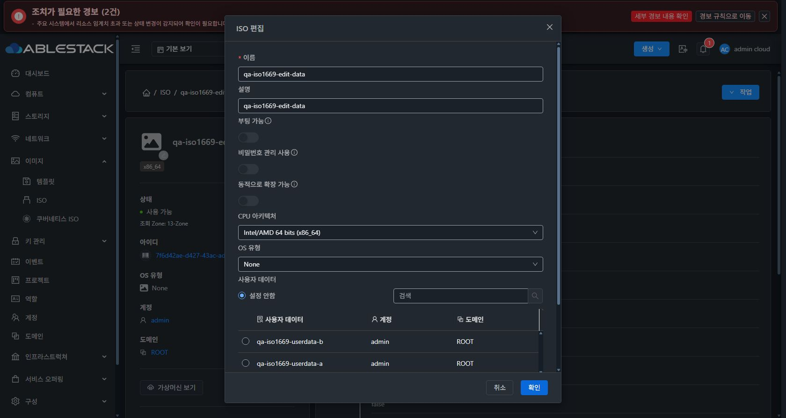
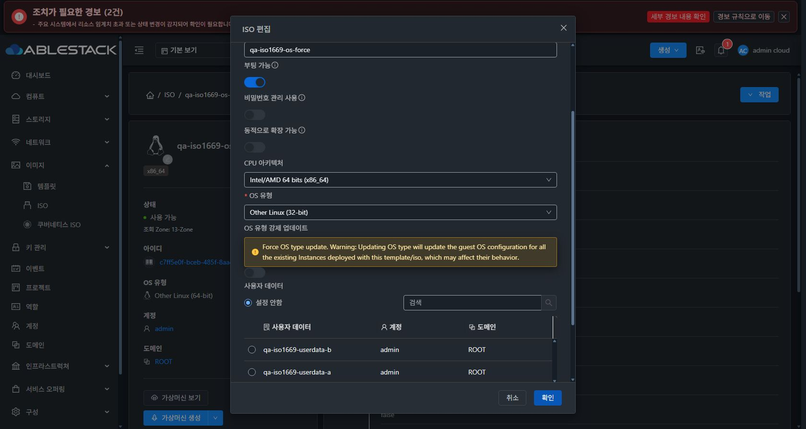
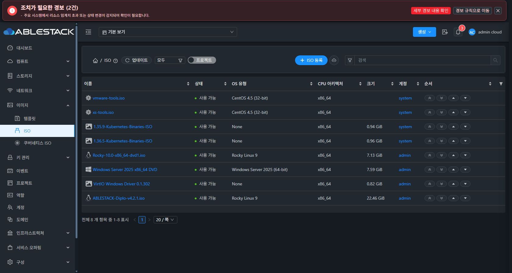

<!--
Licensed to the Apache Software Foundation (ASF) under one
or more contributor license agreements.  See the NOTICE file
distributed with this work for additional information
regarding copyright ownership.  The ASF licenses this file
to you under the Apache License, Version 2.0 (the
"License"); you may not use this file except in compliance
with the License.  You may obtain a copy of the License at

  http://www.apache.org/licenses/LICENSE-2.0

Unless required by applicable law or agreed to in writing,
software distributed under the License is distributed on an
"AS IS" BASIS, WITHOUT WARRANTIES OR CONDITIONS OF ANY
KIND, either express or implied.  See the License for the
specific language governing permissions and limitations
under the License.
 -->

# ISO-04 #1669 수정·사용자 데이터 계약 및 13번 검증

상위 Epic #1664 · 구현 PR #1682 · 개발 순서 4/8 · 2026-11-15 KST.

## 결과

**#1669 기능 구현·13번 필요 범위 배포·실제 UI 검증·전용 자원 정리를 완료했다.** 제품 커밋은 d27ade742cc7f4b3e192785c887f4af858f0b413이다. Epic 전체 완료나 PR 병합을 의미하지 않는다.

- 변경 파일 Lint, 소스 **18 suites / 277 tests**, 운영 입력 **18 suites / 265 tests**, 집중 pre-commit/manual 검사와 UI 빌드가 통과했다.
- 메타데이터 델타 저장, 아키텍처 3종 저장·검색·재개방, 부팅 가능과 OS 연계, 명시적 false·빈 설명, 사용자 데이터 3정책/대상 변경/해제를 UI 요청과 재조회 값으로 대조했다.
- 메타데이터 부분 성공·후속 연결 실패·조회 결과 불명에서 같은 ID와 입력을 보존하고 GET 상태 확인 뒤 연결만 재시도했다. 두 창의 동시 수정과 busy 중 Ctrl+Enter 중복/ESC도 검증했다.
- 전용 ISO 2개·사용자 데이터 2개·정지 VM 1개·5GiB 루트 볼륨 1개를 UI로 정리했다. QA 잔여 0, 기존 ISO **8개 ID·목록 값 전부 일치**다.
- UI 정적 파일 **6개만** 배포했다. 백엔드 JAR·Mold PID·설정·테마·기존 나머지 정적 파일을 보존했다.
- License의 기존 4,077개 경로는 동일하며, 전체 Lint의 기존 실패 hook 16개도 동일하다. 신규 진단 경로는 0이다. **#926·#1044 별도 OPEN**, 전체 CI 성공으로 표시하지 않는다.

[검사 요약](evidence/checks.json) · [UI 요청/재조회 근거](evidence/ui-cases.json) · [시험 자원](evidence/resource-ledger.json) · [배포/보존](evidence/final-runtime.json)

## 설계

수정 창을 현재 값 보존, 명시적 변경만 저장, 재조회로 결과 확인하는 흐름으로 정리한다. 이름·설명·부팅 가능·아키텍처·OS·비밀번호 관리·동적 확장은 운영 listApis의 updateIso 파라미터에 따라 편집한다. 지원하지 않는 필드와 알 수 없는 현재 값은 덮어쓰지 않는다. false는 그대로 유지한다.

아키텍처는 x86_64·aarch64·s390x를 현재 값으로 초기화하고 옵션 label/value로 검색한다. 데이터 ISO를 부팅 가능으로 바꿀 때 None/Unknown이 아닌 실제 OS를 요구한다. OS가 바뀌면 forceupdateostype=false를 명시하며, 영향 경고를 확인하고 스위치를 켠 경우만 true를 전송한다. OS 미변경 시 이 파라미터를 보내지 않는다.

메타데이터와 사용자 데이터 연결은 별도 단계다. 연결만 바꾸면 updateIso를 호출하지 않는다. 연결/정책 변경·해제 후 listIsos로 실제 값을 확인한다. 메타데이터 저장 뒤 연결이 실패하면 입력과 이미지 ID를 유지하고 사용자 데이터 단계만 재시도한다. 응답 유실은 GET 상태 확인으로 해소하며 자동으로 변경 요청을 반복하지 않는다. 전송 전 최신 값과 비교해 다른 창의 변경을 덮어쓰지 않는다.

### ISO 설정 탭 비채택 근거

운영 UI API 문서의 updateIso는 공통 상속으로 details/cleanupdetails를 노출한다. 이 사실만으로 ISO 전용 설정 후보·편집 계약이 성립하지 않는다.

- [ResourceTag.ResourceObjectType.ISO](../../../api/src/main/java/com/cloud/server/ResourceTag.java)는 metadataSupport=false다.
- [ResourceMetaDataManagerImpl](../../../server/src/main/java/com/cloud/metadata/ResourceMetaDataManagerImpl.java)의 DAO map에 Template은 있으나 ISO는 없다.
- [QueryManagerImpl.listDetailOptions](../../../server/src/main/java/com/cloud/api/query/QueryManagerImpl.java)는 Template/UserVm/VnfTemplate/DisasterRecoveryCluster를 처리하며 ISO는 지원하지 않는다.
- updateTemplateOrIso는 임의 details 저장 경로를 상속하지만 ISO에서 허용할 키·값 후보와 읽기/쓰기 제한을 정의하지 않는다.
- UserVmManagerImpl의 ISO 생성 시 details 복사 경로는 이 누락된 운영 계약을 대신하지 않는다.

따라서 #1669의 조건부 완료 기준에 따라 ISO 설정 탭을 추가하지 않는다. VM/Template의 키 후보나 listTemplates/updateTemplate를 재사용하지 않는다. 기존 ISO의 details·format·공개·추출·체크섬 등 이번 수정 범위 밖 값은 요청에서 생략하여 보존한다. 백엔드·스키마 변경은 없다.

## 실제 UI 검증

모든 업무 개체 생성·변경·삭제는 Mold UI로 수행했다. CDP는 UI 요청 관찰과 명시적인 XHR 지연/실패 주입에 사용했다. 직접 API/DB 변경으로 UI 성공을 대신하지 않았다.

| 기능 | 실제 확인 | 결과 |
|---|---|---|
| 초기 값·변경 없음 | x86_64와 부팅/비밀번호/동적 확장 false 재현, 변경 없는 저장은 GET 후 POST 0 | 통과 |
| 아키텍처 | ARM 표시명·s390 값·무결과 검색, aarch64/s390x 저장 및 재개방, x86_64 복귀. checksum/공개/추출 등 보존 | 통과 |
| 부팅 가능 | 데이터 ISO+None 제출 시 오류/POST 0, 실제 Other Linux 선택 후 bootable=true와 안전한 force=false, 다시 false로 변경하며 OS 보존 | 통과 |
| 부가 정보 | 비밀번호 관리·동적 확장 true→false, 빈 설명 저장. 실제 요청의 false/빈 문자열과 재조회 값 일치 | 통과 |
| 사용자 데이터 | A/APPEND 연결, 같은 A의 DENYOVERRIDE 정책만 변경, B/ALLOWOVERRIDE로 대상 변경, 해제. 연결만 변경하면 updateIso 0, 해제 요청에 userdataid/policy 없음 | 통과 |
| 부분 성공·결과 불명 | 이름 저장 뒤 연결 XHR 실패와 후속 조회 실패가 겹친 상태. 입력/같은 ISO ID/부분 성공 표시 유지. 상태 확인 POST 0 후 연결만 재시도. 전체 updateIso 1회, 링크 시도 2회 중 최초 요청은 주입 실패 | 통과 |
| 기존 VM OS 기본 보호 | startvm=false 전용 VM을 둔 ISO에서 OS 변경. force=false를 실제 전송해 서버가 거절하고 ISO/VM OS 원래 64-bit 값 유지 | 통과 |
| 명시적 강제 변경 | 영향 경고 및 기본 off 확인 후 QA 전용 ISO의 force 스위치 선택. true 전송 후 ISO와 정지 VM의 OS ID가 모두 32-bit로 변경 | 통과 |
| OS 미변경 | 다른 창에서 설명만 저장, OS와 force 필드 미전송·강제 스위치 비표시 | 통과 |
| 동시 수정 | 두 창을 열고 다른 창이 설명을 저장한 뒤 오래된 이름 수정 제출. 최신 값 변경 안내, POST 0, 다른 창 값 보존 | 통과 |
| busy·중복 | preflight GET을 지연하고 Ctrl+Enter 2회·Esc 입력. 창 유지/필드 및 취소 잠금, 해제 후 updateIso 1회 | 통과 |
| 키보드·테마 | 라이트/다크에서 이름→설명 Tab, Enter 변경 없는 저장 POST 0, Esc 종료 뒤 작업 버튼 초점 복귀. 1680×897에서 내용 폭 720, 본문 스크롤/고정 footer 확인. 원래 dark 복원 | 통과 |
| ISO 설정 계약 | 운영 API 문서와 서버 후보/DAO 계약 대조 후 비채택. 임의 Template 설정 키나 template API 편집 경로 추가 없음 | 확정 |

null·알 수 없는 값·미지원 필드 보존, 잘못된 정책, 조회 실패 후 GET 전용 상태 확인, 응답 유실 확인, API 제거·중복 제출 등은 단위 테스트로 보강했다. 실제 서버가 null/malformed 응답을 반환한 것으로 주장하지 않는다.

추가 실패 주입 1회는 브라우저 제어가 중단되기 전에 제출 자체가 발생하지 않았다. 해당 시도는 통과 근거에서 제외했고 새 탭의 실제 저장 값을 확인한 뒤 검증을 이어갔다. [근거 구분](evidence/ui-case-disposition.json).

### 화면 근거

라이트 테마의 720px 본문/스크롤·키보드 동작은 실제 DOM과 초점으로 검증했다. 전환 직후 촬영되어 메뉴를 담은 두 파일은 수정 대화상자 시각 근거에서 제외했다. 좁은 화면/모든 상태의 최종 시각 회귀는 #1673에 남긴다.

## 배포 및 보존

현재 운영 입력 /root/work/.build-iso1668-20261115/ui를 복제한 뒤 이번 UpdateISO/isoEdit와 번역 13개 키만 반영했다. canonical 전체를 배포해 다른 운영 기능을 되돌리지 않았다. 운영 입력의 나머지 소스와 기존 VNF/태그 등 차이를 유지했다.

- [소스 경계](evidence/source-boundary.json), [빌드](evidence/ui-build-result.json), [배포 파일](evidence/deploy-files.json), [배포 결과](evidence/ui-deployment.json).
- 새 CSS/JS 3개와 index/en/ko 3개, 총 6개. 기존 hashed 자산은 유지했다. 배포 직전 7,067개 파일 전체 비교로 무관한 변경이 없음을 확인했고, 최종 7,070개다.
- 최종 index SHA-256: 739b1e4956a1f9cd47d8ab20a919c9a2bce8d4397eb849031d35e8614b3d7f8e.
- Mold PID 2545994와 backend JAR SHA-256 97bdbed5f8f6f33edd4576a572269265ebc2c0037f7fa476423e1175c158b224 유지.
- config.json/WEB-INF/web.xml/color.less와 기존 나머지 파일 보존. 서버·DB·SystemVM 재생성이나 재시작 없음.
- 최종 v-245-VM/s-255-VM은 실행·Agent Up, 4.23.0.0 유지.

## 시험 자원 정리 및 검증 범위

전용 VM은 처음부터 정지 상태로 생성했다. OS ID 변경을 검증한 뒤 전용 VM과 루트 볼륨을 UI 영구 삭제로 정리했다. ISO 2개를 Zone에서 삭제하고, 사용자 데이터 2개의 VM/템플릿/ISO 참조 각각 0을 확인한 뒤 삭제 완료 2개를 확인했다. 사용자 데이터 목록은 0이다. VM 이름 및 ROOT-256 볼륨 검색도 0이다.

기존 ISO 8개는 ID뿐 아니라 이름·상태·OS·아키텍처·크기·소유자 등 표시 값이 전부 일치한다. 시험 계정·역할·프로젝트·네트워크는 생성하지 않았다. 브라우저 진단 차단/캐시 설정을 해제하고 원래 다크 테마로 복원했다.

이번 ISO-04 실제 서버 검증은 13번 단일 Zone·x86 KVM/4.23이다. 아키텍처 3종은 ISO 메타데이터 저장 검증이며 ARM/s390x VM 부팅 통과가 아니다. 전용 VM은 startvm=false로 생성했으므로 실제 OS 부팅을 주장하지 않는다. 4.21/4.23 업로드는 #1667의 완료 근거를 유지하며 이번 수정 기능 시험으로 소급하지 않는다. 다중 Zone·비KVM·명시적 좁은 화면·전체 통합 회귀는 #1673, 다운로드/소비는 #1672에 유지한다.

## CI 부채

- License CI 43678648051은 기존 4,077개 unapproved/unknown으로 실패했다. 정확한 Git index export에서도 기준 1046a5dc3f의 경로와 +0/-0이다. [비교](evidence/ci-rat-comparison.json).
- Lint CI 43678648064는 기존 실패 hook 16개로 실패했고 manual 단계는 건너뛰었다. 이전 로그를 같은 방식으로 비교해 신규 진단 경로 0, PR 변경 경로 신규 진단 0을 확인했다. 이전 ResourceTags.vue 진단 1개는 제거됐다. [분류](evidence/ci-precommit-classification.json).
- 집중 변경 경로의 pre-commit/manual과 npm Lint는 통과했다. PR 충돌 검사 43678648084도 통과했다.
- #926·#1044는 별도 OPEN 관리한다. 전역 검사를 성공 처리하거나 새 기능 실패를 기존 부채로 덮지 않는다. 제품 코드 이후 최종 보고서/근거 파일은 동일 집중 hook 및 Git index RAT로 별도 확인한다.

이슈 #1669 종료 조건을 충족했다. Epic #1664는 4/8 완료·OPEN을 유지하며 다음 개발 순서는 #1670이다. PR #1682 병합은 별도다.
