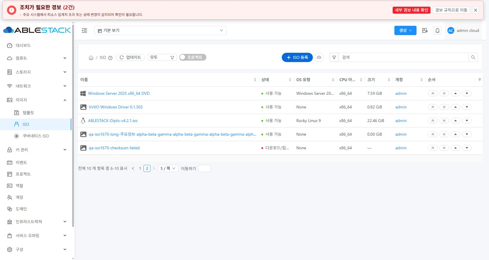
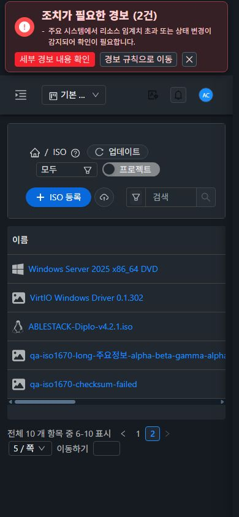
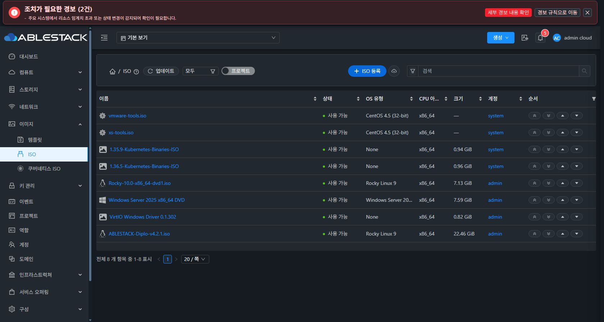

<!--
Licensed to the Apache Software Foundation (ASF) under one
or more contributor license agreements.  See the NOTICE file
distributed with this work for additional information
regarding copyright ownership.  The ASF licenses this file
to you under the Apache License, Version 2.0 (the
"License"); you may not use this file except in compliance
with the License.  You may obtain a copy of the License at

  http://www.apache.org/licenses/LICENSE-2.0

Unless required by applicable law or agreed to in writing,
software distributed under the License is distributed on an
"AS IS" BASIS, WITHOUT WARRANTIES OR CONDITIONS OF ANY
KIND, either express or implied.  See the License for the
specific language governing permissions and limitations
under the License.
 -->

# ISO-05 #1670 목록·검색·복원 구현 및 13번 검증

Epic #1664 · PR #1682 · 개발 순서 5/8 · 2026-11-15 KST.

## 결과

설계·구현·13번 실제 UI 검증·시험 자원 정리를 완료했다. 이슈 #1670의 완료 조건 5개를 충족했으며 Epic은 5/8 완료·OPEN, 다음 개발 순서는 #1671이다. PR 병합은 별도다.

- 검색어·공유 필터·고급 조건·태그·페이지 크기·현재 페이지 정렬을 ISO 전용 query allowlist로 보존한다. 상세/Zone/코멘트와 breadcrumb·뒤로가기에서 같은 목록 상태로 복귀한다.
- 계정·역할·프로젝트·허용 API 변경은 이전 행·선택·검색·복귀 문맥과 늦게 도착한 응답을 무효화한다. owner 표시는 탐색 경계이며 권한이 아니다. 세션·키를 URL에 넣지 않는다.
- bootable/isready/ispublic/hypervisor/userdataid는 실제 listIsos 메타데이터가 지원할 때 노출한다. 관리자 storageid/imagestoreid와 정확한 이름·키워드 부분 검색·태그 계약은 보존한다.
- 이름은 남는 폭을 우선 사용한다. 상태·OS 등은 제한 폭·한 줄 ellipsis와 hover/focus 전체 값을 사용한다. 정렬/검색 도움말은 필드·열에만 두며 정적 설명 배너는 추가하지 않는다.
- 명시적으로 정렬 열을 숨길 때만 정렬을 해제한다. 인자 없는 열 갱신이 상세 복귀 문맥을 지우던 오류는 재현 테스트 2개로 보정했다. 순서 이동 열은 정렬 대상으로 쓰지 않는다.

## 실서버 계약 결함과 필요한 배포 범위

UI에서 `isready=false`·`ispublic=false`를 선택했지만 서버가 전체 10건을 반환하는 결함을 재현했다. 이 결과를 성공한 빈 목록이나 클라이언트 페이지 필터링으로 숨기지 않고 오류로 구분했다.

QueryManagerImpl의 ISO 어댑터가 nullable false와 공개 조건을 SQL 조회에 전달하도록 보정했다. 공개 조건은 공유/ACL의 publicTemplate과 독립된 AND 조건이며 count/페이지 전에 적용한다. 미준비는 기존 준비 판정의 보수를 쓰되 저장소 행 없이 준비된 PERHOST 도구 ISO는 제외한다. true·생략의 기존 실행 가능 판정과 템플릿 조회 계약은 보존한다.

- 운영 JAR의 QueryManagerImpl **1개 클래스**만 교체했다. 92,937개 항목을 대조해 나머지 **92,936개 항목 바이트 보존**을 확인했다.
- 실제 운영 JAR 의존성으로 Java 17 컴파일·JVM `-Xverify:all`·7개 테스트 통과. 원본 163개 메서드 중 160개 동일, 어댑터 2개·공통 private 시그니처 1개 변경, helper 2개 추가.
- Mold **1회 재시작**. DB·Agent·SystemVM 변경이나 전체 배포는 없다. 기존 SystemVM 두 대의 실행·Agent 정상·4.23.0.0과 호스트 세 대의 연결 상태를 UI에서 확인했다.

## UI 검증 행렬

두 시험 ISO가 존재하던 시점의 API count와 실제 화면을 대조했다.

| 항목 | 실제 UI 결과 |
| --- | --- |
| 준비 false / true | 체크섬 실패 1 / 준비 완료 9. PERHOST 2개는 true에만 포함 |
| 공개 false / true | 3 / 7. 반환 행의 boolean과 조건 일치 |
| 커뮤니티 + 공개 false | 관리자·일반 사용자 모두 0. 공유 조건과 독립적으로 교차 적용 |
| 일반 공유 수신자 | 비공개 공유 ISO 1개만 조회. 관리자 이전 주소는 소유 기본 필터로 초기화 |
| 같은 계정의 읽기 전용 역할 전환 | 이전 역할 주소의 조건 초기화, 공유 1개 조회·상세 읽기, 등록/작업 버튼 없음 |
| 키워드 / 정확한 이름 | 부분 키워드 1, 정확한 이름 일부 0·전체 이름 1 |
| 복합 조건 | bootable=false·isready=true·ispublic=false·사용자 데이터 UUID·태그가 동시에 일치하는 1개 |
| 음성 조건 | 태그 값 불일치 0, ISO hypervisor=KVM 0. 실제 ISO의 메타데이터 기준이며 KVM 부팅을 주장하지 않음 |
| 관리자 저장소 | Secondary Storage UUID 조건으로 8개. 일반 계정에는 관리자 저장소 필드 없음 |
| 잘못된 입력 | 잘못된 UUID는 폼 오류. 잘못된 URL UUID는 목록 GET 0회, 오류 안내. 정상 0건과 구분 |
| 페이지·정렬·열 | 50개/쪽 UI 변경, 5개/쪽 이전 주소의 2페이지 복원, 같은 ID 집합의 페이지 내 정렬. API에 sort/owner/return 표시 미전송 |
| 열 선택 | OS 열 숨김 후 새로고침 보존. 정렬 열 숨김 시 sort 제거. 전체 프로젝트 재진입 후 숨긴 프로젝트 열 보존 |
| 프로젝트 전환 | 이전 개인 검색 문맥 초기화, 요청 projectid/current·-1 확인. 관리자 all 필터가 반환하는 10건 계약을 UI에서 그대로 보존 |
| 한 줄·툴팁 | 1680px에서 이름 622·상태 120·OS 148px, 행 47px. 긴 이름 client 577/scroll 1286, OS client 132/scroll 183, hover·키보드 전체 값·초점 표시 |
| 라이트·다크·좁은 화면 | 실제 390×844에서 페이지 폭 380, 표 client 356/scroll 1188, 표 내부 가로 스크롤. 기존 1680×897·다크 설정 복원 |

최종 보정본에서 상세→Zone→breadcrumb 후 page=2·pagesize=5·name/asc와 같은 5개 ID가 복원됐다. 키워드→코멘트→breadcrumb와 브라우저 Back도 동일 주소·입력·1건을 복원했다. 열린 고급 검색은 공개=false 주소에서 준비 필드를 비우고 공개=아니오로 바뀌며, Back 후 준비=아니오·공개 빈 값과 실패 ISO 1건을 복원했다.

프로젝트 선택 자체는 기존 표준 동작에 따라 대시보드로 이동한다. 그 뒤 이전 개인 목록 주소를 재진입해 문맥 초기화와 실제 요청의 프로젝트 ID를 확인했다. 관리자 `all` 필터의 서버 반환 범위를 클라이언트에서 임의로 축소하지 않았다.

조회 오류/기존 서버 결함 재현 기록과 보정 전 화면을 완료 통과로 합산하지 않는다. 원시 관찰의 적용 범위는 [UI 기록 판정](evidence/ui-case-disposition.json)에 구분한다. 무효 입력 폼 시험 중의 정상 자동 갱신 GET을 '잘못된 조건 전송'으로 계산하지 않는다.

## 회귀·검사

- 소스 **32 suites / 661 tests**, 운영 UI 입력 **28 suites / 425 tests**, JVM **7 tests** 통과.
- 변경 UI 전체 Lint와 추가 보정 Lint, 변경 경로 집중 pre-commit·수동 hook·diff 검사 통과.
- 템플릿 목록 48, 검색·Zone·설정과 breadcrumb, VM 목록 103·상세 이벤트 탭, 컴퓨트 오퍼링 10·탭 history, VPC 0·private gateway 0 확인.
- VPC/private gateway는 실제 비어 있어 양성 상세 동작을 주장하지 않는다. 소스의 기존 VPC/NetworkTabs 회귀는 통과했고 운영 UI에 없는 무관한 VPC 변경은 배포하지 않았다.
- 운영 입력은 직전 운영 소스에 ISO 변경만 적용했다. 범위 밖 소스 **1,009개**와 두 언어의 대상 **9개 키 외 번역 값**을 보존하고 빌드 전후 입력 hash를 고정했다.

## 배포·정리 근거

제품 SHA `2e1f33a9b163a894ac811bba508d424121010e00`.

정적 파일 **5→5→4개**를 필요한 단계별 차분으로 반영하고 기존 hashed 자산을 유지했다. 최종 `index.html` SHA-256은 `53f7863ba284da0ce8890514ad274374e376049fb455de23b0eb2b8de39f5299`이다. 마지막 배포는 index·app CSS·vendors JS·app JS 4개이며 백엔드/PID를 추가 변경하지 않았다.

백엔드 JAR 최종 SHA-256 `a130cccd3c545afc44afcd641b22ef49af99bbc3b83e8ffbee1c3a0af4852443`, Mold PID `2545994 → 2620448`. 원래 7,070개 정적 파일 중 index/두 locale 외 값은 전부 같으며 새 hash 자산 7개만 추가됐다. config.json·web.xml·color.less는 보존했다. [배포 보존 대조](evidence/final-preservation.json)와 각 배포 manifest에 파일별 hash·백업 경로를 기록했다.

전용 ISO 2·사용자 데이터 1·계정 1·프로젝트 1을 모두 UI로 삭제했다. 사용자 데이터 삭제 전 VM/템플릿/ISO 참조가 모두 0임을 확인했다. 기존 ISO 8개 ID·이름/상태/OS/arch/크기/계정 값 일치, 템플릿 48·VM 103·계정 3·역할 9·프로젝트 0·사용자 데이터 0을 확인했다. 새로운 VM/볼륨/네트워크/역할은 만들지 않았다. 브라우저의 1680×897·다크 모드와 임시 viewport/cache/interception 설정을 복원했다.

## CI 부채

제품 HEAD의 [License CI 43693744575](https://github.com/ablecloud-team/ablestack-cloud/actions/runs/43693744575)는 미승인 **4,077개**다. [최종 제품 Lint 43693744615](https://github.com/ablecloud-team/ablestack-cloud/actions/runs/43693744615)는 기존 실패 hook **16개**, 같은 방식으로 대조한 기준/제품 진단 경로 **11,179개 동일(+0/-0)**이며 **PR/ISO 변경 경로 진단 0**이다. Passed identity의 전체 파일 열거는 실패 진단에서 제외했다. PR 충돌 검사 43693744560은 통과했다.

소스·테스트·보고서·화면·근거를 포함한 staged Git index export RAT도 기준과 같은 **4,077개(+0/-0)**다. 로그/JSON은 기존 RAT 제외 규칙에 해당하며 결과 파일 추가는 이 경로에만 한정했다. 보고서 문장 확정 뒤 집중 pre-commit/수동 검사와 diff 검사를 완료했다.

전체 CI 성공이나 PR 병합으로 표시하지 않는다. #926·#1044는 기능 작업과 별도 OPEN 관리한다. 다중 Zone·비KVM·전체 통합 회귀는 #1673에 유지하며 기능을 삭제하지 않았다. 4.21·4.23 업로드는 #1667 완료 근거를 유지하고 이번 단계에서 SystemVM을 재생성하지 않았다.

라이트·좁은 화면/열 선택은 2차 배포본에서 검증했고, 최종 배포본은 열 갱신의 탐색 보호 조건만 추가했다. 최종 다크 화면과 복귀·검색폼·정리 경로를 다시 확인했다.

## 화면

