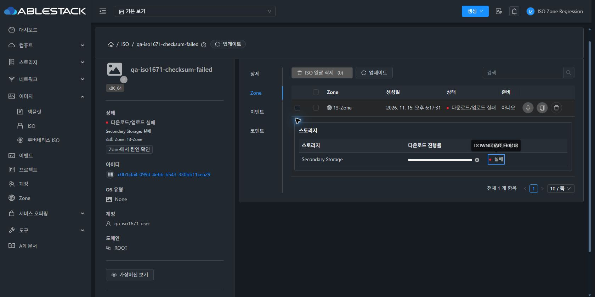
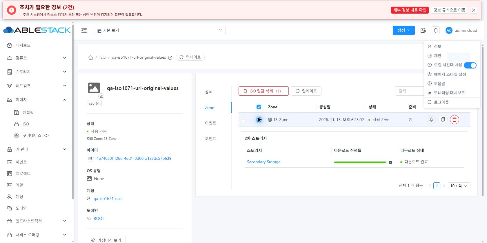
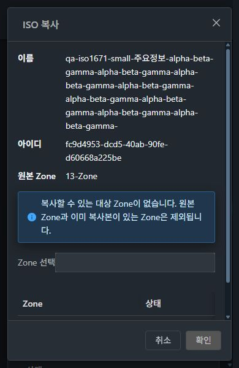
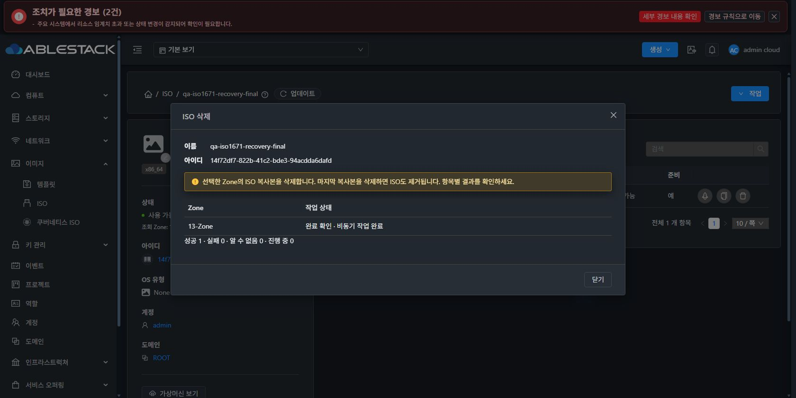

<!--
Licensed to the Apache Software Foundation (ASF) under one
or more contributor license agreements.  See the NOTICE file
distributed with this work for additional information
regarding copyright ownership.  The ASF licenses this file
to you under the Apache License, Version 2.0 (the
"License"); you may not use this file except in compliance
with the License.  You may obtain a copy of the License at

  http://www.apache.org/licenses/LICENSE-2.0

Unless required by applicable law or agreed to in writing,
software distributed under the License is distributed on an
"AS IS" BASIS, WITHOUT WARRANTIES OR CONDITIONS OF ANY
KIND, either express or implied.  See the License for the
specific language governing permissions and limitations
under the License.
 -->

# ISO-06 #1671 상세·Zone·복사/삭제 구현 및 13번 검증

Epic #1664 · PR #1682 · 개발 순서 6/8 · 2026-11-15 KST.

구현·13번 배포·자동화 가능한 실제 UI 검증을 마쳤다. **실제 OS 클립보드의 ID/체크섬/URL 붙여넣기는 사용자 확인 대기**이며, 그 확인에 필요한 ISO 1개·QA 계정 1개·정적 시험 파일을 유지한다. #1671은 OPEN, PR #1682는 Draft다. 완료 보고가 아니다.

## 최종 동작

- VM/템플릿의 ResourceLayout·탭 콘텐츠 스킨·MoldDialog/Actions를 ISO 조건으로 재사용한다. Header/Footer 고정·Body 스크롤·busy 중 중복 제출/닫기/이동 차단·Esc/초점 복귀를 유지한다.
- Zone은 좌측 일괄 삭제 선택 수·업데이트, 우측 검색, 아래 표/저장소 섹션·페이지로 배치한다. 선택 전후 표 위치를 고정하며 읽기·행·선택·일괄에 같은 ISO-01 ACL 모델을 적용한다.
- Zone 이름 부분 검색은 접근 가능한 전체 Zone을 수집한 뒤 페이지로 나눈다. 불완전/실패 응답을 정상 0건으로 바꾸지 않고, 새 검색은 숨겨진 선택을 지운다.
- Primary/Secondary와 유형 생략/미확인에 따른 일반 스토리지 섹션을 구분한다. 제공되지 않은 유형/ID를 이름에서 추정하지 않고, 같은 이름·ID 생략의 행도 유지한다. 저장소 링크는 유형·ID·조회 API 권한이 있을 때만 제공한다.
- ISO의 알려진 상태 코드 접미사는 현지화하며 진단 원문은 tooltip에 보존한다. 서버 모델·저장소 이름·알 수 없는 오류 문장은 변경하지 않고, 템플릿의 기존 표현 계약은 유지한다.
- 복사/삭제는 ISO 이름·ID·원본/선택 Zone·삭제 영향·개별 결과를 유지한다. 원본/기존 복사본/진행 중 복사본/중복 목적지를 제외한다. copyIso의 `copytemplateresponse` 계약을 보존한다.
- 접수·비동기 완료·대상 Zone Ready/삭제 부재를 분리한다. 명시적으로 실패한 항목만 재시도하며, 불확실한 쓰기는 POST 재전송 없이 GET으로 확인한다. 부모 자동 갱신을 보류해 마지막 Zone 삭제의 결과를 읽고 닫은 뒤 보존한 목록 문맥으로 돌아간다.
- GET 복구 성공 후 과거 조회 오류를 제거한다. 계정·역할·프로젝트·세션 경계 변경 시 기존 작업·선택·늦은 응답을 무효화한다.
- 상세 boolean은 예/아니오/알 수 없음, 작은 용량은 이진 단위와 정확한 byte tooltip, 아이디/체크섬/URL은 전체 원문과 기존 복사 계약을 사용한다. 정적 검색 설명 배너를 추가하지 않는다.

## 실제 UI 검증

| 검증 | 결과와 제한 |
| --- | --- |
| 표 위치·검색 | 일반 소유자 선택 전후 절대 top 278px 동일. Zone 이름 불일치 0·부분 1, 검색 변경은 선택 0으로 초기화 |
| 제한 응답 | 일반 계정 응답에 datastoreRole/ID가 생략된 실제 실패 ISO를 일반 스토리지 섹션에 표시. 이름·실패·진행률을 보존하고 저장소 링크를 추정하지 않음 |
| 상태/대비 | 일반/다크 펼침·선택·disabled·loading·오류 확인. 다크 td bg rgb(34,40,47), text rgb(197,204,212); 라이트 bg white/text rgb(75,85,99). 기본 상태와 진단 현지화·원문 tooltip 구분 |
| 좁은 화면 | 실제 390×844에서 페이지 폭 380, 표 내부 가로 스크롤·선택 전후 상대 위치 유지. 390×600 복사 창 body client454/scroll512/overflow auto, Header top13·Footer bottom587 |
| 복사 | 실제 1 Zone에서 원본 이름/ID/Zone·대상 없음 사유·disabled 제출·POST 0 확인. 원본/기존/중복/부분 실패/job 완료와 Ready 지연은 단위 시나리오. 실제 다중 Zone 복사·비KVM은 NOT_RUN |
| 키보드 | Tab으로 복사/삭제 행 버튼 이동, Enter 복사 창 열기, Esc 닫기 후 동일 복사 버튼에 초점 복귀. 저장소 상태는 키보드 원문 tooltip 확인 |
| 일반 소유자 일괄 삭제 | 선택 Zone/이름/ID/마지막 복사본 영향 표시. POST 보류 중 Ctrl+Enter 2회·Esc에도 요청 1·창 유지·닫기 disabled. 주입한 HTTP400 거절은 실패 1과 입력/결과 유지. 명시적 재시도 실제 POST 1·jobstatus1·성공 JSON 빈 Zone 조회 후 완료 1 |
| 마지막 Zone 복귀 | 삭제 확인 창의 breadcrumb href와 실제 복귀 주소 일치. 기존 self·keyword UUID·page/pagesize 문맥과 정상 0건 보존 |
| 개별 삭제·결과 미확인 | 실제 POST 1·jobstatus1 뒤 후속 조회만 HTTP500 주입. 성공 0/미확인 1로 유지하고 GET 재확인에 POST 0. 성공 후 과거 오류 잔존을 발견해 보정·회귀 테스트 추가 |
| 읽기 전용 | 같은 QA 계정을 Read-Only User - Default로 축소 후 실제 재로그인. 이전 역할 주소의 q 초기화·소유 2개 조회, Zone 읽기 정상·checkbox/copy/delete 각0 |
| 시스템 보호 | 기존 시스템 ISO의 선택·복사/삭제 각0. API가 생략한 Zone은 —로 표시하며 기존 자원을 수정하지 않음 |
| 상세 원문 | 1,525,760 byte → 1.46 MiB, boolean 현지화. SHA-256 64자·긴 URL 전체 표시와 3개 원문 복사 버튼 확인 |

최종 c899 보정본에서 별도 시험 ISO `qa-iso1671-recovery-final`을 생성했다. 실제 DELETE POST 1회·jobstatus 1 뒤 후속 GET만 HTTP500으로 주입했다. 결과 미확인 상태를 유지하고 GET 1회·추가 POST 0회로 완료 1·이전 오류 없음까지 UI에서 확인한 뒤 시험 ISO를 삭제했다.

**수동 확인 대기:** `qa-iso1671-url-original-values` 상세의 복사 아이디·복사 체크섬·복사 URL을 별도 브라우저에서 각각 메모장에 붙여넣어 원문과 일치하는지 확인 요청을 보냈다. 자동제어의 관리 클립보드는 웹페이지 복사 결과를 반영하지 않아 이 검사를 통과로 합산하지 않는다.

오류 주입·보정 전 관찰·최종 통과를 [UI 기록 판정](evidence/ui-case-disposition.json)에 구분한다. 원시 데이터의 필드 생략을 권한 부재나 실패로 추정하지 않는다. 자동제어의 관리 클립보드/기본 키 동작 진단은 실제 OS 붙여넣기 통과로 합산하지 않는다.

## 회귀와 검사

- 소스 **33 suites / 690 tests**, 운영 입력 **29 suites / 454 tests**, 변경 UI Lint·집중 pre-commit/수동 검사·빌드 통과.
- 실제 VM 103·템플릿 48 목록, VM 이벤트 탭과 템플릿 Zone을 확인했다. 공통 TemplateAvailability의 ISO 이외 표현은 실제 컴포넌트 테스트로 보존했다.
- 실제 단일 Zone·KVM 환경이다. 다중 Zone/비KVM 양성 UI를 실행했다고 주장하지 않으며 기능을 유지한다. 전체 실계정 ACL 통합 회귀는 #1673에 남긴다.
- 4.21·4.23 전체 업로드/파일 검증은 #1667 완료 근거를 유지한다. 이번 시험 파일은 현재 4.23 SystemVM에서 정상/실패·URL/로컬 생성했으며 SystemVM 재생성이나 backend 변경은 없다.

## 범위·배포·정리

운영 입력에서 UI 정적 delta만 10개→5개→최종 4개 파일로 배포했다. 최종 index SHA-256 `3af095fcdd5785a6c0e6c53b13e4a907245d066540041a86eb366fbd6a4f3d8e`, app `88418ef8`, 마지막 백업 `/var/tmp/iso1671-20261115-ui-backup-kqwi_t3m`. 기존 7,077개 자산은 보존하고 해시 자산 14개를 추가했다. config.json·WEB-INF/web.xml·color.less·backend JAR hash·Mold PID 2620448을 보존했다. Backend/Agent/SystemVM 변경·재시작은 없다.

범위 밖 운영 소스 **1,013개**, 각 언어의 대상 **14개 키 외 번역**, 의존성/빌드 설정 5개를 보존했다. 현재 운영 입력에 ISO delta를 3-way 적용하고 빌드 전후 입력 hash를 고정했다. 무관한 VPC 등 canonical/운영 차이를 덮어쓰지 않았다.

시험 ISO 4개 중 실패 ISO·긴 이름 ISO·최종 복구 회귀 ISO 3개를 UI에서 삭제했다. 수동 확인용 URL ISO `1e740a0f-f266-4ed1-8d00-a127dc57b639` 1개와 소유 QA 계정 `5d927af7-7e6a-4b7d-bd14-6c21b179315a`, `qa-iso1671-20261115`의 단일 정적 파일은 확인 후 정리할 예정이다. 기존 ISO 8개는 유지했다. 계정의 권한은 시험 중 User에서 Read-Only User - Default로 축소했고 복원/상향하지 않았다.

## CI 부채

제품 c899의 [최종 Lint 43707360412](https://github.com/ablecloud-team/ablestack-cloud/actions/runs/43707360412)는 기존 실패 hook 16개·진단 경로 11,179개와 동일(+0/-0), PR 및 #1671 변경 경로 신규 진단 0입니다. License 43707360476와 문서 포함 index export RAT는 기존 4,077개 경로와 동일(+0/-0), PR 충돌 검사는 통과했다. 로컬 최신 yamllint의 Python>=3.10 요구는 동일 hook을 Python3.11로 실행해 처리했으며 저장소 CI 설정은 변경하지 않았다. 후속 문서 HEAD의 CI는 별도 실행되며 전체 CI 성공으로 표시하지 않는다.

CI 부채 #926·#1044는 별도 OPEN 유지한다. 전체 CI 성공이나 PR 병합으로 표시하지 않는다. Epic #1664는 현재 5/8 완료·OPEN이다. #1671 수동 확인·정리와 종료 후 6/8로 갱신하고 다음 순서 #1672로 진행한다.

## 화면

